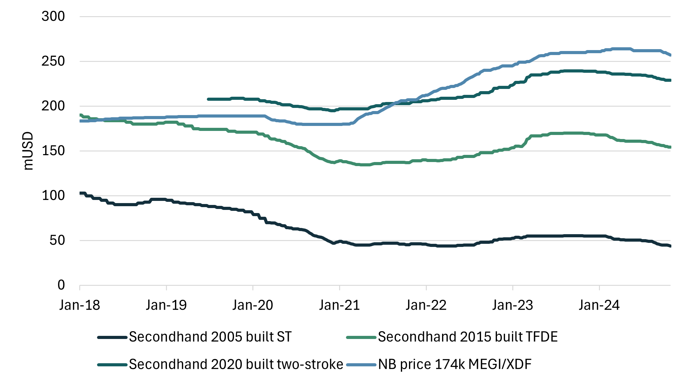
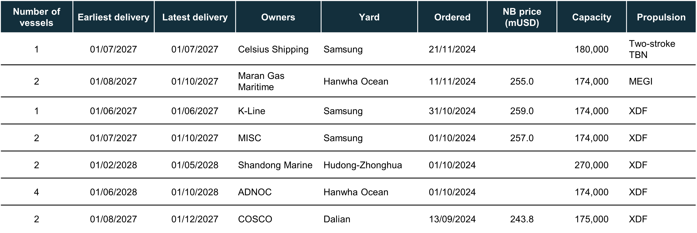
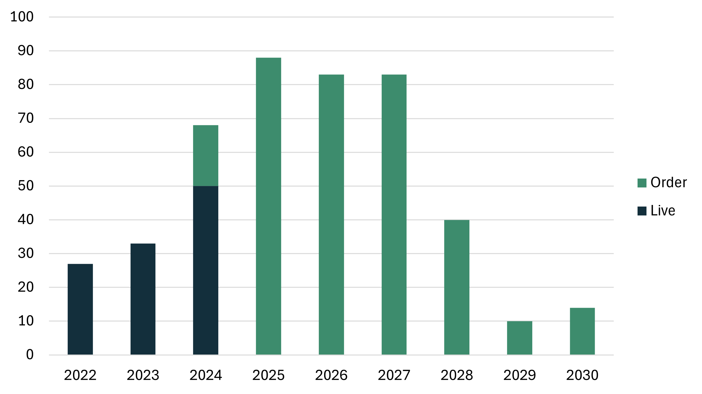
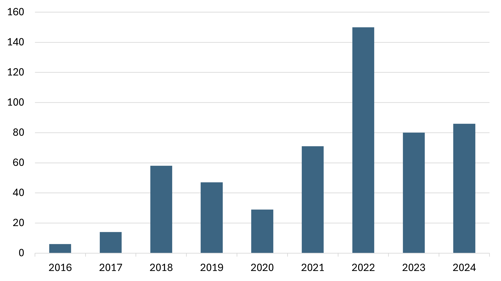
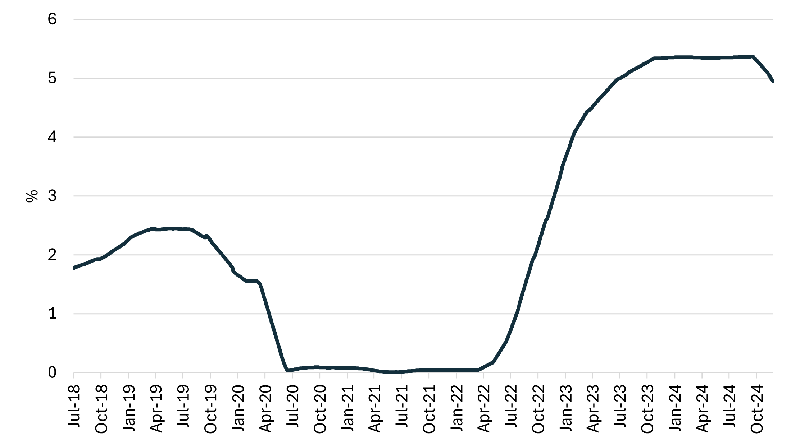
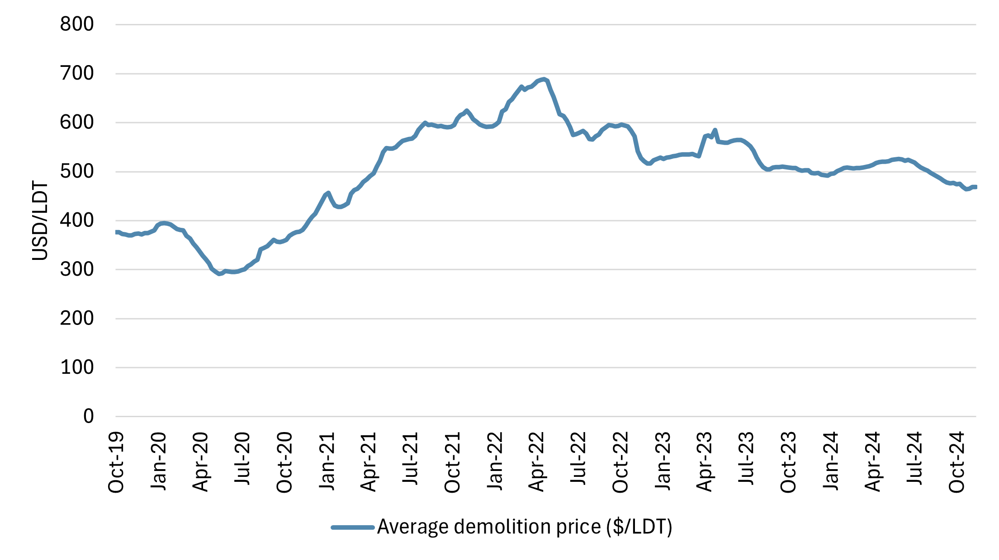

# LNG SnP report - October/November

**Date:** 2024-11-28 | **Department:** LNG | **Publisher:** Fearnleys AS  
**Original PDF:** [Local PDF](../pdfs/2024/2024-11-28_lng-snp-report-october-november-2024-1.pdf) | [Cloud Backup](https://pbrkapp.blob.core.windows.net/report/febb855d-e165-4243-ae77-4cc9022efe84/report.pdf)  

---

## Market reflections

The significant changes to charter rates seem to have given tailwinds to the sale of vessels. Several vessels have changed hands and we see an increasing number of owners evaluating the options before them. Is layup in anticipation of a market recovery the right choice or should they say "goodbye" to their hard-working ladies and hand them over to the undertaker (aka recycling buyers)?

We would argue that laying up a vessel in today's LNGC market presents more complex challenges compared to previous downturns. Factors such as increasing cargo sizes, heightened scrutiny on emissions, and the declining tradeability of smaller, less efficient, and older vessels are all significant obstacles for owners to navigate.

Not only do Owners have to think about the costs associated with entering layup, but also the cost and time of reactivation when (not if) the winds of fortune change. The ability to make it to the market in time if the vessel has to go to drydock to obtain updated class status and ability to trade - and will charterers be willing to accept vessels not having sailed for an extended period.

These considerations, combined with asset prices coming under scrutiny, will pose for interesting discussions in the months to come.

However, despite the challenges facing Owners with aging tonnage, there is an appetite to buy vessels and we expect to see more vessels change hands before the end of the year.

*Chart: Recent sales*

*Chart: Yearly sales*

*Chart: Asset values*

## Newbuilding update

Shipyards are seeing few to no inquiries in the LNGC space at the moment, spending time and resources on developing and improving designs. There are still a few slots left in 2027, where yards are willing to negotiate. For mid-2028 and onwards they keep their current price ask.

*Chart: Recent orders*

*Chart: Deliveries incl. orderbook*

*Chart: LNGC orders*

## Interest rates

As interest rates have become an increasingly larger element in Owner's calculations - coming from a world of free money - it is interesting to look at what the market is saying about the future. The 10-year/2-year spread (aka yield curve spread) is currently hovering around 0, suggesting a flattish interest rate environment in the range of 4.2%. This is slightly below the current SOFR which stands at appx 4.5%; hence expectations of a continued softening.

The inverted yield curve is no longer to be seen - and hopefully, the policy makers are able to avoid any recessions (which historically have been predicted well by the yield curve).

*Chart: Interest rate (90 day avg. SOFR)*

*Chart: 10-Year Treasury Constant Maturity Minus 2-Year Treasury Constant Maturity*

*Source: FRED*

## Recycling

At the start of 2024, we projected that 10–12 vessels would head to recycling yards over the course of the year. Until recently, this target seemed out of reach. However, the recent recycling of four SK vessels has pushed the total to seven, with discussions underway for an additional 2–3 vessels.

Given the current chartering environment and limited opportunities for older tonnage, next year is shaping up to be particularly active for recycling negotiations. A key factor driving this trend is the growing awareness of the significant costs associated with laying up and reactivating vessels. As these expenses weigh heavily on owners' decisions, the market appears poised for an increase in recycling activity.

**Bangladesh**  US$ 465/475

**Pakistan**       US$ 470/480

**India**            US$ 475/485

**Turkey**         US$ 335/345

*Chart: Demolition price (large tanker)*

*Source: Baltic Exchange*

## World fleet at a glance

*Chart: Live fleet by propulsion*

*Chart: Total fleet*

*Chart: LNGC fleet by propulsion and delivery year*
