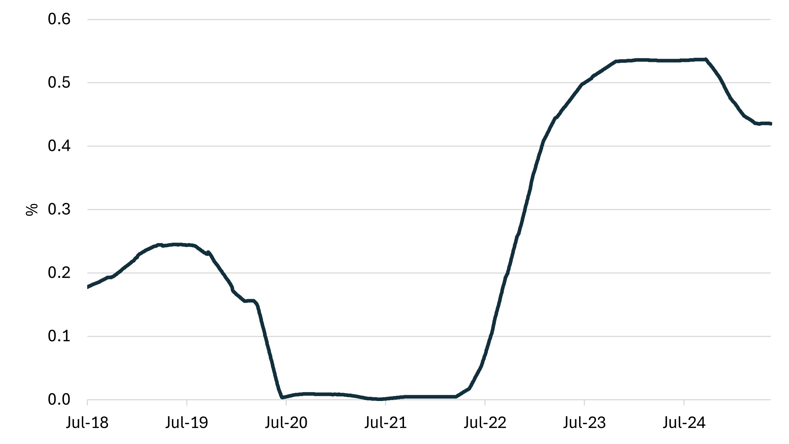
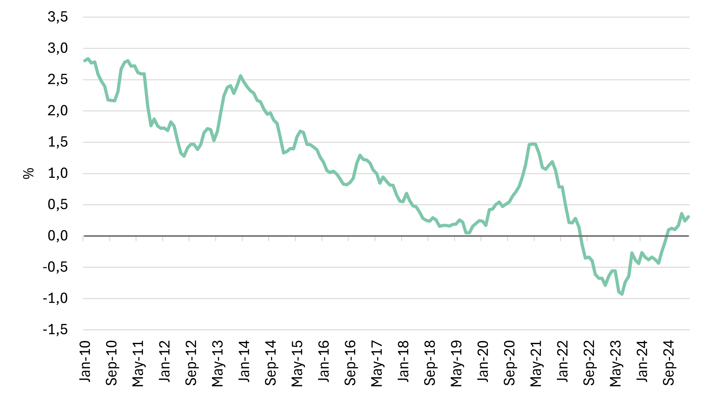
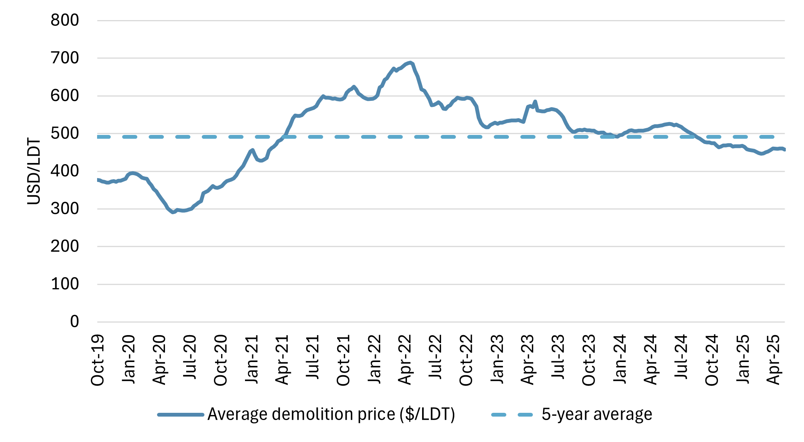

# LNG SnP report - April & May

**Date:** 2025-05-21 | **Department:** LNG | **Publisher:** Fearnleys AS  
**Original PDF:** [Local PDF](../pdfs/2025/2025-05-21_lng-snp-report-april-may.pdf) | [Cloud Backup](https://pbrkapp.blob.core.windows.net/report/7c603db9-8e5d-43dc-a1d6-f3038d8da676/report.pdf)  

---

## Market reflections

The past couple of months have largely echoed Bon Jovi's "All Talk, No Action.”

The market seems to be riddled with activity where vessels are put on subjects, failed on subjects or even better, “no-connection”, whilst the odd one out ends with a transaction in the end. At present the count is 8 vessels sold for further trading and 3 having been recycled.

The KYC focus is continuing to be important and the fear of having a vessel show up in the wrong trade subsequent to a sale. This is a ongoing concern even though the appropriate measures are made during negotiations and documentation. Prospective buyers passing the KYC criteria appear to still be of the view that they may be catching the knife, as values remain under pressure. While this is predominantly related to ST/TFDE tonnage, the appetite for modern tonnage suggests the gap between willing buyers and willing sellers needs to narrow. Whether as a consequence of improved outlook and lifting the bid or reflecting over the current gloom to lower the ask - its too wide today.

### Recent sales

| Vessel Name | Year of build | Sale Price ($Mn) | Capacity (CBM) | Seller | Buyer |
|---|---|---|---|---|---|
| Condor LNG | 2006 | 29,00 | 145 000 | Cardiff | Chinese interest |
| Al Khazna | 1994 | 20,00 | 137 500 | ADNOC |  |
| Dukhan | 2004 | 20,13 | 137 661 | MOL | Scrap |
| Trader III | 2002 | 13,18 | 137 100 | Capital Maritime & Trading | GMS |
| LNG Bayelsa | 2003 | 25,00 | 137 300 | BGT | Dixstone/Perenco |
| SK Sunrise | 2003 | 23,00 | 138 000 | SK Shipping | Chinese interest |
| Energy Frontier | 2003 | 23,00 | 147 000 | TLT | MOL |
| Golar Arctic | 2004 | 23,00 | 140 000 | Golar | Soechi |

*Chart: Yearly sales*

*Chart: Asset values*

## Newbuilding update

Korean shipyards are leveraging recent United States Trade Representative (USTR) developments to implement price increases across most vessel segments, reversing a five-month downward trend. Several major oil companies have engaged with shipyards for newbuild orders, with indications suggesting further orders are anticipated post-summer, bolstering confidence within the Liquefied Natural Gas Carrier (LNGC) sector. Nevertheless, shipyards are actively seeking to secure contracts for early 2028 delivery slots to avoid potential conversion of these berths to vessel types with shorter lead times, such as container ships and VLCCs.

| Name | Owners | Yard | Ordered | Capacity | Propulsion | Delivery |
|---|---|---|---|---|---|---|
| Hd Hyundai Samho | Purus | Hyundai Samho | 01/04/2025 | 180,000 | XDF | 01/03/2028 |
| Hanwha Ocean 2606 | Hanwha Ocean | Hanwha Ocean | 01/03/2025 | 175,000 | MEGI | 01/06/2027 |
| Hanwha Ocean 2607 | Hanwha Ocean | Hanwha Ocean | 01/03/2025 | 175,000 | MEGI | 01/08/2027 |
| Samsung 2729 | Celsius Shipping | Samsung | 17/01/2025 | 180,000 | XDF | 01/06/2027 |
| Samsung 2709 | MISC | Samsung | 01/12/2024 | 174,000 | XDF | 01/01/2027 |
| Samsung 2710 | MISC | Samsung | 01/12/2024 | 174,000 | XDF | 01/04/2027 |
| Hanwha Ocean 2602 | Maran Gas Maritime | Hanwha Ocean | 05/11/2024 | 174,000 | MEGI | 01/08/2027 |
| Hanwha Ocean 2603 | Maran Gas Maritime | Hanwha Ocean | 05/11/2024 | 174,000 | MEGI | 01/12/2027 |
| Hanwha Ocean 2598 | ADNOC | Hanwha Ocean | 01/10/2024 | 174,000 | XDF | 01/06/2028 |

*Chart: Deliveries incl. orderbook*

*Chart: LNGC orders*

## Interest rates

The credit markets have been highly volatile since our last report as the fallout of "Liberation Day" drove yields higher with the US 10-year jumping 50bps to 4.5% in the aftermath. Since then investors have been on free soloing on changes in tariffs hitting the headlines leading to some interesting moves. While the story a few months back was lower interest rates on back of diminishing growth prospects it is now turned upside down. With Moody's as the last rating agency to cut US AAA-rating (S&P and Fitch already at AA-level) the cost of borrowing in USD will likely nudge higher. Sure enough, the President seems to have a disagreement with the Fed as to when to cut rates, but overall expectations are of several cuts in 2025 still.

It is interesting to note that ECB are down in the low-2s with talks of another cut at the next meeting - potentially an opportunity for borrowers to think about EUR-denominated financing?

*Chart: Interest rate (90 day avg. SOFR)*

*Chart: 10-Year Treasury Constant Maturity Minus 2-Year Treasury Constant Maturity*

*Source: FRED*

## Recycling

The recycling market remains largely static, although renewed discussions are emerging, primarily from Eastern players. This stems from owners' corporate departments evaluating the optimal outcome between recycling now and a costly lay-up. The latter is a gamble, hoping for either a miraculous rebound in the spot market or a lucrative project sale that outpaces scrap value. However, the clock is ticking, as lay-up expenses can quickly exceed the current recycling returns, making the wait a risky proposition.

**Bangladesh**  US$ 465/475

**Pakistan**       US$ 455/465

**India**            US$ 460/470

**Turkey**         US$ 255/265

*Chart: Demolition price (large tanker)*

*Source: Baltic Exchange*

## World fleet at a glance

*Chart: Live fleet by propulsion*

*Chart: Total fleet*

*Chart: LNGC fleet by propulsion and delivery year*
