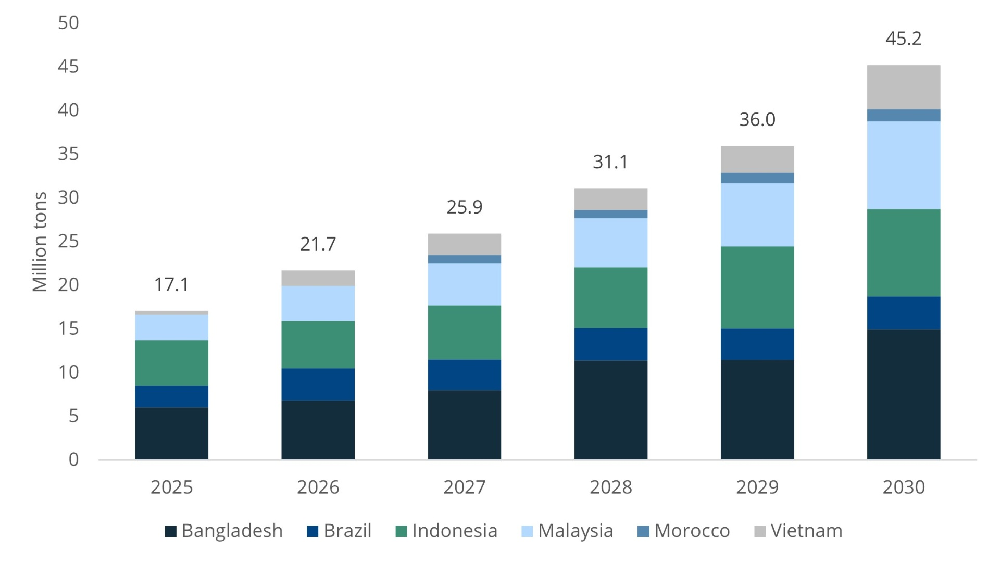
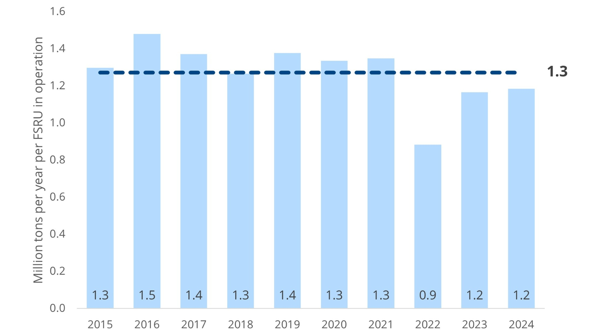
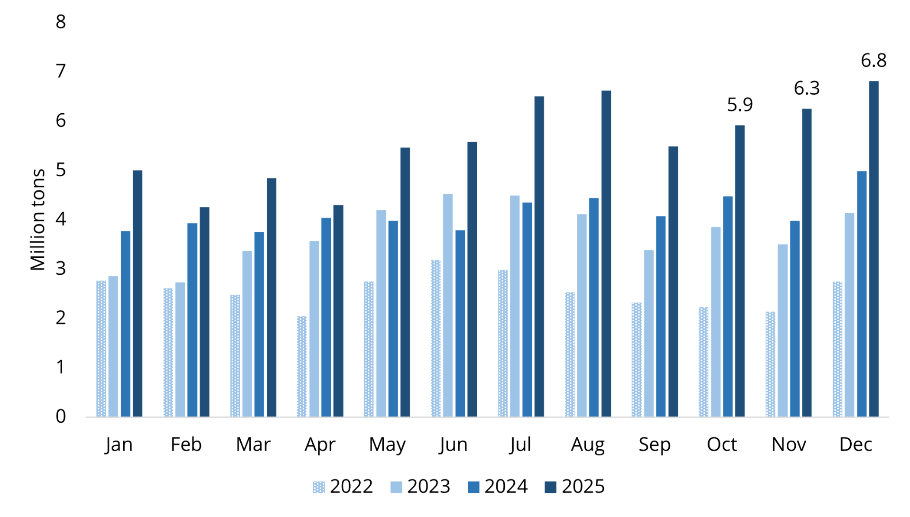
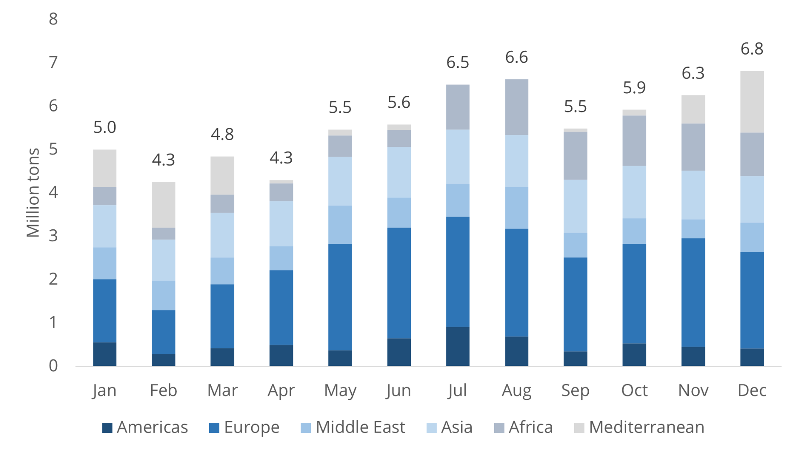
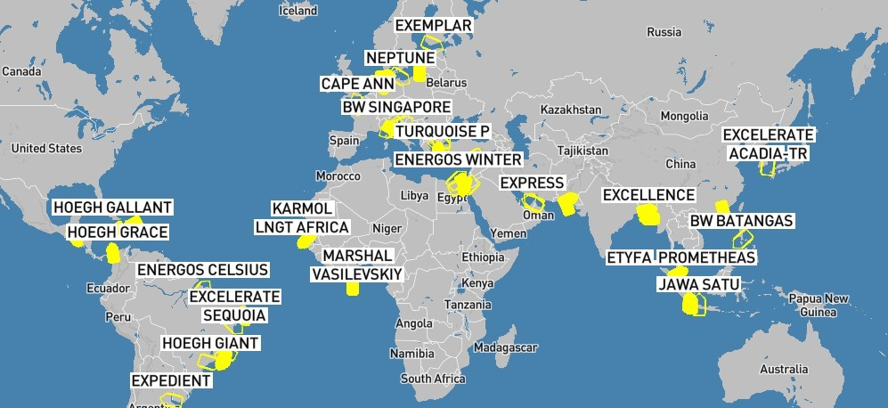

# FSRU Annual Review - 2025

**Date:** 2026-01-01 | **Department:** LNG | **Publisher:** Fearnleys AS  
**Original PDF:** [Local PDF](../pdfs/2026/2026-01-01_lng-fsru-annual-report-2025.pdf) | [Cloud Backup](https://pbrkapp.blob.core.windows.net/report/6ba0bda4-c3f0-468b-ac96-ecd258b42165/report.pdf)  

---

## Market reflections: 2025 wrapped

With 2025 in the books, we can conclude that the FSRU market maintains its winning streak – showing continued strength for the fourth consecutive year. Our tracking shows **seven contracts concluded**, of which only **two are for new locations** (Dominican Republic and Iraq) and for relatively short firm periods of 3 to 5 years. **EGAS’ fixing spree** resulted in **four charters** ranging from 5 to 10 years. Rounding out the field is one short-term extension for undisclosed project. Charter rate levels remain highly sensitive to FSRU specifications and duration, but generally in **six-digit range** and not too far from starting with a “2” if shorter durations for the right FSRU. For **longer charters (7-15 years)** the market seems to be ever so carefully pricing in the fact that a number of FSRU conversions are likely to arrive at the same time as a handful of existing units come open. By no means a collapse, but **in the range of US$ 120-140k/day** (subject to specifications and project)

In the context of longer charters; what is worth noting is the absence of concluded charters for new long-term projects with solid fundamentals. The number of projects that should (unfortunately not “will”) secure FSRU capacity to hit their more or less realistic timelines is in double-digits; with attributes that are win-win for both FSRU owners and the projects themselves. Therefore it is **frustrating to see what we can only attribute to mediocre project management, unstructured market processes and politics time and time again washing away timelines drawn in the sand**. The consequence is hard work by FSRU (and FSU for that matter) players to understand which horses to back.

While we acknowledge that Fearnleys cannot work miracles (even though we’d like to think so), it is increasingly clear to us that project owners in particular should seek professional advice to achieve a higher number of successful outcomes; **the lines are open!**

Peering into **2026** we count **more than ten projects that may take FID**, but a closer look reveals that we may see **3-4 new projects**; projects which we by and large see stitched up with a selected FSRU already. **Key focal points** will be power auction in **Brazil** (how much will be gas-fired and need FSRUs?) , developments in **Southeast Asia** (will they stop beating around the bush?) and a handful of **European** projects (will shippers be putting pen to paper in open seasons?). Of course, the FSRU market is never dull and we look forward to what we expect will be **another strong year**.

### Key market developments during the quarter

OCTOBER

**Ecopetrol** relaunches/changes tender for 2nd FSRU with “technically and logistically superior site” Coveñas as the new location. Apart from the change of location, the requirement looks the same – and we wonder how Ecopetrol did not identify the improved site earlier. General conversations around Colombia hit topics such as lack of structure, low level of guarantees and unrealistic expectations.

**Excelerate** announced having secured the **Iraq**-project which has developed through the year with multiple G-t-G discussions where it seems Uncle Sam prevailed. Excelerate will supply LNG in addition to the FSRU (initially their newbuild **EXCELERATE ACADIA** and topside equipment for the terminal in **Khor Al-Zubair** (located upriver in shallow waters)

**LNG CROATIA** returned online after periodic drydock and installation of an additional **4th regas train**. Since returning, the unit has taken seven cargoes and sending out full-throttle.

**Snam** and **Hoegh EVI** formally tie up for FSRU in Oristano, Sardinia where Snam will take ownership of the (former) Avenir LNG terminal and install an FSRU to facilitate the methanization of Sardinia. The FSRU replaces previous attempts in Porto Torres and Portovesme.

**Eems Energy Terminal** announced **Exmar** as the supplier of FSRU in Eemshaven once the current contract for **ENERGOS IGLOO** expires in Q3/27. Exmar already operates the **FSRU EEMSHAVEN LNG** and is expected convert a **TFDE**-vessel for the project.

Karpowership’s newly formed FSRU-arm **Kinetics** issued US$ 400m bond with intentions to undertake **three FSRU conversion** projects at Seatrium. Kinetics will take a step into the “big leagues” with one of the conversions being a high pressure/high send-out unit; differing from their existing FSRU portfolio designed to support KPS’ fleet of powerships.

NOVEMBER

**Centrica** signed up “approximately six cargoes per year” for 15 years with Exodus which will form the supply to Genesis’ project in **Puerto Cortes, Honduras**. The FSU allocated to the project is **BILBAO KNUTSEN**. Depending on the cargo size, six cargoes would equate to around 400,000 tons per year which appears to be slightly too much for a 240MW CCGT if this is the sole offtaker. However, positive to see another country include LNG in its energy mix.

**UKs Department for Energy Security and Net Zero** (DESNZ) issued a market consultation for the potential development of **one or more FSRUs** (along with other alternatives). The consultation is expected to close mid-Feb and is a high-level evaluation without specific details of site, timing or specifications. With several FSRU projects with a commercial mindset not gaining traction over the last 15-20 year in UK, maybe government intervention will make it stick.

**Gas Networks Ireland** has reportedly selected **Shannon** as the preferred location for its strategic FSRU. Discussions were mainly between Cork and Shannon. Shannon has for a long time been considered the most progressed location for an FSRU in Ireland and with the approval of Shannon LNGs 600MW power plant (which is a subsidiary of NFE) in Mar-25 we’re hopeful of the next steps by GNI to eventually come to market for an FSRU.

**DET** ended up not allocating any slots for **W’haven 1+2** during the auction for Dec-25, Q1+2+4/26 and Q1/27. A total of 28 slots were offered at a reserve price of **EUR 0.56/MMBtu (~US$ 0.66/MMBtu)**. While the FSRUs in Wilhelmshaven have been busy it is somewhat curious that DET now implements a relatively high reserve price given their decision to sell slots at below-market during earlier auctions.

Total Energies confirmed **CAPE ANN** will be demobilizing from Le Havre after not seeing a cargo since Jun-24. The unit received a total of 10 cargoes between Nov-23 and Jun-24, being one of few “insurance” FSRUs in Europe. While it is not clear when she will depart Le Havre (she is currently in port), it expected that Cape Ann may be subchartered to another project.

DECEMBER

**Morocco** emerged from hiding after the EOI earlier in the year with a **Prequalification of FSRU providers**. The timeline suggests preselection will be done by **end-Feb 2026** with the preferred bidder by **end-Jun 2026**. The six qualification criteria are relatively stringent and will effectively only qualify the major existing FSRU players given the requirement to having owned/operated at least two FSRUs for at least five years within the last fifteen years.

**Snam** acquires stake in **OLT Livorno** at a price of EUR 126m (appx US$ 147m) for 48.2% - implying an asset value of approximately US$ 305m. The price is high and does in our view reflect the cash flows at a very low return rate, not the underlying value of the asset.

**Egypt** and **Israel** agreeing on gas supply agreement. The first phase starting in 2026 will increase gas exports from Israel to Egypt by appx 2BCMA (equivalent to ~1.5million tons of LNG) from 4.7 to 6.7 BCMA before the second phase (targeted for 2029) will increase flows to 12-13BCMA. The incremental volumes (5-6BCMA) in the second phase is equivalent to 3.5-4.5 million tons of LNG. While still early to draw conclusions it may be the **first sign of a fleet of underutilized FSRUs**…

**Squadron Energy’s** terminal in **Port Kembla (PKET)** took a step closer to confirming startup in 2027 with the appointment of **Reganosa** as **O&M provider** for the terminal. The FSRU allocated to the project is **HOEGH GALLEON** which is currently on a subcharter to EGAS. While considerable uncertainty remains around the various Australian FSRU projects – including the “ready-to-operate” PKET – the long-term requirement for an insurance to the southeastern part of the country seems inevitable.

‘Tis is the season for **Open Seasons** as both **Zeeland Energy Terminal** and **Gaz-System** started consultations for binding volumes. With **DET** failing to sell slots at what we would deem reasonable prices and **Eemshaven Energy Terminal** coming to market in 2026, there is no shortage of future regas capacity being offered – *something to consider for the players very long LNG as a potential sink?*

### Quarterly corporate highlights

On the corporate front, **NFE** continues to kick the ball down the road with its creditors which impacts **Energos Infrastructure**. During the quarter, Energos came to market with **US$ 0.5bn+1.5bn credit issuances** to refinance which ultimately turned into a **hung deal**. As we understand, it may still be alive, but as long as visibility on NFE is opaque at best it will remain challenging to refinance in our view. A more successful bond process was **Kinetics** which is Karpowership’’s FSRU outfit trying to break in to mainstream FSRUs. Lastly, **Snam and Igneo** closed the **OLT transaction** at a price that gives *zero reference points as to the value of an FSRU*, but rather good insight in how fixed, long-term cash flow and return on invested capital on **Regulatory Asset Base (RAB)** creates value for sellers.

### Quarterly focus: Can FSRUs provide support to absorb LNG as we head into an oversupplied LNG market

While we reflect on 2025 from an FSRU perspective, the last quarter of 2025 brought about an increased focus on what the world will do with all the LNG that is set to come into production over the next decade. Talks about Short Run Marginal Costs (SRMC), JKM in the US$ 5-6/MMBtu-range and projecting US cargo cancellations in 2028-2029 has led the market down a bearish rabbit hole.

In this quarter’s focus piece, we look at the ability of FSRUs to support the demand side from what we deem as three main attributes: time-to-market, project likelihood and throughput.

Starting with time-to-market; a critical limitation to FSRU demand is that they need to support structural demand, not short-term/price-sensitive demand pockets that may emerge on back of lower LNG prices. Despite short-term deals done in 2025 they are generally bridging solutions to long-term requirements (Dom.Rep.) or in anticipation of other sources of natural gas becoming available (Egypt). What the LNG market needs to fundamentally absorb the supply is new markets with strong underlying demand for power generation or industrial use – such as Vietnam, Malaysia, Brazil, Morocco, Indonesia and Bangladesh to mention a few no-brainers. Based on our demand forecast, these six nations alone will add around 30mtpa of imports by 2030 of which the majority is structural. All of it will not be on FSRUs, but they are all FSRU-hot spots. Not to say that the other potential new importers will not support LNG demand, but the magnitude is likely too limited to make a notable dent.

The challenge faced is lead time for FSRUs to commence operations; we continue to estimate 27-30 months from FID to COD for an FSRU project and that excludes the preparatory works to get to an FID. This is where “project likelihood” comes into play; when we evaluate our database/pipeline of prospective projects a key aspect is the underlying real need for an FSRU. Europe showed that things can move quick in the face of adversity, but similarly it could be argued (as an example) that the power sector in Vietnam is facing serious adversity which should have prompted fast-track projects…it has not. There are a number of reasons why (we haven’t even touched credit and bankability), but perhaps this highlights the uncertainty of LNG as a long-term affordable energy source, looking at volatility in LNG prices over the past decade could easily be mirrored into the next one.

The third element we consider is throughput once an FSRU is operational. Every project is unique, but on a generalized basis we would argue 600-700MW-equivalents of gas demand is a minimum for an FSRU to be economically justifiable. On the other end of the spectrum, few FSRUs are able to support more than 3,500-4,000MW-equivalents (3.7-4.2 million tons per year) – at which point regas costs become very competitive. Taking a holistic view on FSRUs, our data shows FSRUs globally average at around 1.2-1.4mtpa (with the extremes being zero on the low-end and closer to 5mtpa in the high-end). Assuming increased utilization of FSRUs by 25% on back of a structural demand for natural gas with visibility on consumers we’d still need 20 FSRUs to handle 30-35mtpa. Or in plain language; around 15% of the incremental supply – which is historically the share of LNG imported on FSRUs.

These are just a few aspects of how FSRUs can impact long-term LNG demand and we most certainly stress the importance of FSRUs as lean and mean way of accessing LNG, but a dose of realism makes us doubtful a potential LNG oversupply will be mitigated in a timely manner by new FSRUs. However, turning it upside down: Without development of a substantial number of FSRU projects in the next five years the world is at risk of having to deal with the oversupply for an extended period of time.

*Chart: FSRU "Hot spots": Set to absorb additional 30mtpa by 2030*

*Chart: FSRU Utilization: Global average has been around 1.3mtpa*

*Source: S&P Platts / Fearnleys*

### FSRU activity and volumes

Q4 was another (consecutive) record-breaking quarter for FSRU imports as the global FSRU fleet is now in operation by-and-large. Overall activity at operational FSRUs reached a total of **19.0mt / 300 cargoes** (which is up 42% from **13.4mt / 226 cargoes** in Q4/24, but *only 2%* from **18.6mt / 304 cargoes** in Q3/25). The Y-o-Y increase is driven by-and-large by **Europe, Egypt and Turkey**. Europe reached 7.0mt during the quarter (marginally down from the 7.2 in Q3) while Egypt racked up another 3+ mtpa-quarter at 3.1mtpa. Additionally, Turkey is in full throttle-mode with 2.2mtpa for the quarter across 32 cargoes in typical seasonal pattern. In Europe, there seems to be a more stable environment with no new units added in the quarter, but slightly lower activity across all terminals. Egypt, now have 4+1 FSRUs; Damietta taking its first 6 cargoes and +1 in Aqaba having taken 1 cargo during the quarter.

For the full year of 2025, our tally shows **67.1mt / 1,091 cargoes** were imported through FSRUs compared to **49.6mt / 861 cargoes** in 2024. This is a stunning 3**5% Y-o-Y** growth. Regional development shows higher activity in all regions apart from Americas and Middle East which are notoriously seasonal/insurance-based regions.

As we continue to see FSRUs increase their importance in the global LNG value chain; global LNG imports in 2025 came in at appx 435mt; which now means FSRUs continue to account for **around 16% of global LNG imports**. While we’d prefer to see the relative imports on FSRUs increase – *we do not foresee this increase in 2026 (or 2027)* given the lead-time for new projects.

The busiest terminals in 2025 were Elengy Engro (Pakistan) **EXCELERATE EXQUISITE** with 72 cargoes, closely followed by Eemshaven (Netherlands) **ENERGOS IGLOO/EEMSHAVEN LNG** at 70 and Ain Sokhna Sumed (Egypt) **HOEGH GALLEON** at 64. However, on a volume basis Eemshaven moved more product at 4.8mtpa with Ain Sohhna Sumed at 4.5 and Elengy Engro at 4.4, What is interesting to note is the *wide range in implied cargo size*. Damietta (**ENERGOS WINTER** being a 145,000cbm FSRU) took the larges cargoes at around **158,500**cbm whereas cargoes going into Dakar (**KARMOL LNGT AFRICA**) took partials at appx **72,000**cbm.

Finally, the only FSRU without a cargo in 2025 was CAPE ANN in Le Havre (a reasonably good data point for why she is now departing), but also Terminal Gas Sul in Brazil saw zero cargoes while technically being an operational terminal. (We expect that to change come power auctions in 2026).

*Chart: Global volumes imported through FSRUs (2022-2025)*

*Chart: Monthly volumes imported through FSRUs by region (2025)*

*Source: S&P / Platts*

### Recent FSRU Project Developments

*Asia & Middle East*

**New Zealand** has been developing its project for **Port Taranaki** during the quarter with **TORMAN I** as a hot candidate together with a few other more esoteric solutions. The project remains a political priority, but recent news suggest a slowdown in the process.

**Malaysia** is progressing their **RGT 3 & 4** projects and are expected to come to market in **2026** with FSRU requirements. Several FSRU Owners are already engaged directly, but tender processes are expected to be the most likely route.

*Europe & Mediterranean*

**Poland** is slowly, but surely progressing their **2nd FSRU** in Gdansk. Timing is not defined yet, but the first FSRU is set to reach COD in 2028 and hence the next unit is **probably a 2030+ startup**.

There are rumours of **Lebanon** returning to the FSRU-scene after having been “out of office” since 2018-2019. Talks are linked to **Tripoli** as the site to support the only feasible consumer at **Deir Ammar TPP**.

*Americas & Caribbean*

Continued activity in **Brazil** as the power auction is scheduled for mid-March with startups in **2026-2031** (the earlier likely being brownfields and the later being greenfields). We’re seeing discussions for both near-term FSRUs to support 2026-2027 operations and long-term FSRU/FSU conversions for the later-dated CODs.

**Guatemala** will be closing the technical bids for their 1.4GW auction in **Feb-26**. Thus far *limited talks about FSRUs* to support CCGT, but the outcome will be closely watched.

*Africa & Other*

**South Africa** remains stagnant from an LNG perspective, but talks about FSRUs in new sites in **Mozambique** has prompted renewed interest as the government-allocated sites of **Inhassoro** and **Port of Beira** were announced in November. It is unclear whether this is a genuine project or a way for *Moz to force domestic LNG back to shore*.

*We encourage clients with deeper interest in ongoing project developments, tender activity and business development to contact Fearnleys directly; the above is merely scratching the surface of activity.*

### Notable FSRU movements

*Chart: GLOBAL_FSRU_MAP*

*Source: Fearnleys*

As the FSRU market remains by and large sold out there are limited units moving around (which is in many ways good and reflected in the high volumes).

**EXPRESS** has replaced **EXPLORER** at **DUSUPs** facilities as **EXPLORER** undergoes drydock at Dubai Drydocks. The swap is likely a short-term bridge and **EXPRESS** will return to Ruwais early-26.

**EXCELERATE ACADIA** has been launched and is currently undergoing sea trials in South Korea, The unit should be mobilizing to Iraq once delivered to Owners.

**SAROS** moved a bit around in early-Oct, but seemingly nothing material.

**ETYFA PROMETHEUS** remains in Malacca where works to complete the unit is ongoing still.

### Asset values: Newbuildings and conversion candidates

*Chart: FSRU conversion candidates: Secondhand values*

*Chart: FSRU Newbuild prices*

*Source: Fearnleys*

Despite the view that new FSRUs may come up short in saving the day in respect of the impending LNG oversupply, the **activity level remains very high**. The width of the project pipeline remains wide (albeit a bit leaky in terms of project quality) and we maintain that at least 3-4 genuine new projects will reach FID. What was a reserved approach to taking semi-speculative positions on FSRUs has turned during the quarter and **our tally shows 8-10 conversion units** in the works of which **4-5 have a dedicated home/project** already. The remaining are essentially speculative, but we caveat it by the fact that **nobody has gone full blast** on a conversion just yet. The approach is to do pre-engineering and ordering regas module – and for a select few – position with a vessel acquisition.

Asset values have dropped through the quarter with a **145k ST** now in the range of **US$ 23.5m** on prompt basis while **TFDE/DFDEs** in the 160k range are assessed around **US$ 125-130m**. However, for projects wanting to secure a LNGC for conversion with later delivery or with conditions precedent on project award, the prices are generally a notch higher through reservation fees and the likes.

The trend of more focus on larger units remains prevalent as the extra US$ 100m in asset cost will likely yield improvement in LNG price, reduced shipping costs, lower demurrage and potentially longer life span; all adding up.

Conversion costs and timelines remain relatively unaltered with end-to-end (and we continue reiterate this is **FID to COD**) being in the range of **27-30 months for both in-house and LSTK conversions** at a yard. As mentioned in our last update one new player has emerged on the conversion scene with a pitch of doing the job in around 20 months – having raised eyebrows (and interest). Having digested the offering the reception in the market has been relatively muted and met with skepticism. Conversion costs remain in the range of **US$ 130 (TFDE) -170 (ST) million** (excluding contingencies and commissioning) for **500/750 SW/Glycol Open Loop**. Of course, the vanilla FSRU spec indicated may not reflect project specifications which we stress may materially alter the price (such as the “Singapore Unicorn” of MOL at ~US$ 414m).

The FSRU **newbuild market has been quiet**, but there are murmurings of players contemplating this for 2029-deliveries. However, with a steady stream of LNGCs ordered and 2028 effectively sold out it is less tempting for yards to pursue special projects. None of the requirements we see today are specifically requiring a newbuild and we reiterate the view that conversions currently give more bang for the buck.
