# Fearnleys Tanker Market Wrap-up Aug 2026

**Date:** 2026-08-28 | **Department:** TANK | **Publisher:** Fearnleys AS  
**Original PDF:** [Local PDF](../pdfs/2026/2026-08-28_fearnleys-tanker-market-wrap-up-aug-2026.pdf) | [Cloud Backup](https://pbrkapp.blob.core.windows.net/report/1ca6a25b-38c8-4506-9dd2-c63eb612c016/report.pdf)  

---

## Equilibrium - of Sorts

### Summary and outlook

The oil and tanker markets remain in a paradoxical equilibrium, where China runs a fine balancing act for crude oil, aided by increased Hormuz flows lately, and tanker rates are supported by extraordinary oil price discrepancies and broad inefficiencies. Given the fragile balance we introduce three market scenarios, with materially different implications for rates going forward - the range of outcomes has rarely been wider.

The odd environment we are in is (likely) the most bullish possible. Already supported, tanker rates have surged to new highs the last month on re-opened West-East arbitrage, recovering Hormuz transits and CPC volumes, and Red Sea rerouting - again catching fleet positioning wrong-footed. However, as has been the case several times this year, after a rush comes calm, and rates now slide again. With substantial oil price swings, refinery margins at historic highs and crude still undersupplied, there is potential for continued rate strength - possibly boosted further by seasonally higher Americas exports.

Some demand wild-cards going forward are arbitrages and oil price swings (China has an outsized say in whether crude oil prices remain relatively measured), geopolitics and the broader economy (obviously).  On the supply side there is added complexity from the PGSA's  designation of 45 'Hormuz-shuttle' ships as non-compliant (contagion risk), and added fleet growth from former  shadow VLCCs re-entering the compliant market.

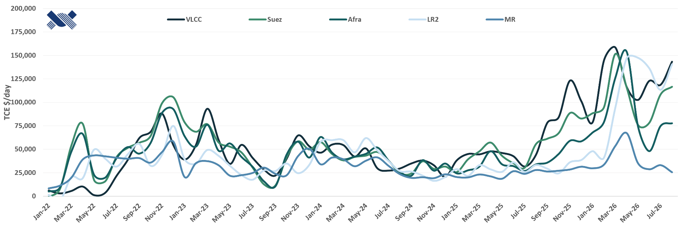
*Chart: Monthly rates by segment*

*Source: Baltic Exchange*

### Three main scenarios

*Chart: Resolution*

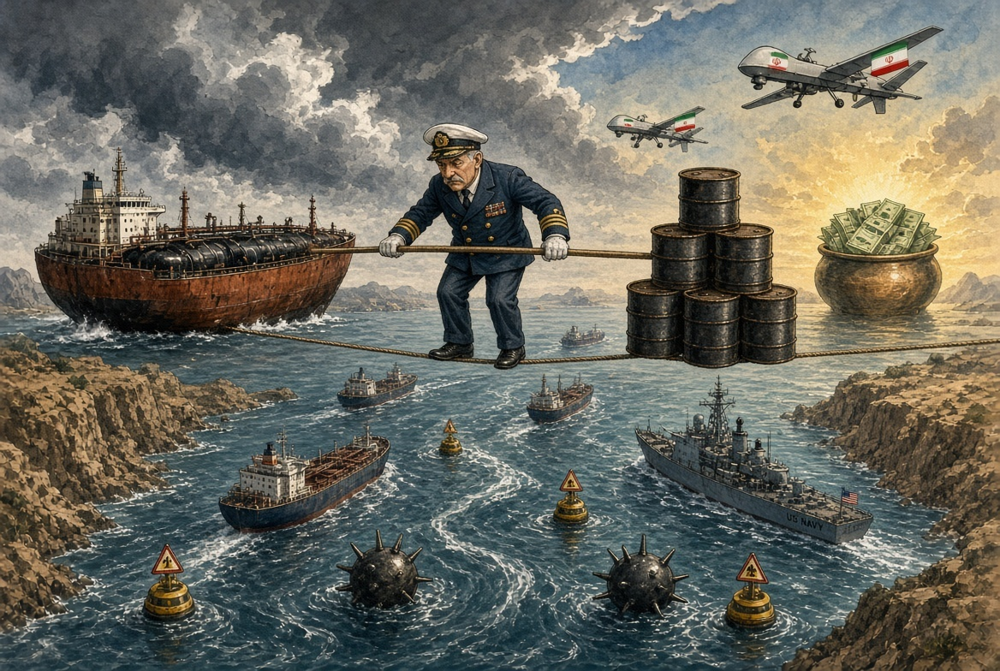
*Chart: Paradoxical equilibrium*

*Chart: Economic meltdown*

The most sustainably positive scenario for tanker demand. There should be incentives for resolution given increasing economic pressure in both the U.S. (Bessent's financial market interventions suggest an uncomfortable position: after years of unsustainable budget deficits, interventions may run into diminishing marginal returns) and Iran (soaring inflation, lower oil exports and goods shortages). However, fundamental differences persist. In this scenario, tanker tonne-miles may soar on a potential race to the bottom for OPEC (and former +) producers on top of strong non-OPEC growth, and strong refinery margins incentivising high runs. The caveat is that extreme price discrepancies will disappear, allowing less room for freight. In other words, a normal (very) strong market for at least the next 12-18 months.

The most bullish scenario for rates is one in which the status quo persists. With widespread inefficiencies around the major chokepoints and wide oil pricing discrepancies, there is sufficient room for oil producers, traders, refiners and owners to earn healthy profits, which is arguably the main reason why we now see record rates. Although volumes remain substantially lower than pre-war, there is enough distance and time effects so that fleet utilisation remains very high, other perhaps than for a few key actors with partly different business models to the norm.

However, there will be increasing risk of shortages - there is likely a limit to how long China can balance the oil market. Therefore, this scenario inevitably may turn into the next one...

This one is one of the reasons why the U.S. has stepped off further escalation, and why Bessent this week refrained from directly sanctioning Chinese entities for dealing with Iran. Further escalation and regional hostility, with corresponding upside for energy and commodity prices may ultimately tilt the global economy into serious trouble. Soaring inflation is not needed on top of already increasing long-term bond yields and U.S. policy exhaustion. A meaningful oil demand (and price) drop could lead to sustained oil production shut-ins. Couple this with the highest potential tanker fleet growth since the global financial crisis...

And you may have almost the same outcome for the tanker market the next few years as in 2010 onwards...

### It all came together again

In ebb and flow over the last few months, there has been waves of fixtures in both basins which have caught the fleet either wrongly positioned, or just too tight, like most recently. First it was some re-routing from Yanbu to the north and some Bahri ballasters set to go around Africa, then a combination of a re-opened West-East arb. simultaneously with increased Hormuz transits and high fixture activity for STS off Fujairah and Oman. CPC volumes coming back in full have helped too, and position lists have shrunk substantially.

Panic? Perhaps that has played in too, piling up more fixtures than normal - which may suggest some more calm to come - this week has been quiet and inevitably put pressure on rates. However, oil pricing and refinery margins suggest there is still incentive for charterers to secure ships at high rates, albeit levels may move up and down in tandem across segments and fixing regions.

Hormuz transit numbers have been hotly debated by oil market watchers amid U.S. administration claims that the flow is much higher (~10 mbpd) than meets the eye through traditional tracking sources (~6 mbpd). There has been an uptick, and may very well be some more upside when more complete tracking becomes available. Some of that, however, seems to be re-routing of Saudi volumes from Yanbu to the Gulf coast, so that the overall uptick in crude loadings has not been vast. There is still an implied (large) shortage of crude oil globally.

CPP loadings have picked up too, led by Asia and the U.S. over the last month. With crack spreads at all-time highs every refiner who can is incentivised to run max - however, capacity remains a constraint.

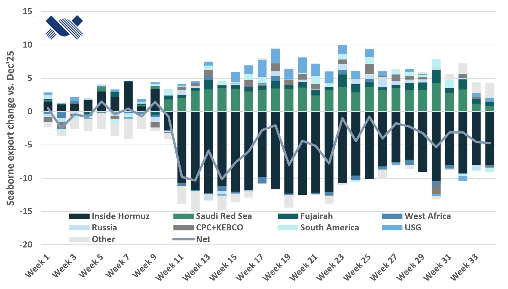
*Chart: Seaborne crude departures by region - vs. Dec'25 baseline*

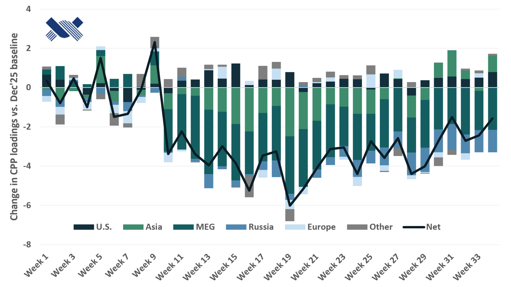
*Chart: Seaborne CPP departures by region - vs. Dec'25 baseline*

*Source: Vortexa*

Tanker demand measured in tonne-days (to better capture waiting time and longer ballast legs etc. vs. tonne-miles) remains above last years' levels, but has come off meaningfully vs. the highs - led lower by VLCCs. Given a much higher Atlantic fixture count for long-haul voyages recently, however, these figures are expected to pick up again near-term - and reverse some of the demand strength for smaller vs. bigger vessels.

Although still lagging, product tanker demand has picked up meaningfully, with higher volumes and some long-haul arbitrages re-opening, which may also give further upside near-term.

Overall, the near-term demand outlook is slightly better for crude vs. products, as key Atlantic producers reduce domestic demand to free up more for exports, and there appears to be a gradual pick-up in volumes out of the MEG too. For products, meanwhile, flows are to a greater extent capped by shut-in capacity.

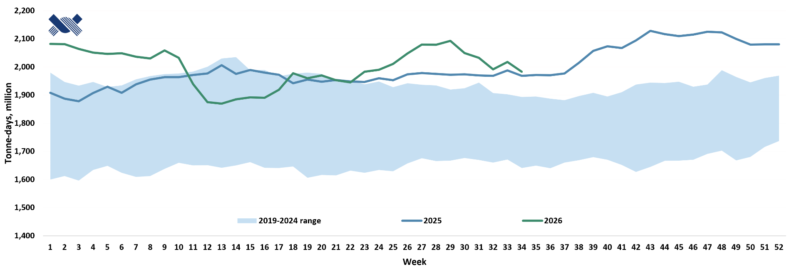
*Chart: Total tanker tonne-day demand (+2% YTD)*

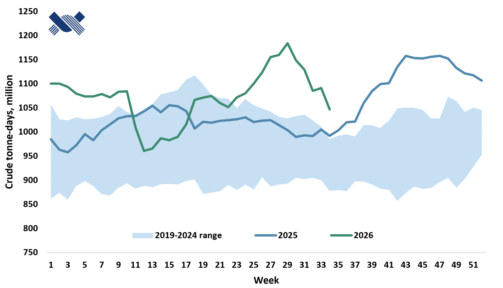
*Chart: Crude tanker tonne-day demand (+6% YTD)*

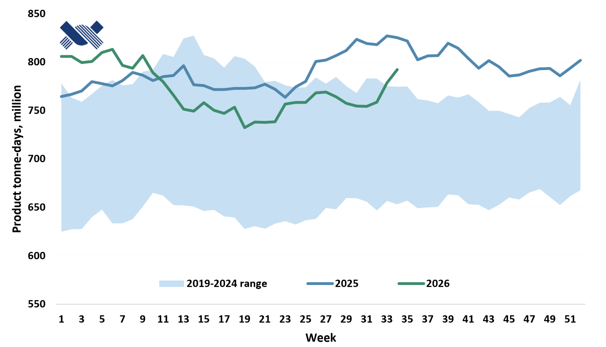
*Chart: Product tanker tonne-day demand (-2% YTD)*

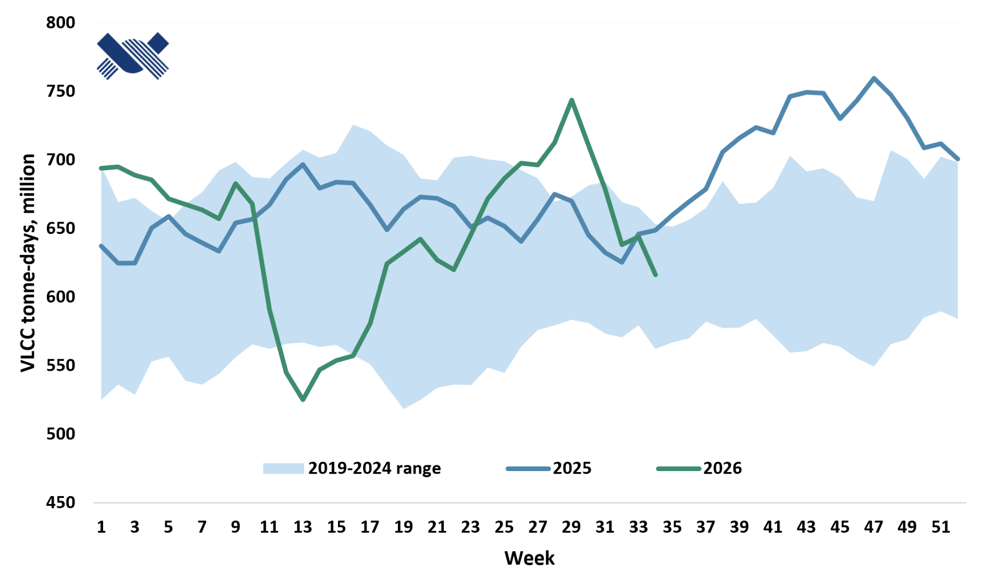
*Chart: VLCC tonne-day demand (-2% YTD)*

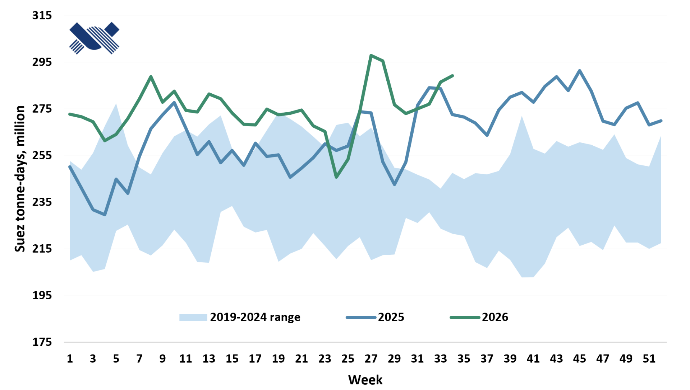
*Chart: Suezmax tonne-day demand (+7% YTD)*

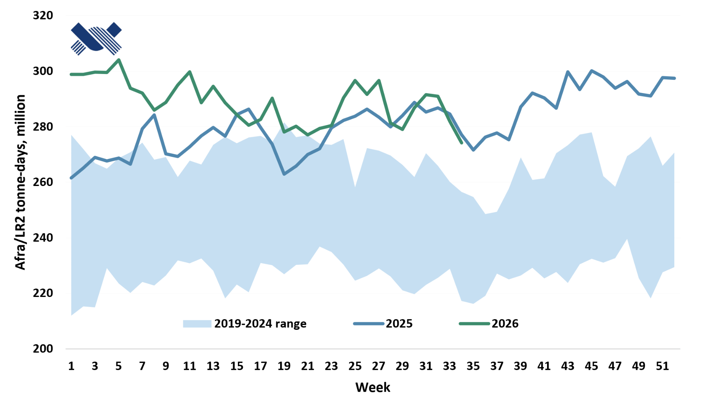
*Chart: Afra/LR2 tonne-day demand (+4% YTD)*

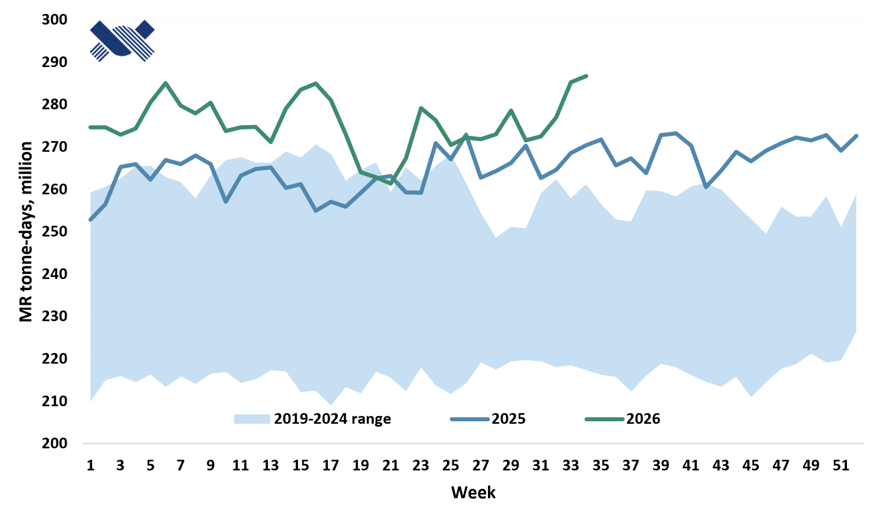
*Chart: MR tonne-day demand (+5% YTD)*

*Source: Vortexa, Fearnleys*

The key indicator to watch for crude tanker demand near-term will be the West-East arbitrage which has re-opened the last couple of weeks, amid a greater demand pull from Asia. Another, less visible, price dynamic which will also be key is the discount for crude grades from inside Hormuz (Dubai vs. Murban below is an imperfect view but at least indicative of direction). If these narrow there may be downside risk for TD3c, which in itself may not be too interesting for others than the select few parties who can actually participate in that (now) niche trade. However, lower discounts may also lower the willingness to pay for surrounding load areas, which are partly connected. Similarly, if TD34 rates come off, the West-East rates may quickly follow.

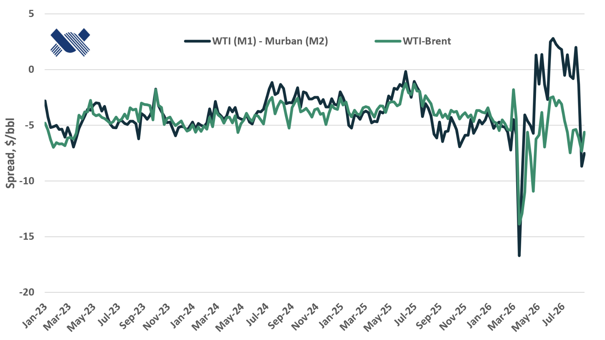
*Chart: Relative oil pricing - USG-East arb. back open*

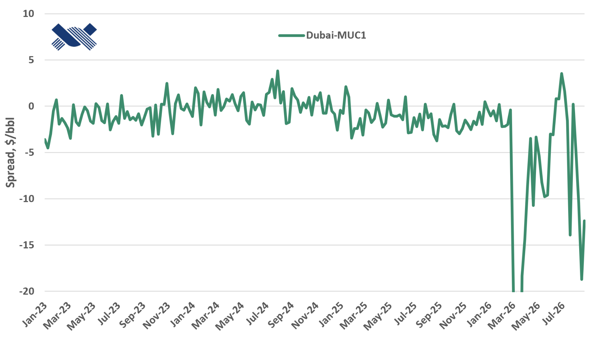
*Chart: Dubai (inside) vs. Murban (outside)*

*Source: Bloomberg*

The product tanker market remains supported by two thirds of the LR2 fleet trading dirty given better earnings and more trade opportunities. Low CPP volumes is a double edged sword - lower product tanker demand is a drag, but at the same time very high crack spreads should give trade possibilities and room for high freight. Over the last month, cracks and MR rates have moved in opposite directions - suggesting room on the upside for rates in areas or periods where tonnage gets tight(er).

*Chart: Share of LR2s trading dirty*

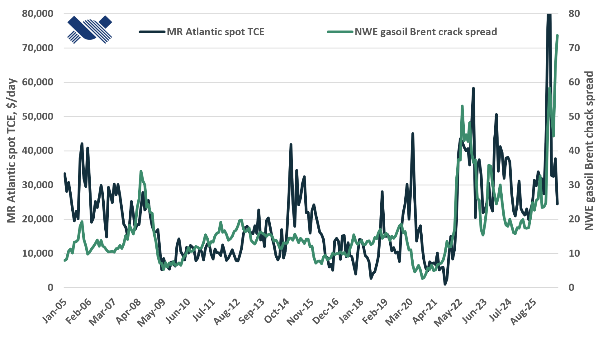
*Chart: Atlantic MR rates vs. NWE gasoil cracks*

*Source: Vortexa, Bloomberg, Baltic Exchange*

### Oil market in some sort of balance

The oil market remains undersupplied, although nowhere near as much as feared as evidenced by onshore inventories having drawn relatively little YTD. The latest estimate for shut-in production in the MEG is at 6 mbpd, so has more than halved since the top, and production elsewhere has risen slightly. Meanwhile, global refinery runs are about 5 mbpd lower than the same time last year.

Much of the fragile balance hangs on China. If Chinese runs and imports can remain low, the equilibrium that currently exists both in the oil and tanker markets may persist. That also hinges on Hormuz transits remaining at about 50% of pre-war levels. If, however, Hormuz flow increases further, that may allow Chinese runs to recover, leaving upside risk for product tanker volumes. Another key question is whether Chinese buyers return before crude volumes rise - which could have a meaningful impact on crude prices..

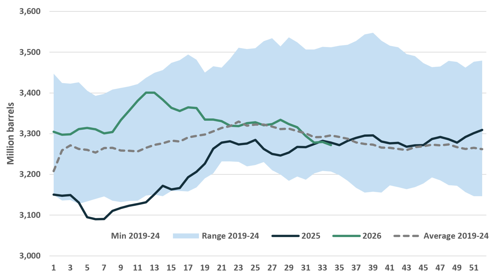
*Chart: Global onshore crude oil inventories*

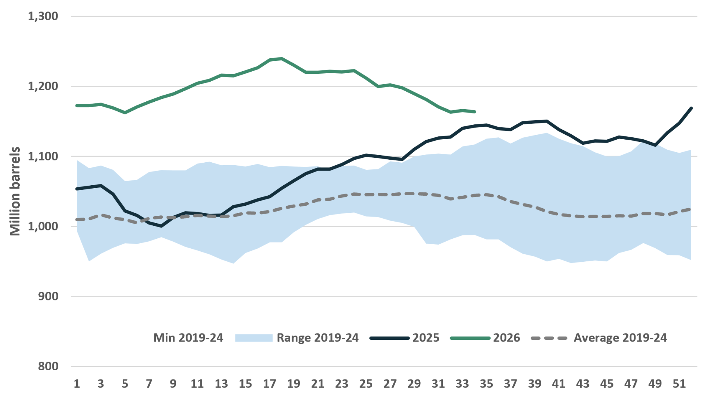
*Chart: China onshore crude oil inventories*

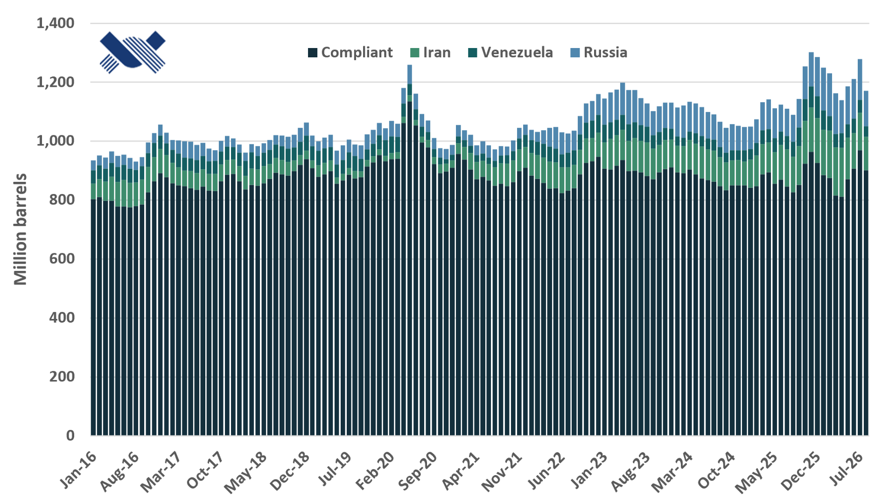
*Chart: Crude oil on the water*

*Source: Vortexa*

Lower refinery runs this year is predominantly due to MEG shut-downs, a sharp reduction in China due to optimisation (and possibly some underlying demand weakness), and Russia due to Ukrainian attacks. Utilisation elsewhere is mostly maxed out, as crack spreads are at historically elevated levels.

Going into autumn maintenance there may be a greater pull of gasoil/diesel into Europe - with arbitrages open from both the U.S. and MEG/India recently. This may be something that eventually bridges the gap between crack spreads and rates.

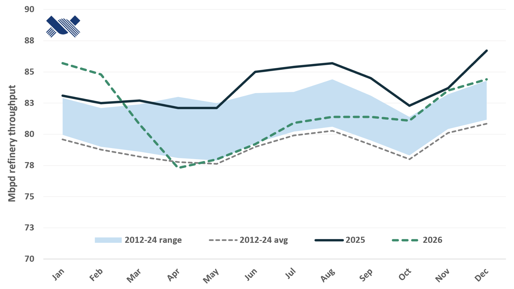
*Chart: Global refinery runs*

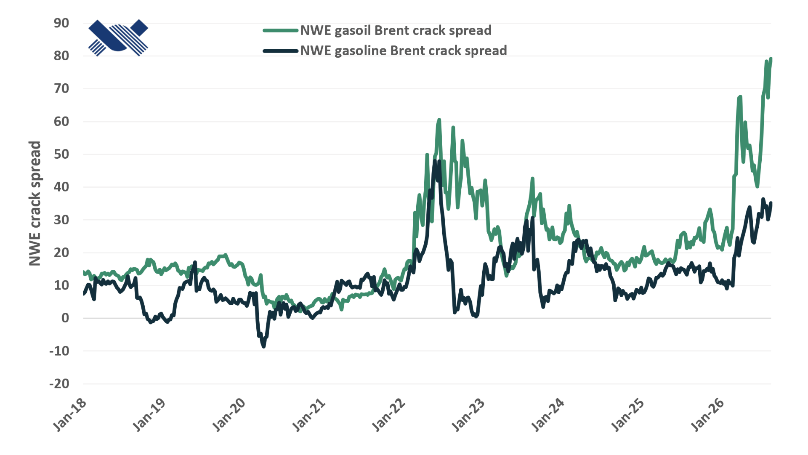
*Chart: Northwest Europe crack spreads*

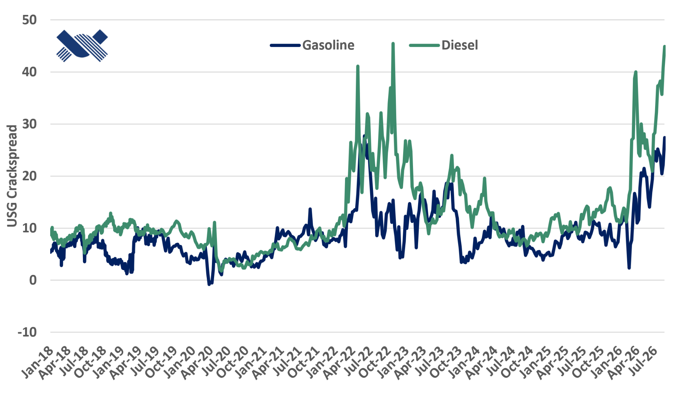
*Chart: U.S. Gulf Coast crack spreads*

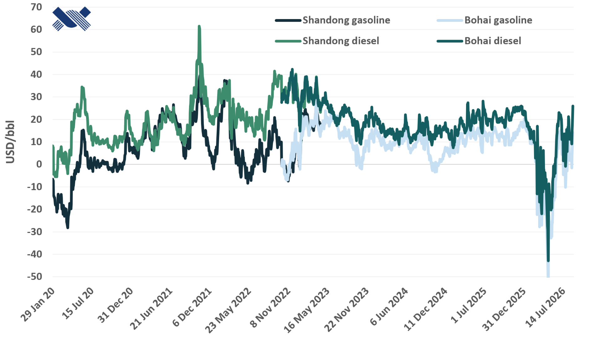
*Chart: Bohai Bay crack spreads*

*Sourec: IEA, Bloomberg, EIA, Argus*

### Some extra fleet growth - but also some potential for further tightness

Over the last few years we have noted that the shadow fleet was for all intents and purposes phased out from the complaint market, and would only return in an extreme rate scenario - a champagne problem.. Well, what do you know!? At least ten former shadow VLCCs have recently ended up doing Hormuz shuttle, thereby effectively re-joining the compliant market.

Now, an interesting 'problem' has arrived which is the complete opposite. The PGSA has published a list of 45 ships which have been designated as non-compliant after transiting the Hormuz Strait in breach of Iran's terms. Most of these have been used for 'Hormuz shuttle' and now stand at risk of having to pay fees (which would be sanctionable by the U.S...), or be seized. Ships that are spotted doing STS transfers with these ships also stand at risk of being 'sanctioned'. Should charterers or other owners shy away from these 45 ships, it could create further logistical inefficiencies and market tightness going forward.

In the resolution and paradoxical equilibrium scenarios even the quite elevated fleet growth over the next 12-18 months should be manageable. Most of this may be absorbed by demand growth potential, inefficiencies and consolidation (only about 17% of the VLCC fleet now controlled by 'independent' owners). From 2028 onwards, however, the huge delivery schedules should start to leave downward pressure.

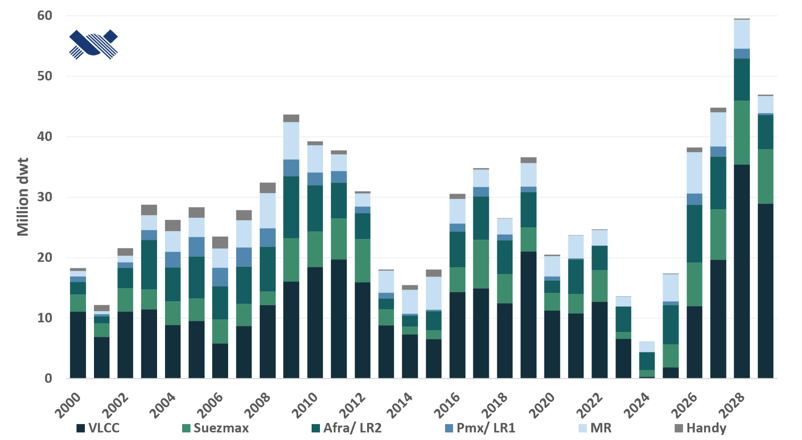
*Chart: Annual tanker deliveries*

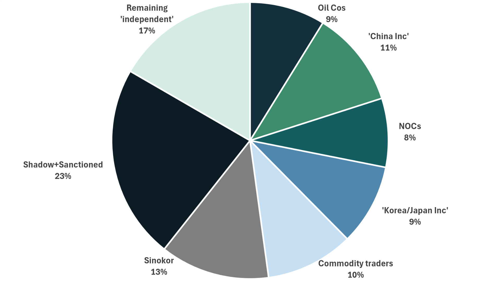
*Chart: VLCC fleet composition, by controlling entity*

*Source: Fearnleys*

Due to lower overall volumes, the number of ballasters in different segments and regions is ample. Some of that is absorbed by longer ballast legs, some in idle/waiting tonnage. Still, there should be enough for charterers to choose from at time of writing.

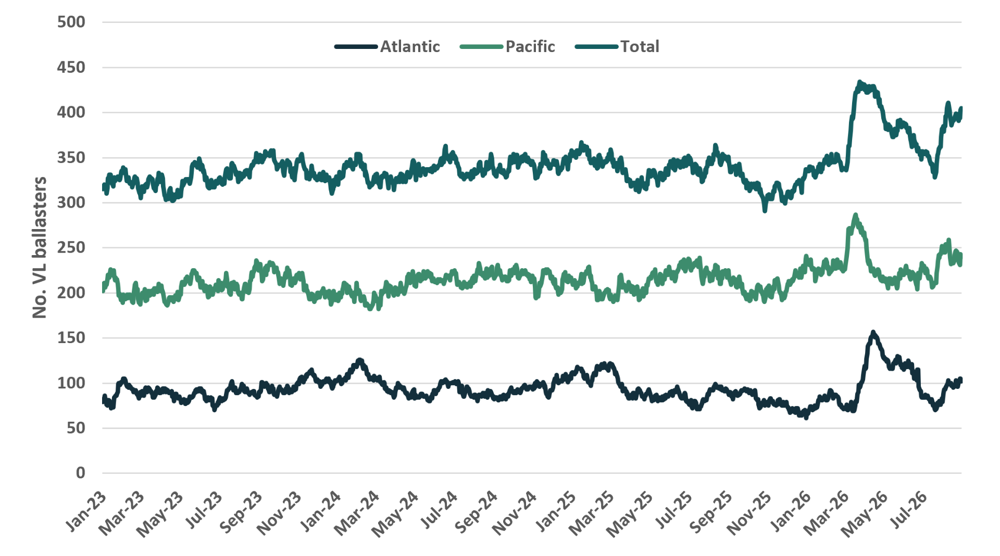
*Chart: VLCC ballasters Atlantic +23 and  Pacific +12 vs. Jan/Feb*

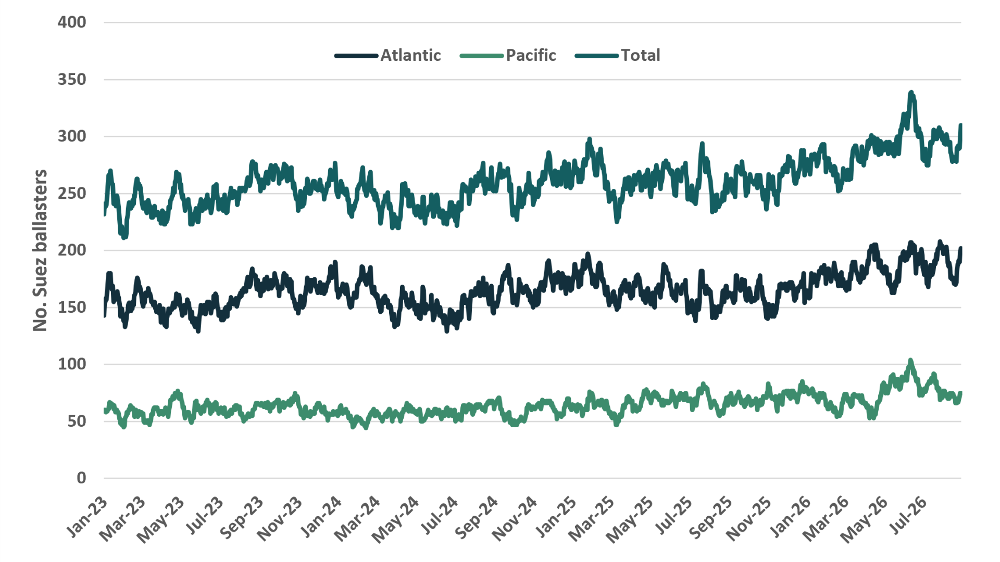
*Chart: Suez ballasters Atlantic +26 and Pacific +7 vs. Jan/Feb*

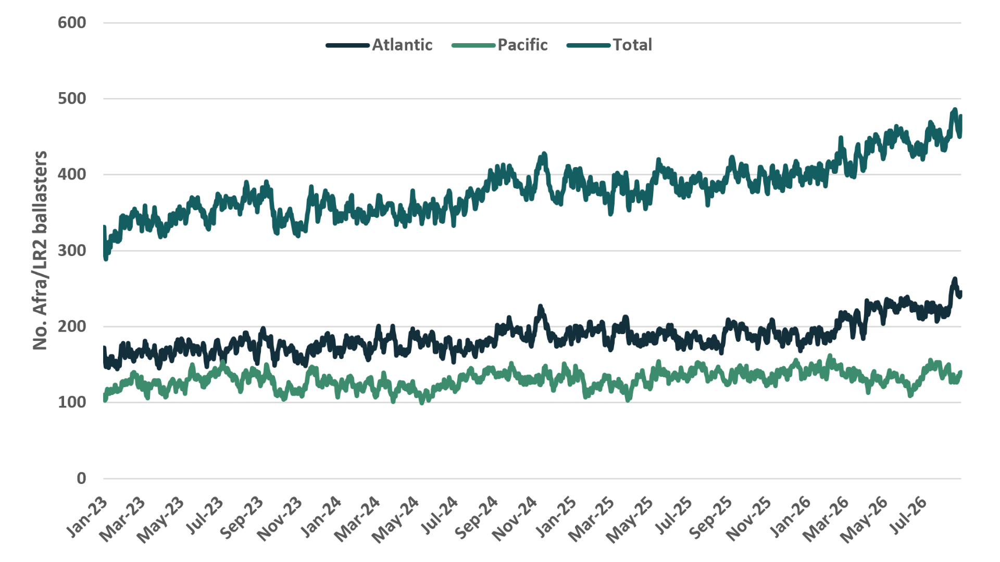
*Chart: Afra/LR2 ballasters Atlantic +51 and Pacific -5 vs. Jan/Feb*

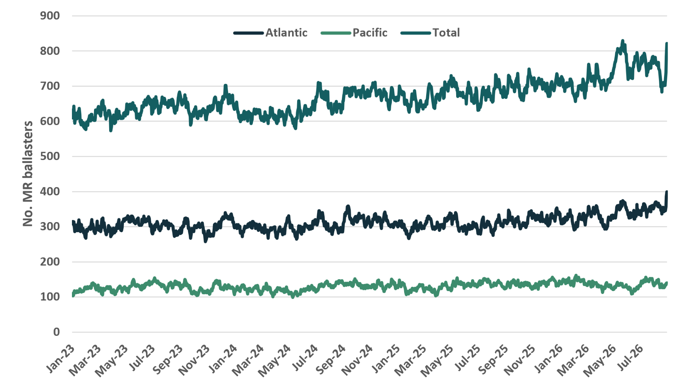
*Chart: MR ballasters Atlantic +80 and Pacific -5 vs. Jan/Feb*

*Source: Vortexa*
