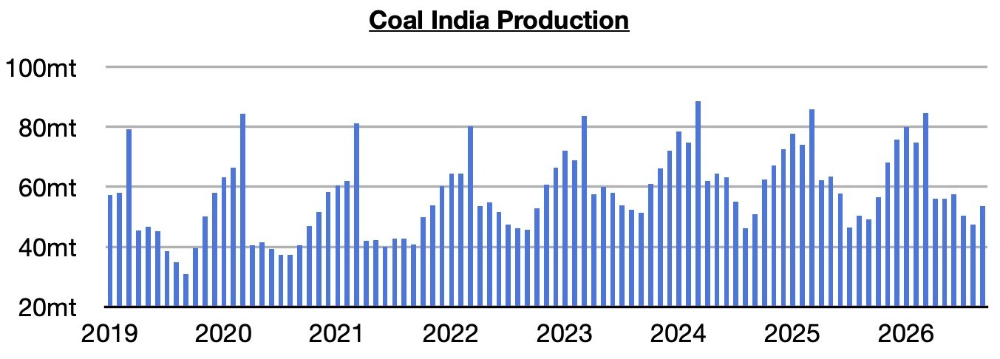
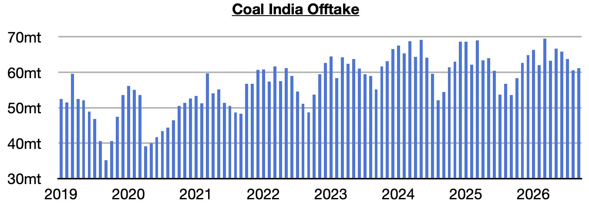
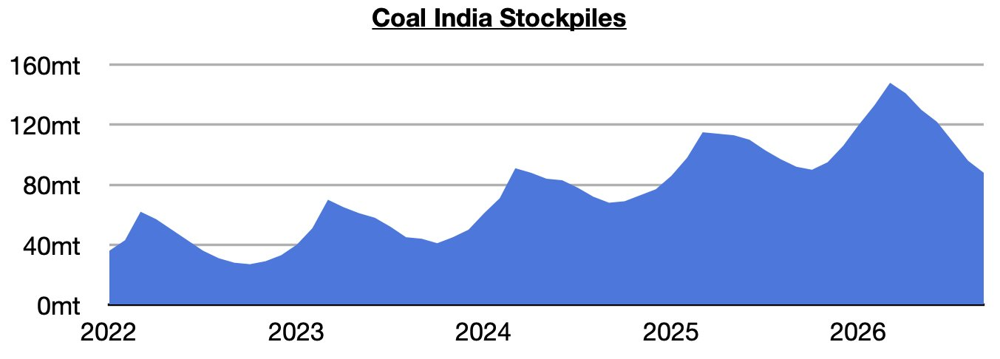

# Coal India's Stockpiles Continue to Decline

**Date:** October 12, 2026  
**Publisher:** Breakwave Advisors | **Category:** Market Insights  
**Original URL:** [https://www.breakwaveadvisors.com/insights/2026/10/12/coal-indias-stockpiles-continue-to-decline](https://www.breakwaveadvisors.com/insights/2026/10/12/coal-indias-stockpiles-continue-to-decline)  

---

*By*[*Jeffrey Landsberg*](https://www.linkedin.com/in/jeffrey-landsberg-70ab957/)

As we discussed in Commodore Research's most recent Weekly Executive Report, Coal India produced approximately 53.5 million tons of coal last month (Coal India is responsible for over 75% of India’s coal output). This is up month-on-month by 6 million tons (13%) and up year-on-year by 4.5 million tons (9%). Previously, Coal India’s production had contracted on a year-on-year during five of the prior six months.

> **Figure 1: Chart 1**  
> [Local Asset](assets/2026-10-12_coal-indias-stockpiles-continue-to-decline_img_chart1_89848183b55e.jpg)

Offtake (the amount sent to customers) totaled 61.2 million tons. This is up month-on-month by 600,000 tons (1%) and up year-on-year by 7.6 million tons (14%). Offtake has now increased on a year-on-year basis for five straight months. Previously, it had contracted on a year-on-year basis in seven of the prior eight months.

> **Figure 2: Chart 2**  
> [Local Asset](assets/2026-10-12_coal-indias-stockpiles-continue-to-decline_img_chart2_ce9b174e4c0d.jpg)

With offtake again coming in above output, India’s stockpiles have fallen further. They now stand at approximately 88 million tons. This is down month-on-month by 8 million tons (-8%) and down year-on-year by 4 million tons (-4%). Prior to the last six months, stockpiles had increased for five straight months. Stockpiles are now at their lowest level since January 2025.

> **Figure 3: Chart 3**  
> [Local Asset](assets/2026-10-12_coal-indias-stockpiles-continue-to-decline_img_chart3_a022f8874b58.jpg)

---

**Tags:** Commodities, Markets, Coal  
