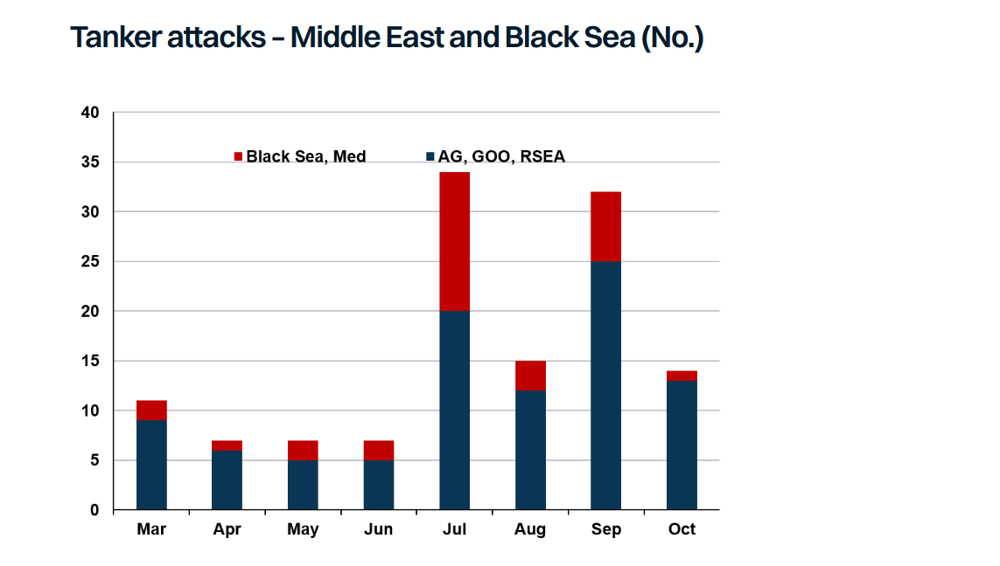

# Damage Control

**Date:** October 12, 2026  
**Publisher:** Breakwave Advisors | **Category:** Market Insights  
**Original URL:** [https://www.breakwaveadvisors.com/insights/2026/10/12/damage-control](https://www.breakwaveadvisors.com/insights/2026/10/12/damage-control)  

---

> **Figure 1: 1 Tanker Smoke**  
> **Interactive Data & Source:** [Gibsons Co](https://www.gibsons.co.uk/market-reports) | [Local Asset](assets/2026-10-12_damage-control_img_1-tanker-smoke_32eb2229ad66.jpg)

Last week, tanker attacks in the Middle East hit their highest levels since the war began and that pace has continued this week. Further, in the past 48 hours, attacks have broadened to the Gulf of Oman and Arabian Gulf, expanding beyond the Hormuz chokepoint. Since the war started, Gibson has tracked 95 attacks on tankers in the region, including Iranian trading tonnage. The actual number is likely higher due to suppressed reporting. Damage has ranged from superficial to severe, with some vessels requiring extensive repairs or being lost entirely. We count 9 VLCCs being struck in the last 12 days alone.

The increase in attacks coincided with the breakdown of talks following the UN General Assembly in late September, suggesting that Iran is once again escalating attacks in the absence of any progress towards a diplomatic resolution. Surprisingly, the US is yet to publicly retaliate, as it did during early September when several tankers were sunk or disabled, though this could change after the midterm elections in early November. Remember “a tanker for a tanker”?

With the rate of attacks high, vessel supply could tighten further as more vessels are removed from service pending repairs. Insurance premiums and freight rates are also likely to rise as owners reassess risk. The reported attack on a VLCC in the Gulf of Oman further adds to the uncertainty, given that is where the majority of Middle East crude is transhipped onto vessels unwilling to risk a Hormuz transit.

Tracking the impact on vessel supply is challenging. Not all attacks are reported, and the common practice of having AIS turned off in the region makes it difficult to track the period following attacks. Many vessels remained dark following the incidents, making it hard to determine whether trading operations were impacted for a prolonged period, particularly for vessels controlled by national oil companies. However, evidence also suggests many vessels were patched up and quickly returned to service. Around a third of the vessels attacked had sufficient data to track downtime. On average, these vessels waited two months following the attack before loading their next cargo, though some required more extensive repairs in dry dock.

The Middle East has not been the only region where tankers have been targeted. In the Black Sea, frequent attacks were seen over the summer against Suezmaxes and Aframaxes loading at the CPC terminal and other Russian ports. Whilst the extent of the damage varied, on average vessels waited nearly two months before loading their next cargo, spending an average of 25 days at repair yards. Although attacks against vessels loading at CPC have subsided following a US-Ukrainian agreement, vessels trading Russian crude face considerable risks, with a Russian trading Aframax likely destroyed earlier this week.

So long as tensions persist, tankers will remain vulnerable. Growing risks in the Middle East threaten to keep freight rates sky-high, while the delivered cost of oil will also remain inflated from higher insurance costs and logistical challenges. Rising attacks also threaten tanker supply. Even in cases where damage is limited, the temporary downtime whilst condition assessments are conducted further adds operational inefficiencies.

> **Figure 2: Στιγμιότυπο Οθόνης 2026 10 12 101055**  
> **Interactive Data & Source:** [Gibsons Co](https://www.gibsons.co.uk/market-reports) | [Local Asset](assets/2026-10-12_damage-control_img_cea3cf84ceb9ceb3cebcceb9cf8ccf84cf85_98bdb4f1f7e8.png)

Data source:[Gibson Shipbrokers](https://www.gibsons.co.uk/market-reports)

---

**Tags:** Tankers, Shipping, Markets  
