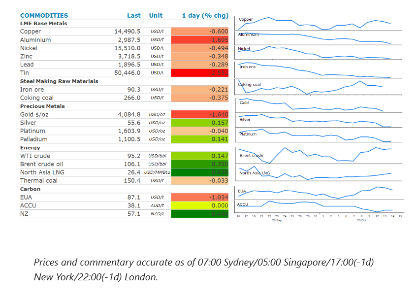
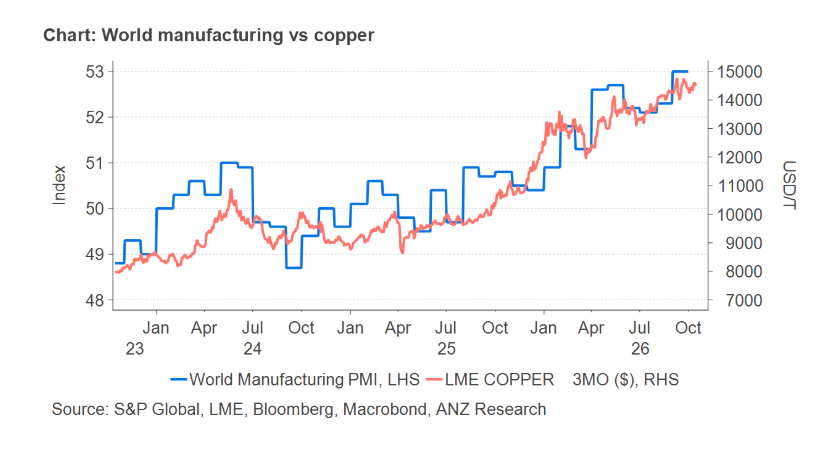

# Gold slumps as higher inflation boosts rate hike expectations

**Date:** October 15, 2026  
**Publisher:** Breakwave Advisors | **Category:** Market Insights  
**Original URL:** [https://www.breakwaveadvisors.com/insights/2026/10/15/gold-slumps-as-higher-inflation-boosts-rate-hike-expectations](https://www.breakwaveadvisors.com/insights/2026/10/15/gold-slumps-as-higher-inflation-boosts-rate-hike-expectations)  

---

The energy sector rose as attacks on oil tankers in the Middle East intensified. Precious metals slumped after stronger than expected inflation in the US.

*By*[*Daniel Hynes*](https://www.linkedin.com/in/dahynes/)

> **Figure 1: Στιγμιότυπο Οθόνης 2026 10 15 100304**  
> **Interactive Data & Source:** [Linkedin](https://www.linkedin.com/newsletters/commodities-wrap-6692196755876012032/?fbclid=IwAR3kiXJqZdxmp9ZcRwBNI7FsBySI-XSC0pfPur1qzjt7OZp7PTE59Tsl1QI) | [Local Asset](assets/2026-10-15_gold-slumps-as-higher-inflation-boosts-rate-hike-expectations_img_cea3cf84ceb9ceb3cebcceb9cf8ccf84cf85_636dc215cab3.png)

**Crude oil**rallied as hostilities intensified in the Middle East, threatening further supply disruptions. The Iranian-backed Houthis continued drone and missile attacks on Saudi Arabia, hitting the headquarters of the state-owned oil producer. Oil production hasn’t been affected, despite damage to buildings containing the operations management office. Meanwhile, attacks on oil tankers in the Persian Gulf continued unabated. Moreover, Iran’s focus is shifting beyond the Strait of Hormuz, with attacks on vessels in the Gulf of Oman and around the port of Fujairah becoming more common. This could threaten not only the smaller vessels that are part of the shuttle system that has enabled strong flows of oil, but the very large crude carriers taking oil to its destinations. Hopes that an energy ceasefire in the Russia-Ukraine conflict would ease constraints on diesel supplies were dashed, after further attacks on Russian refineries. Russia accused Ukraine of attacking two oil refineries in the Saratov and Ryazan regions on Wednesday. The latter is home to one of the largest refineries in the country, with a capacity of around 400kb/d.

Sentiment wasn’t helped by the International Energy Agency’s dour assessment of the conflict’s impact on the oil market. Global observed oil inventories edged down by 10mbbl in September as a further 113mbbl decline in on-land stocks was offset by a rise in oil on water. Non-OECD crude stocks slumped by 76mbbl, with China accounting for 78% of the decline, while OECD inventories dropped by 37mbbl. Global stocks were 509mbbl (-2.4 mb/d) lower than at the end of February.

**Asian LNG**prices pushed above USD29/MMBtu on heightened concerns over supply. Chinese purchases of LNG supported prices. China National Offshore Oil Corp purchased several cargoes for delivery in October and November, according to traders. This suggests the world’s top buyer is beginning to replenish inventories ahead of winter. Imports in September were subdued, reaching 10.9mt (-1.7% y/y). This spells trouble for European buyers, who will be competing for increasingly scarce LNG cargoes. Its storage facilities are only 74% full, which is significantly below levels required to meet demand over winter.

**Gold**slumped after rate hike concerns ramped up following the stronger than expected US consumer price data. The Consumer Price Index rose 0.6% in September, driven by rising fuel costs. The precious metal fell more than 1.6% to threaten breaking back below USD4,000/oz.

**Copper**briefly threatened to touch another record high amid tight market conditions. Europe’s top producer, Aurubis AG, stated that huge shipments of metal to the US are significantly reducing the availability of metal elsewhere. This has been driven by concerns that the US may place tariffs on refined metal imports. This has seen the company increase its premiums for customers in 2027 to a record USD347/t, up 10% on this year’s level. The gains were supported by the threat of strikes in Chile. However, the prospect of tighter monetary policies saw the metal give up those gains by the end of the session.

### Chart of the Day

While supply side issues have been a big driver of record high copper prices, demand is also playing its part. Global manufacturing has shown strong growth in recent months, with the world purchasing manufacturing index recently hitting 53. This is partly driven by the AI sector, where spending on data centres and energy infrastructure has been strong. This is likely to continue to support demand for a copper, a key component in this infrastructure.

> **Figure 2: Στιγμιότυπο Οθόνης 2026 10 15 100459**  
> **Interactive Data & Source:** [Linkedin](https://www.linkedin.com/newsletters/commodities-wrap-6692196755876012032/?fbclid=IwAR3kiXJqZdxmp9ZcRwBNI7FsBySI-XSC0pfPur1qzjt7OZp7PTE59Tsl1QI) | [Local Asset](assets/2026-10-15_gold-slumps-as-higher-inflation-boosts-rate-hike-expectations_img_cea3cf84ceb9ceb3cebcceb9cf8ccf84cf85_9e96d1649273.png)

Data source:[Commodities Wrap](https://www.linkedin.com/newsletters/commodities-wrap-6692196755876012032/?fbclid=IwAR3kiXJqZdxmp9ZcRwBNI7FsBySI-XSC0pfPur1qzjt7OZp7PTE59Tsl1QI)

---

**Tags:** Commodities, Shipping, Markets  
