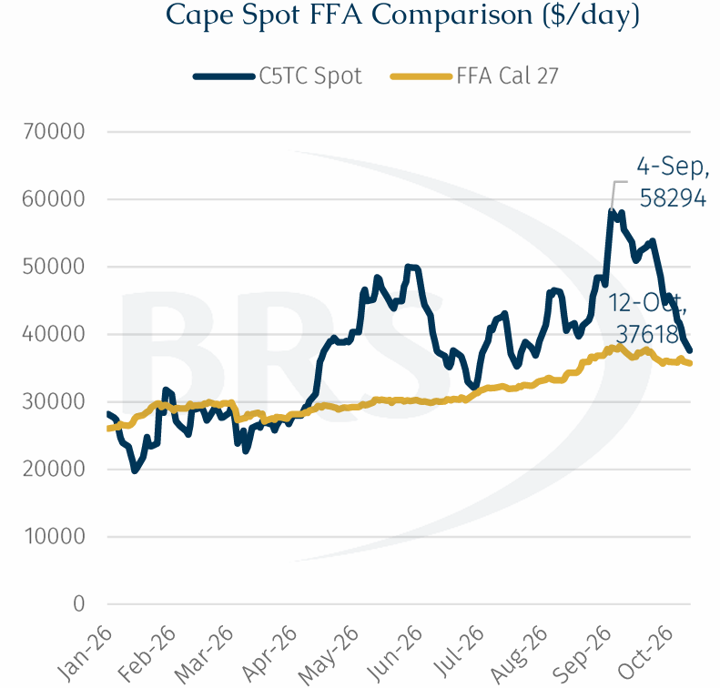
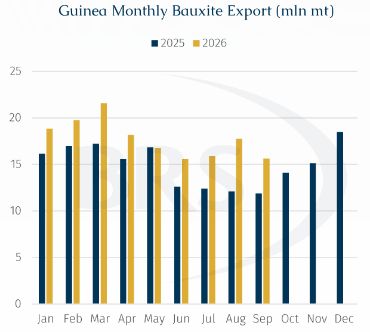
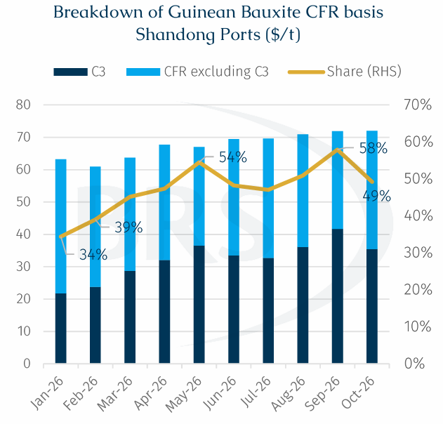
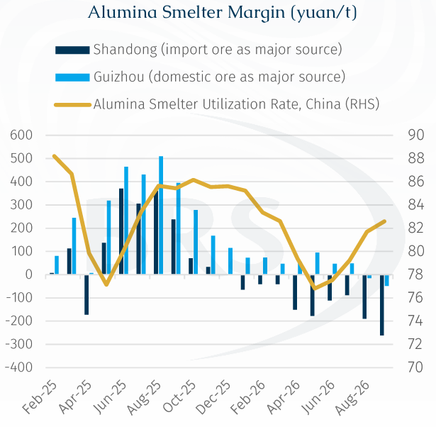

# Falling Cape Freight Rates: Guinea’s Bauxite Shipments Move from a Test of Resilience to a Test of Elasticity

**Date:** October 16, 2026  
**Publisher:** Breakwave Advisors | **Category:** Market Insights  
**Original URL:** [https://www.breakwaveadvisors.com/insights/2026/10/16/falling-cape-freight-rates-guineas-bauxite-shipments-move-from-a-test-of-resilience-to-a-test-of-elasticity](https://www.breakwaveadvisors.com/insights/2026/10/16/falling-cape-freight-rates-guineas-bauxite-shipments-move-from-a-test-of-resilience-to-a-test-of-elasticity)  

---

> **Figure 1: Rgb Color Brs Shipbrokers Monogram L**  
> [Local Asset](assets/2026-10-16_falling-cape-freight-rates-guineas-bauxite-shipments-move-from-a-test-of-resilie_img_rgb-color-brs-shipbrokers-monogram-l_c365f35f1de5.png)

One notable development in the recent dry bulk market has been the sharp retreat in Capesize freight rates from elevated levels, contrasting with the relatively steady to firmer performance of Panamaxes and Supramaxes. According to Baltic Exchange indices, Cape 5TC (182k) fell from a high of $58,294/day on 4 Sep to $37,618/day across one month, a decline of 35%. By comparison, the Panamax and Supramax indices fell 1% and rose 15%, respectively, thus significantly outperforming Capesize in the same time period (4 Sep – 12 Oct).

> **Figure 2: 2 Tow 1**  
> [Local Asset](assets/2026-10-16_falling-cape-freight-rates-guineas-bauxite-shipments-move-from-a-test-of-resilie_img_2tow1_7386d007e555.png)

While views remain divided whether this is a temporary correction or a gradual return to fundamentals, the performance of spot and forward rates might offer one perspective. The comparison chart shows that Cal27 pricing has remained relatively firm despite the sharp decline in spot rates. This suggests that the overall outlook remains intact despite the recent slump. For the shipping market, however, an equally important question is not simply the direction freight rates are heading in, but what this decline implies for commodity trade, and whether improved trade economics can unleash cargo volumes previously constrained by transportation costs.

Recent shipment trends from major Atlantic cargo origins provide some context. According to AXSMarine data, for the first time since the second half of 2024, Brazilian iron ore shipments declined for three consecutive months, from 35.35 mln mt in June to 33.12 mln mt in September. The monthly change in Guinea’s bauxite shipments was more pronounced: September shipments reached 15.61 mln mt, down 2.13 mln mt, or 12.0%, from August’s 17.74 mln mt and this downward trend is expected to continue into October. Seasonally, September and October typically mark the end of Guinea’s rainy season, supporting a significant month-on-month recovery in shipments. However, elevated freight rates have discouraged shipments from Guinean mines, particularly those operated by higher-cost, non-mainstream producers.

> **Figure 3: 3 Tow 2**  
> [Local Asset](assets/2026-10-16_falling-cape-freight-rates-guineas-bauxite-shipments-move-from-a-test-of-resilie_img_3tow2_de275ac78c48.png)

### High Freight Rates Squeeze More Than Just Margins

For Guinean bauxite, transportation costs at one point accounted for more than 50% of the ore’s CFR price, becoming a significant factor affecting miners’ shipment margins. Over the past month, Baltic C3, the Brazil/Guinea-to-China freight benchmark, remained above $40/t while Mysteel data show that the CFR price of Guinean bauxite at Shandong ports has remained broadly stable at $71–72/t over the past few months.

> **Figure 4: 4 Tow 3**  
> [Local Asset](assets/2026-10-16_falling-cape-freight-rates-guineas-bauxite-shipments-move-from-a-test-of-resilie_img_4tow3_3ce7371cbd92.png)

Despite elevated transportation costs, Guinea’s bauxite shipments have not followed a sustained downward trajectory. According to AXSMarine data, second- and third-quarter shipments totalled 50.5 mln mt and 49.2 mln mt, respectively, down 16% and 18% from the first-quarter high of 60.1 mln mt. Nevertheless, shipments remained significantly above last year’s levels, with year-on-year growth still around 20%. It is understood that some major miners had already secured long-term transportation arrangements, providing substantial support for acquiring freight competitive voyages amid a high-freight environment, demonstrating the resilience of Guinea’s exports.

However, relative stability in aggregate volumes does not mean that all mines can absorb high freight costs. For higher-cost mines with limited margins, transportation costs have become an important factor in deciding whether to export, leading to a reduced margin and even worse, preventing some marginal cargoes from reaching the Chinese market as originally planned.

The recent easing in freight rates is beginning to relieve this pressure. Baltic C3 fell to $32.95/t on 12 October, approximately $10.5/t below its late-September high of $43.427/t. For trades previously squeezed by high freight costs, this creates scope for margin improvement and a recovery in shipments. With talks on Guinea-China bauxite runs becoming more active, we believe some marginal Guinean volumes could consequently become viable for export again, particularly those previously delayed because of insufficient economic returns.

While lower freight costs are important for miners, lower CFR prices are equally important, as they make imported ore more attractive to alumina refineries and ultimately support demand for shipments.

### Downstream Profitability Constrains the Recovery in Import Demand

As new processing capacity has come on stream and previously idled capacity has restarted since early May, alumina operating rates have recovered, putting further pressure on industry profitability, particularly at coastal refineries using imported bauxite. Shandong and Guizhou, key regional users of imported and domestic bauxite respectively, offer a useful comparison of the recent pressures facing imported ore. According to Mysteel’s margin indicators, alumina refineries in Shandong recorded losses of RMB261.8/t in September, compared with RMB48.7/t in Guizhou, highlighting the greater profitability pressure on imported-bauxite users. As freight rates decline, the economics of using imported bauxite should improve at the margin. Even if this only means moving from deeper losses to smaller losses, it could encourage some alumina refineries to resume or increase purchases of imported ore. For the shipping market, any increase in demand for imported bauxites would provide some support for long haul seaborne demand.

> **Figure 5: 5 Tow 4**  
> [Local Asset](assets/2026-10-16_falling-cape-freight-rates-guineas-bauxite-shipments-move-from-a-test-of-resilie_img_5tow4_e0aef53c5eb9.png)

However, two constraints remain: alumina refineries are still loss-making, and freight rates remain elevated in absolute terms. A substantial near-term recovery in import demand driven by improved margins is therefore unlikely. We lean towards a modest recovery in Guinea’s bauxite shipments starting in November and December, with a potential increase of around 5%–10% on month, rather than a concentrated, large-scale rebound. While earlier high freight rates tested the resilience of Guinea’s bauxite shipments, the current easing should test market elasticity, potentially unlocking additional cargo volumes and supporting near term Capesize demand.

---

**Tags:** Drybulk, Shipping, Capesize  
