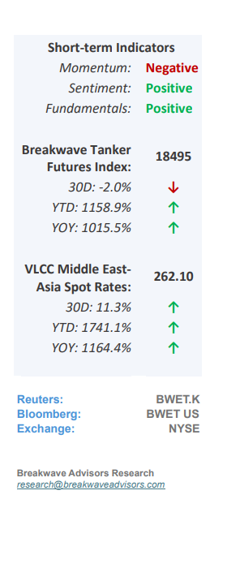
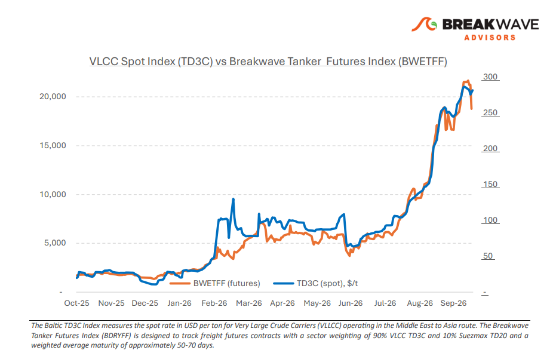
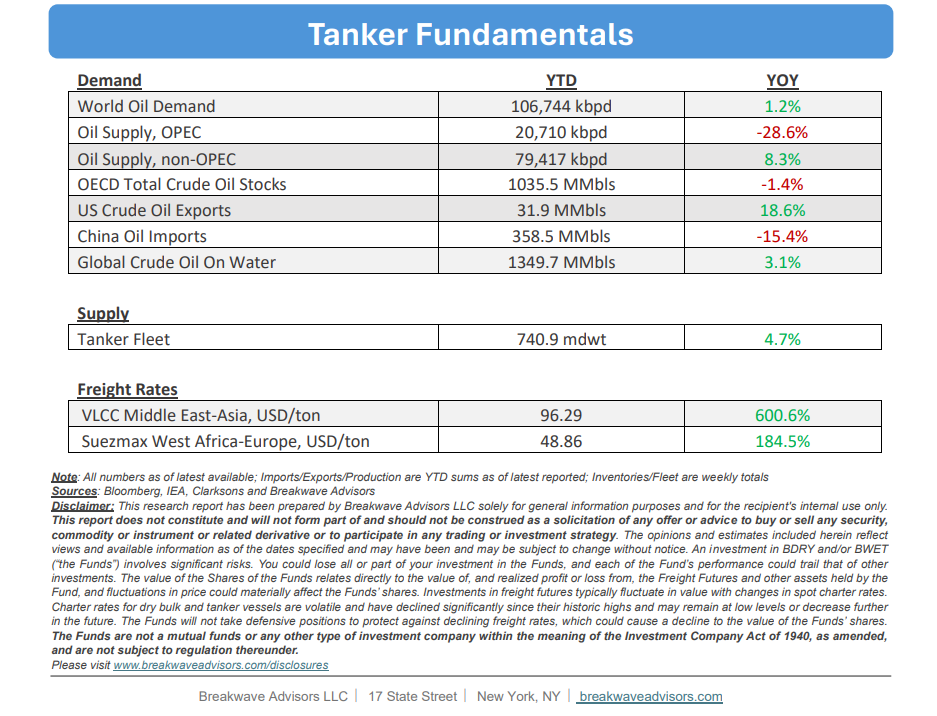

# Breakwave Bi-Weekly Tanker Report - October 20, 2026

**Date:** October 20, 2026  
**Publisher:** Breakwave Advisors | **Category:** Market Insights  
**Original URL:** [https://www.breakwaveadvisors.com/insights/102026wetreportju87-pp-09](https://www.breakwaveadvisors.com/insights/102026wetreportju87-pp-09)  

---

**• VLCC Supported at Record High Amid Exceptional Geopolitical Risks**– Continued attacks on shipping and energy infrastructure are keeping transportation costs**exceptionally high**. The reported Houthi strike on Saudi Aramco's Dhahran headquarters added to concerns over regional energy security, while recent tanker incidents in the Gulf underline the**persistent threats to maritime operations.**At their October 12 meeting, OPEC+ ministers warned that shipping and insurance costs have now risen above one-third of commodity value, highlighting the growing burden on international oil trade. A slight correction in freight prices outside Hormuz reflects**weaker cargo enquiry**and reduced export volumes rather than improved vessel circulation. Meanwhile, Arabian Gulf–China freight futures have come under some downward pressure following discussions of potential**US sanctions relief**for selected shadow-fleet tankers, although no additional commercially available capacity has been confirmed. In the Atlantic, the earlier freight rally has lost momentum as West African cargo enquiry slowed and US Gulf rates retreated from recent highs. Brazil remained relatively more active, with Petrobras attracting increased offers as owners showed greater interest in western employment. The latest correction points to a**more divided VLCC market,**with weaker Atlantic cargo enquiry and greater owner competition contrasting with exceptionally high Arabian Gulf earnings. While potential US sanctions relief has weighed on freight futures, its impact on effective tanker availability remains uncertain. Continued security incidents around Hormuz also leave the durability of the recent easing in question, with no clear indication yet of sustained freight normalization.

> **Figure 1: Cea3cf84ceb9ceb3cebcceb9cf8ccf84cf85**  
> [Local Asset](file:///c:/Users/Dell/Github/Shipping/corpus/03-breakwave/insights/2026/assets/2026-10-20_102026wetreportju87-pp-09_img_cea3cf84ceb9ceb3cebcceb9cf8ccf84cf85_d13205ea2374.png)

•**Oil Prices Back to Multi-month Highs Despite Higher Transits**– Oil prices remain**elevated near multi-month highs**, driven by a 1.7-billion-barrel reduction in global inventories since the start of the war and heightened market tightness despite improved transits through the Strait of Hormuz. While**sizable pre-war storage levels**initially provided a buffer, the global market balance has significantly compressed since then. Current prices are further sustained by record-high refined product prices, resilient global economic activity, and ongoing geopolitical uncertainty surrounding two major wars. Consequently, a**substantial decline in oil prices appears unlikely**in the near term, with the risk of further spikes remaining high due to volatile developments in the Middle East and lingering uncertainty over underlying demand from key Asian economies. We continue to see high oil prices for now but remain quite concerned about**structural demand**destruction that will resurface once the geopolitical situation normalizes.

•**Our Long-term View**– The tanker market has been recovering from a long period of staggered rates as the growth in new vessel supply shrunk while oil demand remained elevated in line with the global economy. The recent rapid increase in freight rates has led to significant new vessel ordering, with the orderbook now standing at above average levels, and although in the near term such a supply/demand misbalance is small, we expect a meaningful negative balance to develop longer term leading to a potential downcycle.

> **Figure 2: Στιγμιότυπο Οθόνης 2026 10 20 095913**  
> [Local Asset](file:///c:/Users/Dell/Github/Shipping/corpus/03-breakwave/insights/2026/assets/2026-10-20_102026wetreportju87-pp-09_img_cea3cf84ceb9ceb3cebcceb9cf8ccf84cf85_29180b61d83e.png)

> **Figure 3: Στιγμιότυπο Οθόνης 2026 10 20 102132**  
> [Local Asset](file:///c:/Users/Dell/Github/Shipping/corpus/03-breakwave/insights/2026/assets/2026-10-20_102026wetreportju87-pp-09_img_cea3cf84ceb9ceb3cebcceb9cf8ccf84cf85_743ce1202219.png)

### Subscribe:
