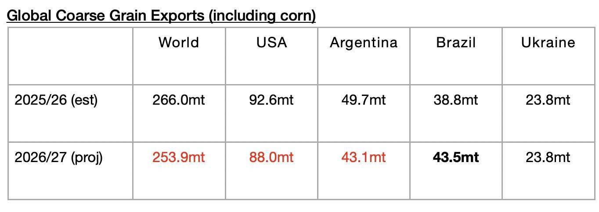

# Contraction in Global Grain Exports Still Expected

**Date:** October 21, 2026  
**Publisher:** Breakwave Advisors | **Category:** Market Insights  
**Original URL:** [https://www.breakwaveadvisors.com/insights/2026/10/21/contraction-in-global-grain-exports-still-expected](https://www.breakwaveadvisors.com/insights/2026/10/21/contraction-in-global-grain-exports-still-expected)  

---

*By*[*Jeffrey Landsberg*](https://www.linkedin.com/in/jeffrey-landsberg-70ab957/)

As we discussed in Commodore Research's most recent Weekly Executive Report, the United States Department of Agriculture (USDA) has released its latest forecast for the 2026/27 season and is now predicting that global coarse grain, wheat, soybean, and soymeal exports will total 745 million tons. This is 1.3 million tons less than the USDA predicted a month ago — and it is 21.3 million tons (-3%) less than is expected for the 2025/26 season. The forecast is still preliminary, but a year-on-year decline in exports would be a headwind for our market. Compared to the 706 million tons of grain that was shipped during the 2024/25 season, however, 745 million tons — if actually shipped — would mark an increase of 40.3 million tons (6%). As we have stressed many times, 745 million tons represents an impressive amount of grain to be shipped, but it is less than the incredible 766.3 million tons that is now estimated for the 2025/26 season.

The USDA is forecasting that global coarse grain exports in 2026/27 will total 253.9 million tons. This would mark a year-on-year decline of 12.1 million tons (-5%) from the 2025/26 season. Coarse grain exports will remain the global grain market’s largest cargo by volume. Moderate year-on-year declines in coarse grain exports are expected from the United States and Argentina. A moderate year-on-year increase is expected from Brazil. Exports from Ukraine are now expected to remain flat.

> **Figure 1: Chart**  
> [Local Asset](assets/2026-10-21_contraction-in-global-grain-exports-still-expected_img_chart_529dfaa90196.jpg)

---

**Tags:** Markets, Drybulk, Commodities  
