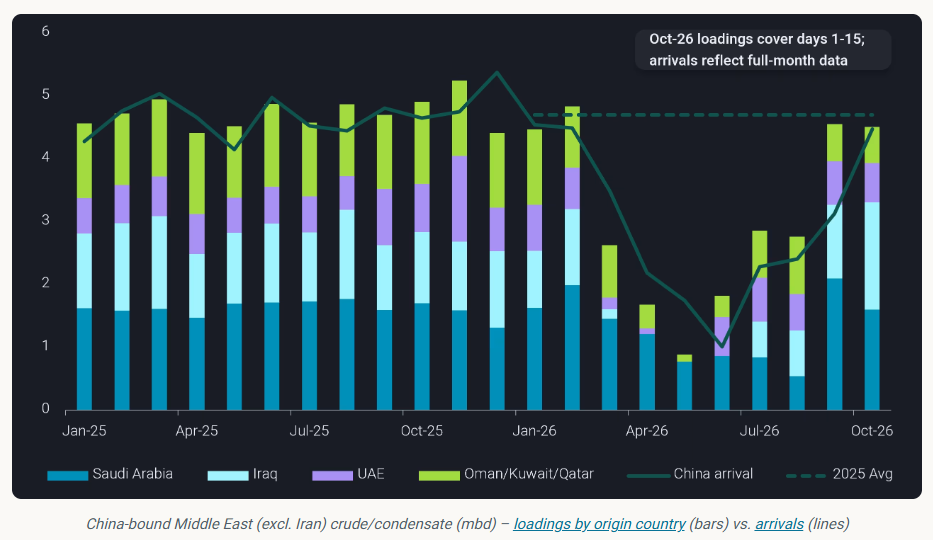
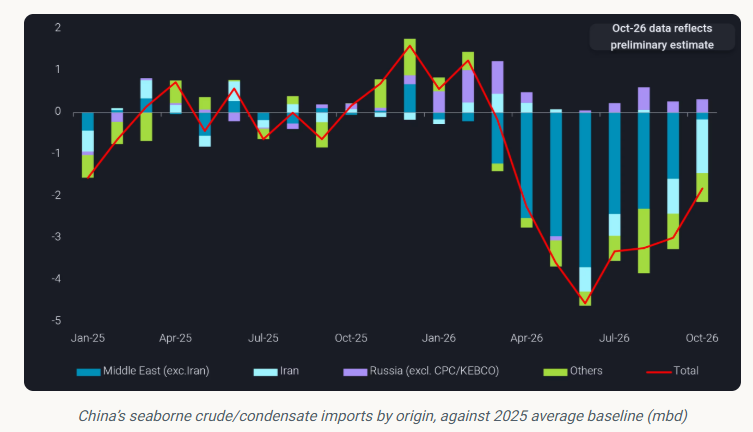
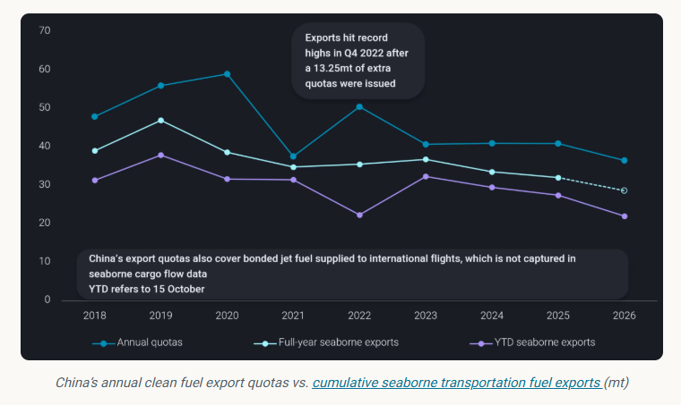

# Gulf producers stand to gain as China replaces Iranian loss

**Date:** October 22, 2026  
**Publisher:** Breakwave Advisors | **Category:** Market Insights  
**Original URL:** [https://www.breakwaveadvisors.com/insights/2026/10/22/gulf-producers-stand-to-gain-as-china-replaces-iranian-loss](https://www.breakwaveadvisors.com/insights/2026/10/22/gulf-producers-stand-to-gain-as-china-replaces-iranian-loss)  

---

The loss of Iranian crude creates an opening for Gulf producers, while China’s fuel export policy is closely linked to Middle East Gulf crude availability.

*By*[*Emma Li*](https://www.linkedin.com/in/emma-li-73003443/)

China’s non-Iranian Middle Eastern crude arrivals are set to reach their highest level since the war began, despite VLCC tightness and Hormuz ship-to-ship (STS) bottlenecks delaying cargo deliveries. As Iranian supplies dwindle, Gulf producers — particularly Saudi Arabia and Iraq — are well positioned to capture more of China’s crude demand. Meanwhile, Beijing’s fuel export policy remains closely tied to Middle Eastern crude availability, with tighter quotas limiting the scope for China to expand seaborne product exports in Q4.

## China’s Middle Eastern Crude Arrivals Recover Despite Hormuz Bottlenecks

Recent Middle Eastern crude arrivals into China have come entirely from the Middle East Gulf (MEG), rather than the Red Sea or Mediterranean, as China-bound loadings have shifted fully back to the MEG since late July.

Although voyages from the MEG to China are taking longer because of STS transfers East of Hormuz or near India, non-Iranian Middle Eastern crude arrivals are still expected to reach around 4.5mbd in October, close to the 2025 average of 4.7mbd.

> **Figure 1: Στιγμιότυπο Οθόνης 2026 10 22 121244**  
> **Interactive Data & Source:** [Analytics Vortexa](https://analytics.vortexa.com/OnShoreCrudeInventories?dateRange=2019-01-01T00%3A00%3A00.000Z__2026-10-20T09%3A24%3A14.836Z&frequency=month&hiddenSeries=%5B%22total_capacity%22%5D&onshoreInventoriesLocations=%5B%225e0cb0b66780a00576309aecff1b65934fc580d775bab29ac2a79397d8544e04%22%2C%22b5fafce6e20de2dc307fb7e0b89978ee91a49a7b6ec6f5461daf2633f3c56674%22%2C%220fddbfd0d90bad306a92fcb483a19276f101a5f7f0783363f9f2a9d40c10558d%22%2C%22f243a800489d8c3a26f72d910bc5cf700e68740093c8fb60f2d250e9cfad31ba%22%2C%22af9a3e69d9e3c22c1da30cb671a3594765e48a6848f9dc61d3cede34cb28ae9a%22%2C%22213a005062ccc66d1319dd469d9d380426f3470defb5bd3a44da9d755eb2b429%22%2C%2250533e2390a0a7899d26a383d2e8414863bdec399c0f9a5860e731901581ac18%22%2C%221812d081fd361bc69e70fcad575b42b3f256904cc48f27ee06c649f87ae4ccfc%22%2C%22d36113ff2fbad58bba189e267a1062112751c7b1de763b852cde6dd5b3ddbc7c%22%2C%228012fda5f9f3c35420b06e7f8ba9523c431fb78260a05a510d3e0b28fd22013f%22%5D&page=OnShoreCrudeInventories&selectedRegion=%5B%22b5fafce6e20de2dc307fb7e0b89978ee91a49a7b6ec6f5461daf2633f3c56674%22%5D&tabId=528ba9e9-41ee-4054-bea2-ab8d7bee1d65&tankCrude=%5B%22confirmed%22%2C%22probable%22%5D&tsSeasonalMovingAvg=1&tsSeasonalShowAvg=0) | [Local Asset](file:///c:/Users/Dell/Github/Shipping/corpus/03-breakwave/insights/2026/assets/2026-10-22_gulf-producers-stand-to-gain-as-china-replaces-iranian-loss_img_cea3cf84ceb9ceb3cebcceb9cf8ccf84cf85_1ffdb410bb8c.png)

Saudi Arabia and Iraq, China’s two largest non-sanctioned crude suppliers before the war, have led the month-on-month recovery. Saudi arrivals — all originating West of Hormuz — are expected to exceed 2mbd in October, compared with a 2025 average of 1.6mbd. Around 75% of these volumes are expected to be absorbed by China’s two largest oil majors, Sinopec and PetroChina.

Iraqi arrivals are expected to remain around 1.1mbd, serving a broader range of buyers that includes Shandong’s teapot refiners. Together, Saudi Arabia and Iraq are set to account for more than two-thirds of China’s Middle Eastern crude imports and over 35% of its total seaborne crude imports in October.

## Replacing Iranian Crude Is Critical to China’s Fuel Balance

China’s total seaborne crude imports are expected to strengthen to around 8.8mbd in October, up from a Q3 average of 7.5mbd, although still well below the 2025 average of 10.6mbd. The loss of Iranian barrels, however, remains a major challenge for China’s crude supply and refined-product balance.

China imported nearly 1.4mbd of Iranian crude and condensate on average through 2025 and the first half of 2026. Although some barrels imported before April — when the first round of US blockade measures began — were placed into storage, most were processed by teapot refiners, which typically focus on distillates and maintain distillate yields of around 70%.

While teapots do not hold quotas to export finished fuels, they remain significant suppliers of gasoline and diesel to China’s domestic market. Beijing has also required state-run refiners to safeguard domestic supply, including by maintaining product inventories at pre-war levels. Any shortfall in teapot output could therefore leave state-run refiners under pressure to make up the difference.

> **Figure 2: Στιγμιότυπο Οθόνης 2026 10 22 121255**  
> **Interactive Data & Source:** [Analytics Vortexa](https://analytics.vortexa.com/OnShoreCrudeInventories?dateRange=2019-01-01T00%3A00%3A00.000Z__2026-10-20T09%3A24%3A14.836Z&frequency=month&hiddenSeries=%5B%22total_capacity%22%5D&onshoreInventoriesLocations=%5B%225e0cb0b66780a00576309aecff1b65934fc580d775bab29ac2a79397d8544e04%22%2C%22b5fafce6e20de2dc307fb7e0b89978ee91a49a7b6ec6f5461daf2633f3c56674%22%2C%220fddbfd0d90bad306a92fcb483a19276f101a5f7f0783363f9f2a9d40c10558d%22%2C%22f243a800489d8c3a26f72d910bc5cf700e68740093c8fb60f2d250e9cfad31ba%22%2C%22af9a3e69d9e3c22c1da30cb671a3594765e48a6848f9dc61d3cede34cb28ae9a%22%2C%22213a005062ccc66d1319dd469d9d380426f3470defb5bd3a44da9d755eb2b429%22%2C%2250533e2390a0a7899d26a383d2e8414863bdec399c0f9a5860e731901581ac18%22%2C%221812d081fd361bc69e70fcad575b42b3f256904cc48f27ee06c649f87ae4ccfc%22%2C%22d36113ff2fbad58bba189e267a1062112751c7b1de763b852cde6dd5b3ddbc7c%22%2C%228012fda5f9f3c35420b06e7f8ba9523c431fb78260a05a510d3e0b28fd22013f%22%5D&page=OnShoreCrudeInventories&selectedRegion=%5B%22b5fafce6e20de2dc307fb7e0b89978ee91a49a7b6ec6f5461daf2633f3c56674%22%5D&tabId=528ba9e9-41ee-4054-bea2-ab8d7bee1d65&tankCrude=%5B%22confirmed%22%2C%22probable%22%5D&tsSeasonalMovingAvg=1&tsSeasonalShowAvg=0) | [Local Asset](file:///c:/Users/Dell/Github/Shipping/corpus/03-breakwave/insights/2026/assets/2026-10-22_gulf-producers-stand-to-gain-as-china-replaces-iranian-loss_img_cea3cf84ceb9ceb3cebcceb9cf8ccf84cf85_b0cfbe0ce0bc.png)

With the last Iranian barrels in Asian waters being drawn down, the lost supply must ultimately be replaced — whether through alternative crude purchases by teapots or increased sourcing by China’s major state-owned refiners.

Russia is unlikely to provide an easy solution. Russia-China crude flows are already stretched amid instability in western Russian production and competition from Indian buyers. This leaves Middle East sour crude producers, led by Saudi Arabia and Iraq, well positioned to benefit as Chinese refiners seek replacement barrels.

Preliminary China-bound crude loadings from the MEG averaged around 4.5mbd in the first half of October, broadly flat from September. Resilient Hormuz transit and ongoing STS activity point to the potential for another strong month, as additional cargoes may signal China once STS transfers are completed.

Higher arrivals should help to at least ease China’s crude stock draw, which reached nearly 57mb in September — the largest monthly draw in[Vortexa’s onshore crude stock dataset](https://analytics.vortexa.com/OnShoreCrudeInventories?dateRange=2019-01-01T00%3A00%3A00.000Z__2026-10-20T09%3A24%3A14.836Z&frequency=month&hiddenSeries=%5B%22total_capacity%22%5D&onshoreInventoriesLocations=%5B%225e0cb0b66780a00576309aecff1b65934fc580d775bab29ac2a79397d8544e04%22%2C%22b5fafce6e20de2dc307fb7e0b89978ee91a49a7b6ec6f5461daf2633f3c56674%22%2C%220fddbfd0d90bad306a92fcb483a19276f101a5f7f0783363f9f2a9d40c10558d%22%2C%22f243a800489d8c3a26f72d910bc5cf700e68740093c8fb60f2d250e9cfad31ba%22%2C%22af9a3e69d9e3c22c1da30cb671a3594765e48a6848f9dc61d3cede34cb28ae9a%22%2C%22213a005062ccc66d1319dd469d9d380426f3470defb5bd3a44da9d755eb2b429%22%2C%2250533e2390a0a7899d26a383d2e8414863bdec399c0f9a5860e731901581ac18%22%2C%221812d081fd361bc69e70fcad575b42b3f256904cc48f27ee06c649f87ae4ccfc%22%2C%22d36113ff2fbad58bba189e267a1062112751c7b1de763b852cde6dd5b3ddbc7c%22%2C%228012fda5f9f3c35420b06e7f8ba9523c431fb78260a05a510d3e0b28fd22013f%22%5D&page=OnShoreCrudeInventories&selectedRegion=%5B%22b5fafce6e20de2dc307fb7e0b89978ee91a49a7b6ec6f5461daf2633f3c56674%22%5D&tabId=528ba9e9-41ee-4054-bea2-ab8d7bee1d65&tankCrude=%5B%22confirmed%22%2C%22probable%22%5D&tsSeasonalMovingAvg=1&tsSeasonalShowAvg=0).

## China’s Fuel Export Policy Remains Tied to MEG Crude Availability

China’s seaborne clean fuel exports are tightly controlled by the National Development and Reform Commission (NDRC) and governed by annual quotas. Amid the Hormuz crisis, the authorities appear to be adjusting export plans more quickly in response to supply risks.

China resumed fuel exports after a brief suspension from 1–7 October, reportedly reflecting concerns over potential teapot run cuts. However, it reduced the final batch of clean fuel export quotas by 55% year on year to 4.55mt, signalling a more cautious approach to product exports.

China has kept its annual clean fuel export quota broadly stable at around 41mt since 2023. Refiners can allocate quotas across eligible products to optimise margins and product yields. This flexibility has supported a shift towards jet fuel in recent years, encompassing both seaborne cargo exports and bonded jet fuel supplied for international flights.

> **Figure 3: Στιγμιότυπο Οθόνης 2026 10 22 121303**  
> **Interactive Data & Source:** [Vortexa](https://www.vortexa.com//oil-gas-data-traders-analysts-data-scientists?gclid=Cj0KCQjw8_qRBhCXARIsAE2AtRZKOvMnbilZ_6_91d7huSFFy71pWLrnPwGwOHVzXsmsG-1a1mZnQw8aAt89EALw_wcB&hsa_acc=1782073842&hsa_ad=548425387665&hsa_cam=14746637662&hsa_grp=125038601902&hsa_kw=&hsa_mt=&hsa_net=adwords&hsa_src=g&hsa_tgt=dsa-1431852288425&hsa_ver=3&utm_campaign=%5BCD%5D%20-%20DSA%20-%20EMEA&utm_medium=cpc&utm_medium=ppc&utm_source=google&utm_source=adwords&utm_term=) | [Local Asset](file:///c:/Users/Dell/Github/Shipping/corpus/03-breakwave/insights/2026/assets/2026-10-22_gulf-producers-stand-to-gain-as-china-replaces-iranian-loss_img_cea3cf84ceb9ceb3cebcceb9cf8ccf84cf85_ff7e0257184f.png)

Based on historical bonded jet fuel consumption and quota utilisation, we estimate that China’s seaborne clean fuel exports could average around 650kbd in Q4 2026, down from September’s three-year high of around 1mbd.

There is, however, potential upside. If Middle Eastern crude supplies remain robust and cargo deliveries become smoother, Beijing could issue up to an additional 4mt of export quotas, potentially lifting seaborne exports back towards September’s levels.

Conversely, renewed supply disruptions — particularly around Hormuz — could prompt Beijing to reinstate export restrictions to safeguard domestic fuel availability.

## Conclusion: Gulf Crude Gains, But China’s Fuel Exports Remain the Swing Factor

The loss of Iranian crude is reshaping China’s import mix, creating an opportunity for Saudi Arabia and Iraq to capture additional demand as refiners seek replacement barrels. Yet stronger Gulf arrivals will not automatically translate into a recovery in China’s fuel exports. Beijing’s priority remains domestic supply security, and its quota decisions will depend on confidence in both crude deliveries and product inventories.

For Gulf producers, the opportunity lies in replacing lost Iranian volumes; for fuel exporters, the key variable is whether Beijing sees enough supply security to loosen the reins.

Data Source:[Vortexa](https://www.vortexa.com//oil-gas-data-traders-analysts-data-scientists?gclid=Cj0KCQjw8_qRBhCXARIsAE2AtRZKOvMnbilZ_6_91d7huSFFy71pWLrnPwGwOHVzXsmsG-1a1mZnQw8aAt89EALw_wcB&hsa_acc=1782073842&hsa_ad=548425387665&hsa_cam=14746637662&hsa_grp=125038601902&hsa_kw=&hsa_mt=&hsa_net=adwords&hsa_src=g&hsa_tgt=dsa-1431852288425&hsa_ver=3&utm_campaign=%5BCD%5D%20-%20DSA%20-%20EMEA&utm_medium=cpc&utm_medium=ppc&utm_source=google&utm_source=adwords&utm_term=)

---

**Tags:** Tankers, China, Crude  
