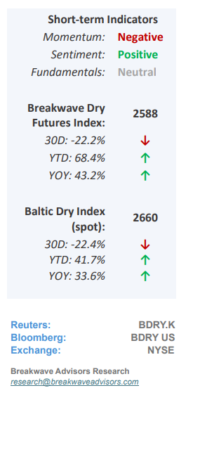
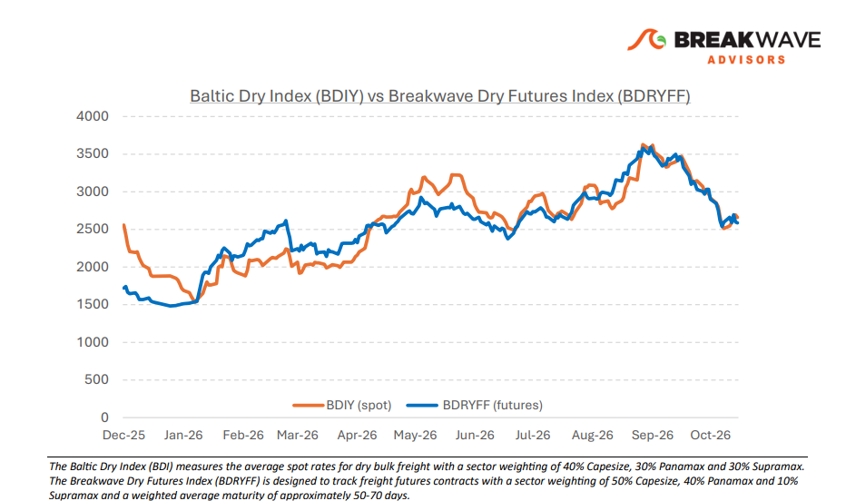
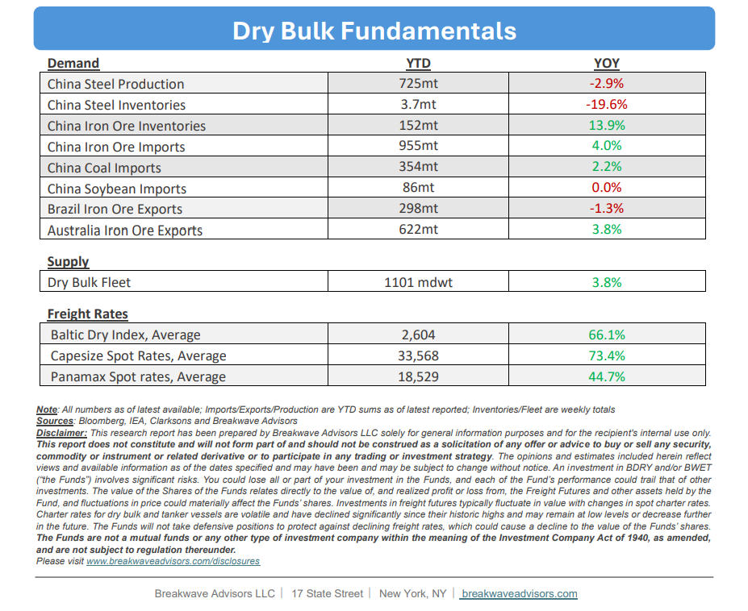

# Breakwave Bi-Weekly Dry Bulk Report - October 27, 2026

**Date:** October 27, 2026  
**Publisher:** Breakwave Advisors | **Category:** Market Insights  
**Original URL:** [https://www.breakwaveadvisors.com/insights/10272026db-reportj47-0o](https://www.breakwaveadvisors.com/insights/10272026db-reportj47-0o)  

---

•**Capesize Spot Index Stabilizes but Risk Remain Abound**– The recent correction in Capesize spot rates appears to have established a floor, with the index stabilizing just below the 30,000 mark after a peak-to-trough decline of over 50%. While freight futures initially tracked this downward movement, front-month contracts are now trading at a premium to the spot index, signaling an anticipated revival in market activity and thus a potential increase in freight rates. This optimism aligns with historical seasonal strength over the next two months, which typically drives rates to annual peaks. However, because the current market baseline is underpinned by geopolitical supply-side constraints rather than structural demand growth, any meaningful upward breakout from these levels will require an incremental influx of physical cargo volumes while the supply side remains constraint. While this demand revival remains highly probable in the near term, ongoing macroeconomic and geopolitical uncertainties continue to pose operational risks, particularly further down the curve, where high contract valuations, especially for the first quarter of next year, face increasing downside risk.

> **Figure 1: Cea3cf84ceb9ceb3cebcceb9cf8ccf84cf85**  
> [Local Asset](assets/2026-10-27_10272026db-reportj47-0o_img_cea3cf84ceb9ceb3cebcceb9cf8ccf84cf85_9d5796b44683.png)

•**Iron Ore Hovers ~$90/ton as Demand Cools, Inventories High**– Despite heightened geopolitical risks over recent months, iron ore prices have exhibited notable stability, with futures market volatility hovering near historic lows. This uncharacteristically quiet period for the historically volatile commodity is primarily driven by a well-supplied global market, stagnant demand growth, and elevated portside inventories in China. While persistent compression in producer margins is expected to eventually curtail seaborne export volumes, a near-term demand acceleration remains unlikely given the flat growth trajectory across global steel markets. Elevated freight rates, sustained by ongoing disruptions in global shipping, continue to exacerbate these producer margin pressures; however, any subsequent normalization in maritime logistics risks bringing structurally weak underlying demand back to the forefront of a market already tilted toward a looser supply balance.

•**Our Long-term View**– The last few years have been characterized by increased geopolitical uncertainty. Going forward, we expect such events to continue to affect global trade and have a meaningful impact on effective vessel supply. Combined with the potential for a multi-year cyclical rebound in China’s economic activity following the recent economic turmoil, dry bulk shipping should experience higher volatility on top of a secular tightness driven by stable bulk commodity demand and rather steady but elevated fleet growth.

> **Figure 2: Στιγμιότυπο Οθόνης 2026 10 27 095415**  
> [Local Asset](assets/2026-10-27_10272026db-reportj47-0o_img_cea3cf84ceb9ceb3cebcceb9cf8ccf84cf85_4e3bc811326f.png)

> **Figure 3: Στιγμιότυπο Οθόνης 2026 10 27 113305**  
> [Local Asset](assets/2026-10-27_10272026db-reportj47-0o_img_cea3cf84ceb9ceb3cebcceb9cf8ccf84cf85_bba293086e02.png)

### Subscribe:
