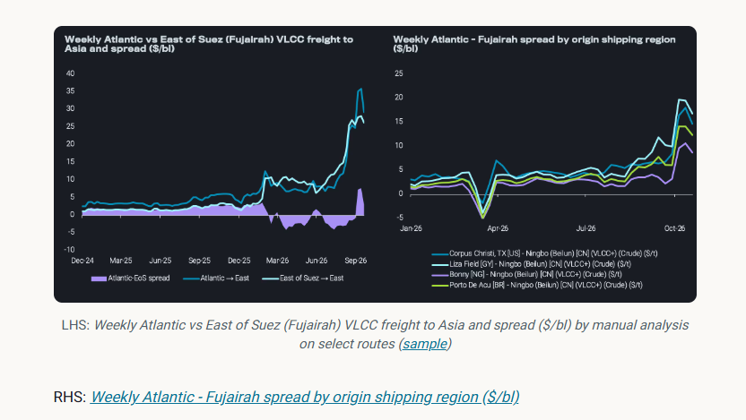
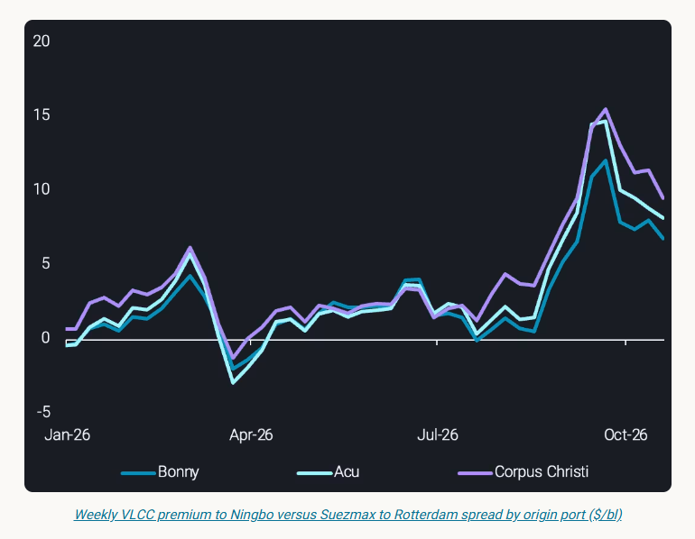
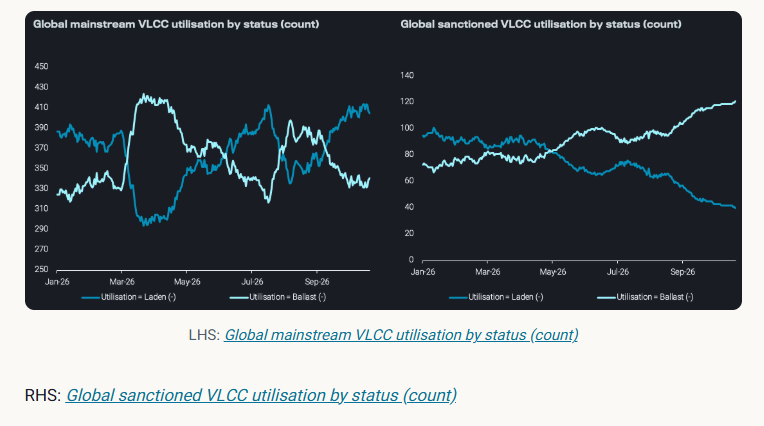
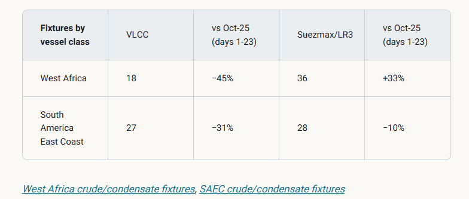
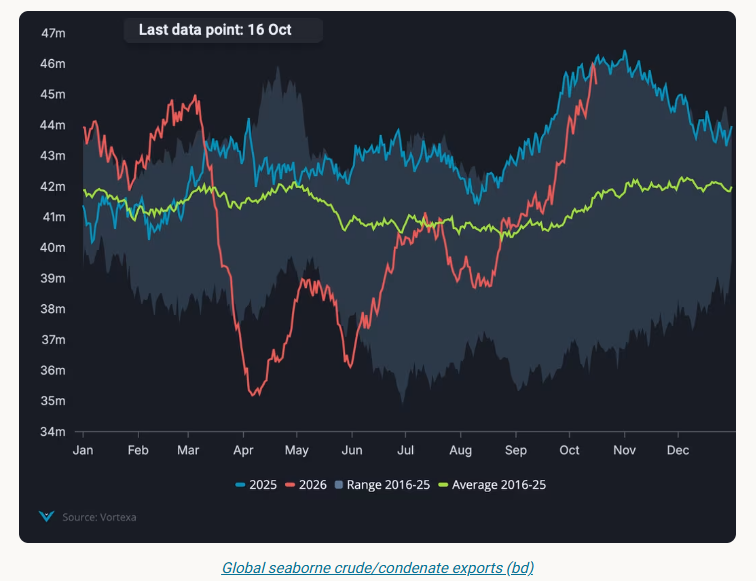

# Is an Atlantic Basin crude glut on the cards?

**Date:** October 28, 2026  
**Publisher:** Breakwave Advisors | **Category:** Market Insights  
**Original URL:** [https://www.breakwaveadvisors.com/insights/2026/10/28/is-an-atlantic-basin-crude-glut-on-the-cards](https://www.breakwaveadvisors.com/insights/2026/10/28/is-an-atlantic-basin-crude-glut-on-the-cards)  

---

Atlantic crude discounts fail to offset high freight to Asia, raising the risk of a regional glut as VLCC availability tightens.

*By*[*George Morris*](https://www.linkedin.com/in/george-d-morris/)

## Freight Erodes Atlantic Crude's Price Advantage for Asian Refiners

Atlantic Basin crude differentials fell to record lows in mid-October (Argus), but discounts have failed to offset the cost of shipping barrels to Asia. VLCC freight to Ningbo costs $8-16/bbl more from Atlantic origins than from Fujairah over the four weeks to Oct 25, versus $1-3/bbl through 2025. Brazilian, Guyanese and West African grades remain expensive to deliver, leaving more crude to compete for buyers in the Atlantic Basin.

Over the past four weeks, the VLCC freight premium to Ningbo ranged from $8/bbl for West Africa to $14.40/bl for the US Gulf, and $16.50/bl for Guyana, all relative to Fujairah. A narrower Brent-Dubai EFS would improve Atlantic Basin crude's relative pricing, but the scale of the freight disadvantage means a significant narrowing would be needed to make Atlantic grades more competitive against Middle Eastern supply.

> **Figure 1: Στιγμιότυπο Οθόνης 2026 10 28 111244**  
> **Interactive Data & Source:** [Analytics Vortexa](https://analytics.vortexa.com/Flows?dateRange=2025-01-01T00%3A00%3A00.000Z__2026-10-16T23%3A59%3A59.999Z&filtersEnabled=%5B%22p%22%2C%22o%22%2C%22d%22%2C%22d_r%22%2C%22v%22%2C%22intra_d%22%2C%22sts_o%22%2C%22c_o%22%2C%22w%22%2C%22v_i%22%2C%22sts%22%2C%22hd%22%5D&frequency=day&from=%5B%2280aa9e4f3014c3d96559c8e642157edbb2b684ea0144ed76cd20b3af75110877%22%5D&fromExcluded=%5B%22d308ddc557e774187ad6c7da81b39db990def9a39e6c88e79cb163b6bdd6e8e5%22%5D&intraMovementDropdown=all&metric=bpd&page=Flows&products=%5B%2254af755a090118dcf9b0724c9a4e9f14745c26165385ffa7f1445bc768f06f11%22%5D&tabId=748ad124-cecc-4484-975c-5c09f3bd5c56&timeSeriesBaselineEnabled=1&timeSeriesBaselineEnd=2024-04-01T10%3A59%3A59.999Z&timeSeriesBaselineStart=2023-01-01T10%3A59%3A59.999Z&timeSeriesChartView=seasonal&timeSeriesHiddenSeries=%5B%22bb70cf56200f5b72ba69a90bda2c6b47ba29da23945c6f1994cfd4c2ef2fe0ff%22%2C%22edb67ef340d7898df010249d0c83731d415edbb3824eb28d8d4d0cdc58b9c5b1%22%5D&timeSeriesProperty=origin_shipping_region_v2&tsAnalysisTotalToggle=1&tsLegendExpanded=1&tsSeasonalMovingAvg=1&tsSeasonalMovingAvgWindow=28d&v=3) | [Local Asset](assets/2026-10-28_is-an-atlantic-basin-crude-glut-on-the-cards_img_cea3cf84ceb9ceb3cebcceb9cf8ccf84cf85_86197629d293.png)

US crude is an outlier however. WTI fob USGC strengthened sharply against other Atlantic grades from mid-October, despite the US Gulf premium to Asia being one of the most expensive against MEG grades. US Gulf-Ningbo VLCC freight fell $7.30/bbl last week, compared with around $6/bbl for Brazil and West Africa. Therefore freight rates have not been a driver of WTI's strong performance.

> **Figure 2: Στιγμιότυπο Οθόνης 2026 10 28 111414**  
> **Interactive Data & Source:** [Analytics Vortexa](https://analytics.vortexa.com/Flows?dateRange=2025-01-01T00%3A00%3A00.000Z__2026-10-16T23%3A59%3A59.999Z&filtersEnabled=%5B%22p%22%2C%22o%22%2C%22d%22%2C%22d_r%22%2C%22v%22%2C%22intra_d%22%2C%22sts_o%22%2C%22c_o%22%2C%22w%22%2C%22v_i%22%2C%22sts%22%2C%22hd%22%5D&frequency=day&from=%5B%2280aa9e4f3014c3d96559c8e642157edbb2b684ea0144ed76cd20b3af75110877%22%5D&fromExcluded=%5B%22d308ddc557e774187ad6c7da81b39db990def9a39e6c88e79cb163b6bdd6e8e5%22%5D&intraMovementDropdown=all&metric=bpd&page=Flows&products=%5B%2254af755a090118dcf9b0724c9a4e9f14745c26165385ffa7f1445bc768f06f11%22%5D&tabId=748ad124-cecc-4484-975c-5c09f3bd5c56&timeSeriesBaselineEnabled=1&timeSeriesBaselineEnd=2024-04-01T10%3A59%3A59.999Z&timeSeriesBaselineStart=2023-01-01T10%3A59%3A59.999Z&timeSeriesChartView=seasonal&timeSeriesHiddenSeries=%5B%22bb70cf56200f5b72ba69a90bda2c6b47ba29da23945c6f1994cfd4c2ef2fe0ff%22%2C%22edb67ef340d7898df010249d0c83731d415edbb3824eb28d8d4d0cdc58b9c5b1%22%5D&timeSeriesProperty=origin_shipping_region_v2&tsAnalysisTotalToggle=1&tsLegendExpanded=1&tsSeasonalMovingAvg=1&tsSeasonalMovingAvgWindow=28d&v=3) | [Local Asset](assets/2026-10-28_is-an-atlantic-basin-crude-glut-on-the-cards_img_cea3cf84ceb9ceb3cebcceb9cf8ccf84cf85_560a7a790751.png)

Lifting a West African, Brazilian or US Gulf cargo east via a VLCC rather than Rotterdam on a Suezmax now costs an additional $8.20/bl on average (w/c 19 Oct), against around $1.50/bl a year ago although it is down from late September peaks. This weaker netback for Asian refiners is keeping more Atlantic crude in the region, with suppliers likely having to compete for European demand ahead.

## Middle East Barrels Have the Advantage in Asia

[Mainstream Middle East seaborne crude/condensate exports](https://analytics.vortexa.com/Flows?dateRange=2025-01-01T00%3A00%3A00.000Z__2026-10-16T23%3A59%3A59.999Z&filtersEnabled=%5B%22p%22%2C%22o%22%2C%22d%22%2C%22d_r%22%2C%22v%22%2C%22intra_d%22%2C%22sts_o%22%2C%22c_o%22%2C%22w%22%2C%22v_i%22%2C%22sts%22%2C%22hd%22%5D&frequency=day&from=%5B%2280aa9e4f3014c3d96559c8e642157edbb2b684ea0144ed76cd20b3af75110877%22%5D&fromExcluded=%5B%22d308ddc557e774187ad6c7da81b39db990def9a39e6c88e79cb163b6bdd6e8e5%22%5D&intraMovementDropdown=all&metric=bpd&page=Flows&products=%5B%2254af755a090118dcf9b0724c9a4e9f14745c26165385ffa7f1445bc768f06f11%22%5D&tabId=748ad124-cecc-4484-975c-5c09f3bd5c56&timeSeriesBaselineEnabled=1&timeSeriesBaselineEnd=2024-04-01T10%3A59%3A59.999Z&timeSeriesBaselineStart=2023-01-01T10%3A59%3A59.999Z&timeSeriesChartView=seasonal&timeSeriesHiddenSeries=%5B%22bb70cf56200f5b72ba69a90bda2c6b47ba29da23945c6f1994cfd4c2ef2fe0ff%22%2C%22edb67ef340d7898df010249d0c83731d415edbb3824eb28d8d4d0cdc58b9c5b1%22%5D&timeSeriesProperty=origin_shipping_region_v2&tsAnalysisTotalToggle=1&tsLegendExpanded=1&tsSeasonalMovingAvg=1&tsSeasonalMovingAvgWindow=28d&v=3)returned to pre-war levels by 1 October, while seaborne crude and condensate exports reached a seasonal high on 14 October, despite vessel attacks reaching a weekly record in the week commencing 28 September.

Pricing is reinforcing the region's advantage as supply returns. Saudi Aramco cut Arab Medium and Heavy official selling prices to Asia to six-year lows in early October (Reuters), while Basrah Medium and Heavy were offered at deep discounts of $34-37.5/bl (Iraqi News).

Over the past four weeks,[Ras Tanura-Ningbo freight](https://analytics.vortexa.com/AnywhereFreightPricing?metric=usd_per_barrel&page=AnywhereFreightPricing&routes=%5B%22f33878a3-8081-4d15-8123-7548eb96e0ef-1%22%2C%22937680be-8909-4719-b5e2-2583cddbd89b-1%22%2C%22ecfc8ff9-a289-4d73-ada0-955cdc48837e-1%22%2C%228014b0a4-5b5f-464a-94fc-bf5ef8f903ae-1%22%2C%228e2aaabd-c358-49a4-8996-8a25bbb28678-1%22%2C%22e32d5898-d9c1-4095-903f-d95c310db087-1%22%2C%2261732f4e-1860-4b90-a124-56c6aa1d9ccf-2%22%2C%22ceb5eb4f-5435-4ff4-a71e-2ad65a0dac6b-1%22%2C%22f53308ba-1544-4087-9a90-a2fc560b8ab7-2%22%2C%2205aab53e-6e8b-4291-8799-e135149a221a-2%22%2C%22f4468405-895c-482c-af59-c1a2cc26f859-2%22%2C%22dc7e24bc-4fea-45d7-bc23-2aea8a81c75b-1%22%2C%224a657b9e-232e-4966-b575-0918f2655a35-1%22%2C%22cd36fb1a-97c9-4631-9131-2651ec23394e-1%22%5D&routesSelected=%5B0%2C1%5D&tabId=1be6410c-1fb2-4c41-905a-3eea2a986e12&timeSeriesDateRange=24-months&timeSeriesFrequency=week)averaged around $12/bbl above[Fujairah-Ningbo](https://analytics.vortexa.com/AnywhereFreightPricing?metric=usd_per_barrel&page=AnywhereFreightPricing&routes=%5B%22f33878a3-8081-4d15-8123-7548eb96e0ef-1%22%2C%22937680be-8909-4719-b5e2-2583cddbd89b-1%22%2C%22ecfc8ff9-a289-4d73-ada0-955cdc48837e-1%22%2C%228014b0a4-5b5f-464a-94fc-bf5ef8f903ae-1%22%2C%228e2aaabd-c358-49a4-8996-8a25bbb28678-1%22%2C%22e32d5898-d9c1-4095-903f-d95c310db087-1%22%2C%2261732f4e-1860-4b90-a124-56c6aa1d9ccf-2%22%2C%22ceb5eb4f-5435-4ff4-a71e-2ad65a0dac6b-1%22%2C%22f53308ba-1544-4087-9a90-a2fc560b8ab7-2%22%2C%2205aab53e-6e8b-4291-8799-e135149a221a-2%22%2C%22f4468405-895c-482c-af59-c1a2cc26f859-2%22%2C%22dc7e24bc-4fea-45d7-bc23-2aea8a81c75b-1%22%2C%224a657b9e-232e-4966-b575-0918f2655a35-1%22%2C%22cd36fb1a-97c9-4631-9131-2651ec23394e-1%22%5D&routesSelected=%5B0%2C1%5D&tabId=1be6410c-1fb2-4c41-905a-3eea2a986e12&timeSeriesDateRange=24-months&timeSeriesFrequency=week)on a VLCC. The difference reflects the additional cost of moving crude from inside the Strait of Hormuz. Cargoes loaded or transferred outside the Strait avoid that leg, giving East of Hormuz supply a key freight advantage over Atlantic barrels.

## The VLCC Shortage Is Concentrated in the Atlantic

Recovering MEG volumes have[drawn VLCC tonnage east](https://analytics.vortexa.com/FleetDistribution?dateRange=2025-01-01T00%3A00%3A00.000Z__2026-10-24T23%3A59%3A59.999Z&filtersEnabled=%5B%22l%22%2C%22v%22%2C%22l_c%22%2C%22o%22%2C%22d%22%2C%22v_v_st%22%2C%22v_f%22%2C%22v_o%22%2C%22v_c%22%2C%22v_a%22%2C%22d_r%22%5D&hiddenSeries=%5B%22total%22%5D&latestProducts=%5B%2254af755a090118dcf9b0724c9a4e9f14745c26165385ffa7f1445bc768f06f11%22%5D&page=FleetDistribution&tabId=d758d2aa-611c-45db-9f36-c3010f2f811d&to=%5B%220427e0f9d52b38c1a98b68c59b8fd80cb1c508e44882e96611e48ef5b140d927%22%5D&v=3&vesselClasses=%5B%22oil_vlcc%22%5D), leaving fewer ships available for Atlantic cargoes.[Ballast VLCCs heading to the Atlantic](https://analytics.vortexa.com/FleetDistribution?dateRange=2025-01-01T00%3A00%3A00.000Z__2026-10-24T23%3A59%3A59.999Z&filtersEnabled=%5B%22l%22%2C%22v%22%2C%22l_c%22%2C%22o%22%2C%22d%22%2C%22v_v_st%22%2C%22v_f%22%2C%22v_o%22%2C%22v_c%22%2C%22v_a%22%2C%22d_r%22%5D&hiddenSeries=%5B%22total%22%5D&latestProducts=%5B%2254af755a090118dcf9b0724c9a4e9f14745c26165385ffa7f1445bc768f06f11%22%5D&location=%5B%2267be333ea46a3cd312e207b05e2c5c4502a9353e39ec81642a93e3b23cc3c10a%22%2C%222d91e099e0a197afc110e4d642a60384f410327eab54755d57730f737efd70e1%22%5D&page=FleetDistribution&tabId=85c137e1-c51b-46f0-9d29-efa9c7350981&to=%5B%2267be333ea46a3cd312e207b05e2c5c4502a9353e39ec81642a93e3b23cc3c10a%22%5D&v=3&vesselClasses=%5B%22oil_vlcc%22%5D)fell to a six-year low on 15 October and remain 30% below the 2025 average. This is the primary driver of the strengthening of VLCC rates in the Atlantic versus in the Middle East -[US Gulf-Ningbo](https://analytics.vortexa.com/AnywhereFreightPricing?page=AnywhereFreightPricing&routes=%5B%223c17c372-6986-4cbc-a516-3d760453396d-1%22%2C%22dc7e24bc-4fea-45d7-bc23-2aea8a81c75b-1%22%2C%224a657b9e-232e-4966-b575-0918f2655a35-1%22%2C%22cd36fb1a-97c9-4631-9131-2651ec23394e-1%22%5D&routesSelected=%5B0%5D&tabId=1be6410c-1fb2-4c41-905a-3eea2a986e12&timeSeriesDateRange=24-months)VLCC freight rates have averaged $35/bl in October (days 1-25), up six-fold y-o-y ($5.80/bl in Oct 2025 days 1-25).

Global mainstream fleet utilisation highlights the tightness in global ballast availability - therefore pushing marginal vessels to swing even more so in favour of employment. Laden VLCC count reached 415 on 15-16 October. The last time the count was that high was November, resulting in a record crude-on-water build. While global mainstream VLCC utilisation remains high in absolute terms, fleet growth has outpaced demand. The total fleet grew 5.7% y-o-y by mid-October versus 2% growth for laden vessels.

> **Figure 3: Στιγμιότυπο Οθόνης 2026 10 28 111524**  
> **Interactive Data & Source:** [Analytics Vortexa](https://analytics.vortexa.com/Fixtures?dateRange=2025-01-01T00%3A00%3A00.000Z__2026-11-30T23%3A59%3A59.999Z&field=laycan_from&filtersEnabled=%5B%22p%22%2C%22o%22%2C%22d%22%2C%22v%22%2C%22g_f%22%2C%22d_r%22%2C%22c%22%2C%22v_o%22%5D&orderDirection=asc&origins=%5B%228ad76c1c935d5a9598fa1b9545b7f6befd12e71fdd814a14e001bdaf99ef0448%22%5D&page=Fixtures&products=%5B%2254af755a090118dcf9b0724c9a4e9f14745c26165385ffa7f1445bc768f06f11%22%5D&sortOrder=laycan_from&tabId=90c9e1a5-bd59-4f16-a0e2-964e934713a8&v=3) | [Local Asset](assets/2026-10-28_is-an-atlantic-basin-crude-glut-on-the-cards_img_cea3cf84ceb9ceb3cebcceb9cf8ccf84cf85_d3bb700e34e1.png)

## Charterers Are Using More Suezmaxes in the South Atlantic

October fixtures (days 1-23) show charterers favouring more available Suezmax supply. Fixtures thus far for West Africa and South America East Coast versus year ago levels:

> **Figure 4: Στιγμιότυπο Οθόνης 2026 10 28 111636**  
> **Interactive Data & Source:** [Analytics Vortexa](https://analytics.vortexa.com/Fixtures?dateRange=2025-01-01T00%3A00%3A00.000Z__2026-11-30T23%3A59%3A59.999Z&field=laycan_from&filtersEnabled=%5B%22p%22%2C%22o%22%2C%22d%22%2C%22v%22%2C%22g_f%22%2C%22d_r%22%2C%22c%22%2C%22v_o%22%5D&orderDirection=asc&origins=%5B%228ad76c1c935d5a9598fa1b9545b7f6befd12e71fdd814a14e001bdaf99ef0448%22%5D&page=Fixtures&products=%5B%2254af755a090118dcf9b0724c9a4e9f14745c26165385ffa7f1445bc768f06f11%22%5D&sortOrder=laycan_from&tabId=90c9e1a5-bd59-4f16-a0e2-964e934713a8&v=3) | [Local Asset](assets/2026-10-28_is-an-atlantic-basin-crude-glut-on-the-cards_img_cea3cf84ceb9ceb3cebcceb9cf8ccf84cf85_1e882b17e861.png)

VLCCs have fallen from around 55% of[West Africa crude/condensate fixtures](https://analytics.vortexa.com/Fixtures?dateRange=2025-01-01T00%3A00%3A00.000Z__2026-11-30T23%3A59%3A59.999Z&field=laycan_from&filtersEnabled=%5B%22p%22%2C%22o%22%2C%22d%22%2C%22v%22%2C%22g_f%22%2C%22d_r%22%2C%22c%22%2C%22v_o%22%5D&orderDirection=asc&origins=%5B%228ad76c1c935d5a9598fa1b9545b7f6befd12e71fdd814a14e001bdaf99ef0448%22%5D&page=Fixtures&products=%5B%2254af755a090118dcf9b0724c9a4e9f14745c26165385ffa7f1445bc768f06f11%22%5D&sortOrder=laycan_from&tabId=90c9e1a5-bd59-4f16-a0e2-964e934713a8&v=3)to approximately 30% since mid-year.[SAEC crude/condensate fixtures](https://analytics.vortexa.com/Fixtures?dateRange=2025-01-01T00%3A00%3A00.000Z__2026-11-30T23%3A59%3A59.999Z&field=laycan_from&filtersEnabled=%5B%22p%22%2C%22o%22%2C%22d%22%2C%22v%22%2C%22g_f%22%2C%22d_r%22%2C%22c%22%2C%22v_o%22%5D&orderDirection=asc&origins=%5B%2211b741e930163dde208cf1ceb7e9b7bf3c5a922dc7af989113bd5c4888cee279%22%5D&page=Fixtures&products=%5B%2254af755a090118dcf9b0724c9a4e9f14745c26165385ffa7f1445bc768f06f11%22%5D&sortOrder=laycan_from&tabId=90c9e1a5-bd59-4f16-a0e2-964e934713a8&v=3)show Guyana has seen a sharper shift, with one VLCC fixture so far in October against 13 a year earlier, while Suezmax fixing has remained steady. West African Suezmax liftings bound for Asia reached a record in the week of 12 October, alongside a record Suezmax premium to VLCC freight on the route.

Despite slower fixing from 11-20 October, forward Suezmax fixtures have risen above norms. By 23 October, 13 West African and 16 SAEC Suezmax fixtures were covering November laycans, versus a 12-month average of around 10, suggesting that Suezmax strength in the South Atlantic is likely to continue ahead.

## Freight Correction Could Ease Pressure on Differentials

Global VLCC freight rates have dropped off from recent highs, and the Atlantic premium is narrowing too. The Atlantic-Asia VLCC basket fell 18% in the w/c 19 Oct, against a 7% decline East of Suez. Atlantic-bound VLCC ballasters have risen 10% from the 15 October low, while 10 of the first 12 November West Africa-Asia fixtures were booked on VLCCs. Hence, whilst Suezmax strength is likely to continue based upon fixtures, VLCC availability in the Atlantic is also signalling improvement. A sustained return of tonnage would ease freight and improve Atlantic crude's competitiveness, with West African grades potentially benefiting first given their smaller freight penalty.

Sanctions relief could add some capacity, although much of the OFAC-listed dirty fleet is also subject to UK or EU sanctions, is Iran-linked or consists of older vessels. Re-entry would likely be gradual, if at all, given the application process required to release OFAC-blocked funds. Meanwhile, pipeline alternatives and national oil company shuttle fleets are helping MEG exports withstand disruption, limiting the likelihood that Atlantic crude can rely on another supply shock to regain Asian market share.

The risk is that crude supply outpaces freight availability. Global seaborne crude/condensate liftings are back near 2025 peaks, with oil on water approaching last year's highs.

> **Figure 5: Στιγμιότυπο Οθόνης 2026 10 28 111724**  
> **Interactive Data & Source:** [Vortexa](https://www.vortexa.com//oil-gas-data-traders-analysts-data-scientists?gclid=Cj0KCQjw8_qRBhCXARIsAE2AtRZKOvMnbilZ_6_91d7huSFFy71pWLrnPwGwOHVzXsmsG-1a1mZnQw8aAt89EALw_wcB&hsa_acc=1782073842&hsa_ad=548425387665&hsa_cam=14746637662&hsa_grp=125038601902&hsa_kw=&hsa_mt=&hsa_net=adwords&hsa_src=g&hsa_tgt=dsa-1431852288425&hsa_ver=3&utm_campaign=%5BCD%5D%20-%20DSA%20-%20EMEA&utm_medium=cpc&utm_medium=ppc&utm_source=google&utm_source=adwords&utm_term=) | [Local Asset](assets/2026-10-28_is-an-atlantic-basin-crude-glut-on-the-cards_img_cea3cf84ceb9ceb3cebcceb9cf8ccf84cf85_8429a2df574d.png)

If freight remains elevated while MEG exports hold up, unsold Atlantic cargoes could accumulate on the water and add to European crude stocks. Further discounting may be needed until more VLCC tonnage returns to the Atlantic.

Data Source:[Vortexa](https://www.vortexa.com//oil-gas-data-traders-analysts-data-scientists?gclid=Cj0KCQjw8_qRBhCXARIsAE2AtRZKOvMnbilZ_6_91d7huSFFy71pWLrnPwGwOHVzXsmsG-1a1mZnQw8aAt89EALw_wcB&hsa_acc=1782073842&hsa_ad=548425387665&hsa_cam=14746637662&hsa_grp=125038601902&hsa_kw=&hsa_mt=&hsa_net=adwords&hsa_src=g&hsa_tgt=dsa-1431852288425&hsa_ver=3&utm_campaign=%5BCD%5D%20-%20DSA%20-%20EMEA&utm_medium=cpc&utm_medium=ppc&utm_source=google&utm_source=adwords&utm_term=)

---

**Tags:** Tankers, Crude, Markets  
