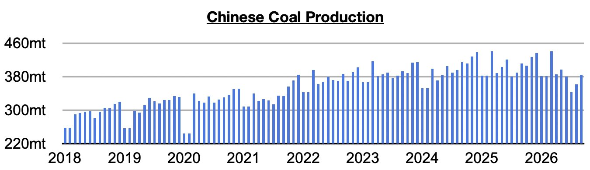
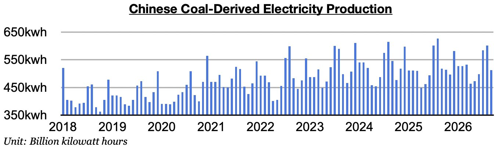
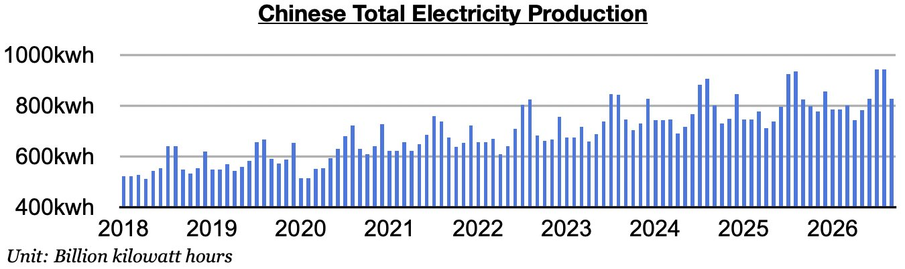
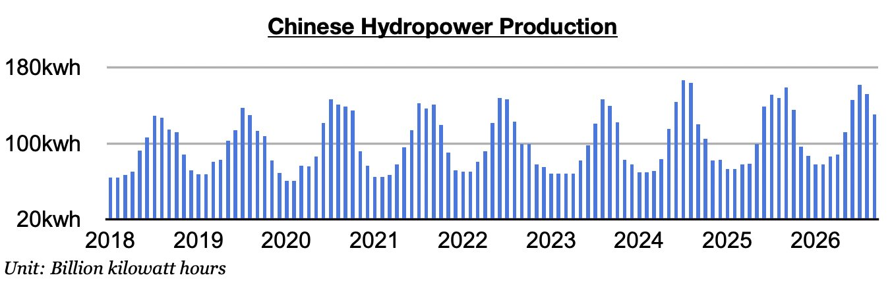

# Dry Bulk's Hydropower & Coal Mining Saviors in China

**Date:** October 29, 2026  
**Publisher:** Breakwave Advisors | **Category:** Market Insights  
**Original URL:** [https://www.breakwaveadvisors.com/insights/2026/10/29/dry-bulks-hydropower-amp-coal-mining-saviors-in-china](https://www.breakwaveadvisors.com/insights/2026/10/29/dry-bulks-hydropower-amp-coal-mining-saviors-in-china)  

---

*By*[*Jeffrey Landsberg*](https://www.linkedin.com/in/jeffrey-landsberg-70ab957/)

As we discussed in Commodore Research's most recent Weekly Executive Report, China’s coal production totaled 385.1 million tons in September. This is up month-on-month by 23.3 million tons (6%) but down year-on-year by 26.4 million tons (-6%). Remaining very significant is that the last time that there was any year-on-year growth was back in June 2025. Prior to the current fifteen-month period of contraction, China's coal production had grown on a year-on-year basis for thirteen straight months.

> **Figure 1: Chart 1**  
> [Local Asset](assets/2026-10-29_dry-bulks-hydropower-amp-coal-mining-saviors-in-china_img_chart1_60705e16e011.jpg)

Coal-derived electricity generation totaled 512.9 billion kilowatt hours. This is down month-on-month by 89.1 billion kilowatt hours (-15%) and down year-on-year by 4.6 billion kilowatt hours (-1%). Very helpful for coal import demand and the dry bulk market is that China's coal-derived electricity generation has now fared better than coal production for nine straight months. A troubling thought remains:**where would the dry bulk market be if coal production was not in contraction?**

> **Figure 2: Chart 2**  
> [Local Asset](assets/2026-10-29_dry-bulks-hydropower-amp-coal-mining-saviors-in-china_img_chart2_4d0bebbdf284.jpg)

Total electricity production came in at 829.4 billion kilowatt hours. This is down month-on-month by 114.4 billion kilowatt hours (-12%) and up year-on-year by only 3.2 billion kilowatt hours (0.5%). China’s consumer market remains weak and the overall economy remains in a recession. It is not at all surprising that electricity production has recently experienced such low growth. Coal-derived electricity generation would have contracted on a year-on-year basis again last month if hydropower output did not suddenly contract.

> **Figure 3: Chart 3**  
> [Local Asset](assets/2026-10-29_dry-bulks-hydropower-amp-coal-mining-saviors-in-china_img_chart3_16c4cbd34a73.jpg)

Hydropower output totaled 130.5 billion kilowatt hours. This is down month-on-month by 21.7 billion kilowatt hours (-14%) and down year-on-year by 28.4 billion kilowatt hours (-18%). Rainfall has been lower than usual in the south and west. Previously, hydropower output had increased year-on-year for twelve straight months.

> **Figure 4: Chart 4**  
> [Local Asset](assets/2026-10-29_dry-bulks-hydropower-amp-coal-mining-saviors-in-china_img_chart4_5332902d3e0a.jpg)

---

**Tags:** Coal, Drybulk, China  
