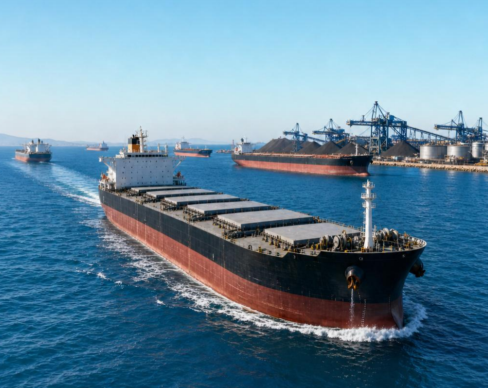
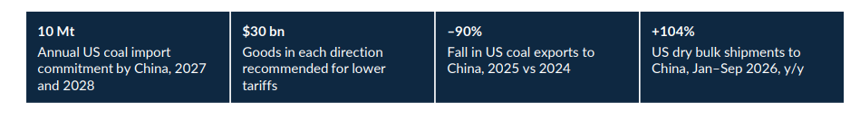
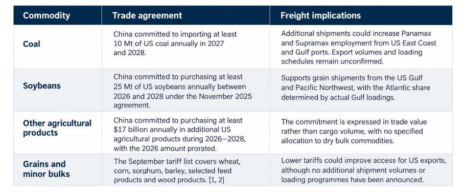

# US–China Commodity Trade and the Atlantic Freight Outlook

**Date:** October 29, 2026  
**Publisher:** Breakwave Advisors | **Category:** Market Insights  
**Original URL:** [https://www.breakwaveadvisors.com/insights/2026/10/29/uschina-commodity-trade-and-the-atlantic-freight-outlook](https://www.breakwaveadvisors.com/insights/2026/10/29/uschina-commodity-trade-and-the-atlantic-freight-outlook)  

---

> **Figure 1: Cea3cf84ceb9ceb3cebcceb9cf8ccf84cf85**  
> [Local Asset](assets/2026-10-29_uschina-commodity-trade-and-the-atlantic-freight-outlook_img_cea3cf84ceb9ceb3cebcceb9cf8ccf84cf85_6bcd443af080.png)

Coal, grain and minor bulk prospects, 2026–2028

This week's Allied Quantumsea Research reviews the latest developments in US–China commodity trade relations and their implications for dry bulk freight markets. The report examines how recent trade agreements and purchasing commitments could reshape coal, grain and minor bulk flows, with particular attention to the potential for stronger Atlantic vessel employment.

Key Takeaways

• Coal: The commitment for China to import at least 10 Mt of US coal annually in 2027 and 2028 could increase long-haul shipments from US Atlantic and Gulf ports, which have historically handled the majority of US coal exports.

• Grain: US soybean shipments to China have recovered in 2026, with recent Pacific Northwest loadings exceeding those from the US Gulf. The freight impact will depend on the distribution of future shipments between the two export regions.

• Trade policy: The September US–China tariff framework remains subject to implementation. Effective dates and product-specific tariff reductions have not yet been confirmed.

• Freight outlook: Additional US coal shipments from 2027 would support Atlantic Panamax and Supramax employment, particularly if Chinese purchases generate new export volumes rather than redirect existing US coal cargoes from other destinations.

> **Figure 2: Στιγμιότυπο Οθόνης 2026 10 29 095047**  
> [Local Asset](assets/2026-10-29_uschina-commodity-trade-and-the-atlantic-freight-outlook_img_cea3cf84ceb9ceb3cebcceb9cf8ccf84cf85_cf2944030291.png)

### What the Agreements Establish

Under the new US–China Board of Trade, the two governments have recommended more favourable tariff treatment for approximately $30 billion of non-sensitive goods in each direction, measured against 2024 trade. USTR states that the US side covers about 30% of US exports to China. China's Ministry of Commerce states that more than 90% of covered products would return to most-favoured-nation treatment once additional bilateral duties are removed, with implementation conditional on domestic legal procedures and simultaneous action by both sides. The broader trade truce has been extended by two months, from 10 November 2026 to 10 January 2027.

> **Figure 3: Στιγμιότυπο Οθόνης 2026 10 29 095057**  
> [Local Asset](assets/2026-10-29_uschina-commodity-trade-and-the-atlantic-freight-outlook_img_cea3cf84ceb9ceb3cebcceb9cf8ccf84cf85_8d4b4aa66eb9.png)

### Coal Offers the Clearest Atlantic Exposure

China's commitment to import at least 10 million metric tonnes of US coal in each of 2027 and 2028 follows a sharp contraction in bilateral trade. US coal exports to China fell 92% in 2025 compared with 2024, according to the US Energy Information Administration. BIMCO reports a 44% year-on-year increase in US coal shipments to China during January–September 2026, although volumes remained 77% below the corresponding 2024 level. The 2027 commitment sets a purchase target, not a confirmed loading programme.

China's customs figures underline the competition facing US suppliers. September coal imports totalled 43.37 million tonnes, down 6% year on year. Imports from Australia rose 56% to 9.81 million tonnes, while those from Indonesia fell 32% to 14.62 million tonnes and Russian shipments increased 39% to 9.43 million tonnes. China's January–September coal imports reached 353.54 million tonnes, up 2.2% year on year. Reuters attributed the September decline in part to high inventories and Indonesian supply constraints.

For freight, the most direct exposure is in Panamax and Kamsarmax employment from US East Coast and Gulf loading areas. A shift in China's purchases from nearer Pacific suppliers to US Atlantic cargoes would increase sailing time and tonne-miles per shipment. BIMCO estimates that US–China coal voyages are approximately four times the average distance of China's coal imports. This is a comparative industry estimate, not a verified nautical-mile distance for a named port pair. The exact voyage depends on the origin, Chinese discharge port and routing.

The size of any Atlantic gain will depend on the actual loading coast, coal grade and the extent to which shipments represent additional US exports rather than cargoes diverted from existing customers. The agreement does not allocate the 10 million tonnes between thermal and metallurgical coal or specify vessel nominations. It therefore supports a potential increase in long-haul Atlantic employment from 2027 but does not yet establish a measurable uplift in freight rates.

### Grain Recovery Supports Both Basins

US dry bulk shipments to China increased 104% year on year during January–September 2026, led by a 176% rise in grain shipments, according to BIMCO. The recovery follows the decline in bilateral trade during 2025 and has been particularly relevant for Panamax employment, with this vessel segment accounting for 68% of US dry bulk volumes shipped to China during the period.

The distribution of US grain exports between the Gulf and Pacific Northwest remains important for freight demand. Panama Canal restrictions have affected Gulf shipments to Asia, with USDA reporting that 24 China-bound soybean vessels carrying approximately 1.6 Mt, inspected at Mississippi Gulf terminals between 4 and 24 September, were routing via the Cape of Good Hope. These longer voyages increase vessel employment days and tonnemile demand, although the additional sailing distance and associated costs affect the competitiveness of Gulf exports relative to Pacific Northwest shipments.

For Atlantic freight, the impact depends on whether additional US Gulf cargoes supplement or replace South American grain shipments. Higher Gulf loadings would increase demand for Panamax and Kamsarmax vessels in the Atlantic, while additional Pacific Northwest exports would primarily support Pacific employment. A shift in Chinese purchases from Brazil or Argentina towards US origins would change vessel deployment and voyage distances, but would not necessarily increase total Atlantic cargo volumes.

### Freight Market Assessment & Outlook

The recovery in US–China commodity trade is creating additional opportunities for dry bulk shipping, with the Atlantic market particularly exposed to developments in US coal and Gulf grain exports. The extent of the freight impact will depend on whether new shipments increase overall cargo demand or redirect volumes from existing trade routes. For Panamax and Supramax vessels, the main consideration is the balance between additional cargo volumes, longer voyage durations and available tonnage. Higher US Atlantic loadings could increase vessel employment, although a sustained improvement in freight rates would require sufficient cargo demand to absorb incoming ballast tonnage. Looking ahead, attention will turn to the implementation of the September tariff framework, the allocation of China's 2027 coal purchases across US export terminals and the pace of soybean loadings from the US Gulf relative to the Pacific Northwest. Brazilian and Argentine grain exports during the 2027 harvest will also influence Atlantic cargo availability, while developments in US port-fee policy and the January trade-truce deadline remain relevant to vessel deployment. The coming months will provide a clearer indication of whether renewed US–China trade translates into additional Atlantic cargo demand or primarily changes the geographical distribution of existing seaborne flows.

---

**Tags:** Drybulk, China, Commodities  
