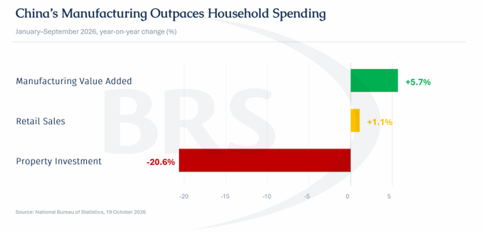
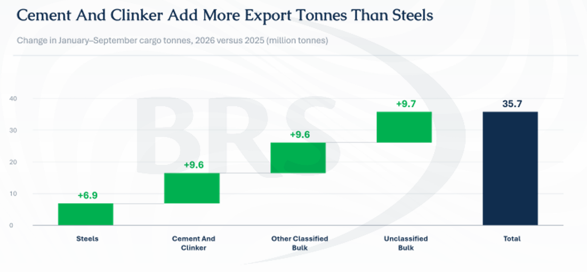
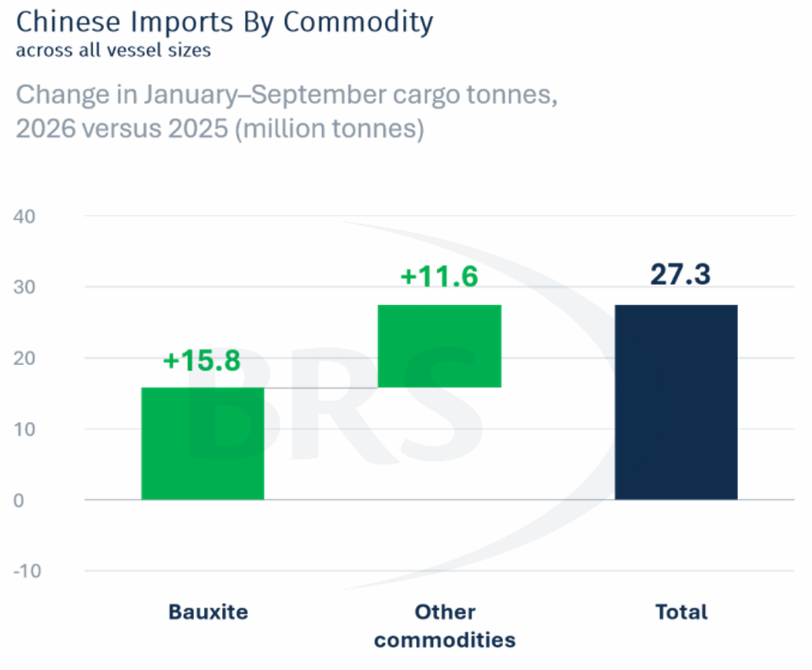
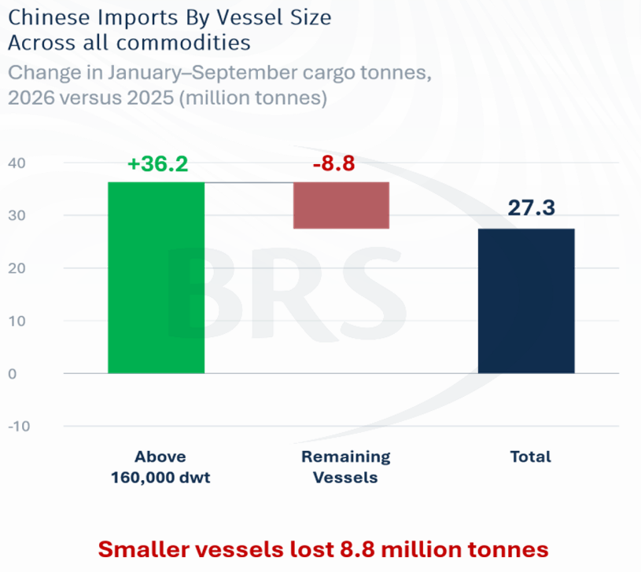

# China Shock 2.0: Rethinking Its Role in Dry Bulk

**Date:** November 02, 2026  
**Publisher:** Breakwave Advisors | **Category:** Market Insights  
**Original URL:** [https://www.breakwaveadvisors.com/insights/2026/11/2/china-shock-20-rethinking-its-role-in-dry-bulk](https://www.breakwaveadvisors.com/insights/2026/11/2/china-shock-20-rethinking-its-role-in-dry-bulk)  

---

> **Figure 1: Rgb Color Brs Shipbrokers Monogram L**  
> [Local Asset](assets/2026-11-02_china-shock-20-rethinking-its-role-in-dry-bulk_img_rgb-color-brs-shipbrokers-monogram-l_c365f35f1de5.png)

China’s role in dry bulk shipping needs reassessing. Property development, infrastructure and rising consumption once provided a broad foundation for raw-material imports. Today, the debate over “China Shock 2.0” reflects two interpretations: an external view emphasising excess production and weak domestic demand, and Beijing’s view emphasising competitiveness and industrial upgrading. For shipping, both point towards the same question: as China’s production increasingly serves overseas markets, how does demand shift between inbound raw materials and outbound industrial cargoes?

The economic imbalance is increasingly visible. According to the National Bureau of Statistics (NBS), manufacturing value added rose 5.7% in the first nine months of 2026, while retail sales increased by just 1.1% and property investment fell by 20.6%. The NBS acknowledged that “the issue of insufficient domestic demand remains prominent”. Production and domestic spending are following different paths, creating conditions in which subdued import growth can coexist with expanding exports.

> **Figure 2: 2 Tow 1**  
> [Local Asset](assets/2026-11-02_china-shock-20-rethinking-its-role-in-dry-bulk_img_2tow1_1192e000532b.png)

AXSMarine data show this divergence clearly. Across January–September loadings, Chinese imports increased by 1.6% to 1.74 billion tonnes, while exports rose 18.5% to 229.3 mln mt. Thereby demonstrating that on an absolute basis, exports rose by a larger increment (35.7 mln mt) than imports (27.3 mln mt ). Compared with the same period in 2024, exports were 40.3% higher, against only 1.9% growth in imports. China remains overwhelmingly an import market, but its incremental contribution to dry bulk shipping is rapidly becoming more outward-facing.

Construction weakness helps explain why. When domestic demand falls faster than production adjusts, producers have greater incentive to sell overseas. The broader steels category reached 91.3 mln mt, up 8.1%, but contributed only 19% of this year’s export increase. Cement and clinker together added 9.6 mln mt - more than the 6.9 mln mt increase in steel. This connection is supported by China Shanshui Cement’s interim report, which explicitly links overseas expansion to insufficient domestic cement demand. For shipping, weak Chinese construction can therefore generate additional outbound cargoes even while undermining the traditional domestic demand base.

> **Figure 3: 3 Tow 2**  
> [Local Asset](assets/2026-11-02_china-shock-20-rethinking-its-role-in-dry-bulk_img_3tow2_950d80534677.png)

The benefit is particularly visible in the smaller vessel segments. Chinese exports carried by geared bulkers (25-68,000 Dwt) increased by 25.1 mln mt, more than offsetting an 11.2 mln mt decline in their Chinese import cargoes. Their combined inbound and outbound volume consequently rose 3.6%. Export employment is helping compensate for weaker inbound business, although the balance depends on destinations, voyage duration and positioning. Steel exports also provide an outlet for production that consumes imported ore: iron ore imports rose 1.3% despite the property downturn.

> **Figure 4: 4 Tow 3**  
> [Local Asset](assets/2026-11-02_china-shock-20-rethinking-its-role-in-dry-bulk_img_4tow3_97526768a46d.png)

> **Figure 5: Στιγμιότυπο Οθόνης 2026 11 02 182007**  
> [Local Asset](assets/2026-11-02_china-shock-20-rethinking-its-role-in-dry-bulk_img_cea3cf84ceb9ceb3cebcceb9cf8ccf84cf85_cee32912057d.png)

Bauxite explains much of the resilience at the larger end. For the first nine months of 2026, bauxite imports reached 178.5 mln mt, up 9.7%, accounting for 58% of China’s total import increase. Excluding bauxite, imports grew just 0.7% and remained 1.3% below 2024. The link to industrial upgrading runs through aluminium demand and the refining chain. New alumina capacity increasingly uses imported bauxite, while imported ore can also be substituted for domestic supply. Consequently, bauxite shipments need not move in proportion to either property activity or final aluminium consumption.

> **Figure 6: 5 Tow 4**  
> [Local Asset](assets/2026-11-02_china-shock-20-rethinking-its-role-in-dry-bulk_img_5tow4_b88ab60107f5.png)

That growth is also becoming more concentrated. Vessels above 160,000 dwt carried 83% of Chinese bauxite imports, compared with 78% last year, while Guinea supplied 81% of the total. Across all commodities, imports on vessels above 160,000 dwt increased by 36.2 mln mt, while the remainder declined by 8.8 mln mt. The headline import increase therefore masks a contraction outside the largest ships. For Capesize owners, this is support increasingly tied to a particular industrial chain and a concentrated, long-haul supply route.

Agricultural cargoes face a different adjustment. Weak household spending and an ageing population challenge the assumption that rising meat consumption will continually lift feed imports. However, declining pork consumption does not imply declining demand for every animal protein. China’s official agricultural outlook envisages lower pork consumption alongside higher poultry consumption. Feed efficiency and policies reducing soybean-meal inclusion provide additional routes to restraining import requirements. The more defensible conclusion is weaker structural growth potential, rather than an inevitable collapse in soybean demand.

The shipment figures require similar care. Soybean imports slipped 0.9% to 88.1 mln mt, but remained above 2024. Corn and wheat imports actually recovered by 47.6% and 16.7% respectively from their depressed 2025 levels, although they remained 46.9% and 58.1% below 2024. That lower base is consistent with Beijing’s drive to strengthen domestic food supply. For Panamax demand, a US–China purchase agreement could change suppliers, loading seasons and stockbuilding without creating equivalent growth in underlying feed consumption. The freight effect depends on what those purchases replace.

Export access is the next constraint. Bloomberg’s recent report that Germany would seek broader EU safeguards illustrates how resistance can spread beyond individual products These were proposed measures, but the commercial implication is clear: foreign markets may become less willing to absorb China’s surplus output. Importing countries face different incentives, however. Cheap cement and steel benefit construction users, while competing domestic producers have reasons to seek protection. The resulting trade pattern is likely to vary by commodity and destination.

For bauxite, protection against Chinese EV exports is a possible longer-term headwind, rather than a direct ceiling on demand. The effect would reach shipping if restrictions reduced China-based vehicle production and aluminium consumption, without sufficient offset elsewhere. Diversion to other markets, domestic sales and other aluminium uses could soften that effect. Similarly, Chinese steel exports may support Chinese ore imports while displacing steel production - and raw-material demand -abroad. Additional Chinese cargoes are therefore not automatically additional global shipping demand.

For 2027, the distinction is increasingly between cargo chains. Capesize exposure depends more on imported-ore refining, bauxite supply and industrial output; Panamax exposure requires closer attention to food policy and procurement; geared employment increasingly includes exports generated by domestic oversupply. Their durability differs. Each owner’s assessment of these changes - and willingness to accept concentration, policy and trade risks - will filter into the next investment decision, from vessel size and employment strategy to the price paid for future earnings.

---

**Tags:** Drybulk, China, Shipping  
