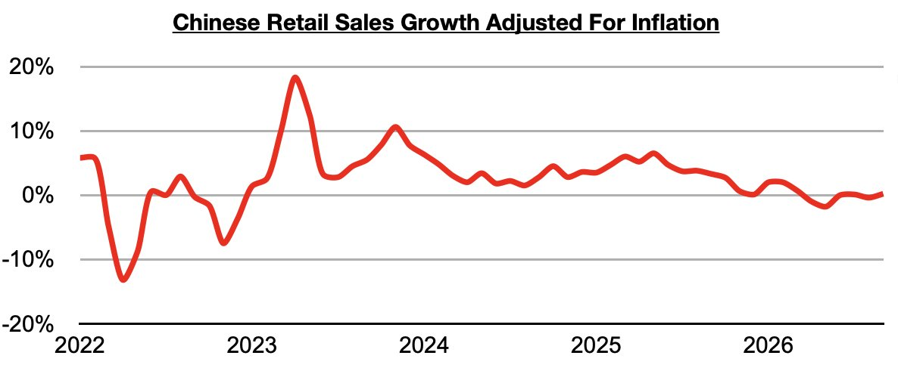
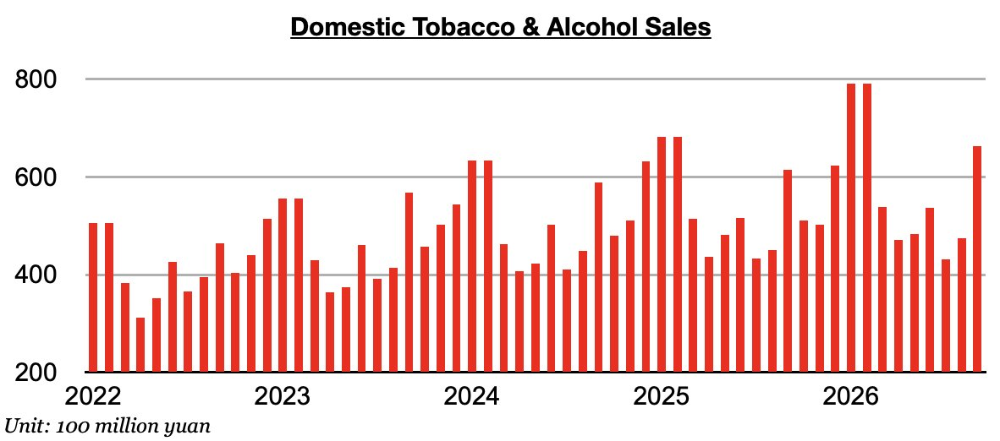
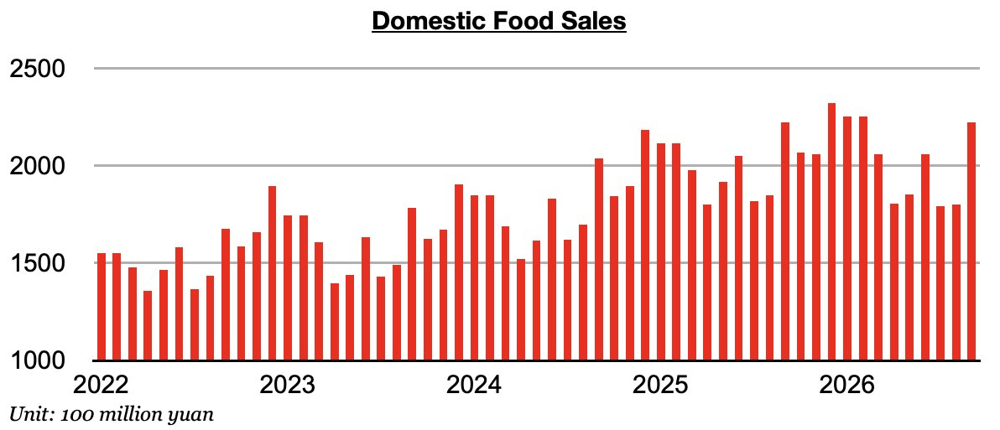
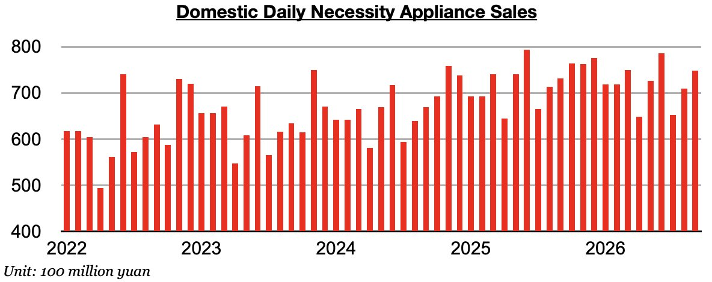

# Improvement, But Recession Continues in China

**Date:** November 02, 2026  
**Publisher:** Breakwave Advisors | **Category:** Market Insights  
**Original URL:** [https://www.breakwaveadvisors.com/insights/2026/11/2/improvement-but-recession-continues-in-china](https://www.breakwaveadvisors.com/insights/2026/11/2/improvement-but-recession-continues-in-china)  

---

*By*[*Jeffrey Landsberg*](https://www.linkedin.com/in/jeffrey-landsberg-70ab957/)

As we discussed in Commodore Research's most recent Weekly China Report, China's retail sales in September grew year-on-year by 1.1%. Taking September’s 0.9% inflation into account, China's retail sales adjusted for inflation achieved increased year-on-year by 0.2%. This is an improvement. Previously, inflation had exceeded retail sales growth in three of the prior five months.

> **Figure 1: Chart 1**  
> [Local Asset](assets/2026-11-02_improvement-but-recession-continues-in-china_img_chart1_54eac4bae376.jpg)

As we discussed in our last update a month ago, every consumer sales category that we monitor contracted on a year-on-year basis in August except for tobacco and alcohol. In September, tobacco and alcohol again grew on a year-on-year basis.

> **Figure 2: Chart 2**  
> [Local Asset](assets/2026-11-02_improvement-but-recession-continues-in-china_img_chart2_d8cf4f889009.jpg)

New in September, food sales and daily necessity sales shifted and both managed to increase year-on-year. Previously, food sales had contracted in three of the prior four months.

> **Figure 3: Chart 3**  
> [Local Asset](assets/2026-11-02_improvement-but-recession-continues-in-china_img_chart3_c09674346197.jpg)

Daily necessity sales had previously contracted on a year-on-year basis for four straight months.

> **Figure 4: Chart 4**  
> [Local Asset](assets/2026-11-02_improvement-but-recession-continues-in-china_img_chart4_d403315aa26b.jpg)

---

**Tags:** China, Markets, Economy  
