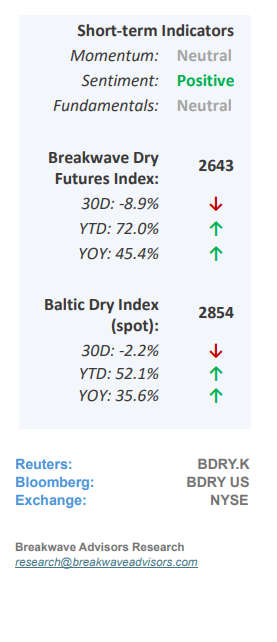
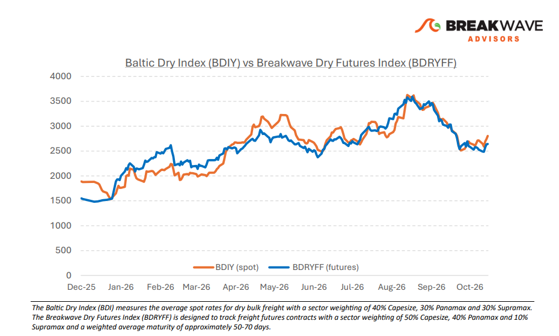
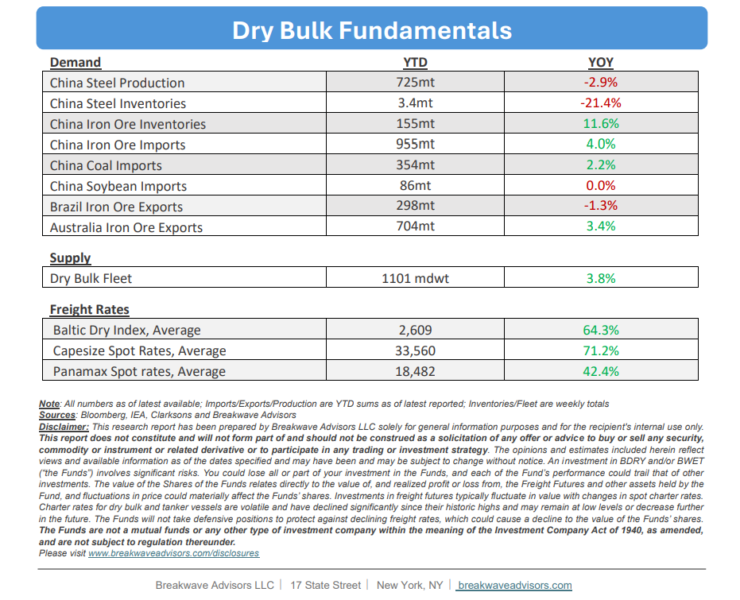

# Breakwave Bi-Weekly Dry Bulk Report - November 10, 2026

**Date:** November 10, 2026  
**Publisher:** Breakwave Advisors | **Category:** Market Insights  
**Original URL:** [https://www.breakwaveadvisors.com/insights/10272026db-reportj47-0o-kes3e](https://www.breakwaveadvisors.com/insights/10272026db-reportj47-0o-kes3e)  

---

•**Capesize Spot Rates Back Above 30,000 as Seasonality Kicks In**– Although November has traditionally served as a strong period for dry bulk shipping, the recent recovery in spot rates actually commenced earlier than usual in mid-October, defying historical trends that typically point to late-month softness. Looking ahead, we anticipate sustained strength across the spot market for the remainder of November. This bullish momentum is further reflected in the futures curve, where December contracts are once again rallying toward the 40,000 mark and firstquarter pricing remains historically elevated. However, while market participants appear to be discounting traditional seasonality, we caution that the broader riskreward profile remains skewed to the downside as we enter the New Year. This vulnerability is driven by ongoing geopolitical uncertainties alongside unpredictable winter weather conditions, which present a critical industry-specific risk. Nevertheless, the dry bulk segment has demonstrated notable resilience amid recent geopolitical turmoil, maintaining far lower volatility than the frantic tanker sector. Ultimately, despite a robust newbuilding delivery schedule and negligible scrapping activity, tight supply-demand dynamics continue to support freight rates at highly profitable levels.

> **Figure 1: Cea3cf84ceb9ceb3cebcceb9cf8ccf84cf85**  
> [Local Asset](assets/2026-11-10_10272026db-reportj47-0o-kes3e_img_cea3cf84ceb9ceb3cebcceb9cf8ccf84cf85_9b8be4b7b541.png)

•**Iron Ore Bounced Off Multi-Year Lows but Remains Under Pressure**– Iron ore, the primary commodity driving dry bulk shipping, remains under sustained pressure as futures prices recently fell below $90 per ton to levels last seen in 2024. Although optimism surrounding China’s economic growth trajectory sparked a brief technical recovery, underlying market fundamentals remain weak, with expanding supply and stagnant demand pointing toward renewed downward pressure. Consequently, these depressed prices threaten to squeeze profit margins for smaller, higher-cost miners, potentially curtailing marginal export volumes and further dampening overall dry bulk vessel utilization. This compounding supply-demand imbalance suggests that freight rates, particularly within the Capesize and Panamax segments, will likely face continued headwinds over the coming year unless structural demand from major steel-producing nations, especially China, sees a sustained revival.

•**Our Long-term View**– The last few years have been characterized by increased geopolitical uncertainty. Going forward, we expect such events to continue to affect global trade and have a meaningful impact on effective vessel supply. Combined with the potential for a multi-year cyclical rebound in China’s economic activity following the recent economic turmoil, dry bulk shipping should experience higher volatility on top of a secular tightness driven by stable bulk commodity demand and rather steady but elevated fleet growth.

> **Figure 2: Στιγμιότυπο Οθόνης 2026 11 09 200045**  
> [Local Asset](assets/2026-11-10_10272026db-reportj47-0o-kes3e_img_cea3cf84ceb9ceb3cebcceb9cf8ccf84cf85_c1f8fde0de25.png)

> **Figure 3: Στιγμιότυπο Οθόνης 2026 11 09 200110**  
> [Local Asset](assets/2026-11-10_10272026db-reportj47-0o-kes3e_img_cea3cf84ceb9ceb3cebcceb9cf8ccf84cf85_4ee0b648605f.png)

### Subscribe:
