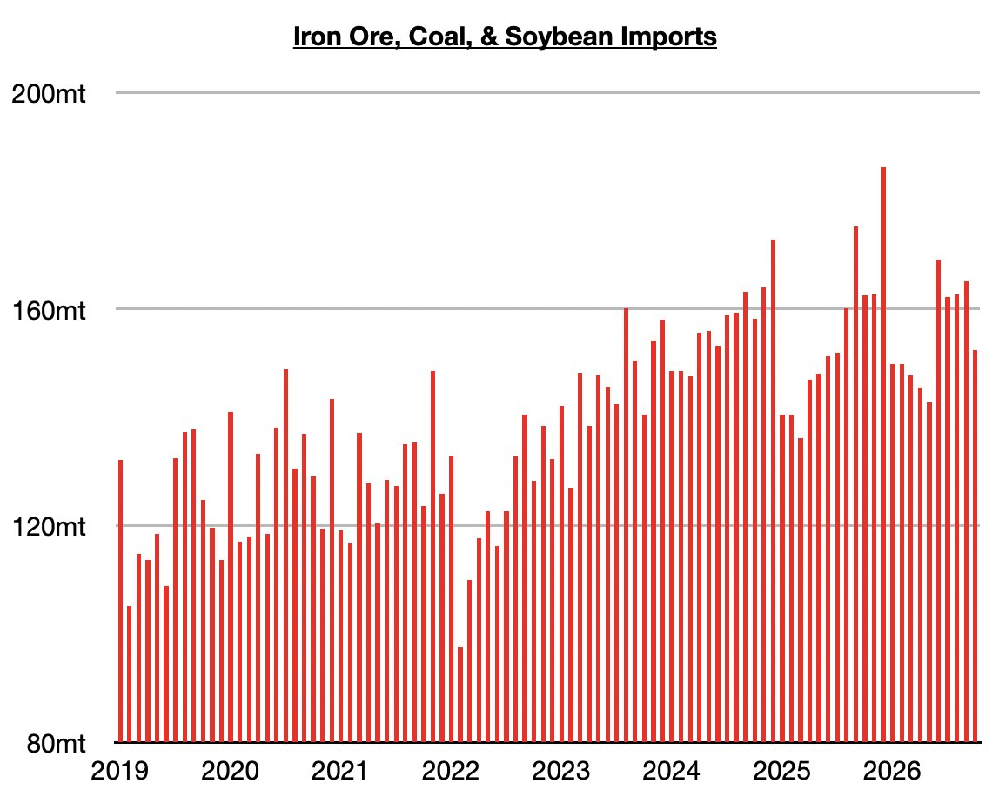

# Another Contraction in China's Dry Bulk Imports

**Date:** November 11, 2026  
**Publisher:** Breakwave Advisors | **Category:** Market Insights  
**Original URL:** [https://www.breakwaveadvisors.com/insights/2026/11/11/another-contraction-in-chinas-dry-bulk-imports](https://www.breakwaveadvisors.com/insights/2026/11/11/another-contraction-in-chinas-dry-bulk-imports)  

---

*By*[*Jeffrey Landsberg*](https://www.linkedin.com/in/jeffrey-landsberg-70ab957/)

As we discussed in Commodore Research's most recent Weekly China Report, coal, iron ore, and soybean imports in October collectively totaled 152.5 million tons. This is down by 12.6 million tons (-8%) from September and down year-on-year by 10 million tons (-6%). Imports have now contracted on a year-on-year basis for two straight months. September's totals came in 18% below December's peak. However, volumes are still relatively high.

> **Figure 1: Chart**  
> [Local Asset](assets/2026-11-11_another-contraction-in-chinas-dry-bulk-imports_img_chart_a78c76c78fdc.jpg)

Iron ore imports totaled 105.7 million tons. This is down by 4.1 million tons (-4%) from September and down year-on-year by 5.6 million tons (-5%). Iron ore imports are coming under pressure due primarily from recent cuts in global iron ore production. Coal imports totaled 39.4 million tons. This is down by 4 million tons (-9%) from September and down year-on-year by 2.3 million tons (-6%). China's coal imports have fallen as both steel output (affecting coking coal imports) and coal-derived electricity generation (affecting thermal coal imports) remain in year-on-year contractions. As we have been stressing in our recent Weekly China Reports and Weekly Executive Reports, the newest and most concerning development in China is that thermal coal-derived electricity generation has contracted on a year-on-year basis for three straight months. Soybean imports totaled 7.4 million tons. This is down by 4.5 million tons (-38%) from September and down year-on-year by 2.1 million tons (-22%). Soybean imports have fallen primarily due to high domestic inventories and weak crushing margins.

---

**Tags:** Drybulk, China, Ironore  
