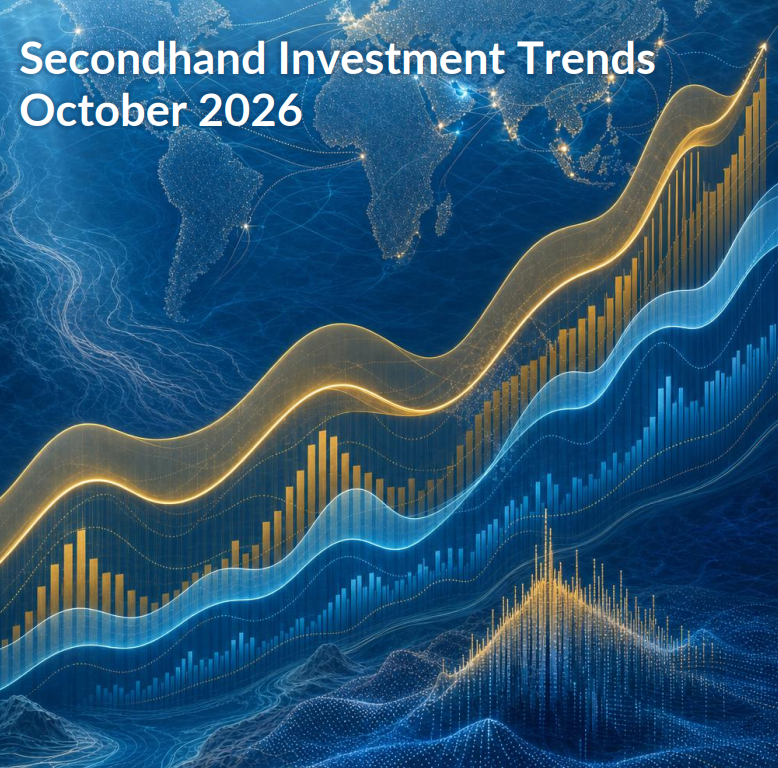
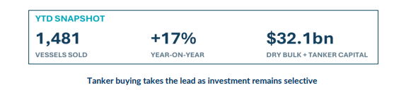
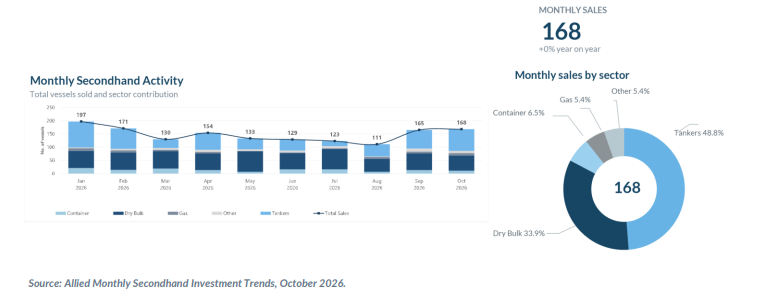
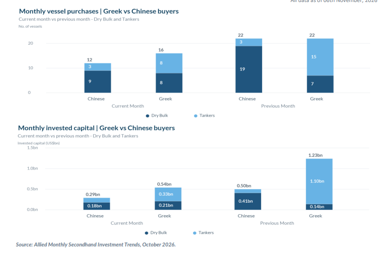

# Secondhand Investment Trends | October 2026

**Date:** November 11, 2026  
**Publisher:** Breakwave Advisors | **Category:** Market Insights  
**Original URL:** [https://www.breakwaveadvisors.com/insights/2026/11/11/secondhand-investment-trends-october-2026](https://www.breakwaveadvisors.com/insights/2026/11/11/secondhand-investment-trends-october-2026)  

---

> **Figure 1: Στιγμιότυπο Οθόνης 2026 11 11 151951**  
> [Local Asset](assets/2026-11-11_secondhand-investment-trends-october-2026_img_cea3cf84ceb9ceb3cebcceb9cf8ccf84cf85_ed6d856d511f.png)

> **Figure 2: Στιγμιότυπο Οθόνης 2026 11 11 152110**  
> [Local Asset](assets/2026-11-11_secondhand-investment-trends-october-2026_img_cea3cf84ceb9ceb3cebcceb9cf8ccf84cf85_0561a747cf2d.png)

October’s secondhand sale-and-purchase market points to a change in where investors are deploying capital, rather than an across-the-board acceleration in buying. Tanker transactions expanded sharply, while dry bulk turnover contracted. At the same time, disclosed spending across all vessel sectors fell from September, highlighting the difference between the number of ships changing hands and the amount of capital committed. The latest geopolitical developments have complicated that assessment. Expectations of a potential easing in regional tensions have weighed on oil prices, yet operational uncertainty around the Strait of Hormuz remains relevant for tanker earnings, fleet availability and investment decisions.

> **Figure 3: Στιγμιότυπο Οθόνης 2026 11 11 152122**  
> [Local Asset](assets/2026-11-11_secondhand-investment-trends-october-2026_img_cea3cf84ceb9ceb3cebcceb9cf8ccf84cf85_658fa2a6efc2.png)

### A Stronger Tanker Share, Not a Stronger Overall Market

A total of 168 vessels were sold in October, nearly unchanged from a year earlier and only 2% above September. Tankers accounted for 82 sales, a 61% year-on-year increase, while dry bulk fell 30.5% to 57 transactions. The tanker sector therefore represented close to half of all monthly vessel sales, compared with approximately one-third for dry bulk. Disclosed investment reached approximately US$4.7bn across all vessel sectors, below September’s US$6.6bn. Tankers attracted US$2.94bn, against US$1.11bn in dry bulk, with the balance allocated to other vessel types. Tankers represented approximately 62% of all-sector disclosed spending and around 73% of the combined dry bulk–tanker total. The increase in tanker transaction activity therefore coexisted with a decline in aggregate monthly investment.

### The Year-to-Date Picture Is More Nuanced

During January–October, dry bulk retained the higher transaction count, at 644 sales versus 572 tankers. However, tanker purchases were up 68% year on year, far ahead of dry bulk’s 7% increase. Disclosed capital also favoured tankers: approximately US$20.8bn compared with US$11.3bn for dry bulk. This suggests that the tanker market has been the more important destination for capital in 2026, even though dry bulk remains highly active by number of transactions.

> **Figure 4: Στιγμιότυπο Οθόνης 2026 11 11 152135**  
> [Local Asset](assets/2026-11-11_secondhand-investment-trends-october-2026_img_cea3cf84ceb9ceb3cebcceb9cf8ccf84cf85_d10e5007c20e.png)

### Greek and Chinese Buyers Reveal Different Priorities

Greek interests purchased 91 vessels in each of the dry bulk and tanker sectors through October, but invested approximately US$4.5bn in tankers, more than double the US$2.1bn allocated to dry bulk. Chinese buyers showed the opposite emphasis, acquiring 148 dry bulk carriers for US$2.5bn compared with 28 tankers for around US$0.6bn. In October alone, Chinese buyers acquired nine bulkers against eight by Greek buyers; Greek disclosed spending on dry bulk was nonetheless higher, at US$213m versus US$175m.

Age profiles further qualify these comparisons. Within dry bulk, the 11–15-year segment attracted the largest individual allocation from both groups, but Greek investment was relatively more concentrated in vessels up to ten years old, whereas Chinese capital had greater exposure to ships older than fifteen years. In tankers, Greek investment was substantial in both the 11–15-year and newest 0–5-year segments, while Chinese purchases were more heavily weighted toward older tonnage.

### Investment Outlook

October’s secondhand market remained active against a geopolitical backdrop in which falling oil prices and renewed diplomatic signals have yet to bring greater certainty to shipping operations. Continued disruption around the Strait of Hormuz, security risks and changes in trading patterns complicate tanker employment and freight expectations. Current earnings therefore remain a difficult benchmark for assessing longer-term asset values, particularly while the timing and extent of any operational recovery remain uncertain.

October’s transactions suggest that buyers remain active, although investment is concentrated in particular vessel segments rather than spread evenly across the market. Greek and Chinese purchasing patterns reveal different investment priorities, while the high proportion of tanker sales without disclosed prices makes it difficult to draw firm conclusions about asset valuations. In dry bulk, commodity flows and regional vessel positioning remain important considerations. The distinction between earnings supported by underlying trading activity and those influenced by exceptional operating conditions remains central to assessing secondhand investment opportunities.

---

**Tags:** Shipping, Markets  
