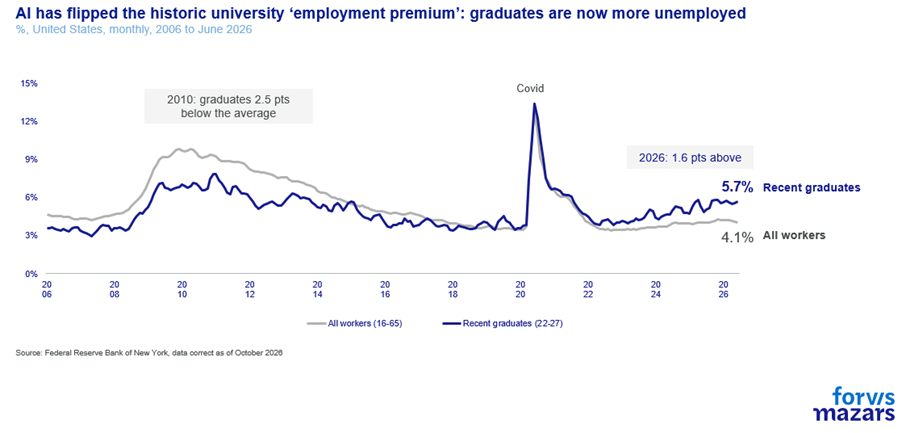
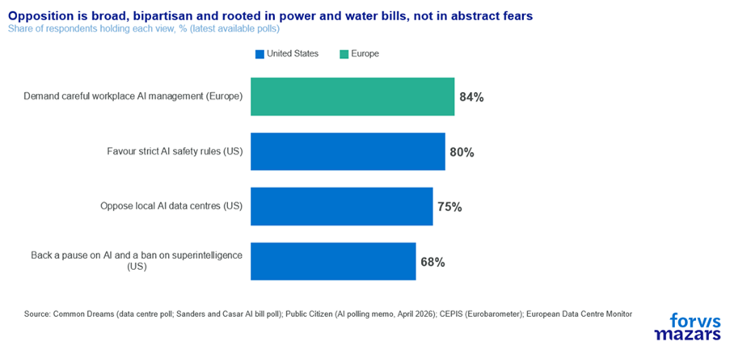
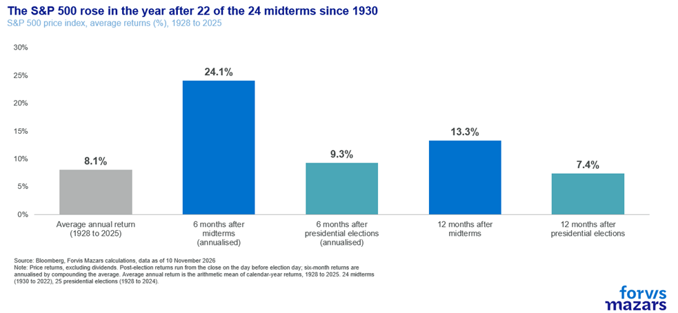

# We need to have a conversation about AI

**Date:** November 13, 2026  
**Publisher:** Breakwave Advisors | **Category:** Market Insights  
**Original URL:** [https://www.breakwaveadvisors.com/insights/2026/11/13/we-need-to-have-a-conversation-about-ai](https://www.breakwaveadvisors.com/insights/2026/11/13/we-need-to-have-a-conversation-about-ai)  

---

The three things business investors need to know about this week’s artificial intelligence (AI) rout:

1. While some of the issues are idiosyncratic to Nvidia’s governance, the outcome of the US election has opened the issue of the broader social costs of AI development.
2. Markets are beginning to price in the eventuality of slower AI development.
3. While risks are real, potential delays in AI projects could be an opportunity for investors, firms and the economy to adapt.

*By*[*George Lagarias*](https://www.linkedin.com/in/george-lagarias-mba-3baa769/)

Summary

AI's boom has met its first political test. Tech shares are down 10% since mid-October, and voters in the US and Europe are asking who carries the risks of data centres. Four years after ChatGPT first spoke to us in a way we could understand, we are beginning to confront the economic, social and political costs of a technology that could reshape life on the planet. The recent market rout reflects concerns about AI’s sustainability, debt-financed investment and the possibility of slower development as voters demand greater safeguards. While some issues are company-specific, the broader AI theme remains intact, driven by political will and technological momentum. For businesses, potential delays are a welcome opportunity to catch up, strategise and adapt to the new reality.

Some conversations around adulthood need to happen. But it is quite often that for various reasons we are not ready for them. Sometimes, the children aren’t ready. Much more often, it is the parents who dread the conversation. In the case of AI, part of the problem is that the conversation needs to happen all too soon.

Four years after ChatGPT spoke to us in a way we could understand, the conversation is nearly upon us, and we dread it, unsure whether we are the parents or the children in it. Humanity initially marvelled at AI; there was no celebration or unity in it. Initially dismissed as little more than a silver-tongued fabulist, it started becoming more apparent that our toolmaker species had invented a tool that can change the face of life on the planet as much as fire, the wheel, the spear, gunpowder or the internet.

It has certainly taken a bit of getting used to, but we have now adopted AI at a massive scale, and relatively quickly by historical standards. Within four years, almost [50](https://graphite.io/research/ai-now-writes-as-many-online-articles-as-humans-do)% of the internet articles are AI or AI-assisted-produced, as is [75](https://ahrefs.com/blog/ai-marketing-statistics/)% of all new webpages.[Half](https://www.imperva.com/resources/resource-library/reports/2024-bad-bot-report/) of internet traffic is now automated bots.

The speed at which AI is developing is exponential. We are already seeing growing evidence that it is affecting the job market, especially for younger people.

> **Figure 1: Market Chart 1**  
> **Interactive Data & Source:** [Bis](https://www.bis.org/publications/bulletin-137-circular-relationships-among-ai-firms) | [Local Asset](assets/2026-11-13_we-need-to-have-a-conversation-about-ai_img_image006_c5a0ffe2664f.png)

With tech stocks falling 10% in the past few weeks, investors are increasingly worried that the AI theme driving markets may have reached a natural end. The Nvidia boss’s personal misadventures aside, markets now worry that the AI theme, a lot of it financed by debt and fully endorsed by a now less powerful White House, may be running out of fuel, despite its popularity.

Some of the worries about sustainability have a basis.

A[recent](https://www.bis.org/publications/bulletin-137-circular-relationships-among-ai-firms) Bank for International Settlements (BIS) bulletin maps the web of circular relationships among AI firms, in which the same companies act as investors, suppliers and customers of one another. Between 2021 and 2025,**28.7%**of AI firms' investment deals by value targeted another AI firm, and **55.2%**of incoming investment in AI firms came from other AI firms. Among these AI-to-AI deals, 16.1% by count and 46.4% by value also involved a commercial supply relationship between investor and target. There is, of course, a modicum of economic logic to this: such arrangements h**elp firms secure scarce inputs such as chips and compute**, and bridge information gaps between investors and young companies. But they also ma **ke the system more opaque and carry macroeconomic risks**. Because the same capital can support both a firm's financing and its revenues, stress at one node can spread quickly across the network. The concern is more acute because AI capex is increasingly debt-funded. A[follow-up paper](../pdfs/2026-11-13_we-need-to-have-a-conversation-about-ai_bulletin-140-building-ai-credit-stru_26ed494d35b2.pdf) puts hyperscaler capital expenditure at over $800bn this year, roughly**2.5% of US GDP**, with gross bond issuance of $222bn by September.

And circular, debt-financed vehicles just run into a thick wall of (mostly blue) voters. Markets are naturally worried that the electorate, fearful of the environmental and social impact of AI, might slow the development of US-driven AI.

After all,[75](https://www.commondreams.org/news/data-center-poll-collapse)% of Americans oppose local AI data centres, across party lines, driven by power and water costs. The European Data Centre Monitor suggests that data centres consume one fourth of electricity in Ireland. Back in the US,[80](../pdfs/2026-11-13_we-need-to-have-a-conversation-about-ai_ai-polling-memo-42026_6ff4e41ff7c9.pdf)% favour strict AI safety rules and [68](https://www.commondreams.org/news/sanders-casar-ai-bill-poll)% support legislation to pause AI development and ban superintelligence. In Europe, the numbers are similar.[84](https://cepis.org/new-eurobarometer-report-europeans-support-ai-at-work-but-call-for-clear-regulations/)% of Europeans demand careful workplace AI management.

> **Figure 2: Are Fears That Voters Can Block Ai Development and Unravel What**  
> *Are fears that voters can block AI development and unravel what is, in essence, a leveraged financing system realistic?*  
> [Local Asset](assets/2026-11-13_we-need-to-have-a-conversation-about-ai_img_image007_a20751fbdd6e.png)

Let’s break down the questions markets are really asking:

According to J.P. Morgan, most of the 2027 projects are already funded, so a pipeline collapse would not be imminent.

*Can voters press the issue?*

Yes, at the edges. Voters have passed 45 ballot measures on data centres and most cap energy use or tighten approval requirements. Governors can slow projects, or stop them with state-level moratoria, but those powers have limits and courts can hear challenges.

*Can delays in projects cause a big issue for markets?*

Potentially, where covenants are too demanding, but there are three notable upsides.

- A delay would push back the release of more capable models, which also need more computing power. That would take the pressure off AI companies to produce a breakthrough every few weeks and give businesses time to plan around the tools they already have. This would take the pressure off AI companies to come up with the next big thing in a few weeks, and buy time for the corporate world to adapt and plan around present tools.
- They would also give a chance to the “slower money” to step in and fill the financing gap.
- A slowdown in deployment could also mitigate some of the damage to the jobs market and allow society to adapt more seamlessly to the new technology.

An AI development slowdown has really one big snag: the geopolitical. A “Sputnik moment”. If China continues to develop AI at the present pace, while the US and allies slow, then it could potentially reach some form of Artificial General Intelligence (AGI) sooner than its competitor. Even then, if history teaches anything, “Sputnik moments” can cause voters to change their tack and demand that the US catch up. One can’t but wonder: would Neil Armstrong have walked on the moon if Soviet Sputnik hadn’t terrified America? Can a Chinese AI lead produce another “humanity to the moon” moment?

### What Should Businesses Make of the Election and Ai?

There are many twists and turns, but AI continues to be an intergenerational technological theme that has the potential to shape life on the planet. A delay buys time, and firms that use it should have [specific steps, for example retrained staff, redesigned processes, an agreed AI policy] in place before the next generation of models arrives.

### What Should Investors Know About the Recent Tech Rout?

For one, Nvidia needs to be separated from the theme. Much of the company’s woes (-22% since mid-October) are idiosyncratic, and not fundamental. Rather, in the grand scheme of things, they are of the lighter governance issues. With over 25 years in the market and a commanding market share in data centres, it is a company that may well survive the potential departure of its chief executive officer (CEO). Meanwhile, for the same period, the wider Magnificent 7 (which includes Nvidia) is down 6%, just double the wider general index. Second, the AI theme, even slowed down, stays very much intact. Driving it is not just speculative market sentiment but rather very strong political will, not to mention actual technological momentum. Having said that, investors may even welcome a market with lower levels of concentration and broader leadership. And remember that by and large, markets tend to do better after the midterms. In the 25 post-midterm 6-month periods, a small sample, arguably, the average annualised return for US large caps has been 24%, against a 9.3% return post-presidential elections.

> **Figure 3: Market Chart 3**  
> [Local Asset](assets/2026-11-13_we-need-to-have-a-conversation-about-ai_img_image008_a2e25d376944.png)
