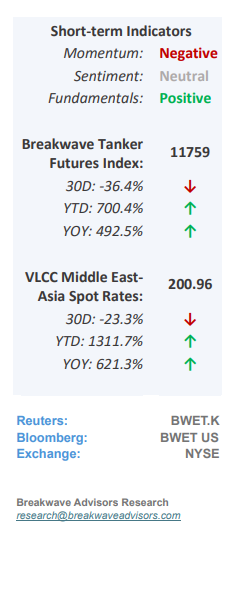
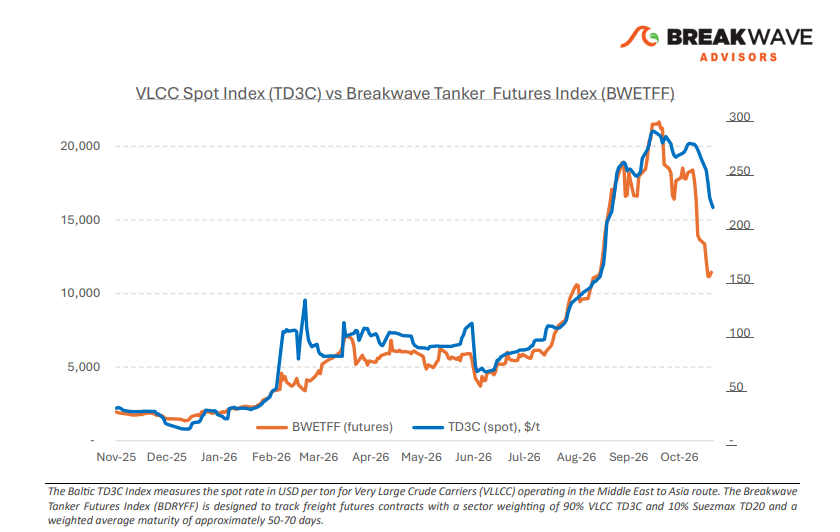
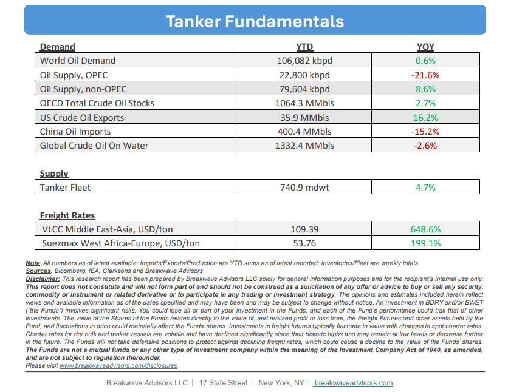

# Breakwave Bi-Weekly Tanker Report - November 17, 2026

**Date:** November 17, 2026  
**Publisher:** Breakwave Advisors | **Category:** Market Insights  
**Original URL:** [https://www.breakwaveadvisors.com/insights/11172026wetreportjj876-oo9](https://www.breakwaveadvisors.com/insights/11172026wetreportjj876-oo9)  

---

**• Sentiment-Driven Correction Meets Improving Vessel Supply –**Crude tanker freight has **corrected sharply from October’s unprecedented highs**, initially driven by changing geopolitical sentiment following the US midterm elections. Expectations of de-escalation weakened freight sentiment, although the subsequent decline has increasingly been supported by changes in physical market conditions. Improving crude availability and rising inventories have reduced refiners’ urgency to secure cargoes, while the resumption of Saudi Arabia’s East–West pipeline operations has allowed tanker positioning to adjust to more established trading patterns.**Increased eastward VLCC ballasting** has strengthened prompt availability around Fujairah and Yanbu, giving charterers greater negotiating leverage. In the Atlantic, limited fresh cargo enquiry and competition among vessel sizes have reinforced the correction.**Lower VLCC rates** have improved their competitiveness against Suezmaxes in West Africa, encouraging renewed interest, although this has yet to translate into sustained fixing activity. The US Gulf remained subdued, while greater European purchases of Saudi crude through Sidi Kerir have reduced some longer-haul employment opportunities. Looking ahead, the key question is **whether fresh cargo demand can absorb the growing number of ballasters** in eastern and western markets. While increased vessel availability may sustain softer freight in the near term, a more lasting normalization would require higher AIS-visible tanker crossings through Hormuz, shorter voyage cycles and broader owner participation. With geopolitical risks unresolved and dark transits remaining difficult to assess, the durability of the correction remains uncertain, particularly if renewed cargo enquiry tightens effective vessel supply.

> **Figure 1: Cea3cf84ceb9ceb3cebcceb9cf8ccf84cf85**  
> [Local Asset](assets/2026-11-17_11172026wetreportjj876-oo9_img_cea3cf84ceb9ceb3cebcceb9cf8ccf84cf85_285c07c6af6e.png)

•**Oil Prices Remain Subdued as IEA Throws Cold Water on Balance**– Crude oil prices have fallen and now sit at the lower end of their six-month range. With the **IEA projecting that supply will exceed demand in the fourth quarter,**demand destruction and improved flows through the Strait of Hormuz appear to be weighing on prices, even as tankers moving through the Strait continue to come under neardaily attack. We remain skeptical of the current pricing, as geopolitical flare-ups have repeatedly widened the risk premium and pushed prices higher.**Longer-term indicators** based on global inventories **suggest spot prices are undervalued**, though the gap between the two has historically varied widely. We remain constructive on prices over the coming months until a more lasting resolution emerges.

•**Our Long-term View**– The tanker market has been recovering from a long period of staggered rates as the growth in new vessel supply shrunk while oil demand remained elevated in line with the global economy. The recent rapid increase in freight rates has led to significant new vessel ordering, with the orderbook now standing at well above average levels, and although in the near term such a supply/demand misbalance is small, we expect a meaningful negative balance to develop longer term leading to an industry downcycle.

> **Figure 2: Στιγμιότυπο Οθόνης 2026 11 16 193656**  
> [Local Asset](assets/2026-11-17_11172026wetreportjj876-oo9_img_cea3cf84ceb9ceb3cebcceb9cf8ccf84cf85_3a9a82dcae8b.png)

> **Figure 3: Στιγμιότυπο Οθόνης 2026 11 16 193707**  
> [Local Asset](assets/2026-11-17_11172026wetreportjj876-oo9_img_cea3cf84ceb9ceb3cebcceb9cf8ccf84cf85_275952a438cb.png)

### Subscribe:
