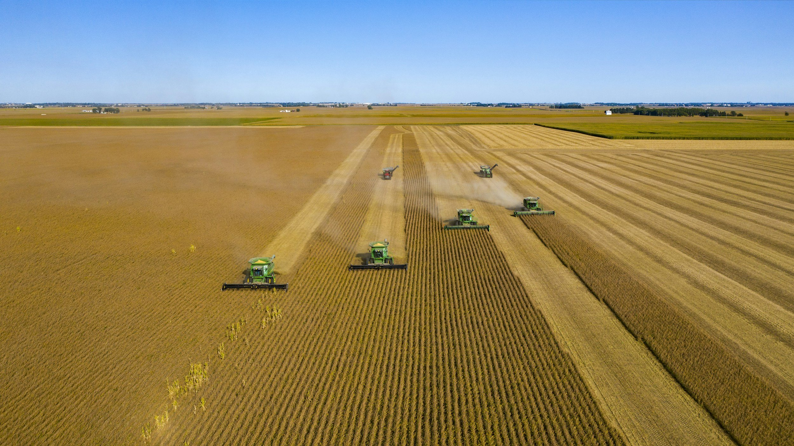

# Kamsarmax Rebounds, Soybeans Set Records

**Date:** November 17, 2026  
**Publisher:** Breakwave Advisors | **Category:** Market Insights  
**Original URL:** [https://www.breakwaveadvisors.com/insights/2026/11/17/kamsarmax-rebounds-soybeans-set-records](https://www.breakwaveadvisors.com/insights/2026/11/17/kamsarmax-rebounds-soybeans-set-records)  

---

> **Figure 1: Byeirini Diamantara&dimitris Roumeliotis**  
> *ByEirini Diamantara&Dimitris Roumeliotis*  
> **Interactive Data & Source:** [Linkedin](https://www.linkedin.com/in/eirini-diamantara-58b269105/) | [Local Asset](assets/2026-11-17_kamsarmax-rebounds-soybeans-set-records_img_unsplash-image-pbbkarmfts_efbdc77b5088.jpg)

The dry bulk market continues to demonstrate contrasting dynamics across the Kamsarmax and Ultramax segments, although the considerable earnings differential observed in late October has narrowed during the first half of November. According to Baltic Exchange data, average Kamsarmax earnings (P5TC) increased by 5.7% week-on-week, reaching USD 19,063/day on 13 November, compared with USD 16,999/day at the end of October. Meanwhile, Ultramax earnings (S11TC) stood at USD 23,203/day, recording a more modest weekly increase of 1.1%. Consequently, the earnings differential between the two segments has narrowed from USD 6,570/day on 30 October to approximately USD 4,140/day, reflecting an improvement in Kamsarmax market conditions.

Despite this recent recovery, Kamsarmax earnings remain 11.2% below their end-September levels, highlighting the persistent pressure facing the segment. The divergence between the two vessel classes continues to reflect differences in cargo exposure, regional tonnage availability and trading flexibility. Kamsarmax vessels remain particularly dependent on coal and grain movements, while Ultramaxes benefit from a more diversified cargo base, including minor bulks, fertilizers, steel products and agricultural commodities. Their onboard cranes also provide greater flexibility in serving smaller ports and terminals with limited infrastructure.

Against this backdrop, developments in the Brazilian soybean trade offer an encouraging perspective for dry bulk demand. According to market data, Brazil exported a record 108.4 million tonnes of soybeans during January–October 2026, representing a 7.9% increase year-on-year. Remarkably, shipments during these ten months have already exceeded the entire 2025 volume by approximately 600,000 tonnes. Second-quarter exports reached 44.9 million tonnes, up 10.3% year-on-year, while third-quarter volumes increased by 8.1% to 29.7 million tonnes.

These developments are particularly relevant for the Panamax/Kamsarmax and Supramax/Ultramax segments, which play an important role in agricultural commodity transportation. With China remaining the principal destination for Brazilian soybeans, continued growth in exports could generate additional tonne-mile demand, especially as long-haul Brazil–Asia shipments absorb vessel capacity for extended periods.

Nevertheless, the seasonal distribution of Brazilian exports remains an important consideration. October shipments declined by almost 14% compared with September, reflecting the gradual winding down of the previous harvest season. Therefore, although annual export volumes have reached record levels, their immediate contribution to freight market strength may remain uneven, depending on shipment timing and available tonnage.

Looking further ahead, the outlook remains constructive. The USDA projects Brazil's 2026/27 soybean production at 186 million tonnes, with exports expected to reach 118 million tonnes. If realised, these volumes could provide further support to dry bulk employment during the upcoming export season, particularly across long-haul routes towards Asia.

In the near term, winter coal demand and North American grain shipments could also contribute to improving Kamsarmax employment. However, stronger electricity consumption does not necessarily translate into higher seaborne coal imports, particularly when inventories remain sufficient or domestic production covers additional requirements.

Overall, while the recent narrowing of the Kamsarmax–Ultramax earnings gap suggests some rebalancing between the segments, sustained recovery will depend on stronger cargo volumes absorbing available vessel supply. Record Brazilian soybean exports provide a positive underlying demand signal, but regional tonnage distribution, seasonal trade patterns and actual tonne-mile growth will remain decisive in determining freight market direction.

Data source:[Xclusiv Shipbrokers Inc.](https://www.linkedin.com/company/xclusiv-shipbrokers-inc/)

---

**Tags:** Shipping, Commodities, Drybulk  
