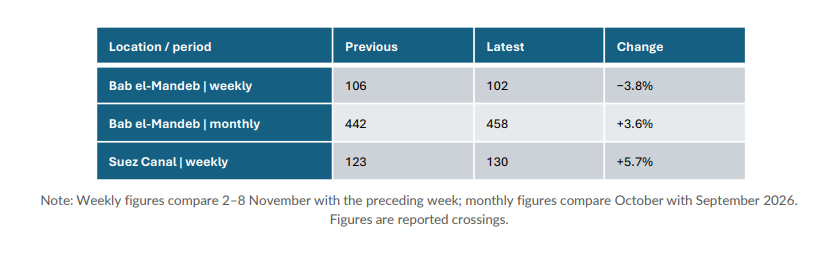
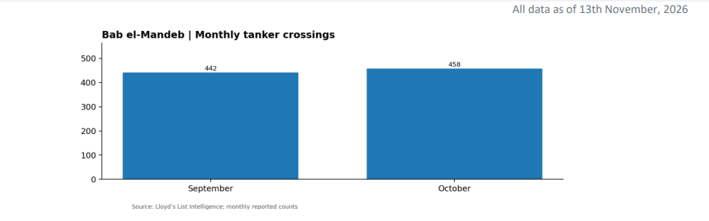
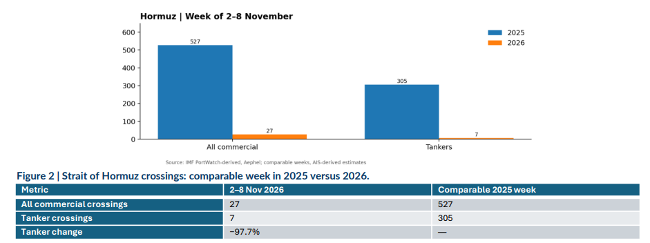

# Tanker Markets at Two Chokepoints

**Date:** November 18, 2026  
**Publisher:** Breakwave Advisors | **Category:** Market Insights  
**Original URL:** [https://www.breakwaveadvisors.com/insights/2026/11/18/tanker-markets-at-two-chokepoints](https://www.breakwaveadvisors.com/insights/2026/11/18/tanker-markets-at-two-chokepoints)  

---

> **Figure 1: Στιγμιότυπο Οθόνης 2026 11 18 115612**  
> [Local Asset](assets/2026-11-18_tanker-markets-at-two-chokepoints_img_cea3cf84ceb9ceb3cebcceb9cf8ccf84cf85_7e24f08c81cb.png)

This week’s Allied Quantumsea Research reviews the extension of the US Jones Act waiver alongside the latest maritime-security and vessel-crossing developments at Bab el-Mandeb and the Strait of Hormuz.

### Executive Assessment

Two distinct constraints continue to influence tanker freight markets. In the United States, the renewed Jones Act waiver permits selected foreign-flag coastwise shipments subject to voyage-specific clearance. In the Middle East, AIS-observed Hormuz traffic remains substantially below its year-earlier level while fresh incidents underline the continuing exposure of commercial shipping. The Red Sea shows some commercial activity, but neither a change in crossings nor a temporary decline in reported attacks is sufficient evidence of a durable normalization in vessel access.

### Jones Act Waiver: Third Extension

On 13 November, US Customs and Border Protection confirmed that the Department of Homeland Security had approved a third extension of the March 2026 Jones Act waiver. The new 90-day period starts on 16 November 2026; covered products must be loaded before 11:59 p.m. Eastern Time on 14 February 2027. This is not a blanket suspension: prospective foreign-flag voyages require a vessel-availability request, a MARAD survey of coastwise-qualified capacity and a determination by the Department of War. Approved voyages also carry CBP notification and post-voyage reporting obligations. [1]

For tanker freight, the extension offers a mechanism to supplement domestic petroleum transportation when suitable US-qualified capacity is unavailable. Its effect on the wider international market depends on the actual number and class of approved foreign-flag voyages, their cargoes and the alternative employment displaced. The legal extension alone does not demonstrate a measurable reduction in international tanker supply.

### Bab El-Mandeb and Suez Canal | Tanker Crossings

Reported tanker crossings through Bab el-Mandeb totalled 102 during 2–8 November, down from 106 in the preceding week (−3.8%). October recorded 458 crossings, compared with 442 in September (+3.6%). At the Suez Canal, tanker crossings increased to 130 from 123 in the latest comparable week (+5.7%).

The latest weekly figures show a slight decline at Bab el-Mandeb alongside an increase at Suez. October’s higher Bab el-Mandeb total also points to a modest month-on-month rise in recorded tanker traffic, although the weekly figures remain mixed across the two passages.

> **Figure 2: Στιγμιότυπο Οθόνης 2026 11 18 115929**  
> [Local Asset](assets/2026-11-18_tanker-markets-at-two-chokepoints_img_cea3cf84ceb9ceb3cebcceb9cf8ccf84cf85_d1550455bcc6.png)

> **Figure 3: Bab El-Mandeb Monthly Tanker Crossings**  
> *Figure 1 | Bab el-Mandeb monthly tanker crossings, September–October 2026.*  
> [Local Asset](assets/2026-11-18_tanker-markets-at-two-chokepoints_img_cea3cf84ceb9ceb3cebcceb9cf8ccf84cf85_ab6a4d292110.png)

The JMIC maritime-security assessment and UKMTO incident reporting continue to warrant caution around the southern Red Sea and approaches to the Gulf of Aden. On 16 November, UKMTO reported a tanker approached by a possible mothership and armed skiff approximately 430 nautical miles east of Socotra; the incident was classified as suspicious activity, not a confirmed successful attack. For tanker employment, a Cape diversion can lengthen voyage cycles and absorb vessel-days, while a sustainable return to the Red Sea would gradually release capacity. The magnitude depends on origin, destination, vessel type and owners’ acceptance of the passage; no uniform voyage-day or freight premium is assumed.

### Strait of Hormuz: Imf Portwatch Transit Evidence

The latest complete week in the IMF PortWatch-derived dataset covers 2–8 November. It records 27 commercial-vessel crossings, including seven tankers, against 527 vessels and 305 tankers in the corresponding week of 2025. This equates to declines of 94.9% and 97.7%, respectively. The estimates are derived from satellite AIS positions and are not exhaustive counts of all physical transits.

> **Figure 4: Στιγμιότυπο Οθόνης 2026 11 18 120155**  
> [Local Asset](assets/2026-11-18_tanker-markets-at-two-chokepoints_img_cea3cf84ceb9ceb3cebcceb9cf8ccf84cf85_e6d20578e644.png)

The same PortWatch-derived source recorded only three commercial crossings on 8 November, one of them a tanker. Daily observations are subject to revision as AIS positions arrive. UKMTO uses a different operational reporting universe and should not be reconciled mechanically with the IMF series. In particular, a PortWatch tanker crossing is not synonymous with a VLCC crude-loading fixture, and dark transits may be missed.

### Market Outlook

The latest security incidents around Hormuz have added further uncertainty to tanker trading conditions, while the extension of the Jones Act waiver introduces additional flexibility for foreign-flagged vessels in US domestic trades. The immediate impact will depend on actual cargo movements rather than the regulatory permissions alone. In the Middle East, the pace of export recovery and owners’ willingness to accept Gulf employment remain central to the freight balance, particularly as available tonnage continues to accumulate outside the region.

For the remainder of November, attention shifts to whether fresh cargo requirements can absorb the available ballast fleet and whether the recent increase in Red Sea transits develops into a sustained recovery. A broader return to Suez routing would reduce voyage durations on affected trades, potentially releasing tonnage into an already uneven market. With security restrictions persisting around Hormuz and vessel supply building in other regions, the timing of cargo demand relative to returning vessel capacity will be critical to the next phase of tanker freight movements.

---

**Tags:** Tankers, Markets, Shipping  
