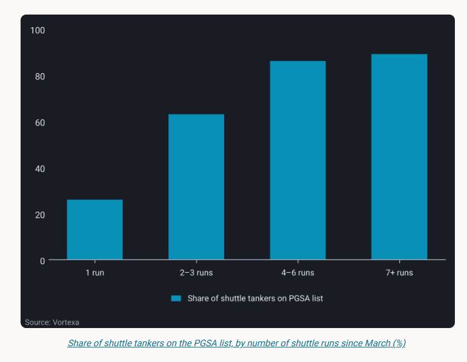
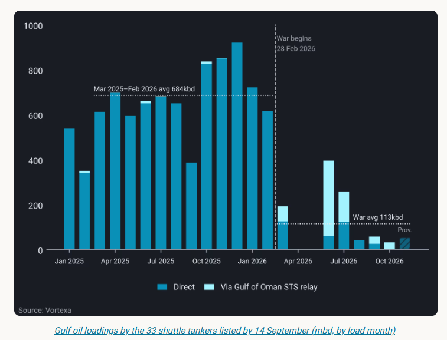
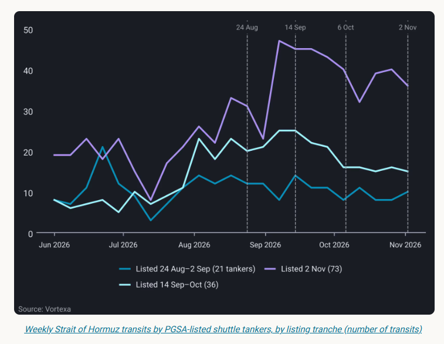
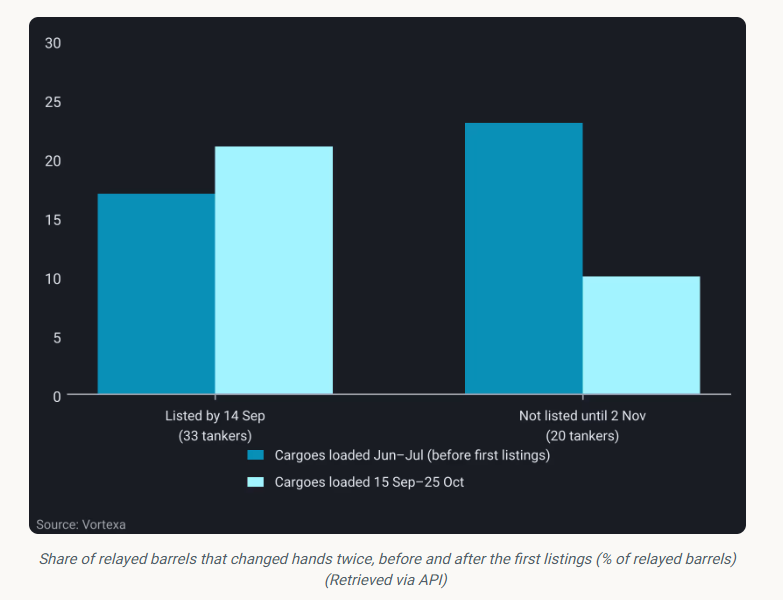

# Iran’s Hormuz blacklist reshapes flows, but exports hold

**Date:** November 19, 2026  
**Publisher:** Breakwave Advisors | **Category:** Market Insights  
**Original URL:** [https://www.breakwaveadvisors.com/insights/2026/11/19/irans-hormuz-blacklist-reshapes-flows-but-exports-hold](https://www.breakwaveadvisors.com/insights/2026/11/19/irans-hormuz-blacklist-reshapes-flows-but-exports-hold)  

---

Despite Iran blacklisting more than half the Gulf shuttle fleet, oil flows continue to grow as tankers adapt through additional STS transfers.

*By*[*Claire Jungman*](https://www.linkedin.com/in/claire-jungman-b40a78110/)

Iran has designated more than half the tankers involved in Gulf shuttle operations, but so far the restrictions have not reduced the volume of oil moving through the shuttle relay. Instead, Vortexa data indicates that operators are adapting how cargoes move, with some designated vessels relying on an additional ship-to-ship (STS) transfer to get oil to its final destination.

### Key Takeaways

- More than half the shuttle fleet has been designated. Of the 231 tankers involved in Gulf shuttle operations since March (excluding Iran), 130 appear on the 2 November PGSA Non-Compliance List. These vessels have accounted for approximately three-quarters of shuttle runs.
- Iran has targeted the busiest ships. 89% of tankers with seven or more shuttle runs are on the list, against 26% of those that made a single run.
- Designated vessels continue to load in the Gulf. Cargoes carried by the 33 shuttle tankers listed by 14 September averaged[2.1mbd](https://analytics.vortexa.com/Flows?dateRange=2026-09-15T00%3A00%3A00.000Z__2026-10-25T23%3A59%3A59.999Z&filtersEnabled=%5B%22p%22%2C%22o%22%2C%22d%22%2C%22d_r%22%2C%22v%22%2C%22intra_d%22%2C%22sts_o%22%2C%22c_o%22%2C%22hd%22%2C%22w%22%2C%22v_f%22%2C%22v_o%22%2C%22sts%22%5D&metric=bpd&page=Flows&tabId=456c494f-d45f-462a-85f0-b2c518b4b591&timeSeriesProperty=destination_region&v=3&vessels=%5B%229c362713e2cfc7d0269ee92110588cdb1663fd6ab920c3ada5d46f385c35b7b5%22%2C%22148416685c97e07d757527bb4e5e2c3138b1a235867829a9becc3e8ced2aaf9b%22%2C%221587fd8ef9cf9c3c082730c42911224f12b67b6ca2107c7629c4614e3f7342f3%22%2C%2239ad848e11a128a875c3f1a7646b343ec51cfef8451e50419682687556da3da0%22%2C%223a1e1603d8f22728db39da2f5f63c4a33d95629e8116bc4cb73ba329e2acce34%22%2C%223e9199fcc961e075653e7c2d8f59733d4ca8c1d9b82b2bb9fa61d7f4d861a63d%22%2C%2240127b8ce943cce48812e1541b64678b391745ba9431ed5e959d3b86a6d3b2b8%22%2C%22420f0d5257a9ae3030df28cf1e0e11ff79c6ffbd4e4cdfc67993eedaa419ded5%22%2C%2253f749ab18ea1e83092458f078adcbbee9715b3655bbdf550402f21b3f7d4d29%22%2C%22541938c0f47862e96d8030f5fedd3b35efe35cd32f00979f461a3862e2c910d4%22%2C%225c8f6f76f8b77030f0ec2ed2b4a202b9600040e0b80e3b9c2ce0672bcaf73934%22%2C%225ed757a4643249d75e38f727bb6fccb382e057840c9e3bebafaf9983f4bd3bf5%22%2C%2267e00dd0a824fcfe49a771be2c7e68e2b6543395db640b1bcd258e1968485019%22%2C%226d8c3c88544b91c959e75abf51293e74b15e472a14d50d6a27024d13a7835a48%22%2C%226df425b444846ecadbc00ef8171505581a5578ece1eaeaf320de2cbad0ff9462%22%2C%2275ca1fa80b3bdb39906a87086accf88ccb3a63e440fad0c3ea694568cdfd7e1b%22%2C%2279102561ce4abe23c26d749423ef7862e399cb321b9d2789a96d3155a3bb51bd%22%2C%2283ac6980c281eebcb2a808d58fd0233a38ccc8e4c4f4f2b67afe36043e4e2d00%22%2C%2293863b2460a32e9172855344434a7eef43e2f1c36d2c0b2b88eb894b28eb05c8%22%2C%229db0c7c318b05f24b4e6c29f18f2ce00bc823192c94911fd2f5c0eeee7c43e73%22%2C%22a04063aa2d1af17ddd0a405fff3268e64d953df21b6721f08f05a28b4f35618a%22%2C%22ab2d716ec5c776837c33b63241167237e83c50d6bae823d1dddc44add373b182%22%2C%22b5a9315f4d156ed34eae8323ccf4be3bfe16d8c3e1dfe54125c361546327416c%22%2C%22b696df5a1149f3c515a078e534b47a0951146a3394ea8fc756b4453cc967aa67%22%2C%22b959acc1382e084f14ee4e8fcee882665d6dc64bd4b73649988dfebfd4dec6c1%22%2C%22bac1feb1acc070727abb701631cfc1347f9c23ab62b013dafa090939e4e1a066%22%2C%22bbe0b6150f2b6d874548375b3806b84463142f55a3935decbd45dac4ed4c9576%22%2C%22bdbe8916dec168c80513ae365646e84fb25be637b0c624540a2fb55e2810426d%22%2C%22be1e2eb01e90acacd9a3e8ebfd4e8e010f5b51e9e9f6d4319f58378e505ba598%22%2C%22e535603d08039d47c7927a7d10c29210002eaadd46156133b7efa5ddd52797eb%22%2C%22e75d5fbdc241b626e0f70a833ac68bc40824762c7374bffca315e59ac345a037%22%2C%22f27c3261aa34fe8304655565b85a8816072d870b3506a60b78232b866d85da0e%22%2C%22f7ccdc4f9bc4d3aee7ef7ac0572fc4e32e55ab7ad00efd6cccbbdaed7ff44d3e%22%5D) between 15 September and 25 October, up from[1.5mbd](https://analytics.vortexa.com/Flows?dateRange=2026-06-01T00%3A00%3A00.000Z__2026-07-31T23%3A59%3A59.999Z&filtersEnabled=%5B%22p%22%2C%22o%22%2C%22d%22%2C%22d_r%22%2C%22v%22%2C%22intra_d%22%2C%22sts_o%22%2C%22c_o%22%2C%22hd%22%2C%22w%22%2C%22v_f%22%2C%22v_o%22%2C%22sts%22%5D&metric=bpd&page=Flows&tabId=456c494f-d45f-462a-85f0-b2c518b4b591&timeSeriesProperty=destination_region&v=3&vessels=%5B%229c362713e2cfc7d0269ee92110588cdb1663fd6ab920c3ada5d46f385c35b7b5%22%2C%22148416685c97e07d757527bb4e5e2c3138b1a235867829a9becc3e8ced2aaf9b%22%2C%221587fd8ef9cf9c3c082730c42911224f12b67b6ca2107c7629c4614e3f7342f3%22%2C%2239ad848e11a128a875c3f1a7646b343ec51cfef8451e50419682687556da3da0%22%2C%223a1e1603d8f22728db39da2f5f63c4a33d95629e8116bc4cb73ba329e2acce34%22%2C%223e9199fcc961e075653e7c2d8f59733d4ca8c1d9b82b2bb9fa61d7f4d861a63d%22%2C%2240127b8ce943cce48812e1541b64678b391745ba9431ed5e959d3b86a6d3b2b8%22%2C%22420f0d5257a9ae3030df28cf1e0e11ff79c6ffbd4e4cdfc67993eedaa419ded5%22%2C%2253f749ab18ea1e83092458f078adcbbee9715b3655bbdf550402f21b3f7d4d29%22%2C%22541938c0f47862e96d8030f5fedd3b35efe35cd32f00979f461a3862e2c910d4%22%2C%225c8f6f76f8b77030f0ec2ed2b4a202b9600040e0b80e3b9c2ce0672bcaf73934%22%2C%225ed757a4643249d75e38f727bb6fccb382e057840c9e3bebafaf9983f4bd3bf5%22%2C%2267e00dd0a824fcfe49a771be2c7e68e2b6543395db640b1bcd258e1968485019%22%2C%226d8c3c88544b91c959e75abf51293e74b15e472a14d50d6a27024d13a7835a48%22%2C%226df425b444846ecadbc00ef8171505581a5578ece1eaeaf320de2cbad0ff9462%22%2C%2275ca1fa80b3bdb39906a87086accf88ccb3a63e440fad0c3ea694568cdfd7e1b%22%2C%2279102561ce4abe23c26d749423ef7862e399cb321b9d2789a96d3155a3bb51bd%22%2C%2283ac6980c281eebcb2a808d58fd0233a38ccc8e4c4f4f2b67afe36043e4e2d00%22%2C%2293863b2460a32e9172855344434a7eef43e2f1c36d2c0b2b88eb894b28eb05c8%22%2C%229db0c7c318b05f24b4e6c29f18f2ce00bc823192c94911fd2f5c0eeee7c43e73%22%2C%22a04063aa2d1af17ddd0a405fff3268e64d953df21b6721f08f05a28b4f35618a%22%2C%22ab2d716ec5c776837c33b63241167237e83c50d6bae823d1dddc44add373b182%22%2C%22b5a9315f4d156ed34eae8323ccf4be3bfe16d8c3e1dfe54125c361546327416c%22%2C%22b696df5a1149f3c515a078e534b47a0951146a3394ea8fc756b4453cc967aa67%22%2C%22b959acc1382e084f14ee4e8fcee882665d6dc64bd4b73649988dfebfd4dec6c1%22%2C%22bac1feb1acc070727abb701631cfc1347f9c23ab62b013dafa090939e4e1a066%22%2C%22bbe0b6150f2b6d874548375b3806b84463142f55a3935decbd45dac4ed4c9576%22%2C%22bdbe8916dec168c80513ae365646e84fb25be637b0c624540a2fb55e2810426d%22%2C%22be1e2eb01e90acacd9a3e8ebfd4e8e010f5b51e9e9f6d4319f58378e505ba598%22%2C%22e535603d08039d47c7927a7d10c29210002eaadd46156133b7efa5ddd52797eb%22%2C%22e75d5fbdc241b626e0f70a833ac68bc40824762c7374bffca315e59ac345a037%22%2C%22f27c3261aa34fe8304655565b85a8816072d870b3506a60b78232b866d85da0e%22%2C%22f7ccdc4f9bc4d3aee7ef7ac0572fc4e32e55ab7ad00efd6cccbbdaed7ff44d3e%22%5D) in June–July. That 42% rise was in line with tankers not yet listed.
- Hormuz transits have slowed relative to the wider fleet. Designated tankers' weekly [transits](https://analytics.vortexa.com/InsightsHubPage?articleId=6utChDynvUMFMrZdjoS5Ty&articleType=highlight&page=InsightsHubPage&searchTerm=&tabId=1b0f9203-6807-4110-9092-711bbd0831c4) were flat or down after listing, while transits by all oil tankers rose about 30% over the same before-and-after weeks.
- Second STS transfers are becoming more common. On tankers listed by 14 September, about one in five relayed barrels went through a second STS transfer after listing in the Gulf of Oman, up from one in six before. On tankers not yet listed, the rate fell to one in ten.
- Gulf shuttle volumes continue to grow. Oil movements through the relay increased from[5.7mbd in August to 8.5mbd in October (excluding Iran)](https://analytics.vortexa.com/Flows?dateRange=2025-01-01T00%3A00%3A00.000Z__2026-10-31T23%3A59%3A59.999Z&filtersEnabled=%5B%22p%22%2C%22o%22%2C%22d%22%2C%22d_r%22%2C%22v%22%2C%22intra_d%22%2C%22sts_o%22%2C%22c_o%22%2C%22hd%22%2C%22w%22%2C%22v_f%22%2C%22v_o%22%2C%22sts%22%5D&from=%5B%220cbe50bd8391492dbd1c968b9badf1d48b0492df670e4807965668f08cc68b8d%22%5D&fromExcluded=%5B%22d308ddc557e774187ad6c7da81b39db990def9a39e6c88e79cb163b6bdd6e8e5%22%5D&metric=bpd&movementEvent=ship_to_ship_start&page=Flows&sts=%5B%222e7d6c4f69db8f27f5742277261c03fc3170f96c2777fc4c39a31503605ec942%22%2C%22753a6bf29d7a9a3eaaf8bc2af912e110709aa323db6efe93dac124250aa09abe%22%2C%220ebe165ac02fe3f2928e5acf56ce47e2211d5202f4bb566676f9b38bc00742c4%22%2C%226a31e15174ecaf2471aef4d35a5885eea3ab8ae10728a12a57fd8a8ab66376e7%22%2C%2242f5223e6c388e6e28b2c8f381af19ed796852a65424a9d4ee953851cb76f25f%22%2C%22db3842c43978765a6a0748eb18e441864d1ca2a6c187fab9cf17fe818fc0fbe3%22%5D&tabId=456c494f-d45f-462a-85f0-b2c518b4b591&timeSeriesProperty=destination_region&v=3&waypoint=%5B%22331fd90b8f038b8b941ee70b066f605937451c9446dff73f1e69b4c30346c2d0%22%5D), suggesting that operators have so far been able to adapt to the restrictions.

## Iran's Designations Now Cover the Majority of Shuttle Activity

Iran's Persian Gulf Strait Authority (PGSA) expanded its Non-Compliance List on 2 November, adding 114 vessels and bringing the published total to 240.

Of the 231 tankers Vortexa has identified as participating in Gulf shuttle operations since March, 130 were included in that version of the list, representing 56% of the fleet.

These vessels account for a disproportionate share of shuttle activity, having performed approximately three-quarters of all runs between Gulf loading terminals and STS locations east of Hormuz.

The designated shuttle fleet is dominated by large crude carriers, including 86 VLCCs, alongside Suezmaxes, Aframaxes and product tankers.

## Iran Has Targeted the Busiest Ships, Not One Exporter

What sets the designated tankers apart is how active they have been in the relay, not where they load. Only 26% of tankers that made a single shuttle run since March are on the list, against 86% of those with four to six runs and 89% of those with seven or more. Listed tankers averaged 4.2 runs each, against 1.7 for those left off.

> **Figure 1: Στιγμιότυπο Οθόνης 2026 11 19 102821**  
> **Interactive Data & Source:** [Analytics Vortexa](https://analytics.vortexa.com/Flows?dateRange=2026-09-15T00%3A00%3A00.000Z__2026-10-25T23%3A59%3A59.999Z&filtersEnabled=%5B%22p%22%2C%22o%22%2C%22d%22%2C%22d_r%22%2C%22v%22%2C%22intra_d%22%2C%22sts_o%22%2C%22c_o%22%2C%22hd%22%2C%22w%22%2C%22v_f%22%2C%22v_o%22%2C%22sts%22%5D&metric=bpd&page=Flows&tabId=456c494f-d45f-462a-85f0-b2c518b4b591&timeSeriesProperty=destination_region&v=3&vessels=%5B%229c362713e2cfc7d0269ee92110588cdb1663fd6ab920c3ada5d46f385c35b7b5%22%2C%22148416685c97e07d757527bb4e5e2c3138b1a235867829a9becc3e8ced2aaf9b%22%2C%221587fd8ef9cf9c3c082730c42911224f12b67b6ca2107c7629c4614e3f7342f3%22%2C%2239ad848e11a128a875c3f1a7646b343ec51cfef8451e50419682687556da3da0%22%2C%223a1e1603d8f22728db39da2f5f63c4a33d95629e8116bc4cb73ba329e2acce34%22%2C%223e9199fcc961e075653e7c2d8f59733d4ca8c1d9b82b2bb9fa61d7f4d861a63d%22%2C%2240127b8ce943cce48812e1541b64678b391745ba9431ed5e959d3b86a6d3b2b8%22%2C%22420f0d5257a9ae3030df28cf1e0e11ff79c6ffbd4e4cdfc67993eedaa419ded5%22%2C%2253f749ab18ea1e83092458f078adcbbee9715b3655bbdf550402f21b3f7d4d29%22%2C%22541938c0f47862e96d8030f5fedd3b35efe35cd32f00979f461a3862e2c910d4%22%2C%225c8f6f76f8b77030f0ec2ed2b4a202b9600040e0b80e3b9c2ce0672bcaf73934%22%2C%225ed757a4643249d75e38f727bb6fccb382e057840c9e3bebafaf9983f4bd3bf5%22%2C%2267e00dd0a824fcfe49a771be2c7e68e2b6543395db640b1bcd258e1968485019%22%2C%226d8c3c88544b91c959e75abf51293e74b15e472a14d50d6a27024d13a7835a48%22%2C%226df425b444846ecadbc00ef8171505581a5578ece1eaeaf320de2cbad0ff9462%22%2C%2275ca1fa80b3bdb39906a87086accf88ccb3a63e440fad0c3ea694568cdfd7e1b%22%2C%2279102561ce4abe23c26d749423ef7862e399cb321b9d2789a96d3155a3bb51bd%22%2C%2283ac6980c281eebcb2a808d58fd0233a38ccc8e4c4f4f2b67afe36043e4e2d00%22%2C%2293863b2460a32e9172855344434a7eef43e2f1c36d2c0b2b88eb894b28eb05c8%22%2C%229db0c7c318b05f24b4e6c29f18f2ce00bc823192c94911fd2f5c0eeee7c43e73%22%2C%22a04063aa2d1af17ddd0a405fff3268e64d953df21b6721f08f05a28b4f35618a%22%2C%22ab2d716ec5c776837c33b63241167237e83c50d6bae823d1dddc44add373b182%22%2C%22b5a9315f4d156ed34eae8323ccf4be3bfe16d8c3e1dfe54125c361546327416c%22%2C%22b696df5a1149f3c515a078e534b47a0951146a3394ea8fc756b4453cc967aa67%22%2C%22b959acc1382e084f14ee4e8fcee882665d6dc64bd4b73649988dfebfd4dec6c1%22%2C%22bac1feb1acc070727abb701631cfc1347f9c23ab62b013dafa090939e4e1a066%22%2C%22bbe0b6150f2b6d874548375b3806b84463142f55a3935decbd45dac4ed4c9576%22%2C%22bdbe8916dec168c80513ae365646e84fb25be637b0c624540a2fb55e2810426d%22%2C%22be1e2eb01e90acacd9a3e8ebfd4e8e010f5b51e9e9f6d4319f58378e505ba598%22%2C%22e535603d08039d47c7927a7d10c29210002eaadd46156133b7efa5ddd52797eb%22%2C%22e75d5fbdc241b626e0f70a833ac68bc40824762c7374bffca315e59ac345a037%22%2C%22f27c3261aa34fe8304655565b85a8816072d870b3506a60b78232b866d85da0e%22%2C%22f7ccdc4f9bc4d3aee7ef7ac0572fc4e32e55ab7ad00efd6cccbbdaed7ff44d3e%22%5D) | [Local Asset](assets/2026-11-19_irans-hormuz-blacklist-reshapes-flows-but-exports-hold_img_cea3cf84ceb9ceb3cebcceb9cf8ccf84cf85_607246baf31a.png)

The scale of these designations raises an important question for the market: are restrictions actually reducing Gulf oil exports, or are they changing how cargoes move?

### Designated Tankers Continue to Load Gulf Crude

Despite the restrictions, Vortexa data shows that designated tankers have continued to load significant volumes of oil from Gulf terminals.

The 33 shuttle tankers designated by 14 September loaded an average of[2.1mbd](https://analytics.vortexa.com/Flows?dateRange=2026-09-15T00%3A00%3A00.000Z__2026-10-25T23%3A59%3A59.999Z&filtersEnabled=%5B%22p%22%2C%22o%22%2C%22d%22%2C%22d_r%22%2C%22v%22%2C%22intra_d%22%2C%22sts_o%22%2C%22c_o%22%2C%22hd%22%2C%22w%22%2C%22v_f%22%2C%22v_o%22%2C%22sts%22%5D&metric=bpd&page=Flows&tabId=456c494f-d45f-462a-85f0-b2c518b4b591&timeSeriesProperty=destination_region&v=3&vessels=%5B%229c362713e2cfc7d0269ee92110588cdb1663fd6ab920c3ada5d46f385c35b7b5%22%2C%22148416685c97e07d757527bb4e5e2c3138b1a235867829a9becc3e8ced2aaf9b%22%2C%221587fd8ef9cf9c3c082730c42911224f12b67b6ca2107c7629c4614e3f7342f3%22%2C%2239ad848e11a128a875c3f1a7646b343ec51cfef8451e50419682687556da3da0%22%2C%223a1e1603d8f22728db39da2f5f63c4a33d95629e8116bc4cb73ba329e2acce34%22%2C%223e9199fcc961e075653e7c2d8f59733d4ca8c1d9b82b2bb9fa61d7f4d861a63d%22%2C%2240127b8ce943cce48812e1541b64678b391745ba9431ed5e959d3b86a6d3b2b8%22%2C%22420f0d5257a9ae3030df28cf1e0e11ff79c6ffbd4e4cdfc67993eedaa419ded5%22%2C%2253f749ab18ea1e83092458f078adcbbee9715b3655bbdf550402f21b3f7d4d29%22%2C%22541938c0f47862e96d8030f5fedd3b35efe35cd32f00979f461a3862e2c910d4%22%2C%225c8f6f76f8b77030f0ec2ed2b4a202b9600040e0b80e3b9c2ce0672bcaf73934%22%2C%225ed757a4643249d75e38f727bb6fccb382e057840c9e3bebafaf9983f4bd3bf5%22%2C%2267e00dd0a824fcfe49a771be2c7e68e2b6543395db640b1bcd258e1968485019%22%2C%226d8c3c88544b91c959e75abf51293e74b15e472a14d50d6a27024d13a7835a48%22%2C%226df425b444846ecadbc00ef8171505581a5578ece1eaeaf320de2cbad0ff9462%22%2C%2275ca1fa80b3bdb39906a87086accf88ccb3a63e440fad0c3ea694568cdfd7e1b%22%2C%2279102561ce4abe23c26d749423ef7862e399cb321b9d2789a96d3155a3bb51bd%22%2C%2283ac6980c281eebcb2a808d58fd0233a38ccc8e4c4f4f2b67afe36043e4e2d00%22%2C%2293863b2460a32e9172855344434a7eef43e2f1c36d2c0b2b88eb894b28eb05c8%22%2C%229db0c7c318b05f24b4e6c29f18f2ce00bc823192c94911fd2f5c0eeee7c43e73%22%2C%22a04063aa2d1af17ddd0a405fff3268e64d953df21b6721f08f05a28b4f35618a%22%2C%22ab2d716ec5c776837c33b63241167237e83c50d6bae823d1dddc44add373b182%22%2C%22b5a9315f4d156ed34eae8323ccf4be3bfe16d8c3e1dfe54125c361546327416c%22%2C%22b696df5a1149f3c515a078e534b47a0951146a3394ea8fc756b4453cc967aa67%22%2C%22b959acc1382e084f14ee4e8fcee882665d6dc64bd4b73649988dfebfd4dec6c1%22%2C%22bac1feb1acc070727abb701631cfc1347f9c23ab62b013dafa090939e4e1a066%22%2C%22bbe0b6150f2b6d874548375b3806b84463142f55a3935decbd45dac4ed4c9576%22%2C%22bdbe8916dec168c80513ae365646e84fb25be637b0c624540a2fb55e2810426d%22%2C%22be1e2eb01e90acacd9a3e8ebfd4e8e010f5b51e9e9f6d4319f58378e505ba598%22%2C%22e535603d08039d47c7927a7d10c29210002eaadd46156133b7efa5ddd52797eb%22%2C%22e75d5fbdc241b626e0f70a833ac68bc40824762c7374bffca315e59ac345a037%22%2C%22f27c3261aa34fe8304655565b85a8816072d870b3506a60b78232b866d85da0e%22%2C%22f7ccdc4f9bc4d3aee7ef7ac0572fc4e32e55ab7ad00efd6cccbbdaed7ff44d3e%22%5D) between 15 September and 25 October, up from approximately[1.5mbd](https://analytics.vortexa.com/Flows?dateRange=2026-06-01T00%3A00%3A00.000Z__2026-07-31T23%3A59%3A59.999Z&filtersEnabled=%5B%22p%22%2C%22o%22%2C%22d%22%2C%22d_r%22%2C%22v%22%2C%22intra_d%22%2C%22sts_o%22%2C%22c_o%22%2C%22hd%22%2C%22w%22%2C%22v_f%22%2C%22v_o%22%2C%22sts%22%5D&metric=bpd&page=Flows&tabId=456c494f-d45f-462a-85f0-b2c518b4b591&timeSeriesProperty=destination_region&v=3&vessels=%5B%229c362713e2cfc7d0269ee92110588cdb1663fd6ab920c3ada5d46f385c35b7b5%22%2C%22148416685c97e07d757527bb4e5e2c3138b1a235867829a9becc3e8ced2aaf9b%22%2C%221587fd8ef9cf9c3c082730c42911224f12b67b6ca2107c7629c4614e3f7342f3%22%2C%2239ad848e11a128a875c3f1a7646b343ec51cfef8451e50419682687556da3da0%22%2C%223a1e1603d8f22728db39da2f5f63c4a33d95629e8116bc4cb73ba329e2acce34%22%2C%223e9199fcc961e075653e7c2d8f59733d4ca8c1d9b82b2bb9fa61d7f4d861a63d%22%2C%2240127b8ce943cce48812e1541b64678b391745ba9431ed5e959d3b86a6d3b2b8%22%2C%22420f0d5257a9ae3030df28cf1e0e11ff79c6ffbd4e4cdfc67993eedaa419ded5%22%2C%2253f749ab18ea1e83092458f078adcbbee9715b3655bbdf550402f21b3f7d4d29%22%2C%22541938c0f47862e96d8030f5fedd3b35efe35cd32f00979f461a3862e2c910d4%22%2C%225c8f6f76f8b77030f0ec2ed2b4a202b9600040e0b80e3b9c2ce0672bcaf73934%22%2C%225ed757a4643249d75e38f727bb6fccb382e057840c9e3bebafaf9983f4bd3bf5%22%2C%2267e00dd0a824fcfe49a771be2c7e68e2b6543395db640b1bcd258e1968485019%22%2C%226d8c3c88544b91c959e75abf51293e74b15e472a14d50d6a27024d13a7835a48%22%2C%226df425b444846ecadbc00ef8171505581a5578ece1eaeaf320de2cbad0ff9462%22%2C%2275ca1fa80b3bdb39906a87086accf88ccb3a63e440fad0c3ea694568cdfd7e1b%22%2C%2279102561ce4abe23c26d749423ef7862e399cb321b9d2789a96d3155a3bb51bd%22%2C%2283ac6980c281eebcb2a808d58fd0233a38ccc8e4c4f4f2b67afe36043e4e2d00%22%2C%2293863b2460a32e9172855344434a7eef43e2f1c36d2c0b2b88eb894b28eb05c8%22%2C%229db0c7c318b05f24b4e6c29f18f2ce00bc823192c94911fd2f5c0eeee7c43e73%22%2C%22a04063aa2d1af17ddd0a405fff3268e64d953df21b6721f08f05a28b4f35618a%22%2C%22ab2d716ec5c776837c33b63241167237e83c50d6bae823d1dddc44add373b182%22%2C%22b5a9315f4d156ed34eae8323ccf4be3bfe16d8c3e1dfe54125c361546327416c%22%2C%22b696df5a1149f3c515a078e534b47a0951146a3394ea8fc756b4453cc967aa67%22%2C%22b959acc1382e084f14ee4e8fcee882665d6dc64bd4b73649988dfebfd4dec6c1%22%2C%22bac1feb1acc070727abb701631cfc1347f9c23ab62b013dafa090939e4e1a066%22%2C%22bbe0b6150f2b6d874548375b3806b84463142f55a3935decbd45dac4ed4c9576%22%2C%22bdbe8916dec168c80513ae365646e84fb25be637b0c624540a2fb55e2810426d%22%2C%22be1e2eb01e90acacd9a3e8ebfd4e8e010f5b51e9e9f6d4319f58378e505ba598%22%2C%22e535603d08039d47c7927a7d10c29210002eaadd46156133b7efa5ddd52797eb%22%2C%22e75d5fbdc241b626e0f70a833ac68bc40824762c7374bffca315e59ac345a037%22%2C%22f27c3261aa34fe8304655565b85a8816072d870b3506a60b78232b866d85da0e%22%2C%22f7ccdc4f9bc4d3aee7ef7ac0572fc4e32e55ab7ad00efd6cccbbdaed7ff44d3e%22%5D) in June–July.

This increase was broadly consistent with the 36% growth recorded among a comparison group of 20 shuttle tankers that were not designated until 2 November.

> **Figure 2: Στιγμιότυπο Οθόνης 2026 11 19 102924**  
> **Interactive Data & Source:** [Vortexa](https://www.vortexa.com//oil-gas-data-traders-analysts-data-scientists?gclid=Cj0KCQjw8_qRBhCXARIsAE2AtRZKOvMnbilZ_6_91d7huSFFy71pWLrnPwGwOHVzXsmsG-1a1mZnQw8aAt89EALw_wcB&hsa_acc=1782073842&hsa_ad=548425387665&hsa_cam=14746637662&hsa_grp=125038601902&hsa_kw=&hsa_mt=&hsa_net=adwords&hsa_src=g&hsa_tgt=dsa-1431852288425&hsa_ver=3&utm_campaign=%5BCD%5D%20-%20DSA%20-%20EMEA&utm_medium=cpc&utm_medium=ppc&utm_source=google&utm_source=adwords&utm_term=) | [Local Asset](assets/2026-11-19_irans-hormuz-blacklist-reshapes-flows-but-exports-hold_img_cea3cf84ceb9ceb3cebcceb9cf8ccf84cf85_d1a2832fffc2.png)

In other words, the earlier-designated vessels have not experienced an evident decline in loading activity relative to their peers.

However, the picture is different when looking at Strait of Hormuz transit activity.

For shuttle tankers designated between 24 August and 2 September, weekly transits averaged 10.3 after listing, compared with 10.8 beforehand. Over the same period, transits across the wider oil-tanker fleet increased by 32%.

The divergence was more pronounced among vessels designated between 14 September and October. Their weekly transits declined by 28%, from 21.7 to 15.6, while the wider fleet recorded a 31% increase.

Shuttle runs to STS locations east of Hormuz also declined for both groups, by 22% and 29%, respectively.

> **Figure 3: Στιγμιότυπο Οθόνης 2026 11 19 103021**  
> **Interactive Data & Source:** [Vortexa](https://www.vortexa.com//oil-gas-data-traders-analysts-data-scientists?gclid=Cj0KCQjw8_qRBhCXARIsAE2AtRZKOvMnbilZ_6_91d7huSFFy71pWLrnPwGwOHVzXsmsG-1a1mZnQw8aAt89EALw_wcB&hsa_acc=1782073842&hsa_ad=548425387665&hsa_cam=14746637662&hsa_grp=125038601902&hsa_kw=&hsa_mt=&hsa_net=adwords&hsa_src=g&hsa_tgt=dsa-1431852288425&hsa_ver=3&utm_campaign=%5BCD%5D%20-%20DSA%20-%20EMEA&utm_medium=cpc&utm_medium=ppc&utm_source=google&utm_source=adwords&utm_term=) | [Local Asset](assets/2026-11-19_irans-hormuz-blacklist-reshapes-flows-but-exports-hold_img_cea3cf84ceb9ceb3cebcceb9cf8ccf84cf85_922e07fdf21e.png)

This suggests that designated tankers are making fewer voyages through Hormuz relative to overall market activity, even as they continue to load Gulf crude.

The distinction matters. The data points to changes in vessel deployment and cargo movements, rather than a straightforward reduction in exports. However, the observed divergence does not by itself establish that PGSA designations caused the slowdown.

## Additional Sts Transfers Are Emerging in Cargo Movements

One of the more notable developments is the increasing use of additional STS transfers involving designated vessels.

For shuttle tankers designated by 14 September, Vortexa estimates that the share of relayed barrels involving a second STS transfer increased from 17% in June–July to 21% between 15 September and 25 October.

While additional STS transfers became more common among designated tankers, the opposite trend was observed among vessels that had not yet been designated. For these vessels, the estimated share of cargo requiring a second STS transfer declined from 23% in June–July to 10% between mid-September and late October.

> **Figure 4: Στιγμιότυπο Οθόνης 2026 11 19 103126**  
> **Interactive Data & Source:** [Vortexa](https://www.vortexa.com//oil-gas-data-traders-analysts-data-scientists?gclid=Cj0KCQjw8_qRBhCXARIsAE2AtRZKOvMnbilZ_6_91d7huSFFy71pWLrnPwGwOHVzXsmsG-1a1mZnQw8aAt89EALw_wcB&hsa_acc=1782073842&hsa_ad=548425387665&hsa_cam=14746637662&hsa_grp=125038601902&hsa_kw=&hsa_mt=&hsa_net=adwords&hsa_src=g&hsa_tgt=dsa-1431852288425&hsa_ver=3&utm_campaign=%5BCD%5D%20-%20DSA%20-%20EMEA&utm_medium=cpc&utm_medium=ppc&utm_source=google&utm_source=adwords&utm_term=) | [Local Asset](assets/2026-11-19_irans-hormuz-blacklist-reshapes-flows-but-exports-hold_img_cea3cf84ceb9ceb3cebcceb9cf8ccf84cf85_9d9b7da5a85b.png)

For example, Vortexa tracked a designated VLCC that loaded crude at a Gulf terminal in early September before transferring its cargo to a non-designated tanker off Fujairah.

Rather than transporting the oil directly to its final destination, the receiving tanker subsequently split the cargo between two additional vessels, which delivered the oil to China and Singapore.

This illustrates how operators can introduce an additional step into the cargo movement, allowing designated shuttle tankers to continue loading and transferring Gulf crude while relying on other vessels for onward transportation.

Vortexa data also indicates that the use of such intermediate vessels is becoming more common. One non-designated tanker, which had not handled cargoes from the early-designated fleet during June–July, was involved in the onward movement of portions of 10 cargoes between mid-September and late October.

## What Does This Mean for Gulf Oil Exports?

The data so far suggests that Iran's restrictions are having a greater impact on **how oil moves than on how much oil moves**.

Designated tankers continue to load Gulf crude, and overall shuttle volumes have increased even as the number of vessels on the PGSA list has expanded.

At the same time, lower relative transit activity among designated vessels and the increasing use of additional STS transfers point to adjustments within the physical supply chain.

The next test will be whether these arrangements remain sustainable as the latest designations begin to affect cargo movements.

Three developments will be particularly important to monitor:

- **The impact of the 2 November designations.**The addition of 73 shuttle tankers more than doubled the designated shuttle fleet. Their subsequent movements will help establish whether the use of additional transfers becomes more widespread.
- **The emergence of new intermediate vessels.**Greater reliance on a smaller pool of non-designated tankers could increase vessel requirements and introduce new operational bottlenecks.
- **Changes in direct deliveries and shuttle utilization.**A sustained shift towards direct voyages, or longer turnaround times for shuttle vessels, could change the capacity and structure of the Gulf relay system.

For now, the expansion of the PGSA blacklist has not translated into a corresponding reduction in Gulf shuttle volumes. Instead, Vortexa data suggests that the market is absorbing the restrictions through changes in vessel deployment and cargo transfer patterns.

The question is how much additional complexity the relay can absorb before it begins to affect the volume or speed of Gulf oil exports.

Data Source:[Vortexa](https://www.vortexa.com//oil-gas-data-traders-analysts-data-scientists?gclid=Cj0KCQjw8_qRBhCXARIsAE2AtRZKOvMnbilZ_6_91d7huSFFy71pWLrnPwGwOHVzXsmsG-1a1mZnQw8aAt89EALw_wcB&hsa_acc=1782073842&hsa_ad=548425387665&hsa_cam=14746637662&hsa_grp=125038601902&hsa_kw=&hsa_mt=&hsa_net=adwords&hsa_src=g&hsa_tgt=dsa-1431852288425&hsa_ver=3&utm_campaign=%5BCD%5D%20-%20DSA%20-%20EMEA&utm_medium=cpc&utm_medium=ppc&utm_source=google&utm_source=adwords&utm_term=)

---

**Tags:** Geopolitics, Shipping, Markets  
