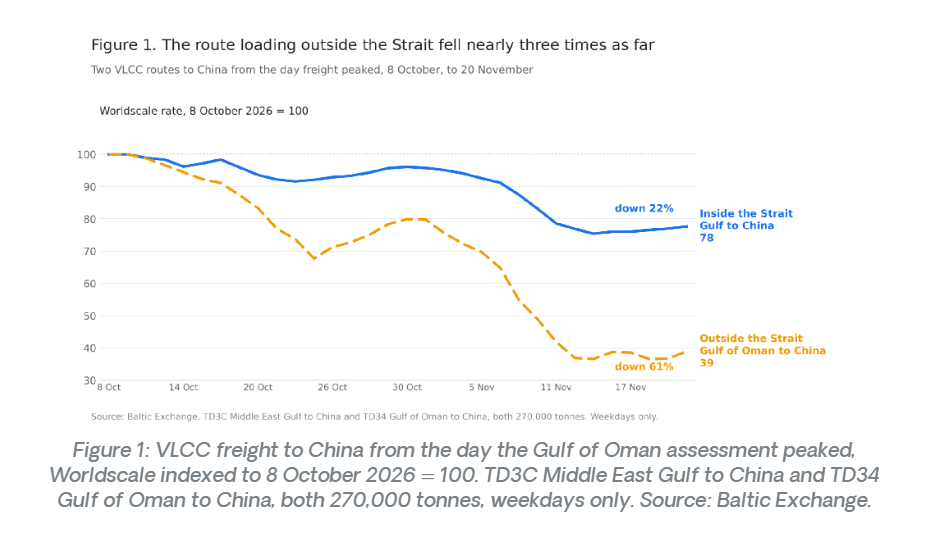
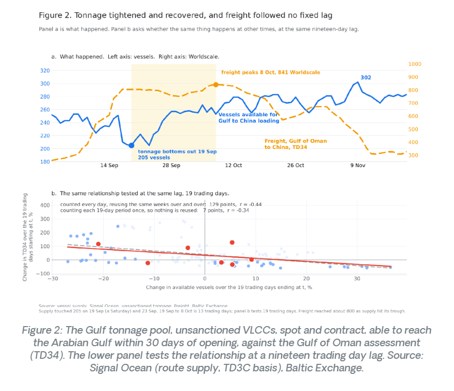
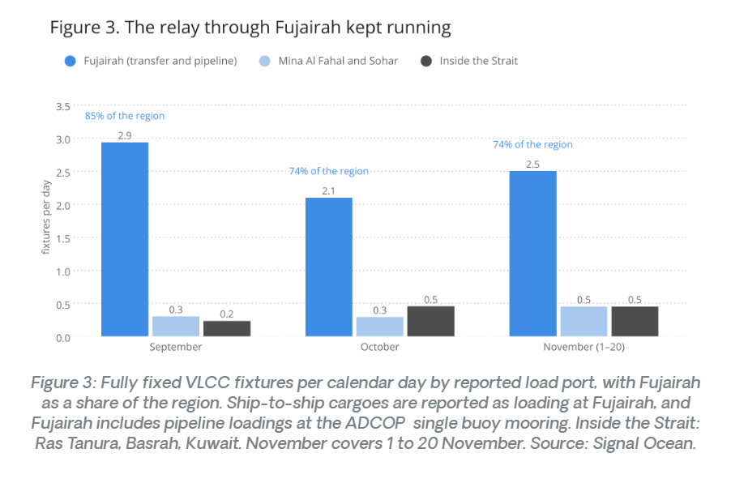
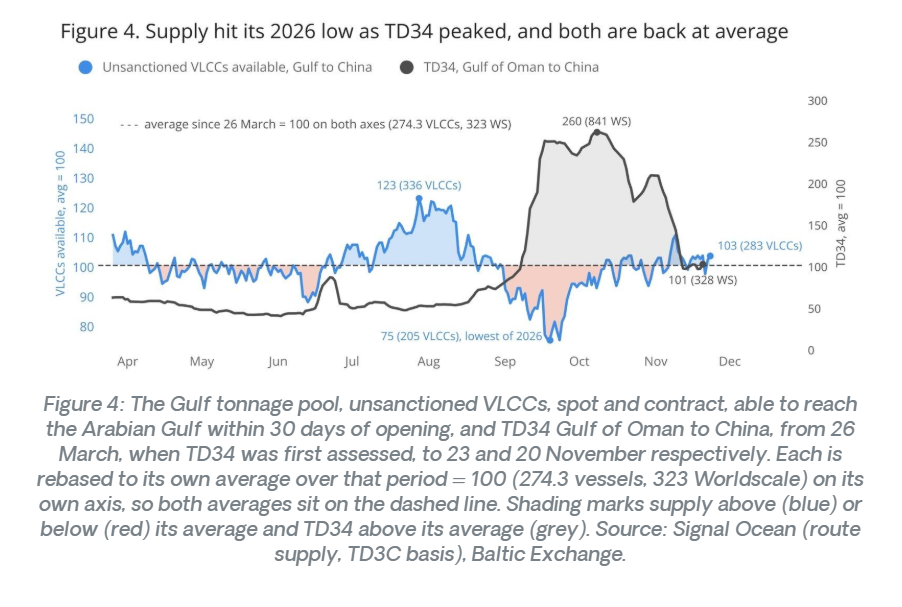

# Good Times Bad Times: The Premium Stays with the Strait

**Date:** November 25, 2026  
**Publisher:** Breakwave Advisors | **Category:** Market Insights  
**Original URL:** [https://www.breakwaveadvisors.com/insights/2026/11/25/good-times-bad-times-the-premium-stays-with-the-strait](https://www.breakwaveadvisors.com/insights/2026/11/25/good-times-bad-times-the-premium-stays-with-the-strait)  

---

*By*[*Nikolas Zannikos*](https://www.linkedin.com/in/nikolas-zannikos-508604290/)

In October, we wrote that if the transfer network off Oman kept pace, Gulf crude would carry China's refill and keep drawing tonnage east, supporting earnings on both routes. The relay largely kept pace. The earnings split: freight outside the Strait gave back most of its gains, while freight inside it held on.

The cost of chartering a VLCC from the Gulf of Oman to China (TD34) reached 841 Worldscale on 8 October, the highest level since the route began to be assessed in March. By 20 November it stood at 328, down 61%. Over the same six weeks the run loading inside the Strait of Hormuz (TD3C) fell by 22% (Figure 1).

The obvious reading is that cargo abandoned loading outside the Strait and went back inside. Port and fixture data do not support it. The explanation is simpler. Freight outside the Strait fell with the rest of the VLCC market, and freight inside it did not, because it carries a premium for the transit itself.

‍

> **Figure 1: Στιγμιότυπο Οθόνης 2026 11 25 123116**  
> [Local Asset](assets/2026-11-25_good-times-bad-times-the-premium-stays-with-the-strait_img_cea3cf84ceb9ceb3cebcceb9cf8ccf84cf85_03a7a848d798.png)

Over the same six weeks, in Worldscale terms (lump sum for TD22), West Africa to China (TD15) fell by 60% and the US Gulf to China run (TD22) by 56%, both well away from the Gulf. The dividing line is not the length of the voyage, since the long haul Gulf to China run (TD3C) barely moved. It is the Hormuz transit. Of the four VLCC routes into China, only the one that crosses the Strait held most of its value, and the Gulf of Oman route fell with the routes from West Africa and the US Gulf.

‍

## The Premium Stayed with the Strait

TD3C runs from Ras Tanura to Ningbo, about 10% further than TD34 from Mina Al Fahal. Yet on 8 October TD3C was assessed at 1.6 times TD34 in Worldscale points, and on 20 November at 3.1 times. Both routes are priced off fixed annual flat rates, so the gap in dollars moved the same way. Base freight fell everywhere, and the price of the transit itself widened.

Saudi Aramco's pricing points the same way. It set the November Arab Light price to Asia at US$ 5.00 below the Oman and Dubai average, a cut of US$ 3.00, to compensate buyers for freight, and has reportedly widened the discount again for December. The seller is absorbing part of the transit cost rather than expecting it to disappear.

‍

## Tonnage Tightened, Then Recovered

> **Figure 2: Στιγμιότυπο Οθόνης 2026 11 25 123128**  
> [Local Asset](assets/2026-11-25_good-times-bad-times-the-premium-stays-with-the-strait_img_cea3cf84ceb9ceb3cebcceb9cf8ccf84cf85_4178e4756c82.png)

Figure 2 shows the Gulf tonnage pool: unsanctioned VLCCs, on spot and on contract, that could reach the Arabian Gulf within 30 days of their next open date. It is a wider measure than the net supply count. A ship discharging in China enters the count as soon as its open date and position qualify, so about half of the latest count is still laden or discharging in the Far East. The lower panel asks whether a change in that count predicts the next move in freight. For each date it plots the percentage change in available VLCCs over the previous nineteen trading days against the percentage change in the Gulf of Oman assessment over the following nineteen. If tonnage leads freight, the points should slope downwards: fewer ships first, higher rates after. Measured on every trading day, consecutive windows would share eighteen of their nineteen days, so the panel also uses blocks nineteen days apart that do not overlap, which leaves seven independent observations over the life of the route.

The Gulf tonnage pool hit its lowest level of the year on 19 September and touched it again on 23 September. By late November it was back around its 2026 average.

The Gulf of Oman assessment climbed from about 260 Worldscale on 1 September to about 800 by 17 September, reaching that level in the same days that the pool fell to its trough. It then held between roughly 750 and 840 for three weeks while the pool recovered by about a quarter.

The relationship cannot generalise. The Gulf of Oman route has been assessed for 167 trading days, which at a nineteen day horizon leaves seven independent observations, and on those the correlation of −0.34 is not distinguishable from noise. The sign is negative whichever day the blocks start on, so the September episode is consistent with tonnage mattering, but seven points cannot turn it into a rule.

‍

## The Relay Through Fujairah Kept Running

> **Figure 3: Στιγμιότυπο Οθόνης 2026 11 25 123139**  
> [Local Asset](assets/2026-11-25_good-times-bad-times-the-premium-stays-with-the-strait_img_cea3cf84ceb9ceb3cebcceb9cf8ccf84cf85_0e1d2607d22d.png)

Over the past 60 days, 77% of VLCC loading calls at Fujairah were at the anchorage, where cargo is transferred from other vessels, and 21% at the ADCOP single buoy mooring, which loads crude piped from Abu Dhabi. Where the delivering vessel can be identified, it is almost always another VLCC shuttling cargo out through the Strait.

That relay did not stop. VLCC fixtures loading at Fujairah ran at 2.9 a day in September, 2.1 in October and 2.5 in the first twenty days of November, against 0.2 to 0.5 a day loading inside the Strait (Figure 3). Fujairah's share of fixtures in the region was 85% in September and 74% in both October and November.

The relay eased only slightly. Our AIS tracking counts 20 to 24 VLCC transfer loadings a week at Fujairah and Sohar from late August to mid October, with one week at 32, and 16 to 21 a week from late October, while fixtures and cargo counts out of the region held steady. Waits shortened too, the median time from arrival to loaded falling from 190 hours in September to 138 hours in November.

‍

> **Figure 4: Disclaimer:this Report Has Been Prepared by Signal Group For**  
> *Disclaimer:This report has been prepared by Signal Group for general information purposes only. It does not constitute, and should not be relied upon as, investment, financial, trading, legal or commercial advice, or as a recommendation to enter into any transaction. While reasonable efforts have been made to ensure that the information is accurate and reliable at the date of publication, no representation or warranty, express or implied, is given as to its accuracy, completeness or continued availability. Certain figures may be estimates or provisional and may subsequently be revised. Market conditions and other external factors may change without notice and may not be reflected in this report. Readers should conduct their own assessment and seek appropriate professional advice before making any decision. To the fullest extent permitted by law, Signal Group accepts no liability for any loss or damage arising from the use of, or reliance on, this report.Copyright notice:© 2026 Signal Group. All rights reserved. Except where otherwise stated or permitted by law, this report may not be copied, reproduced, modified, published or redistributed, in whole or in part, without the prior written consent of Signal Group. Third-party data and content remain the property of their respective owners and are used subject to the applicable terms and licences.*  
> [Local Asset](assets/2026-11-25_good-times-bad-times-the-premium-stays-with-the-strait_img_cea3cf84ceb9ceb3cebcceb9cf8ccf84cf85_66ac19b1e01f.png)

The squeeze on ships came when the pool was at its thinnest. The Gulf tonnage pool fell to its 2026 low on 19 September, a quarter below its average since March. In the same weeks TD34 rose to about two and a half times its own average (Figure 4). As the relay sped up it released about ten VLCCs, from roughly 28 tied up in September to 18 from October, and by 23 November the pool was back around its average, with TD34 back on its average too. That helped end the September squeeze, but it is too small to account on its own for a 61% fall that matched routes with no exposure to the Gulf.

‍

## The Squeeze That Came and Went

The disruption premium has not gone. It has concentrated on the Strait itself. The Gulf tonnage pool is back around its average (Figure 4) and freight outside the Strait has fallen back with the wider market, while the premium for the transit was wider on 20 November than on 8 October. Arabian Gulf–China loadings are broadly unchanged from October. The focus is now on whether incoming ballasters, meet sufficient fresh cargo demand.

‍
