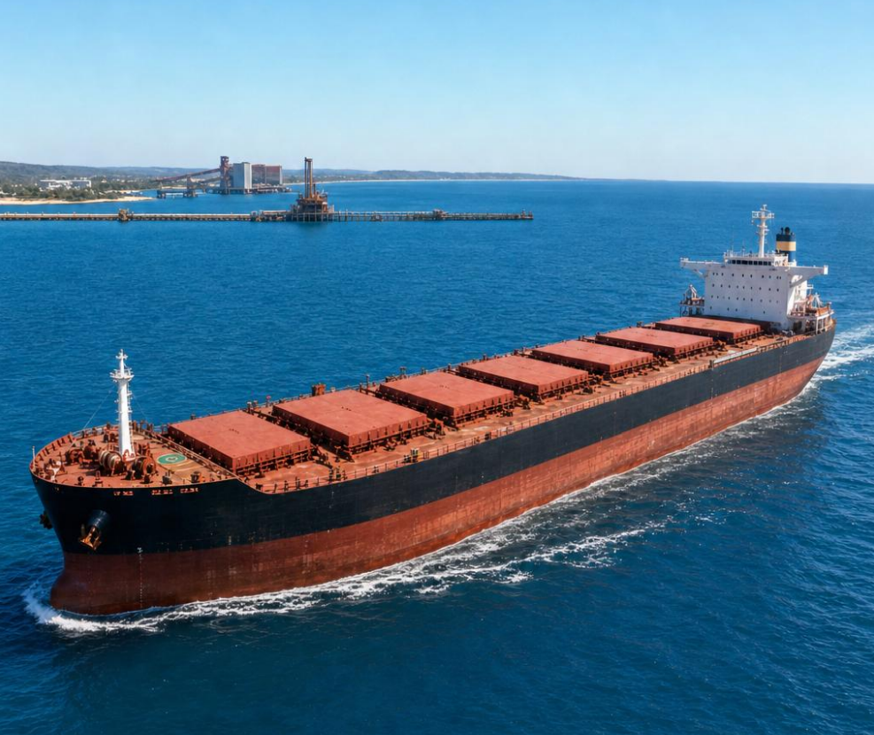
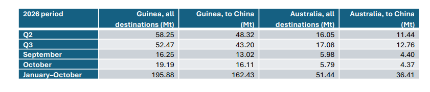
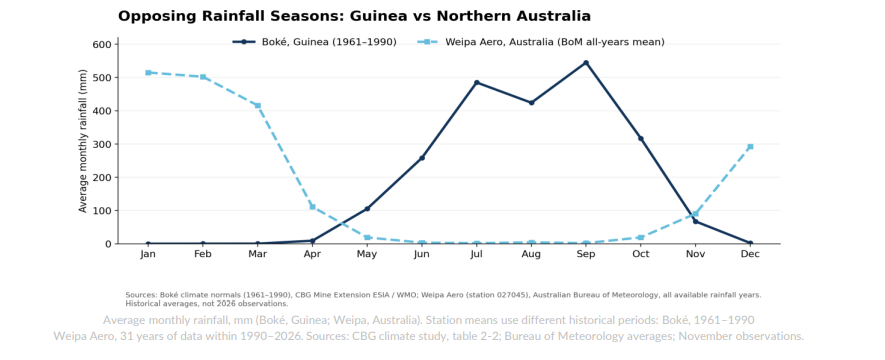

# Bauxite Special Review I Guinea and Australia bauxite flows to China, Q2–Q3 2026 and October

**Date:** November 27, 2026  
**Publisher:** Breakwave Advisors | **Category:** Market Insights  
**Original URL:** [https://www.breakwaveadvisors.com/insights/2026/11/27/bauxite-special-review-i-guinea-and-australia-bauxite-flows-to-china-q2q3-2026-and-october](https://www.breakwaveadvisors.com/insights/2026/11/27/bauxite-special-review-i-guinea-and-australia-bauxite-flows-to-china-q2q3-2026-and-october)  

---

> **Figure 1: Cea3cf84ceb9ceb3cebcceb9cf8ccf84cf85**  
> [Local Asset](assets/2026-11-27_bauxite-special-review-i-guinea-and-australia-bauxite-flows-to-china-q2q3-2026-a_img_cea3cf84ceb9ceb3cebcceb9cf8ccf84cf85_a629b37e54b7.png)

This week’s Allied QuantumSea Research reviews how bauxite loadings from Guinea and Australia to China shifted between Q2 and Q3 2026, and what the change means for Capesize demand. During Guinea’s rainy season, Australia offset 26% of the quarterly decline in Guinean shipments to China, but its shorter voyage replaced only about 7% of the lost laden tonne-miles. With Guinean loadings recovering in October and Australia’s wet season approaching, the review looks at where freight demand goes next.

### Key Findings

Australia's additional China-bound bauxite loadings offset approximately 26% of Guinea's Q3 2026 quarter-on-quarter volume decline. However, the shorter Australian voyage replaced only around 7% of the estimated lost laden tonne-miles, based on indicative sailing distances.

•**Q3 shift:**Guinea's China-bound loadings declined by 5.12 Mt from Q2, while Australia's increased by 1.32 Mt, leaving combined shipments 3.80 Mt lower.

•**Year on year**: Despite the quarterly decline, Guinea's Q3 China-bound loadings were 31.5% above the same period in 2025, while Australia's increased by 0.9%.

•**October recovery:**Guinea's China-bound loadings increased by 3.09 Mt from September, equivalent to approximately 24%, while Australian shipments remained near 4.4 Mt.

•**Year to date**: During January–October, Guinea's China-bound shipments increased by 21.5% year on year. Australia's China-bound shipments rose 2.7%, despite a 4.8% decline in its overall bauxite exports. China's share of Australian shipments increased from 65.6% to 70.8%.

### China Took More Australian Bauxite in Q3

Between Q2 and Q3 2026, Guinea's bauxite loadings for China declined by 5.12 Mt, while Australia's increased by 1.32 Mt, leaving combined China-bound shipments 3.80 Mt lower. Despite the quarterly decline, Guinea's Q3 loadings to China were reportedly 31.5% higher year on year, compared with a 0.9% increase from Australia.

> **Figure 2: Στιγμιότυπο Οθόνης 2026 11 27 104238**  
> [Local Asset](assets/2026-11-27_bauxite-special-review-i-guinea-and-australia-bauxite-flows-to-china-q2q3-2026-a_img_cea3cf84ceb9ceb3cebcceb9cf8ccf84cf85_7feda2b4d678.png)

### Guinea Drove the October Recovery

Guinea's China-bound bauxite loadings increased by 3.09 Mt in October from September, a rise of 23.7%, while Australian shipments remained broadly stable at around 4.4 Mt. Guinea's total loadings across all destinations increased by 18.1%, indicating that the recovery was concentrated in China-bound cargoes.

Over January–October, Guinea's China-bound shipments were reportedly 21.5% higher year on year. Australia's shipments to China increased by 2.7%, despite a 4.8% decline in its overall bauxite exports, lifting China's share of Australian loadings to 70.8%, from approximately 65.6% a year earlier.

### Chinese Customs: October Import Arrivals

Chinese customs recorded 19.70 Mt of bauxite imports in October 2026, including approximately 15.2 Mt from Guinea. Based on the reported country breakdown, Guinea and Australia together accounted for around 97% of total imports. These figures reflect imports recorded by Chinese customs rather than shipments loaded during October.

### Opposing Rainfall Seasons Shape Bauxite Cargo Availability

Guinea is moving beyond its rainy season as northern Australia approaches its wetter months. Historical rainfall patterns in Guinea's Boké region show the heaviest precipitation between July and September, while Weipa in Australia's Cape York typically experiences its wettest conditions between December and March. At Weipa Aero, average monthly rainfall rises from around 90 mm in November to 293 mm in December and 515 mm in January.

The seasonal contrast is relevant to bauxite export operations. At Metro Mining's Bauxite Hills operation, approximately 95 km north of Weipa, mining is normally concentrated between April and December, reflecting the operational constraints of the northern Australian wet season. Guinea's improving seasonal conditions, meanwhile, may support more consistent mining, barging and port-loading activity.

> **Figure 3: Στιγμιότυπο Οθόνης 2026 11 27 104410**  
> [Local Asset](assets/2026-11-27_bauxite-special-review-i-guinea-and-australia-bauxite-flows-to-china-q2q3-2026-a_img_cea3cf84ceb9ceb3cebcceb9cf8ccf84cf85_e867caba2f60.png)

Recent shipment data show a mixed picture as Guinea moves beyond its rainy season and northern Australia approaches its wetter months. SMM's latest verified weekly observations, as of 13 November, placed departures from Guinea's main bauxite ports at 4.45 Mt, down 0.20 Mt week on week, while Australian departures increased by 0.39 Mt to 1.20 Mt. Separately, Mysteel reported stronger China-bound shipments from both origins during 6–12 November, supported by improving operating conditions in Guinea and increased Australian loading activity. The different movements reflect distinct reporting coverage and should not be interpreted as contradictory. For freight, the key question is whether sustained Guinean cargo availability can absorb prompt Capesize tonnage in West Africa, while the approaching Australian wet season begins to influence individual export programmes.

### The Longer Voyage Matters for Capesize Demand

Australia's additional China-bound bauxite shipments in Q3 provided only a modest offset to the decline in Guinean volumes, with the difference in voyage distances amplifying the impact on vessel demand. While Australia's additional cargoes replaced approximately 26% of Guinea's lost shipment volume, they compensated for only around 7% of the estimated reduction in laden tonne-miles. This calculation assumes indicative sailing distances of 11,000 nautical miles from Guinea and 3,000 nautical miles from Australia to China and excludes ballast voyages, waiting time and port-specific variations.

Despite improving seasonal conditions in Guinea, a recovery in cargo volumes does not necessarily translate into immediate freight strength. Guinea–China Capesize freight remained in the $35–38/t range in mid-November, according to SMM, while Chinese alumina refineries held approximately 95 days of bauxite inventory coverage, potentially limiting the urgency of additional purchases. The more relevant question for Atlantic Capesize freight is whether renewed Guinean loadings can absorb available tonnage faster than additional vessels reposition into West Africa. A sustained recovery in cargo demand, rather than a temporary increase in departures, would be more significant for tightening the regional supply balance. The next test for Atlantic freight is whether fresh Guinean cargoes can reduce the prompt Capesize list in West Africa, despite further ballast arrivals.

---

**Tags:** Drybulk, Commodities, Markets  
