# Weekly Dry Market Monitor: Week 43, 2026

*Published on 28 October 2026*

## Spotlight of the Week | Fujairah

## Gulf Congestion Rises, Fujairah Takes 28%

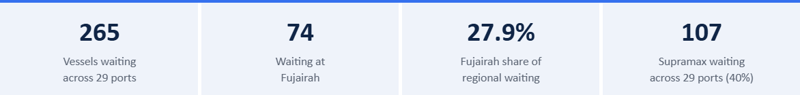

> **Figure 1: Gulf Congestion Rises, Fujairah Takes 28%**  
> **Interactive Data & Source:** [Signal Ocean Platform](https://www.thesignalgroup.com/weekly-market-monitor/weekly-dry-market-monitor-week-43-2026) | [Local Asset](../../images/6ae1e539338e479a5bf8f831_1cf3c763.png)

**Fujairah records the largest concentration of waiting bulk vessels.** More than six months into the Middle East shipping crisis, vessel waiting remains elevated across the Arabian Gulf and Gulf of Oman. As of 28 October, 265 dry bulk vessels were recorded waiting across 29 selected ports, led by Fujairah with 74 vessels (28%) and Sohar with 50. Together, the two ports account for 47% of the regional waiting fleet. Supramax represents the largest segment, with 107 vessels (40%), followed by Panamax (56) and Handysize (53). Prolonged waiting, particularly among Supramax vessels, can reduce prompt tonnage availability, although the freight impact depends on waiting duration and subsequent vessel employment.

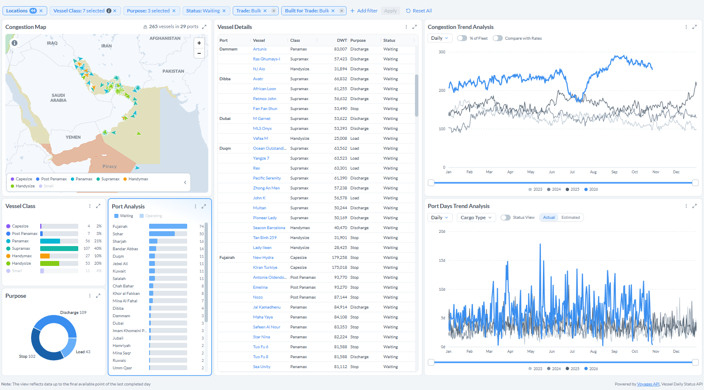

> **Figure 1: Vessels Waiting Across 29 Arabian Gulf and Gulf of Oman Ports, Waiting-Status Snapshot, 28 Oct 2026**  
> *Figure 1: Vessels waiting across 29 Arabian Gulf and Gulf of Oman ports, waiting-status snapshot, 28 Oct 2026 (Source: Signal Ocean Platform, Congestion Insights).*  
> **Interactive Data & Source:** [Signal Ocean Platform](https://www.thesignalgroup.com/weekly-market-monitor/weekly-dry-market-monitor-week-43-2026) | [Local Asset](../../images/6ae1e590713df988726bbd3a_ab93f8be.png)

**Regional waiting is running 75% above last year.** The regional waiting series averaged 268 vessels in 1–27 October, against 154 in the same period of 2025 and 139 in 2024. The count dipped to 170 in mid-July, rebuilt through August to a peak of 291 on 15 September, and stood at 254 on 27 October.

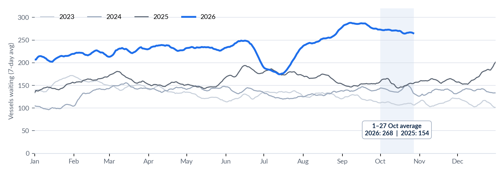

> **Figure 2: Vessels Waiting Across the Selected Regional Ports, 7-Day Average, 2023–2026; Data to 27 Oct 2026**  
> *Figure 2: Vessels waiting across the selected regional ports, 7-day average, 2023–2026; data to 27 Oct 2026 (Source: Signal Ocean Platform, congestion trend export).*  
> **Interactive Data & Source:** [Signal Ocean Platform](https://www.thesignalgroup.com/weekly-market-monitor/weekly-dry-market-monitor-week-43-2026) | [Local Asset](../../images/6ae1e5af2354b4c62150ee7b_c05f3979.png)

## Inside Fujairah: Supramax Accounts for Half of Waiting Dry Bulk Vessels

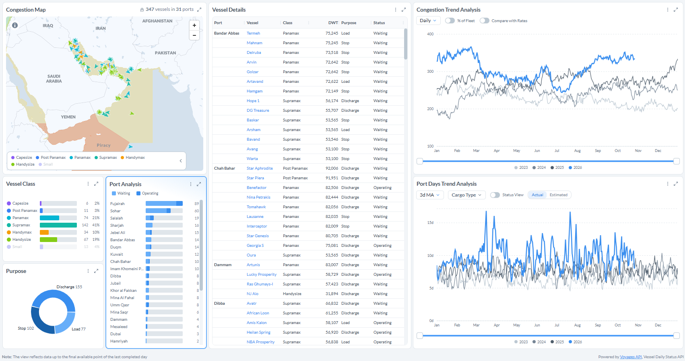

> **Figure 3: Fujairah Vessels Waiting by Class and Purpose, Daily Congestion Trend and Port Days Trend (7-Day Ma, Selected Cargo Types), 28 Oct 2026**  
> *Figure 3: Fujairah vessels waiting by class and purpose, daily congestion trend and port days trend (7-day MA, selected cargo types), 28 Oct 2026 (Source: Signal Ocean Platform).*  
> **Interactive Data & Source:** [Signal Ocean Platform](https://www.thesignalgroup.com/weekly-market-monitor/weekly-dry-market-monitor-week-43-2026) | [Local Asset](../../images/6ae1e67ac8aed5b6a6f84bbe_77d7ffc3.png)

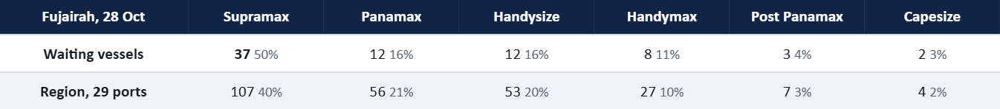

> **Table 1: Waiting Vessels by Class, Fujairah vs the 29-Port Regional Sample, 28 Oct 2026**  
> *Table 1: Waiting vessels by class, Fujairah vs the 29-port regional sample, 28 Oct 2026 (Source: Signal Ocean Platform).*  
> **Interactive Data & Source:** [Signal Ocean Platform](https://www.thesignalgroup.com/weekly-market-monitor/weekly-dry-market-monitor-week-43-2026) | [Local Asset](../../images/6ae1e6be0f42b203077bb586_c8c04ac8.png)

**Supramax dominates Fujairah's waiting fleet.** Of the 74 vessels recorded waiting on 28 October, 37 were Supramaxes, representing 50% of the port's total compared with 40% across the wider 29-port region. Fujairah alone accounts for nearly 35% of all waiting Supramaxes in the regional sample, while Panamax and Handysize follow with 12 vessels each.

**Stop calls dominate vessel activity.** Of the 74 waiting vessels, 48 (65%) are classified as stop calls, compared with 22 for discharge and just four for loading. This contrasts with the wider regional pattern, where discharge accounts for 109 vessels and stops for 102. Fujairah consequently represents almost half of all regional waiting stop calls, suggesting that its vessel accumulation extends beyond conventional loading and discharge activity.

**Congestion has intensified since mid-year.** Fujairah's daily waiting count remained largely below 40 vessels during the first half of 2026 before rising through July and August. The fleet subsequently reached approximately 80–95 vessels during September and October, before easing to 74 by 28 October. Despite the recent moderation, waiting levels remain elevated compared with the first half of the year.

## Spotlight of the Week | Fujairah

Capesize iron ore routes and Asian Supramax tightened, Panamax Atlantic shortfalls deepened, while Handysize HS7 (North China) and Panamax P6 moved into balance; HS6 remains in surplus. The US Gulf remains oversupplied for Supramax.

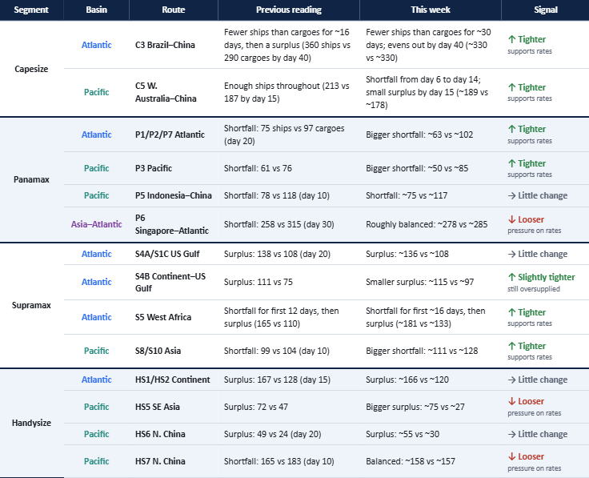

> **Table 2: Ships Available vs Cargoes Expected, Cumulative Vessel Counts**  
> *Table 2: Ships available vs cargoes expected, cumulative vessel counts. Previous reading as last published; this week read from the 23 Oct 2026 dashboards, so figures are approximate (Source: Signal). For each route, we compare the ships that will be free to load (supply) with the cargoes expected to need them (demand) over the coming days. Fewer ships than cargoes = a tight market, which supports freight rates; more ships than cargoes = an oversupplied market, which weighs on rates.*  
> **Interactive Data & Source:** [Signal Ocean Platform](https://www.thesignalgroup.com/weekly-market-monitor/weekly-dry-market-monitor-week-43-2026) | [Local Asset](../../images/6ae1e72f0f3b68ac98cd7160_53d05400.png)

## Freight Market Overview

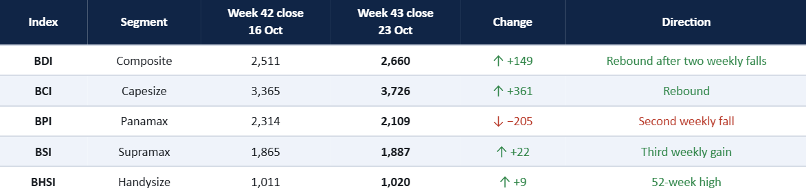

> **Figure 7: Freight Market Overview**  
> **Interactive Data & Source:** [Signal Ocean Platform](https://www.thesignalgroup.com/weekly-market-monitor/weekly-dry-market-monitor-week-43-2026) | [Local Asset](../../images/6ae1e808cbca9f72e34faa83_a93e8863.png)

**From Week 42 to Week 43.** Week 42 was a heavy week for Capesize: the BCI fell 975 points to 3,365, and C5TC(180) dropped to $27,015/day, pulling the BDI down 406 points to 2,511. The previous week, the market recovered part of that loss. The BDI rose 149 points to 2,660 as the BCI regained 361 points and C5TC(180) climbed to $30,292/day. Supramax and Handysize kept their steady climb (BHSI at a 52-week high), while Panamax fell for a second week, with P5TC down from $20,827 to $18,981/day.

**Smaller sizes lead.** The geared segments are the steadiest part of the market: the BHSI is at a 52-week high, and the BSI is 3 points below its own, with HS3\_38 (South Atlantic) +$1,550 and Supramax S3 (North China–West Africa) +$2,050 this week.

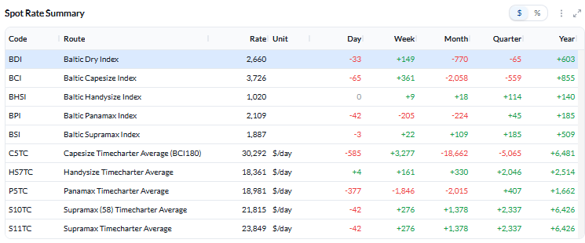

> **Figure 4: BDI Spot Rate Summary, Close 23 Oct 2026; 52-Week High 3,628, Low 1,532, Average 2,543**  
> *Figure 4: BDI spot rate summary, close 23 Oct 2026; 52-week high 3,628, low 1,532, average 2,543 (Source: Signal).*  
> **Interactive Data & Source:** [Signal Ocean Platform](https://www.thesignalgroup.com/weekly-market-monitor/weekly-dry-market-monitor-week-43-2026) | [Local Asset](../../images/6ae1e815fddc02027c85ae7e_72bea95a.png)

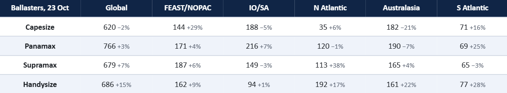

> **Table 3: Ballasters (Empty Ships Heading to Load) and Week-on-Week Change, 23 Oct 2026**  
> *Table 3: Ballasters (empty ships heading to load) and week-on-week change, 23 Oct 2026 (Source: Signal).*  
> **Interactive Data & Source:** [Signal Ocean Platform](https://www.thesignalgroup.com/weekly-market-monitor/weekly-dry-market-monitor-week-43-2026) | [Local Asset](../../images/6ae1e8369b8bd9d1397b3f35_ab0a9b0d.png)

## Key Takeaway

- Capesize rates recovered a portion of their Week 42 declines as vessel availability tightened relative to cargo demand on the C3 and C5 iron ore routes.

- Asian Supramax markets strengthened amid regional tonnage scarcity. Conversely, Panamax stood out as a clear exception, dropping for a second consecutive week despite expectations of a deficit in forward vessel supply; a growing ballast fleet in the South Atlantic may be adding downside pressure. Geared tonnage remains oversupplied in the US Gulf.

- Across 29 Middle Eastern ports, 265 vessels are currently waiting—74 at Fujairah, mostly Supramaxes, and mostly on stop calls. With regional congestion running 75% above last year's levels, available geared tonnage outside the Strait of Hormuz could face persistent operational constraints as long as these ships remain idle.

## Capesize

**Freight.** The BCI rose 361 points to 3,726 and C5TC(180) $3,277 to $30,292/day (C5TC(182) $33,795). The Pacific led: C10\_182 +$7,163 to $35,868/day and C5 +$1.49 to $13.94/mt. C3 gained $2.92 to $33.64/mt, and C14\_182 gained $4,546 to $33,064/day; C8\_182 fell $1,850 to $29,550/day. C9\_182 remains the top route at $64,200/day.

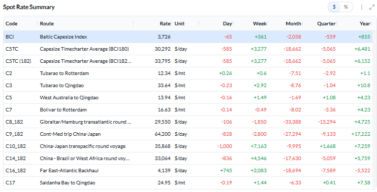

> **Figure 5: Capesize Route Rates, Close 23 Oct 2026**  
> *Figure 5: Capesize route rates, close 23 Oct 2026 (Source: Signal).*  
> **Interactive Data & Source:** [Signal Ocean Platform](https://www.thesignalgroup.com/weekly-market-monitor/weekly-dry-market-monitor-week-43-2026) | [Local Asset](../../images/6ae1e90126b80ec561678c5b_236f2aee.png)

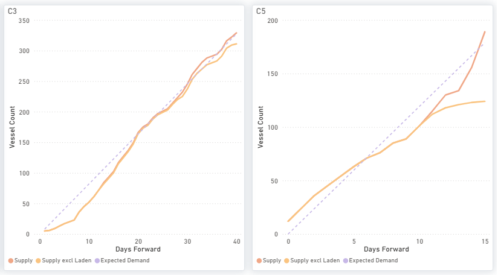

> **Figure 6: Capesize Ships Available (Supply) vs Cargoes Expected (Demand), by Days Ahead**  
> *Figure 6: Capesize ships available (supply) vs cargoes expected (demand), by days ahead (Source: Signal).*  
> **Interactive Data & Source:** [Signal Ocean Platform](https://www.thesignalgroup.com/weekly-market-monitor/weekly-dry-market-monitor-week-43-2026) | [Local Asset](../../images/6ae1e97c100e5483a356581a_92d6d0fa.png)

**Ships vs cargoes.** On C3, there are now fewer ships than cargoes for about the next 30 days, evening out only around day 40 (~330 each), against about 16 days in the previous reading. On C5, ships fall short of cargoes between days 6 and 14. Australasia ballasters fell 21% while FEAST/NOPAC rose 29%, so open tonnage is shifting north rather than disappearing.

## Panamax

**Freight.** The BPI fell 205 points to 2,109 and P5TC fell from $1,846 to $18,981/day, with all routes lower. The Atlantic led the fall: P1A\_82 −$2,809 to $17,736/day and P2A\_82 −$2,577 to $26,520/day (still the top route); P6\_82 −$2,455. P7 and P8 eased to $71.94/mt and $53.69/mt.

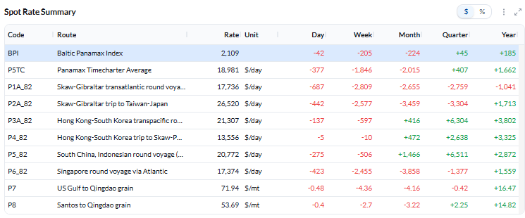

> **Figure 7: Panamax Route Rates, Close 23 Oct 2026**  
> *Figure 7: Panamax route rates, close 23 Oct 2026 (Source: Signal).*  
> **Interactive Data & Source:** [Signal Ocean Platform](https://www.thesignalgroup.com/weekly-market-monitor/weekly-dry-market-monitor-week-43-2026) | [Local Asset](../../images/6ae1e9ccbf4dfc276e217584_22d9ea51.png)

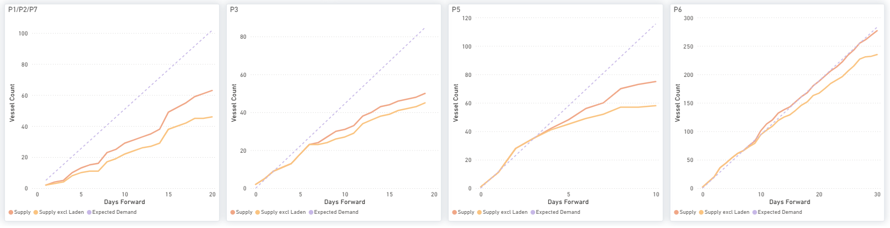

> **Figure 8: Panamax Ships Available (Supply) vs Cargoes Expected (Demand), by Days Ahead**  
> *Figure 8: Panamax ships available (supply) vs cargoes expected (demand), by days ahead (Source: Signal).*  
> **Interactive Data & Source:** [Signal Ocean Platform](https://www.thesignalgroup.com/weekly-market-monitor/weekly-dry-market-monitor-week-43-2026) | [Local Asset](../../images/6ae1ea08100e5483a356c2b7_ef38247c.png)

**Ships vs cargoes.** Forward vessel supply continues to lag behind expected demand across the P1/P2/P7 (~63 vessels against ~102 by day 20), P3, and P5 routes, whereas P6 has approached market balance. Despite these ongoing deficit conditions, freight rates trended lower. Although an influx of ballasters into the South Atlantic (+25%) and Indian Ocean/South Africa region (+7%). The divergence between forward supply–demand balances and declining freight rates suggests that the projected shortages have yet to translate into sustained support for earnings.

## Supramax

**Freight.** The BSI edged up 22 points to 1,887, just below its 52-week high of 1,890, and S11TC $276 to $23,849/day. Asia led: S3 +$2,050 to $24,167/day, S8 +$514 to $27,900/day and S10 +$456. The US Gulf eased: S1C −$1,475 to $30,169/day and S4A −$1,066 to $30,853/day (still the top route).

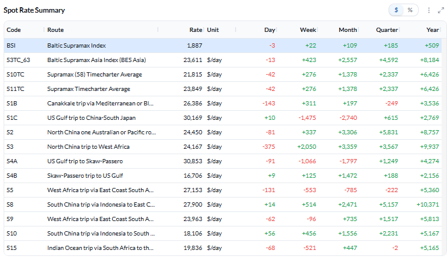

> **Figure 9: Supramax Route Rates, Close 23 Oct 2026**  
> *Figure 9: Supramax route rates, close 23 Oct 2026 (Source: Signal).*  
> **Interactive Data & Source:** [Signal Ocean Platform](https://www.thesignalgroup.com/weekly-market-monitor/weekly-dry-market-monitor-week-43-2026) | [Local Asset](../../images/6ae1ea6136e3df31bb0d5587_3abfad3c.png)

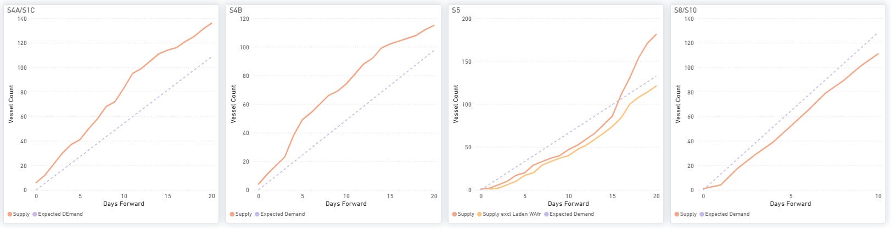

> **Figure 10: Supramax Ships Available (Supply) vs Cargoes Expected (Demand), by Days Ahead**  
> *Figure 10: Supramax ships available (supply) vs cargoes expected (demand), by days ahead (Source: Signal).*  
> **Interactive Data & Source:** [Signal Ocean Platform](https://www.thesignalgroup.com/weekly-market-monitor/weekly-dry-market-monitor-week-43-2026) | [Local Asset](../../images/6ae1eaa62420a015053b661c_a0716bb8.png)

**Ships vs cargoes.** The US Gulf routes (S4A/S1C, S4B) still have more ships than cargoes, and North Atlantic ballasters jumped 38% to 113. In Asia (S8/S10), ships fall short of cargoes throughout (~111 vs ~128 by day 10), and West Africa (S5) is short for the first ~16 days.

## Handysize

**Freight.** The BHSI rose 9 points to 1,020, a 52-week high, and HS7TC rose from $161 to $18,361/day. HS3\_38 (South Atlantic) gained $1,550 to $30,022/day and remains the top route; HS4\_38 (US Gulf) fell $772 to $19,657/day. Asia firmed modestly (HS5 +$200, HS6 and HS7 +$163).

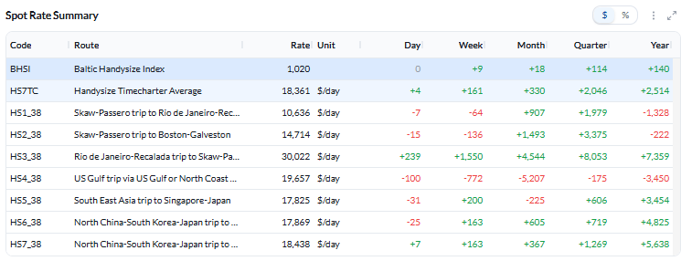

> **Figure 11: Handysize Route Rates, Close 23 Oct 2026**  
> *Figure 11: Handysize route rates, close 23 Oct 2026 (Source: Signal).*  
> **Interactive Data & Source:** [Signal Ocean Platform](https://www.thesignalgroup.com/weekly-market-monitor/weekly-dry-market-monitor-week-43-2026) | [Local Asset](../../images/6ae1eae5f2cc9abae10952ef_21ed3f94.png)

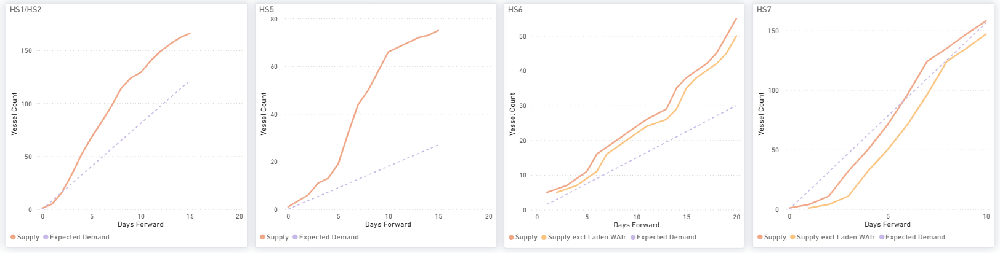

> **Figure 12: Handysize Ships Available (Supply) vs Cargoes Expected (Demand), by Days Ahead**  
> *Figure 12: Handysize ships available (supply) vs cargoes expected (demand), by days ahead (Source: Signal).*  
> **Interactive Data & Source:** [Signal Ocean Platform](https://www.thesignalgroup.com/weekly-market-monitor/weekly-dry-market-monitor-week-43-2026) | [Local Asset](../../images/6ae1eb243612134ca55eed31_7f8745c1.png)

**Ships vs cargoes.** HS1/HS2, HS5 and HS6 all have more ships than cargoes. HS7, where ships were short of cargoes in the previous reading, is now balanced (~158 vs ~157 by day 10). Global ballasters rose 15% to 686, with gains in every region, which caps further upside.

*Disclaimer:* *This report has been prepared by Signal Group for general information purposes only. It does not constitute, and should not be relied upon as, investment, financial, trading, legal or commercial advice, or as a recommendation to enter into any transaction. While reasonable efforts have been made to ensure the information is accurate and reliable at the date of publication, no representation or warranty, express or implied, is given as to its accuracy, completeness or continued availability. Certain figures may be estimates or provisional and may subsequently be revised. Market conditions and other external factors may change without notice and may not be reflected in this report. Readers should conduct their own assessment and seek appropriate professional advice before making any decision. To the fullest extent permitted by law, Signal Group accepts no liability for any loss or damage arising from the use of, or reliance on, this report. Copyright notice: © 2026 Signal Group. All rights reserved. Except where otherwise stated or permitted by law, this report may not be copied, reproduced, modified, published or redistributed, in whole or in part, without the prior written consent of Signal Group. Third-party data and content remain the property of their respective owners and are used subject to the applicable terms and licences.*
