# Weekly Dry Market Monitor: Week 45, 2026

*Published on 13 November 2026*

## SPOTLIGHT OF THE WEEK | AUSTRALIA BAUXITE

**Australia Bauxite: Fewer Cargoes Overall, but More of Them Bound for China**

> **Figure 1: Spotlight of the Week | Australia Bauxite**  
> **Interactive Data & Source:** [Signal Ocean Platform](https://www.thesignalgroup.com/weekly-market-monitor/weekly-dry-market-monitor-week-45-2026) | [Local Asset](../../images/6af6c4724a78dbda3296660b_52c4e293.png)

**Lower exports overall.** Signal Ocean's tracked flows show Australian bauxite exports reached 51.44 Mt during January–October 2026, down 4.8% from 54.05 Mt a year earlier and slightly below the 51.73 Mt recorded in the same period of 2024. The decline was not uniform throughout the year. Q3 shipments increased 6.4% quarter-on-quarter to 17.08 Mt, although they remained 5.1% below the corresponding period of 2025. October exports reached 5.79 Mt, down 3.2% month-on-month but 1.3% higher year-on-year.

**China's** **share** **of** **Australian** **bauxite** **exports has grown.** Australian bauxite shipments to China increased 2.7% year-over-year to 36.41 Mt during January–October 2026, while exports to other destinations declined 19.1% to 15.03 Mt. China's share of Australia's total bauxite exports rose to 70.8%, up from 65.6% a year earlier. The divergence was more pronounced in October, when China-bound shipments increased 13.6% year-over-year to 4.37 Mt, while volumes to other destinations fell 23.9%.

**A softer start to November.** Signal Ocean's tracked Australian bauxite exports declined to 0.88 Mt in the week ending 8 November, down 28.7% week-on-week and 31.8% year-on-year. China-bound shipments eased 10.6% on the week to 0.75 Mt, while exports to other destinations fell more sharply, by 67.3%, to 0.13 Mt. The latest weekly decline was therefore more pronounced outside China, consistent with the growing concentration of Australian bauxite shipments towards the Chinese market. However, the weekly figures should be viewed alongside October's 1.3% year-on-year increase in total exports.

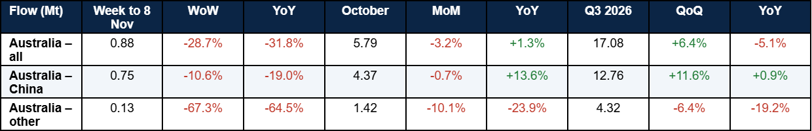

> **Table 1: Australian Bauxite Exports, Weekly, Monthly and Quarterly Comparison**  
> *Table 1: Australian bauxite exports, weekly, monthly and quarterly comparison. Other = all destinations minus China. WoW = vs week ending 1 Nov; MoM = vs September; QoQ = vs Q2 2026; YoY = vs same period of 2025. Forward-flagged cargoes excluded (Source: Signal cargo flows).*  
> **Interactive Data & Source:** [Signal Ocean Platform](https://www.thesignalgroup.com/weekly-market-monitor/weekly-dry-market-monitor-week-45-2026) | [Local Asset](../../images/6af6c4ca37a7b707768572ae_fa325fd7.png)

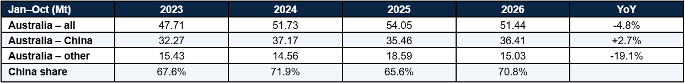

> **Table 2: Australian Bauxite Exports, January–october, 2023–2026**  
> *Table 2: Australian bauxite exports, January–October, 2023–2026 (Source: Signal cargo flows). Signal Ocean tracked bauxite volumes exclude forward-flagged cargoes. Metro Mining reports wet tonnes, which should not be directly compared with the tracked cargo-flow totals without confirming the measurement basis.*  
> **Interactive Data & Source:** [Signal Ocean Platform](https://www.thesignalgroup.com/weekly-market-monitor/weekly-dry-market-monitor-week-45-2026) | [Local Asset](../../images/6af6c50f253af4c7d4005bad_b268f5ae.png)

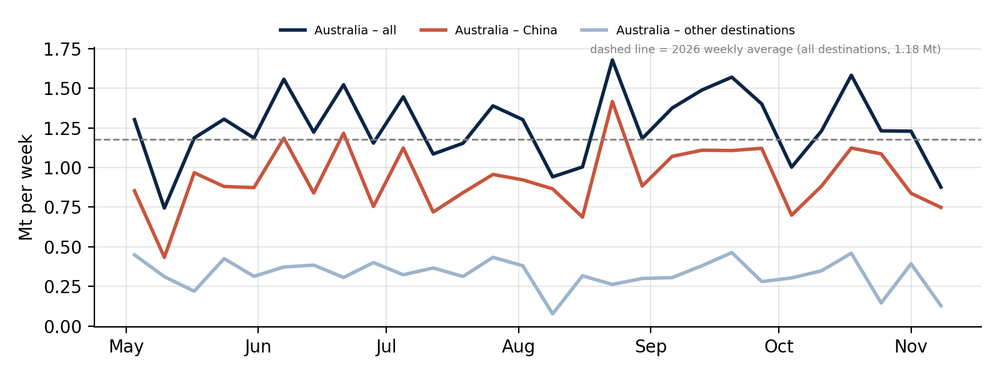

> **Figure 1: Weekly Australian Bauxite Exports by Destination, May–november 2026, Mt**  
> *Figure 1: Weekly Australian bauxite exports by destination, May–November 2026, Mt (Source: Signal cargo flows).*  
> **Interactive Data & Source:** [Signal Ocean Platform](https://www.thesignalgroup.com/weekly-market-monitor/weekly-dry-market-monitor-week-45-2026) | [Local Asset](../../images/6af6c51b6f05df7da5bdda6c_521505c2.png)

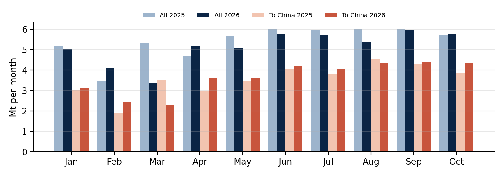

> **Figure 2: Monthly Australian Bauxite Exports, All Destinations and China, January–october 2025 vs 2026, Mt**  
> *Figure 2: Monthly Australian bauxite exports, all destinations and China, January–October 2025 vs 2026, Mt (Source: Signal cargo flows).*  
> **Interactive Data & Source:** [Signal Ocean Platform](https://www.thesignalgroup.com/weekly-market-monitor/weekly-dry-market-monitor-week-45-2026) | [Local Asset](../../images/6af6c5262b3f5d9e0335070e_cb6968ac.png)

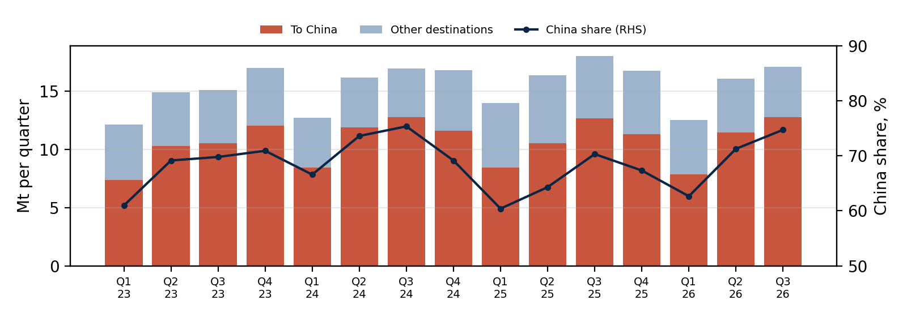

> **Figure 3: Quarterly Australian Bauxite Exports by Destination and China Share, Q1 2023–q3 2026**  
> *Figure 3: Quarterly Australian bauxite exports by destination and China share, Q1 2023–Q3 2026 (Source: Signal cargo flows).*  
> **Interactive Data & Source:** [Signal Ocean Platform](https://www.thesignalgroup.com/weekly-market-monitor/weekly-dry-market-monitor-week-45-2026) | [Local Asset](../../images/6af6c54036d72cf79e9b8370_6a6bb396.png)

**Australian supply and Chinese demand.** Metro Mining reported improved shipments from its Bauxite Hills operation, with October exports reaching 752,000 wet tonnes, approximately 14% above September, following earlier mining and barging disruptions. Loading performance also improved, with a Capesize vessel loaded in 5.8 days, the company's fastest turnaround of 2026. In China, aluminium ingot inventories across three major regions declined by 6,000 t to 370,000 t on 11 November. However, conditions further upstream remain less supportive of additional bauxite purchases. Weekly Chinese alumina production fell to 1.733 Mt as of 5 November, with the operating rate declining to 75.55%. Improved Australian loading capacity may therefore not immediately translate into stronger spot cargo demand. China's increasing share of Australian bauxite exports favours shorter Pacific voyages over the longer Guinea–China route, with different implications for Capesize tonne-mile demand.

*Chinese aluminium ingot inventory observations are dated 11 November and are presented as a subsequent market update; the freight reference week ends 6 November. Downstream aluminium inventories are distinct from refinery bauxite feedstock stocks.*

## FORWARD VESSEL AVAILABILITY | WHAT CHANGED

The C3 Brazil–China 40-day forward balance tightened, with the vessel shortfall widening from 9 to 48 ships, while C5 West Australia–China remained in surplus at 37 vessels. Panamax balances eased in both basins, with P1/P2/P7 Atlantic moving from a 34-ship shortfall to balance and P6 Singapore–Atlantic shifting into a 10-ship surplus. The P3 Pacific shortfall narrowed from 29 to 10 vessels, while P5 Indonesia–China remained 45 ships short. Among geared vessels, surpluses widened on S4B Continent–US Gulf and S5 West Africa, while S4A/S1C US Gulf and HS1/HS2 Continent recorded smaller surpluses. HS7 North China showed the largest Handysize shortfall, widening from 21 to 36 vessels.

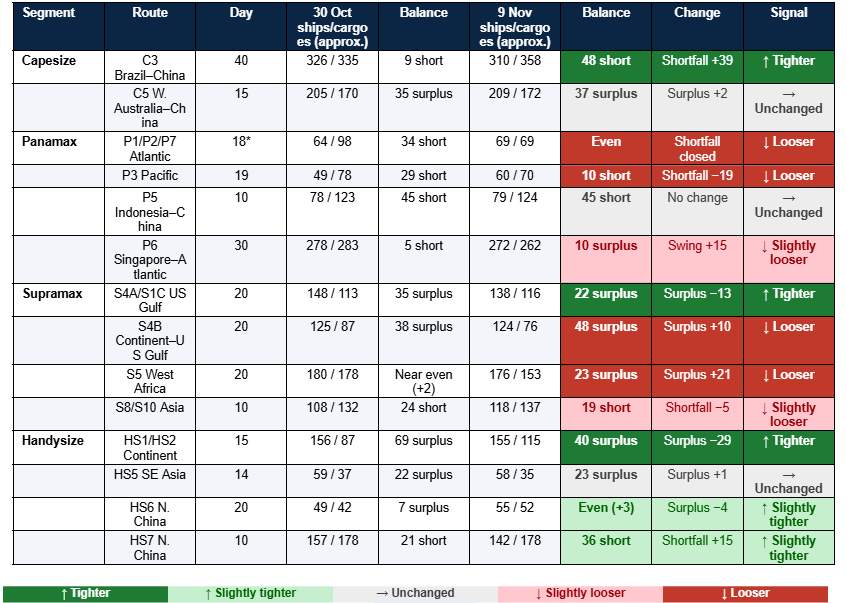

> **Table 3: Approximate Cumulative Available Ships and Expected Cargoes, Comparing the 30 October Dashboards with the 9 November 2026 Dashboard Captures at the Specified Route-Specific Forecast Horizons**  
> *Table 3: Approximate cumulative available ships and expected cargoes, comparing the 30 October dashboards with the 9 November 2026 dashboard captures at the specified route-specific forecast horizons. Balance = ships minus cargoes: “short” = fewer ships than cargoes (tight); “surplus” = more ships than cargoes (loose); within ±3 = even. Signal rule: a move of 3 ships or less, or under 2.5% of cargoes = Unchanged; under 10% = Slightly tighter/looser; 10% or more = Tighter/Looser. Colour key: green = tighter (supportive for owners); grey = unchanged; red = looser. *P1/P2/P7 curve now ends on day 18 (Source: Signal Ocean). All counts are approximate chart readings.*  
> **Interactive Data & Source:** [Signal Ocean Platform](https://www.thesignalgroup.com/weekly-market-monitor/weekly-dry-market-monitor-week-45-2026) | [Local Asset](../../images/6af6c5bcdf17554fe0407a01_8fa1d540.png)

## FREIGHT MARKET OVERVIEW

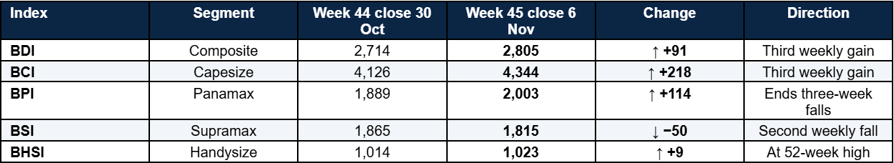

> **Table 4: Baltic Indices at the 6 November 2026 Weekly Close, Compared with 30 October 2026**  
> *Table 4: Baltic indices at the 6 November 2026 weekly close, compared with 30 October 2026 (Source: Baltic Exchange).*  
> **Interactive Data & Source:** [Signal Ocean Platform](https://www.thesignalgroup.com/weekly-market-monitor/weekly-dry-market-monitor-week-45-2026) | [Local Asset](../../images/6af6c5f86baa68906a7eff4c_f03eec04.png)

**From Week 44 to Week 45.** The BDI increased by 91 points to 2,805 on 6 November, marking its third consecutive weekly gain and remaining above its 52-week average of 2,568. Capesize strengthened, with the BCI rising 218 points to 4,344, while Panamax recovered, with the BPI gaining 114 points to 2,003.

**Geared sizes diverged.** The BSI declined by 50 points to 1,815, while S11TC earnings fell by $623/day to $22,946/day. In contrast, the BHSI increased by 9 points to 1,023, reaching a new 52-week high, with HS7TC earnings edging up by $163/day to $18,418/day.

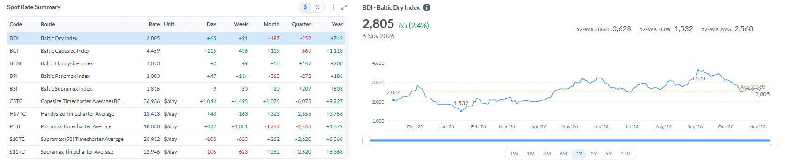

> **Figure 4: Baltic Spot Rate Summary and BDI; BDI at 6 Nov 2026, BCI and C5TC Rows at 9 Nov 2026**  
> *Figure 4: Baltic spot rate summary and BDI; BDI at 6 Nov 2026, BCI and C5TC rows at 9 Nov 2026. BDI 52-week reference values: high 3,628, low 1,532, average 2,568 (Source: Baltic Exchange).*  
> **Interactive Data & Source:** [Signal Ocean Platform](https://www.thesignalgroup.com/weekly-market-monitor/weekly-dry-market-monitor-week-45-2026) | [Local Asset](../../images/6af6c60e6f32850ed1ec8740_6868275b.png)

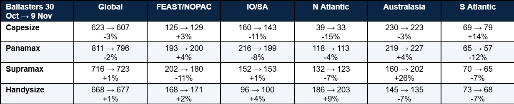

> **Table 5: Ballasters (Empty Ships Heading to Load), Week 44 (30 Oct) → Week 45 Reading (9 Nov Dashboard Capture), and Change**  
> *Table 5: Ballasters (empty ships heading to load), Week 44 (30 Oct) → Week 45 reading (9 Nov dashboard capture), and change. The dashboards’ own week-on-week percentages use a different base and are not used here (Source: Signal).*  
> **Interactive Data & Source:** [Signal Ocean Platform](https://www.thesignalgroup.com/weekly-market-monitor/weekly-dry-market-monitor-week-45-2026) | [Local Asset](../../images/6af6c62ce19252585970af3b_51f97653.png)

## KEY TAKEAWAY

•  **Capesize:** Firmer at the 6 November weekly close, with the BCI rising 218 points to 4,344. The C3 Brazil–China 40-day forward shortfall widened from about 9 to 48 vessels, while C5 West Australia–China remained in surplus at about 37 vessels. Atlantic conditions strengthened, although Pacific freight remained more subdued.

•  **Panamax:** Recovered after three consecutive weekly declines, with the BPI gaining 114 points to 2,003. Forward vessel balances loosened across P1/P2/P7 Atlantic, P3 Pacific and P6 Singapore–Atlantic, while P5 Indonesia–China retained a shortfall of about 45 vessels.

•  **Supramax and Handysize:** Supramax weakened, with wider vessel surpluses on S4B Continent–US Gulf and S5 West Africa. Handysize reached a 52-week high, supported by firmer conditions in parts of the Atlantic. The HS1/HS2 Continent surplus narrowed from about 69 to 40 vessels, while the HS7 North China shortfall widened from about 21 to 36 vessels.

## CAPESIZE

**Freight.** At the 6 November weekly close, the BCI reached 4,344, up 218 points from 4,126 on 30 October. The Capesize 5TC (182) average closed the week at $39,395/day, up $1,975/day from $37,420/day on 30 October, having opened the week at $35,944/day. The North Atlantic outperformed, with the C8 transatlantic index lifted to about $41,000/day by Friday. In the Pacific, C5 West Australia–China miner business was concluded at $13.25/t on Friday, below Monday’s opening levels, while active C3 fixing midweek pushed Brazil–China rates towards $37.00/t. Official 6 November C3 and C5 index assessments are pending verification, so the C3–C5 spread is not quoted for the weekly close.

**9 November: subsequent observation.** By 9 November, the BCI stood at 4,459, C5TC at $36,936/day, C3 at $36.52/t and C5 at $13.80/t (spread $22.72/t). These are subsequent observations and are not used for the weekly closing comparison.

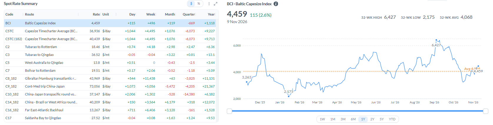

> **Figure 5: Capesize Route Rates, 9 November 2026 Subsequent Observation, Shown for Context and Not the Weekly Close**  
> *Figure 5: Capesize route rates, 9 November 2026 subsequent observation, shown for context and not the weekly close (Source: Baltic Exchange).*  
> **Interactive Data & Source:** [Signal Ocean Platform](https://www.thesignalgroup.com/weekly-market-monitor/weekly-dry-market-monitor-week-45-2026) | [Local Asset](../../images/6af6c6634db2a7a3510af249_45588833.png)

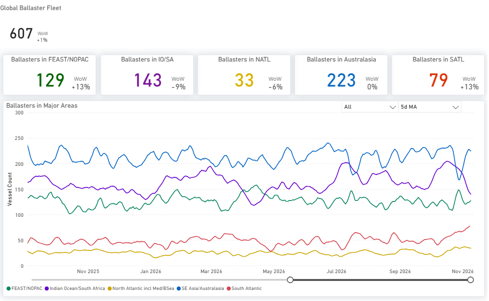

> **Figure 6: Capesize Ballasters by Region, 5-Day Ma; Dashboard WoW Uses Its Own Base, See Table 5**  
> *Figure 6: Capesize ballasters by region, 5-day MA; dashboard WoW uses its own base, see Table 5 (Source: Signal).*  
> **Interactive Data & Source:** [Signal Ocean Platform](https://www.thesignalgroup.com/weekly-market-monitor/weekly-dry-market-monitor-week-45-2026) | [Local Asset](../../images/6af6c67b4db2a7a3510b0a03_fb5418c1.png)

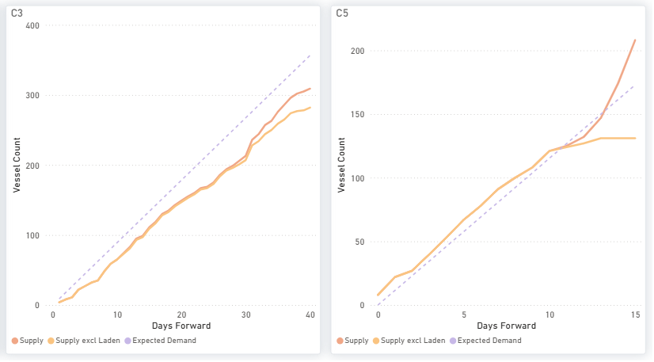

> **Figure 7: Capesize Available Ships (Supply) vs Expected Cargoes (Demand), by Days Ahead**  
> *Figure 7: Capesize available ships (supply) vs expected cargoes (demand), by days ahead (Source: Signal).*  
> **Interactive Data & Source:** [Signal Ocean Platform](https://www.thesignalgroup.com/weekly-market-monitor/weekly-dry-market-monitor-week-45-2026) | [Local Asset](../../images/6af6c6876f05df7da5bf7a85_c71f2de0.png)

**Ships vs cargoes (approximate chart readings).** C3: ships below cargoes across the whole 40-day window (310 vs 358 by day 40, from 326 vs 335). C5: total available supply, including laden vessels, reaches or exceeds expected cargoes from approximately day 10; by day 15 the chart shows 209 ships against 172 cargoes. Excluding laden vessels, available supply levels off near 131 ships. Ballasters vs Week 44: global 623→607 (−3%); South Atlantic 69→79 (+14%); IO/SA 160→143 (−11%); Australasia 230→223 (−3%).

## PANAMAX

**Freight.** The BPI rose 114 points to 2,003, while P5TC earnings increased by $1,031/day to $18,030/day, ending three consecutive weekly declines. The Atlantic led the rebound: P1A\_82 +$1,745/day to $15,977/day and P2A\_82 +$1,392/day to $24,234/day, still the top route. P3A\_82 rose $894/day to $20,506/day, and P6\_82 rose $709/day to $17,087/day. P5\_82 slipped $150/day to $18,672/day and P7 $0.63/mt to $67.73/mt.

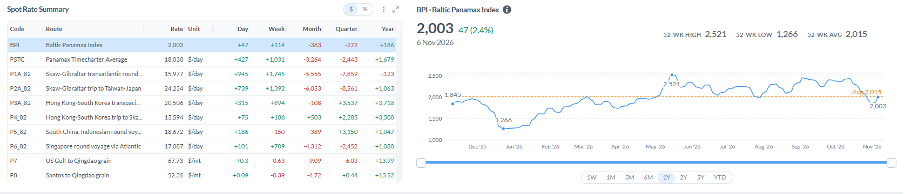

> **Figure 8: Panamax Route Rates, 6 Nov 2026**  
> *Figure 8: Panamax route rates, 6 Nov 2026 (Source: Baltic Exchange).*  
> **Interactive Data & Source:** [Signal Ocean Platform](https://www.thesignalgroup.com/weekly-market-monitor/weekly-dry-market-monitor-week-45-2026) | [Local Asset](../../images/6af6c6b3a1377e06247111ac_da87dcdf.png)

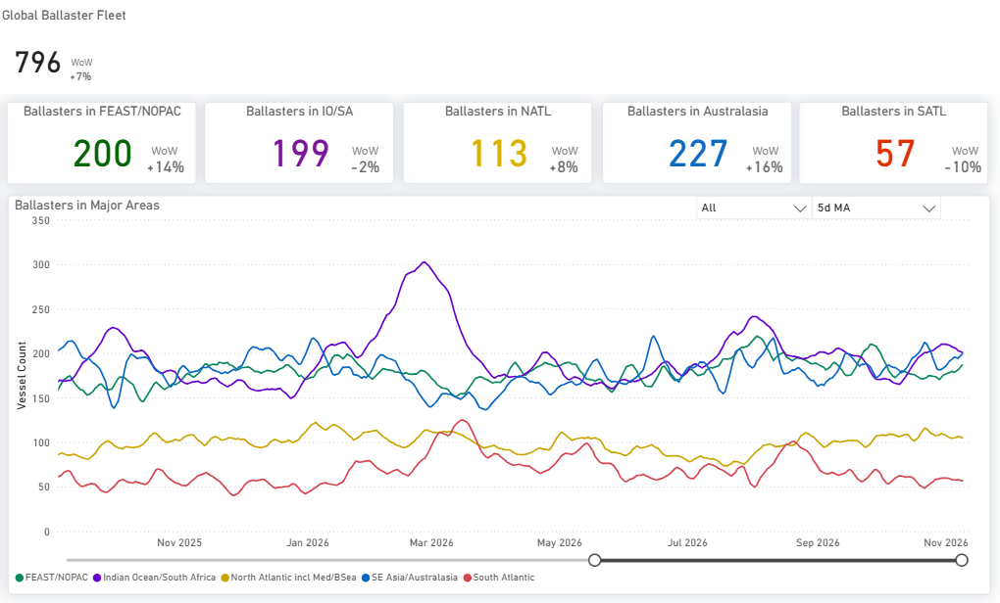

> **Figure 9: Panamax Ballasters by Region, 5-Day Ma; Dashboard WoW Uses Its Own Base, See Table 5**  
> *Figure 9: Panamax ballasters by region, 5-day MA; dashboard WoW uses its own base, see Table 5 (Source: Signal).*  
> **Interactive Data & Source:** [Signal Ocean Platform](https://www.thesignalgroup.com/weekly-market-monitor/weekly-dry-market-monitor-week-45-2026) | [Local Asset](../../images/6af6c6d14a78dbda3297965f_dcebadee.png)

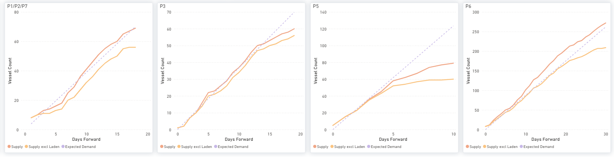

> **Figure 10: Panamax Available Ships (Supply) vs Expected Cargoes (Demand), by Days Ahead**  
> *Figure 10: Panamax available ships (supply) vs expected cargoes (demand), by days ahead (Source: Signal).*  
> **Interactive Data & Source:** [Signal Ocean Platform](https://www.thesignalgroup.com/weekly-market-monitor/weekly-dry-market-monitor-week-45-2026) | [Local Asset](../../images/6af6c6e04a78dbda3297cf6d_6427eb2e.png)

**Ships vs cargoes (approximate chart readings).** Forward counts loosened. P1/P2/P7 69 vs 69 by day 18 (from 34 short); P3 60 vs 70 by day 19 (from 29 short); P6 272 vs 262 by day 30 (from 5 short); P5 unchanged at 79 vs 124 by day 10. Ballasters vs Week 44: global 811→796 (−2%); Australasia 219→227 (+4%); South Atlantic 65→57 (−12%).

## SUPRAMAX

**Freight.** The BSI fell 50 points to 1,815, its second consecutive weekly decline, while S11TC earnings decreased by $623/day to $22,946/day. Losses were broad: S15 Indian Ocean −$1,778/day to $17,811/day, S1B −$878/day, S5 West Africa −$812/day to $25,391/day, and S3 −$592/day to $23,875/day. The US Gulf held: S4A −$132/day to $29,756/day, the top route, and S1C +$22/day to $29,472/day.

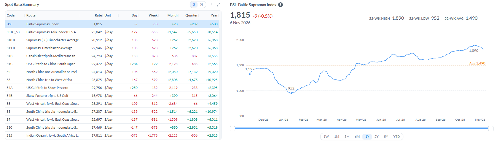

> **Figure 11: Supramax Route Rates, 6 Nov 2026**  
> *Figure 11: Supramax route rates, 6 Nov 2026 (Source: Baltic Exchange).*  
> **Interactive Data & Source:** [Signal Ocean Platform](https://www.thesignalgroup.com/weekly-market-monitor/weekly-dry-market-monitor-week-45-2026) | [Local Asset](../../images/6af6c7156f05df7da5bfb319_8f8f02df.png)

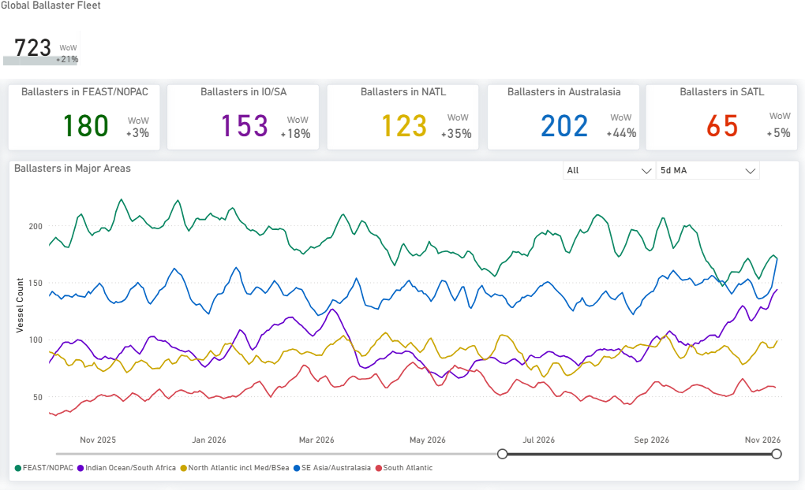

> **Figure 12: Supramax Ballasters by Region, 5-Day Ma; Dashboard WoW Uses Its Own Base, See Table 5**  
> *Figure 12: Supramax ballasters by region, 5-day MA; dashboard WoW uses its own base, see Table 5 (Source: Signal).*  
> **Interactive Data & Source:** [Signal Ocean Platform](https://www.thesignalgroup.com/weekly-market-monitor/weekly-dry-market-monitor-week-45-2026) | [Local Asset](../../images/6af6c722eadcdf18fc09f491_d27c1c9f.png)

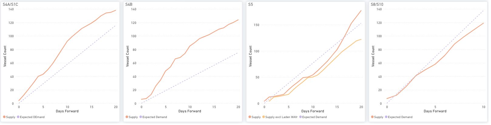

> **Figure 13: Supramax Available Ships (Supply) vs Expected Cargoes (Demand), by Days Ahead**  
> *Figure 13: Supramax available ships (supply) vs expected cargoes (demand), by days ahead (Source: Signal).*  
> **Interactive Data & Source:** [Signal Ocean Platform](https://www.thesignalgroup.com/weekly-market-monitor/weekly-dry-market-monitor-week-45-2026) | [Local Asset](../../images/6af6c72f85fcdc91c6c025a7_46cbcdaf.png)

**Next fixing window (approximate chart readings).** S4B Continent–US Gulf is the main drag (124 ships vs 76 cargoes by day 20) and S5 West Africa swung into surplus (176 vs 153, from near balance). S4A/S1C narrowed to 138 vs 116. Asia remains the support: S8/S10 118 vs 137 by day 10. Ballasters vs Week 44: global 716→723 (+1%); Australasia 160→202 (+26%); FEAST/NOPAC 202→180 (−11%).

## HANDYSIZE

**Freight.** The BHSI rose 9 points to 1,023, reaching a new 52-week high, while HS7TC earnings increased by $163/day to $18,418/day. The Atlantic firmed: HS4\_38 US Gulf +$836/day to $19,393/day, HS2\_38 +$535/day and HS1\_38 +$521/day. HS3\_38 South Atlantic fell $1,139/day to $28,794/day but remains the top route. Asia edged up: HS7\_38 +$275/day to $18,950/day and HS6\_38 +$119/day.

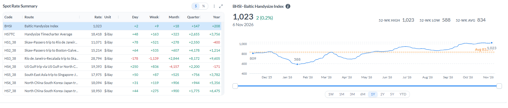

> **Figure 14: Handysize Route Rates, 6 Nov 2026**  
> *Figure 14: Handysize route rates, 6 Nov 2026 (Source: Baltic Exchange).*  
> **Interactive Data & Source:** [Signal Ocean Platform](https://www.thesignalgroup.com/weekly-market-monitor/weekly-dry-market-monitor-week-45-2026) | [Local Asset](../../images/6af6c75ae1925258597163e0_89d36865.png)

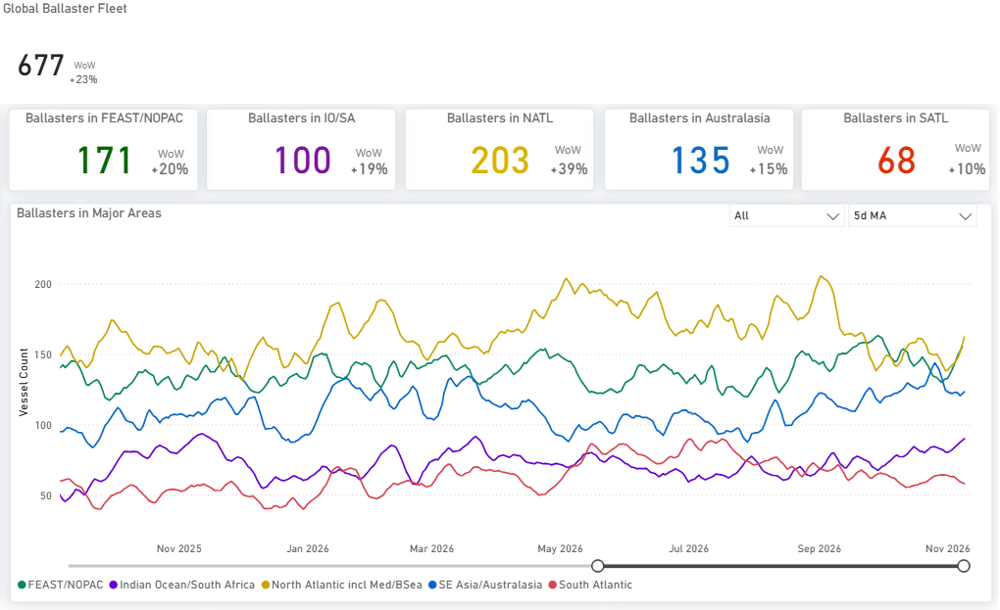

> **Figure 15: Handysize Ballasters by Region, 5-Day Ma; Dashboard WoW Uses Its Own Base, See Table 5**  
> *Figure 15: Handysize ballasters by region, 5-day MA; dashboard WoW uses its own base, see Table 5 (Source: Signal).*  
> **Interactive Data & Source:** [Signal Ocean Platform](https://www.thesignalgroup.com/weekly-market-monitor/weekly-dry-market-monitor-week-45-2026) | [Local Asset](../../images/6af6c7686baa68906a7f841e_2ff32dc2.png)

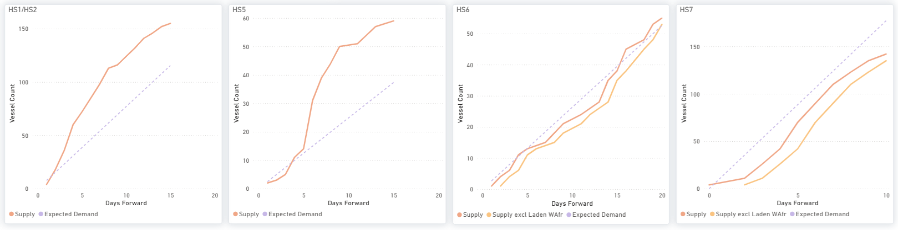

> **Figure 16: Handysize Available Ships (Supply) vs Expected Cargoes (Demand), by Days Ahead**  
> *Figure 16: Handysize available ships (supply) vs expected cargoes (demand), by days ahead (Source: Signal).*  
> **Interactive Data & Source:** [Signal Ocean Platform](https://www.thesignalgroup.com/weekly-market-monitor/weekly-dry-market-monitor-week-45-2026) | [Local Asset](../../images/6af6c7837ad37a78da4e09e6_edbc8b49.png)

**Next fixing window (approximate chart readings).** HS7 North China is the nearest-dated support: 142 ships vs 178 cargoes by day 10, from 21 short. The HS1/HS2 Continent surplus narrowed to 155 vs 115 by day 15 (from 156 vs 87). HS5 is unchanged (58 vs 35 by day 14), and HS6 is now even (55 vs 52 by day 20). Ballasters vs Week 44: global 668→677 (+1%); North Atlantic 186→203 (+9%); Australasia 145→135 (−7%).

***Disclaimer:*** *This report has been prepared by Signal Group for general information purposes only. It does not constitute, and should not be relied upon as, investment, financial, trading, legal or commercial advice, or as a recommendation to enter into any transaction. While reasonable efforts have been made to ensure that the information is accurate and reliable at the date of publication, no representation or warranty, express or implied, is given as to its accuracy, completeness or continued availability. Certain figures may be estimates or provisional and may subsequently be revised. Market conditions and other external factors may change without notice and may not be reflected in this report. Readers should conduct their own assessment and seek appropriate professional advice before making any decision. To the fullest extent permitted by law, Signal Group accepts no liability for any loss or damage arising from the use of, or reliance on, this report.*

***Copyright notice:*** *© 2026 Signal Group. All rights reserved. Except where otherwise stated or permitted by law, this report may not be copied, reproduced, modified, published or redistributed, in whole or in part, without the prior written consent of Signal Group. Third-party data and content remain the property of their respective owners and are used subject to the applicable terms and licences.*
