# Weekly Dry Market Monitor: Week 46, 2026

*Published on 19 November 2026*

## SPOTLIGHT OF THE WEEK | SEGMENT COMPARISON

**Capesize and Panamax Led as Asian Supramax/Handy Supply Tightened**

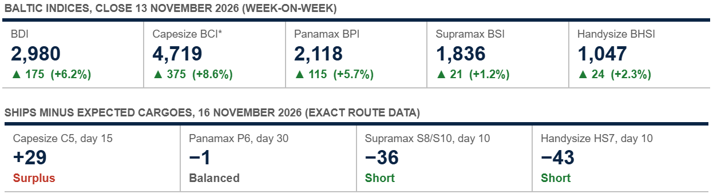

> **Figure 1: Spotlight of the Week | Segment Comparison**  
> **Interactive Data & Source:** [Signal Ocean Platform](https://www.thesignalgroup.com/weekly-market-monitor/weekly-dry-market-monitor-week-46-2026) | [Local Asset](../../images/6aff023311658ef2b6cc4c3b_66da36be.png)

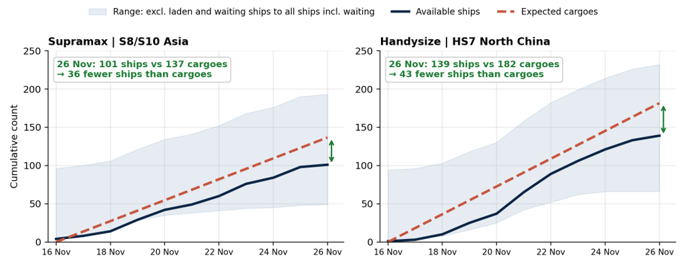

> **Figure 1: Supramax S8/s10 Asia and Handysize HS7 North China: Cumulative Available Ships (Excluding Waiting Vessels) vs Expected Cargoes, Day by Day From the 16 November 2026 Snapshot to 26 November**  
> *Figure 1: Supramax S8/S10 Asia and Handysize HS7 North China: cumulative available ships (excluding waiting vessels) vs expected cargoes, day by day from the 16 November 2026 snapshot to 26 November. Shaded band = range from excluding laden and waiting ships (bottom) to all ships including waiting (top). Exact route values (Source: Signal Ocean).*  
> **Interactive Data & Source:** [Signal Ocean Platform](https://www.thesignalgroup.com/weekly-market-monitor/weekly-dry-market-monitor-week-46-2026) | [Local Asset](../../images/6aff024be15d762c01aa3dbb_a18c6fa1.png)

Capesize and Panamax led the weekly freight gains, with the BCI rising 8.6% and the BPI 5.7%, compared with more modest increases of 1.2% for Supramax and 2.3% for Handysize. The improvement was largely concentrated on Atlantic routes, particularly for the larger vessel segments. However, forward vessel availability as of 16 November points to a different pattern across regions and vessel sizes. While C5 West Australia–China retained a surplus of 29 vessels against expected cargoes by day 15 and P6 Singapore–Atlantic was broadly balanced by day 30, Asian Supramax and Handysize routes showed tighter conditions. On S8/S10, expected cargoes exceeded available vessels by 36 over the next 10 days, compared with 19 a week earlier, while the shortfall on HS7 North China widened from 36 to 43 vessels. Despite this tightening, Asian Supramax spot rates continued to decline, indicating that the stronger forward cargo demand relative to available tonnage has not yet been reflected in freight earnings.

## FORWARD VESSEL AVAILABILITY | WHAT CHANGED

Between the 9 and 16 November snapshots, ten of 14 routes tightened, three loosened and one was unchanged; horizons differ by route, from 10 to 40 days. The largest moves were on C3 Brazil–China (deficit about 48 → 73 by day 40), S8/S10 Asia (19 → 36 by day 10), HS1/HS2 Continent (surplus 40 → 11 by day 15) and S5 West Africa (surplus 23 → 53 by day 20).

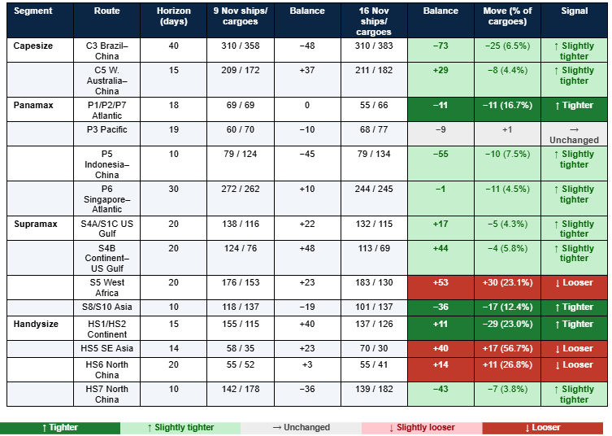

> **Table 1: Cumulative Available Ships (Excluding Waiting Vessels) Minus Expected Cargoes at the Route-Specific Horizon**  
> *Table 1: Cumulative available ships (excluding waiting vessels) minus expected cargoes at the route-specific horizon. Negative values indicate a conditional deficit. Signal rule, applied in order: (1) move of 3 ships or less, or under 2.5% of 16 November expected cargoes = Unchanged; (2) under 10% = Slightly tighter/looser; (3) 10% or more = Tighter/Looser. A fall in the balance = tighter (Source: Signal Ocean; snapshots 9 and 16 November 2026).*  
> **Interactive Data & Source:** [Signal Ocean Platform](https://www.thesignalgroup.com/weekly-market-monitor/weekly-dry-market-monitor-week-46-2026) | [Local Asset](../../images/6aff02b98a2f288dbbb1f1ce_0450d4b5.png)

## FREIGHT MARKET OVERVIEW

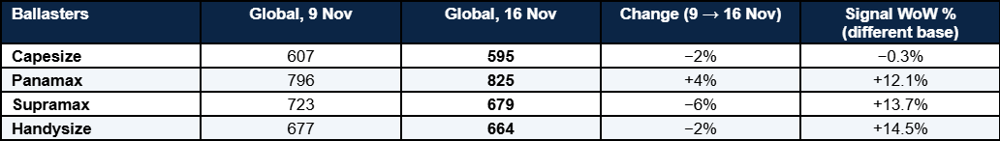

> **Table 2: Global Ballasters (Empty Ships Heading to Load)**  
> *Table 2: Global ballasters (empty ships heading to load). The report compares fixed 9 and 16 November counts. (Source: Signal Ocean).*  
> **Interactive Data & Source:** [Signal Ocean Platform](https://www.thesignalgroup.com/weekly-market-monitor/weekly-dry-market-monitor-week-46-2026) | [Local Asset](../../images/6aff0352237d3907fd0f0d6d_3e53aac0.png)

## KEY TAKEAWAY

During the week ending November 13, the Baltic Dry Index (BDI) climbed to 2,980, supported by gains across all four vessel classes, led by Capesize and Panamax ships on Atlantic routes. However, forward data from November 16 indicated a shifting market dynamic: while Capesize and Panamax routes remained balanced or in oversupply, Asian Supramax and Handysize sectors faced vessel shortages that had not yet been reflected in their spot rates.

## CAPESIZE

**Freight.** The BCI closed the week at 4,719 on 13 November, up 375 points, and eased 161 points to 4,558 on Monday 16 November. Over the week to 16 November, C8 transatlantic rose $3,781/day to $47,750/day and C9 fronthaul rose $1,488/day to $74,544/day, the highest-earning route. C14 China–Brazil fell $2,382/day to $37,827/day. C3 Brazil–China fell $1.48/t to $35.04/t, while C5 West Australia–China was flat at $13.81/t, which narrowed the C3–C5 spread to $21.23/t from $22.72/t.

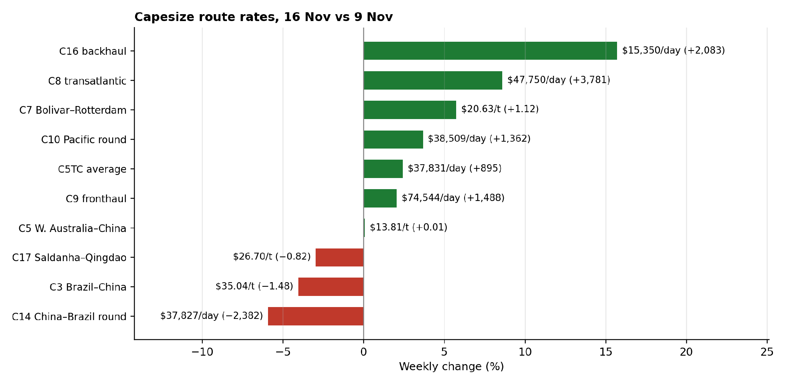

> **Figure 2: Capesize Route Rates and Weekly Change, 16 November vs 9 November 2026 Assessments**  
> *Figure 2: Capesize route rates and weekly change, 16 November vs 9 November 2026 assessments (Source: Baltic Exchange/Signal Ocean).*  
> **Interactive Data & Source:** [Signal Ocean Platform](https://www.thesignalgroup.com/weekly-market-monitor/weekly-dry-market-monitor-week-46-2026) | [Local Asset](../../images/6aff03c276a3586479b1a97a_0f91f134.png)

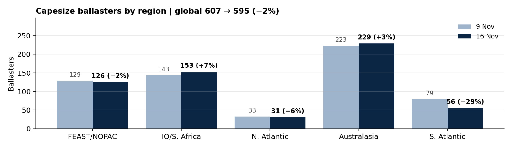

> **Figure 3: Capesize Ballasters by Region, 9 and 16 November 2026**  
> *Figure 3: Capesize ballasters by region, 9 and 16 November 2026 (Source: Signal Ocean).*  
> **Interactive Data & Source:** [Signal Ocean Platform](https://www.thesignalgroup.com/weekly-market-monitor/weekly-dry-market-monitor-week-46-2026) | [Local Asset](../../images/6aff03cc2d9e2d470651e335_8b71b70e.png)

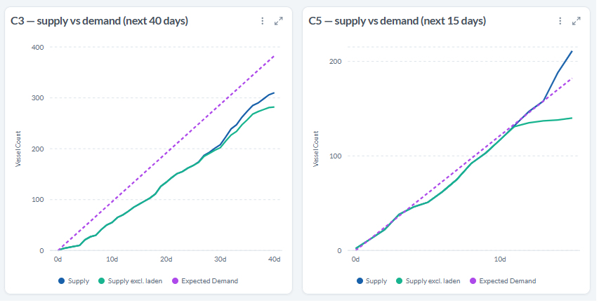

> **Figure 4: Capesize Available Ships (Excluding Waiting Vessels) vs Expected Cargoes, C3 (40-Day Horizon) and C5 (15-Day Horizon), 16 November 2026**  
> *Figure 4: Capesize available ships (excluding waiting vessels) vs expected cargoes, C3 (40-day horizon) and C5 (15-day horizon), 16 November 2026 (Source: Signal Ocean).*  
> **Interactive Data & Source:** [Signal Ocean Platform](https://www.thesignalgroup.com/weekly-market-monitor/weekly-dry-market-monitor-week-46-2026) | [Local Asset](../../images/6aff03ed439fdf0fbf191ba6_90b36881.png)

The C3 Brazil–China rate fell over the week even though the 16 November snapshot showed an approximately 73-ship deficit at the 40-day horizon. C5, on a 15-day horizon, showed a 29-ship surplus. Global ballasters fell from 607 to 595, led by the South Atlantic (79 to 56).

## PANAMAX

**Freight.** The BPI rose 115 points to 2,118. The Atlantic led: P1A transatlantic rose $2,609/day to $18,586/day and P2A fronthaul rose $1,486/day to $25,720/day, the highest-earning route. P6 rose $1,137/day to $18,224/day and P5 rose $317/day to $18,989/day, while P3A Pacific fell $422/day to $20,084/day. Grain routes P7 and P8 edged up to $68.75/t and $52.79/t.

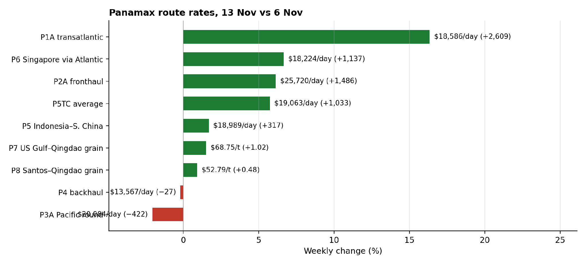

> **Figure 5: Panamax Route Rates and Weekly Change, 13 November vs 6 November 2026**  
> *Figure 5: Panamax route rates and weekly change, 13 November vs 6 November 2026 (Source: Baltic Exchange/Signal Ocean).*  
> **Interactive Data & Source:** [Signal Ocean Platform](https://www.thesignalgroup.com/weekly-market-monitor/weekly-dry-market-monitor-week-46-2026) | [Local Asset](../../images/6aff04107da050dec31c6a7a_9f48bd29.png)

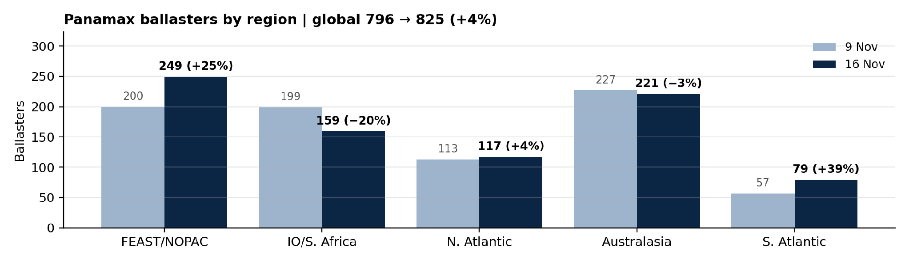

> **Figure 6: Panamax Ballasters by Region, 9 and 16 November 2026**  
> *Figure 6: Panamax ballasters by region, 9 and 16 November 2026 (Source: Signal Ocean).*  
> **Interactive Data & Source:** [Signal Ocean Platform](https://www.thesignalgroup.com/weekly-market-monitor/weekly-dry-market-monitor-week-46-2026) | [Local Asset](../../images/6aff04302cd946de605cfa0f_9e2e03a6.png)

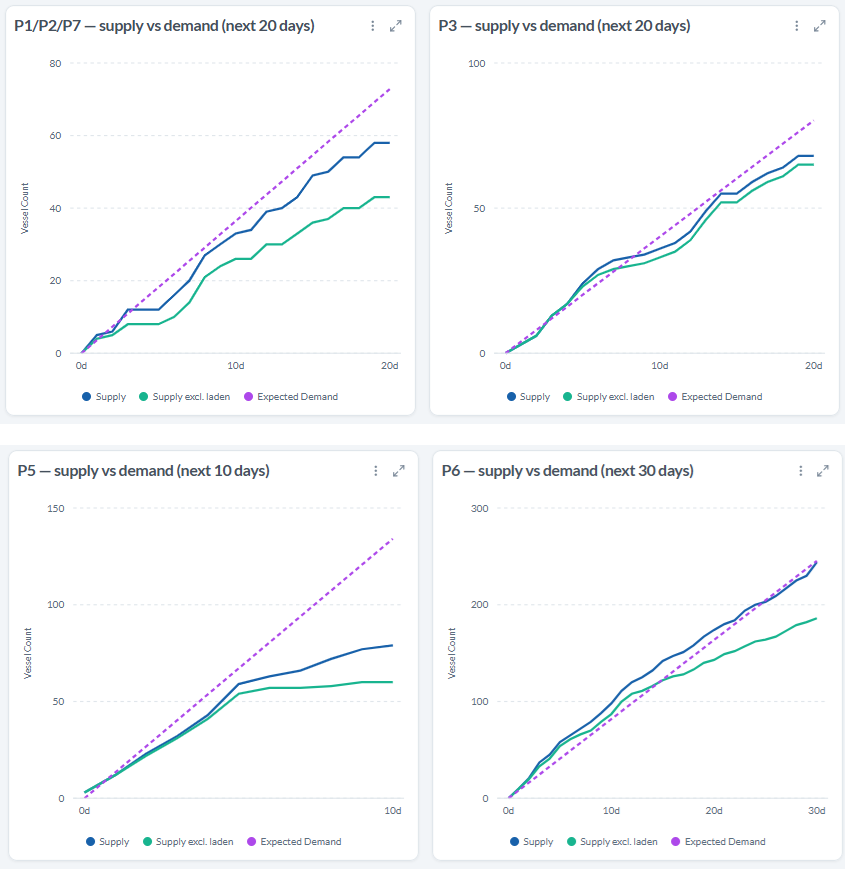

> **Figure 7: Panamax Available Ships (Excluding Waiting Vessels) vs Expected Cargoes: P1/p2/p7 and P3 (20 Days), P5 (10 Days), P6 (30 Days), 16 November 2026**  
> *Figure 7: Panamax available ships (excluding waiting vessels) vs expected cargoes: P1/P2/P7 and P3 (20 days), P5 (10 days), P6 (30 days), 16 November 2026 (Source: Signal Ocean).*  
> **Interactive Data & Source:** [Signal Ocean Platform](https://www.thesignalgroup.com/weekly-market-monitor/weekly-dry-market-monitor-week-46-2026) | [Local Asset](../../images/6aff043c7e2b39900fe9dc22_3a187a3d.png)

The P5TC was still 12.9% below its level a month earlier. Far East/North Pacific ballasters rose from 200 to 249, while P5 Indonesia–China showed a deficit of about 55 ships by day 10 and P1/P2/P7 about 11 by day 18; P6 was level at day 30. A larger regional ballast pool does not translate directly into ships eligible for a specific route and loading window.

## SUPRAMAX

**Freight.** The BSI rose 21 points to 1,836. Supramax gains were concentrated in the Atlantic: S4A US Gulf rose $7,351/day to $37,107/day and S1C $2,853/day to $32,325/day. Asian and Indian Ocean routes fell: S2 −$1,076/day, S8 −$792/day, S10 −$725/day and S15 −$1,111/day; the Asia index (S3TC\_63) lost $912/day to $22,130/day.

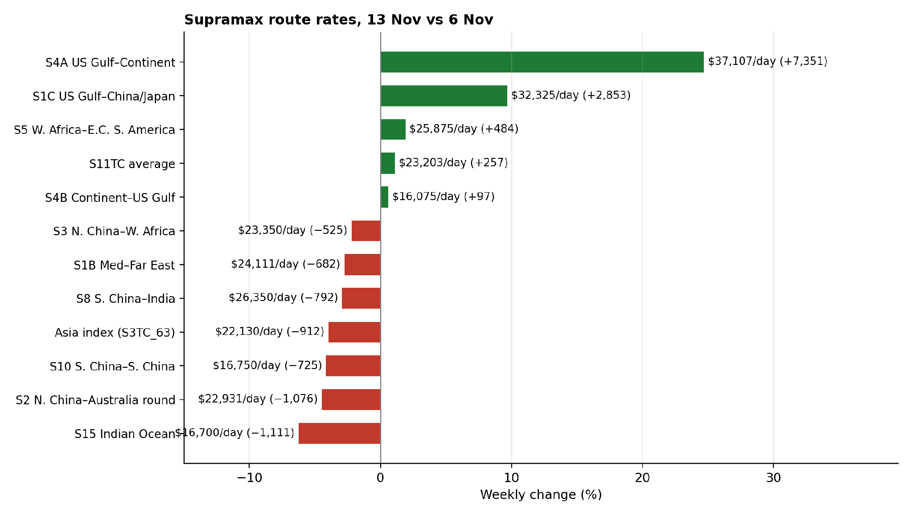

> **Figure 8: Supramax Route Rates and Weekly Change, 13 November vs 6 November 2026**  
> *Figure 8: Supramax route rates and weekly change, 13 November vs 6 November 2026 (Source: Baltic Exchange/Signal Ocean).*  
> **Interactive Data & Source:** [Signal Ocean Platform](https://www.thesignalgroup.com/weekly-market-monitor/weekly-dry-market-monitor-week-46-2026) | [Local Asset](../../images/6aff04616c384344847341d1_0bdbe9f9.png)

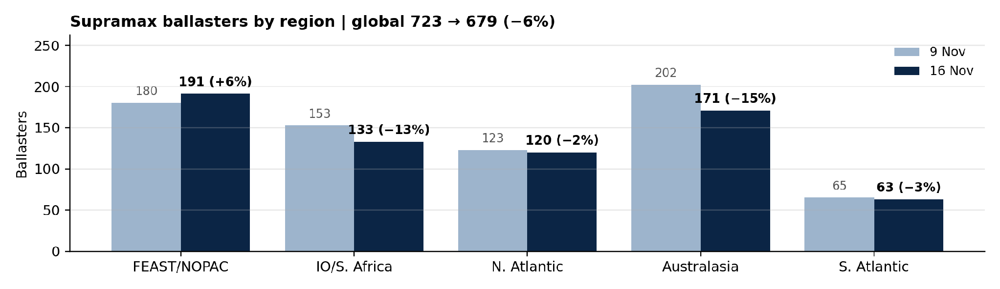

> **Figure 9: Supramax Ballasters by Region, 9 and 16 November 2026**  
> *Figure 9: Supramax ballasters by region, 9 and 16 November 2026 (Source: Signal Ocean).*  
> **Interactive Data & Source:** [Signal Ocean Platform](https://www.thesignalgroup.com/weekly-market-monitor/weekly-dry-market-monitor-week-46-2026) | [Local Asset](../../images/6aff04772e5051b8eeabbbe8_af34333c.png)

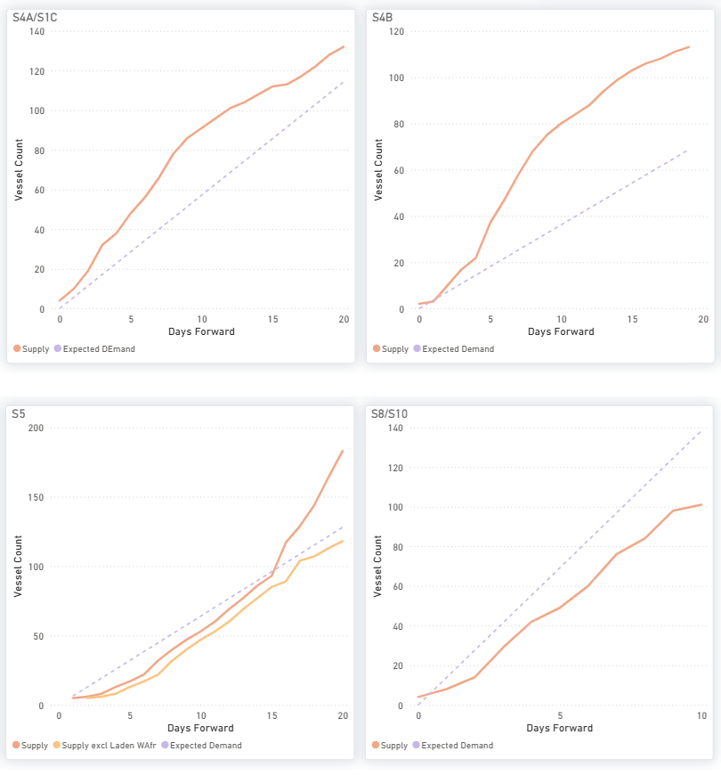

> **Figure 10: Supramax Available Ships vs Expected Cargoes: S4a/s1c, S4B and S5 (20 Days), S8/s10 (10 Days), 16 November 2026**  
> *Figure 10: Supramax available ships vs expected cargoes: S4A/S1C, S4B and S5 (20 days), S8/S10 (10 days), 16 November 2026 (Source: Signal Ocean).*  
> **Interactive Data & Source:** [Signal Ocean Platform](https://www.thesignalgroup.com/weekly-market-monitor/weekly-dry-market-monitor-week-46-2026) | [Local Asset](../../images/6aff048247122ff1b6a8bef4_1eda88a6.png)

On S8/S10, the forward balance and the rate moves pointed in opposite directions. S5 West Africa showed a surplus of about 53 ships by day 20, so the Supramax picture was uneven across basins. Ballasters fell from 723 to 679, with Australasia down from 202 to 171 and the Indian Ocean/South Africa from 153 to 133.

## HANDYSIZE

**Freight.** The BHSI rose 24 points to 1,047. HS4 US Gulf led, up $1,921/day to $21,314/day; HS3 South Atlantic rose $812/day to $29,606/day, the highest-earning route. In Asia, HS7 rose $150/day to $19,100/day, HS5 rose $131/day, and HS6 rose $25/day.

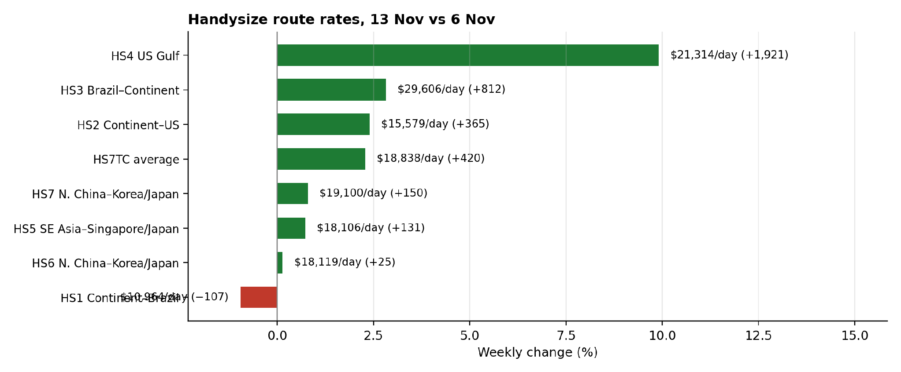

> **Figure 11: Handysize Route Rates and Weekly Change, 13 November vs 6 November 2026**  
> *Figure 11: Handysize route rates and weekly change, 13 November vs 6 November 2026 (Source: Baltic Exchange/Signal Ocean).*  
> **Interactive Data & Source:** [Signal Ocean Platform](https://www.thesignalgroup.com/weekly-market-monitor/weekly-dry-market-monitor-week-46-2026) | [Local Asset](../../images/6aff04b4850b56cd56b45261_68605584.png)

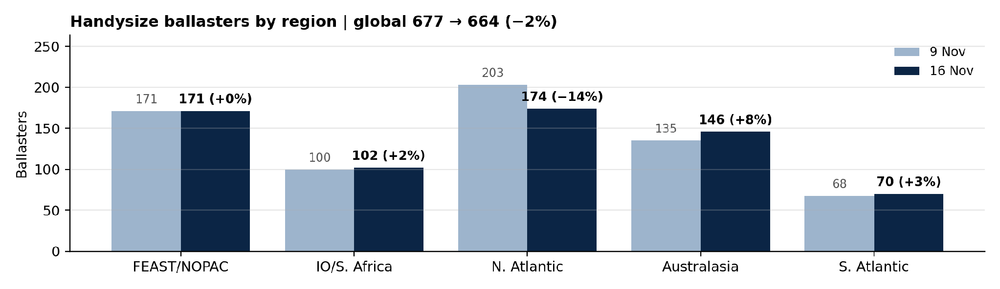

> **Figure 12: Handysize Ballasters by Region, 9 and 16 November 2026**  
> *Figure 12: Handysize ballasters by region, 9 and 16 November 2026 (Source: Signal Ocean).*  
> **Interactive Data & Source:** [Signal Ocean Platform](https://www.thesignalgroup.com/weekly-market-monitor/weekly-dry-market-monitor-week-46-2026) | [Local Asset](../../images/6aff04cd439fdf0fbf19a882_f7986c91.png)

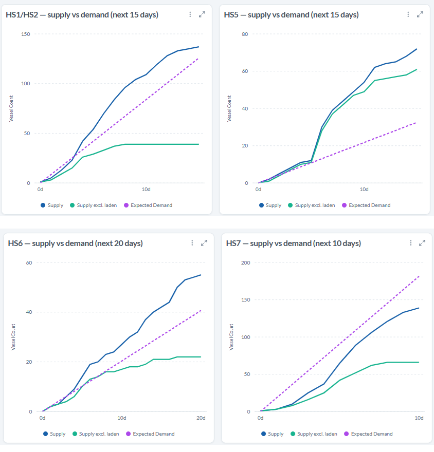

> **Figure 13: Handysize Available Ships vs Expected Cargoes: Hs1/hs2 and HS5 (15 Days), HS6 (20 Days), HS7 (10 Days), 16 November 2026**  
> *Figure 13: Handysize available ships vs expected cargoes: HS1/HS2 and HS5 (15 days), HS6 (20 days), HS7 (10 days), 16 November 2026 (Source: Signal Ocean).*  
> **Interactive Data & Source:** [Signal Ocean Platform](https://www.thesignalgroup.com/weekly-market-monitor/weekly-dry-market-monitor-week-46-2026) | [Local Asset](../../images/6aff04cd439fdf0fbf19a885_921955f3.png)

The BHSI set a new 52-week high. HS7 North China showed a deficit of about 43 ships by day 10 while its rate rose only modestly; HS5 Southeast Asia and HS6 North China showed surpluses of about 40 and 14 ships, so the Asian picture was not uniformly tight. Ballasters fell from 677 to 664, with the North Atlantic down from 203 to 174.

***Disclaimer:*** *This report has been prepared by Signal Group for general information purposes only. It does not constitute, and should not be relied upon as, investment, financial, trading, legal or commercial advice, or as a recommendation to enter into any transaction. While reasonable efforts have been made to ensure that the information is accurate and reliable at the date of publication, no representation or warranty, express or implied, is given as to its accuracy, completeness or continued availability. Certain figures may be estimates or provisional and may subsequently be revised. Market conditions and other external factors may change without notice and may not be reflected in this report. Readers should conduct their own assessment and seek appropriate professional advice before making any decision. To the fullest extent permitted by law, Signal Group accepts no liability for any loss or damage arising from the use of, or reliance on, this report.*

***Copyright notice:*** *© 2026 Signal Group. All rights reserved. Except where otherwise stated or permitted by law, this report may not be copied, reproduced, modified, published or redistributed, in whole or in part, without the prior written consent of Signal Group. Third-party data and content remain the property of their respective owners and are used subject to the applicable terms and licences.*
