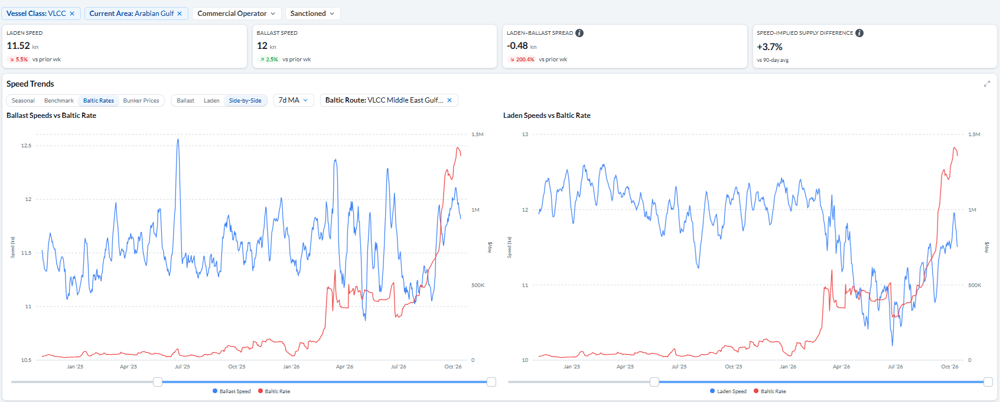
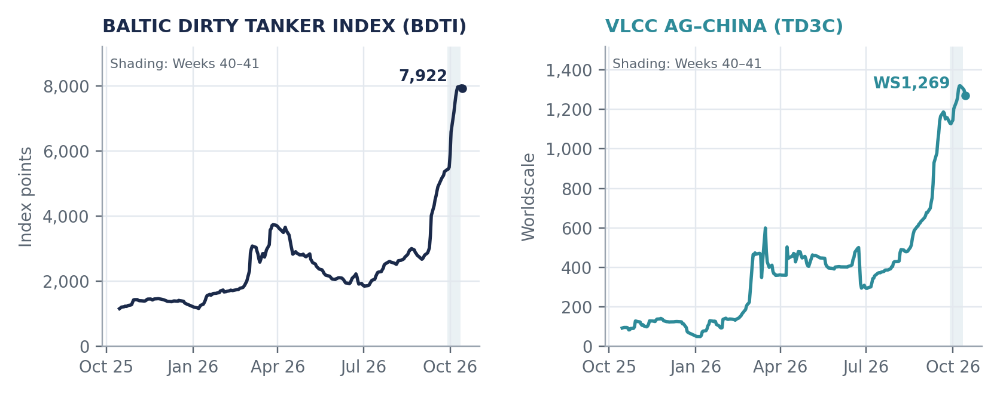
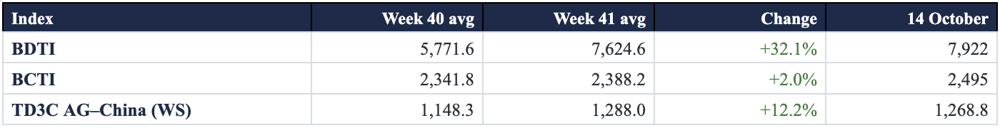
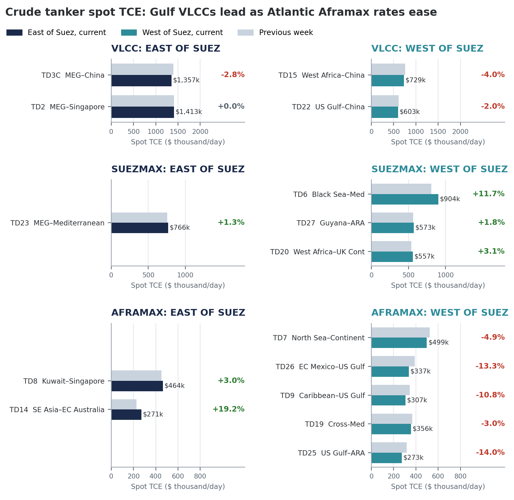
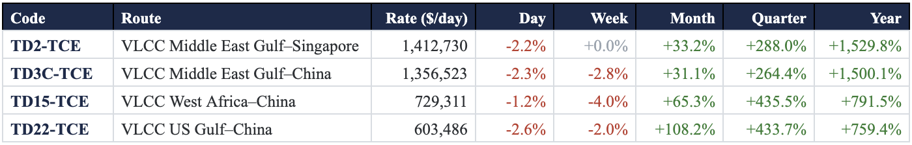
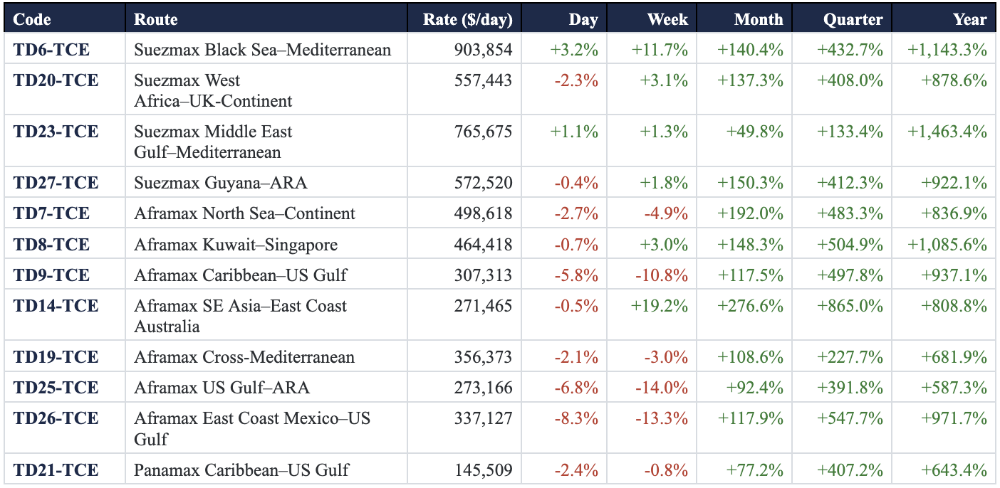
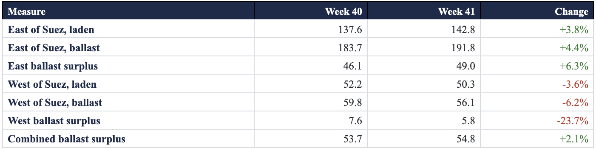
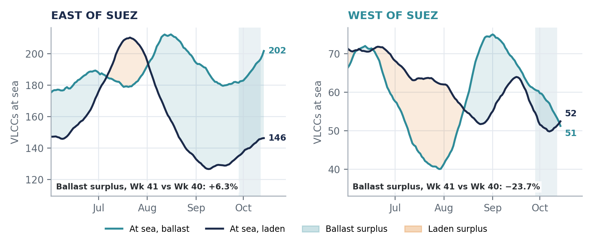
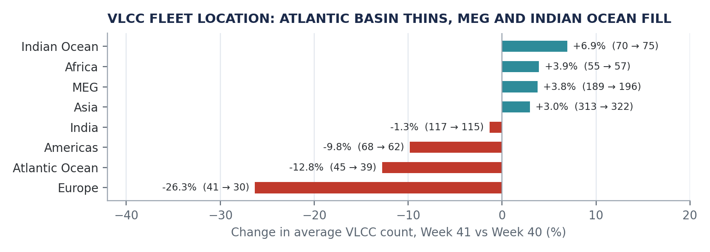
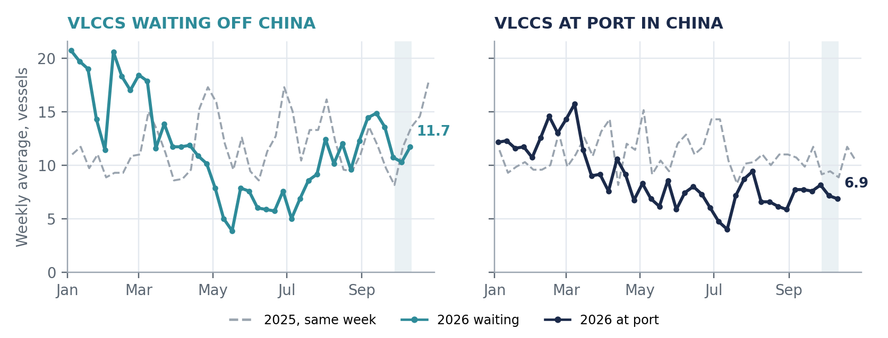

# Weekly Tanker Market Monitor: Week 41 2026

*Published on 16 October 2026*

## Spotlight of the Week- Faster Ballast, Slower Laden: VLCC Supply Signals Diverge

This week’s Tanker Market Monitor examines divergence in VLCC sailing speeds, regional vessel supply, and freight earnings. In the Arabian Gulf, ballast vessels are accelerating while laden ships are slowing, with no clear improvement in overall voyage turnaround. Meanwhile, the western VLCC ballast surplus has narrowed, in contrast to rising ballast numbers East of Suez. Despite this increase in eastern vessel supply, Gulf VLCC earnings remain exceptionally high, and dirty-tanker freight continues to outperform the clean market by a substantial margin. The findings highlight why faster repositioning and higher ballast counts have yet to translate into meaningful freight relief.

> **Figure 1: Dashboard View**  
> *Dashboard view. Signal Ocean Platform, VLCC ballast and laden speeds in the Arabian Gulf; trend panels use a seven-day moving average.Snapshot of 15 October 2026 with dashboard week-over-week changes; not calendar Week 40–41 averages.*  
> **Interactive Data & Source:** [Signal Ocean Platform](https://www.thesignalgroup.com/weekly-market-monitor/weekly-tanker-market-monitor-week-41-2026) | [Local Asset](../../images/6ad214c0b6e71e957bb6e7a5_61464ba3.png)

Arabian Gulf VLCC ballast speed reached **12.00 knots, up 2.5%** from the previous week, while laden speed declined **5.5% to 11.52 knots**, leaving ballast vessels sailing 0.48 knots faster than loaded ships. The current speed-implied supply indicator stood **3.7% above its 90-day average**, reflecting faster repositioning rather than an increase in available tonnage. While this may shorten ballast voyages, slower laden sailings, waiting times and cargo transfers continue to affect vessel turnaround, with no clear evidence yet of improved effective VLCC availability.

**MARKET SIGNAL:  Western VLCC availability tightened, with the ballast surplus down 23.7%, but the combined at-sea balance did not: a larger eastern surplus left it 2.1% higher. Freight performance split sharply by vessel class, with all four assessed Suezmax routes up on the week and all five western Aframax routes down.**

## Dirty Freight Outpaces Clean Tankers

The **Baltic Dirty Tanker Index (BDTI) rose 32% to a Week 41 average of 7,625 points**, significantly outpacing the **2% increase in the Baltic Clean Tanker Index (BCTI) to 2,388 points**. VLCC freight on the Arabian Gulf–China route (TD3C) also strengthened, averaging **WS1,288, up 12%** from the previous week. By 14 October, the BDTI stood at **7,922 points**, easing from its **13 October peak of 7,999**, the highest reading in the supplied 12-month series and almost seven times its level a year earlier. The modest pullback leaves crude tanker freight at historically elevated levels, with little indication of a meaningful reversal in the recent upward trend.

> **Chart 1: Baltic Dirty Tanker Index and VLCC Ag–china (TD3C), Daily, 15 October 2025–14 October 2026**  
> *Chart 1. Baltic Dirty Tanker Index and VLCC AG–China (TD3C), daily, 15 October 2025–14 October 2026. Shading marks Weeks 40–41.Source: Baltic Exchange assessments via Signal Ocean, data through 14 October 2026.*  
> **Interactive Data & Source:** [Signal Ocean Platform](https://www.thesignalgroup.com/weekly-market-monitor/weekly-tanker-market-monitor-week-41-2026) | [Local Asset](../../images/6ad214c0b6e71e957bb6e79f_5e2b3977.png)

## Baltic Index Averages: Week 40 vs Week 41

> **Figure 3: Five Assessment Days per Week: 28 September–2 October and 5–9 October**  
> *Five assessment days per week: 28 September–2 October and 5–9 October. Sources: Signal for BDTI and TD3C; StockQ for BCTI.*  
> **Interactive Data & Source:** [Signal Ocean Platform](https://www.thesignalgroup.com/weekly-market-monitor/weekly-tanker-market-monitor-week-41-2026) | [Local Asset](../../images/6ad2140ee56e845ad972099d_Screenshot 2026-10-16 at 13.09.05.png)

## Freight: Gulf VLCC Earnings Lead as Atlantic Aframax Rates Ease

**VLCC:** In the 15 October snapshot, Gulf routes still carry the highest earnings in the crude basket. **MEG–Singapore (TD2) stands at $1,412,730/day**, flat on the week, and **MEG–China (TD3C) at $1,356,523/day, down 2.8%**. AG–China earnings remain 86.0% above West Africa–China (TD15, $729,311/day, -4.0%) and 124.8% above US Gulf–China (TD22, $603,486/day, -2.0%). Over the month, however, the Atlantic routes rose faster: TD22 is up 108.2% and TD15 65.3%, against 31.1% for TD3C.

**All four assessed Suezmax routes recorded weekly gains.** **Black Sea–Mediterranean (TD6) rose 11.7% to $903,854/day**, now above MEG–Mediterranean (TD23) at $765,675/day (+1.3%). West Africa–UK Continent (TD20) added 3.1% and Guyana–ARA (TD27) 1.8%.

> **Chart 2: Crude Tanker Spot TCE by Route and Vessel Class, East vs West of Suez, Current vs Previous Week ($/day).baltic Exchange TCE Assessments Via Signal Ocean, Snapshot Dated 15 October; Changes Against the Dashboard’s Prior-Week Reference.**  
> *Chart 2. Crude tanker spot TCE by route and vessel class, East vs West of Suez, current vs previous week ($/day).Baltic Exchange TCE assessments via Signal Ocean, snapshot dated 15 October; changes against the dashboard’s prior-week reference.*  
> **Interactive Data & Source:** [Signal Ocean Platform](https://www.thesignalgroup.com/weekly-market-monitor/weekly-tanker-market-monitor-week-41-2026) | [Local Asset](../../images/6ad214c0b6e71e957bb6e7a2_cd218aaf.png)

**All five western Aframax routes fell, while both eastern routes increased.** **US Gulf–ARA (TD25) dropped 14.0% to $273,166/day**, East Coast Mexico–US Gulf (TD26) 13.3% to $337,127/day and Caribbean–US Gulf (TD9) 10.8% to $307,313/day.

East of Suez, **SE Asia–East Coast Australia (TD14) rose 19.2% to $271,465/day**, the largest weekly gain in the basket, and Kuwait–Singapore (TD8) gained 3.0%. In total, nine of the 16 dirty routes declined week on week. All 16 routes remain above their month-earlier levels, with gains ranging from 31.1% to 276.6%.

## Spot Rate Summary: Dirty TCE, VLCC, Suezmax, Aframax and Panamax

> **Figure 5: Spot Rate Summary: Dirty TCE, VLCC, Suezmax, Aframax and Panamax**  
> **Interactive Data & Source:** [Signal Ocean Platform](https://www.thesignalgroup.com/weekly-market-monitor/weekly-tanker-market-monitor-week-41-2026) | [Local Asset](../../images/6ad21442b6e71e957bb6a40f_Screenshot 2026-10-16 at 13.09.17.png)

> **Figure 6: Baltic Exchange TCE Assessments Via Signal Ocean, Snapshot Dated 15 October; Changes Against the Dashboard’s Prior-Week Reference**  
> *Baltic Exchange TCE assessments via Signal Ocean, snapshot dated 15 October; changes against the dashboard’s prior-week reference. Rates in $/day; all changes are percentages.*  
> **Interactive Data & Source:** [Signal Ocean Platform](https://www.thesignalgroup.com/weekly-market-monitor/weekly-tanker-market-monitor-week-41-2026) | [Local Asset](../../images/6ad2145ce14a351c4c380657_Screenshot 2026-10-16 at 13.09.25.png)

## VLCC Supply Tightens West of Suez as Eastern Ballast Numbers Rise

**West of Suez, ballast vessels declined 6% to an average of 56**, reducing the ballast surplus by **24%, from 8 to 6 vessels**. East of Suez, ballast numbers increased 4% to 192, outpacing the rise in laden vessels and lifting the regional surplus by 6% to 49. By 14 October, western laden VLCCs outnumbered ballasters for the first time since mid-August, while eastern ballast numbers continued to rise. The latest figures point to tighter vessel positioning in the Atlantic, against a larger pool of ballast tonnage in the East that has yet to ease exceptional Gulf freight earnings.

## VLCCs at Sea: Week 40 vs Week 41 Averages

> **Figure 7: Weekly Means of Seven Daily Exported Measures; Surplus Is Ballast Minus Laden**  
> *Weekly means of seven daily exported measures; surplus is ballast minus laden. These counts do not identify ships ready to accept prompt cargoes.*  
> **Interactive Data & Source:** [Signal Ocean Platform](https://www.thesignalgroup.com/weekly-market-monitor/weekly-tanker-market-monitor-week-41-2026) | [Local Asset](../../images/6ad2147690ed3299eee29d1b_Screenshot 2026-10-16 at 13.09.32.png)

> **Chart 3: VLCCs at Sea, Ballast vs Laden, East and West of Suez, 1 June–14 October 2026**  
> *Chart 3. VLCCs at sea, ballast vs laden, East and West of Suez, 1 June–14 October 2026. Shading marks Weeks 40–41.Source: Signal; exported smoothed daily at-sea measures, VLCC 200,000 dwt and above.*  
> **Interactive Data & Source:** [Signal Ocean Platform](https://www.thesignalgroup.com/weekly-market-monitor/weekly-tanker-market-monitor-week-41-2026) | [Local Asset](../../images/6ad214c0b6e71e957bb6e7a9_4cbefb52.png)

Average VLCC counts declined across western regions in Week 41, led by Europe (**−26.3%, from 41 to 30**), the Atlantic Ocean (**−12.8%, from 45 to 39**) and the Americas (**−9.8%, from 68 to 62**). In contrast, counts increased in the Middle East Gulf (**+3.8%, from 189 to 196**) and Indian Ocean (**+6.9%, from 70 to 75**). The shift points to a greater concentration of VLCCs in eastern waters, although total vessel counts do not necessarily reflect prompt availability for charter.

> **Chart 4: Average VLCC Count by Area, Week 41 vs Week 40, All Statuses (Areas with Ten or More Vessels).source: Signal; Fleet Distribution by Zone, VLCC 200,000 DWT and Above.**  
> *Chart 4. Average VLCC count by area, Week 41 vs Week 40, all statuses (areas with ten or more vessels).Source: Signal; fleet distribution by zone, VLCC 200,000 dwt and above.*  
> **Interactive Data & Source:** [Signal Ocean Platform](https://www.thesignalgroup.com/weekly-market-monitor/weekly-tanker-market-monitor-week-41-2026) | [Local Asset](../../images/6ad214c0b6e71e957bb6e7ac_20754b43.png)

## China Congestion Edges Higher But Stays Below Last Year

China’s VLCC waiting count averaged **12 vessels in Week 41, up 14%** from the previous week, while vessels at port remained close to seven. The combined average increased **7% to 19 vessels**, with the rise concentrated in the waiting queue. Congestion remained below the same week of 2025, when an average of 14 VLCCs were waiting, and 9 were at port. By 14 October, the daily count had eased to 9 waiting vessels, while 8 were at port, pointing to some moderation in the waiting queue.

> **Chart 5: VLCCs Waiting Off and at Port in China, Monday–sunday Averages, 2026 vs Same Week of 2025**  
> *Chart 5. VLCCs waiting off and at port in China, Monday–Sunday averages, 2026 vs same week of 2025. Shading marks Weeks 40–41.Source: Signal; congestion data through 11 October 2026.*  
> **Interactive Data & Source:** [Signal Ocean Platform](https://www.thesignalgroup.com/weekly-market-monitor/weekly-tanker-market-monitor-week-41-2026) | [Local Asset](../../images/6ad214c0b6e71e957bb6e7af_10605e37.png)

## Hormuz Freight Watch: Bunker Supply Tightens as Saudi Delivered Sales Expand

**Marine fuel availability remains constrained across key bunkering hubs, while Saudi Arabia expands delivered crude sales to Asian refiners. Renewed attacks in Hormuz continue to complicate vessel deployment and loading arrangements.**

**Bunker fuel constraints:** Marine fuel availability remains tight across several East of Suez locations. In Singapore, recommended lead times have extended to **11–18 days for VLSFO and 11–17 days for HSFO**. Fujairah has seen some improvement in VLSFO availability, although HSFO and LSMGO supplies remain limited. Port Suez is also reporting critically low inventories across conventional bunker grades. These constraints add to voyage planning requirements, particularly for vessels operating between the Gulf, Red Sea and Asian discharge ports.

**Saudi delivered crude sales:** Chinese refiners purchased **at least 12 million barrels of Saudi crude for November loading on a delivered basis**, with additional sales to India and Taiwan. Buyers' reluctance to charter vessels for loading inside Hormuz has encouraged Saudi Arabia to arrange transportation directly, while allocations continue through Yanbu and Sidi Kerir. This keeps crude moving but transfers responsibility for securing tanker capacity to the seller.

**Hormuz security:** UKMTO reported projectile strikes involving a tanker and container ship on 13 October. Singapore's maritime authority separately confirmed that GFS Pride was struck and subsequently sank, while GFS Giselle sustained damage and reached safe anchorage following an attack on 14 October. These incidents reinforce the continuing uncertainty surrounding Gulf transits.
