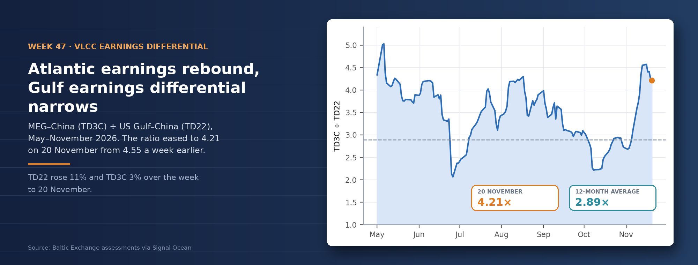
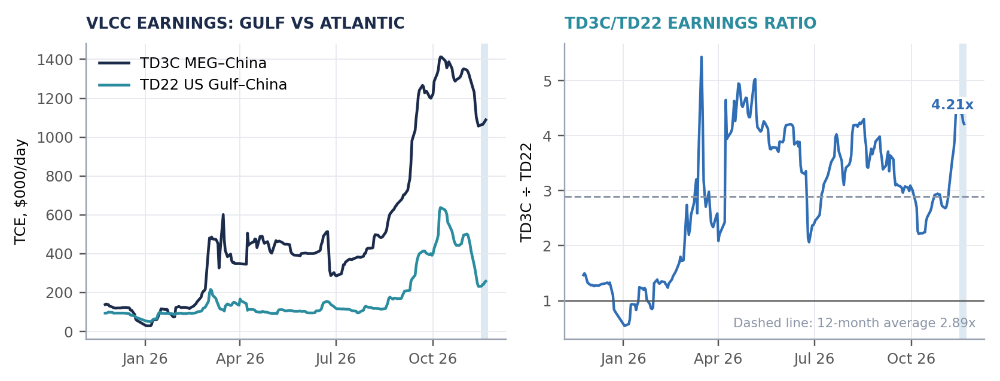
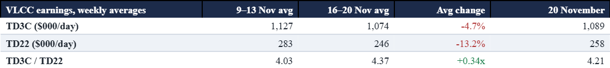
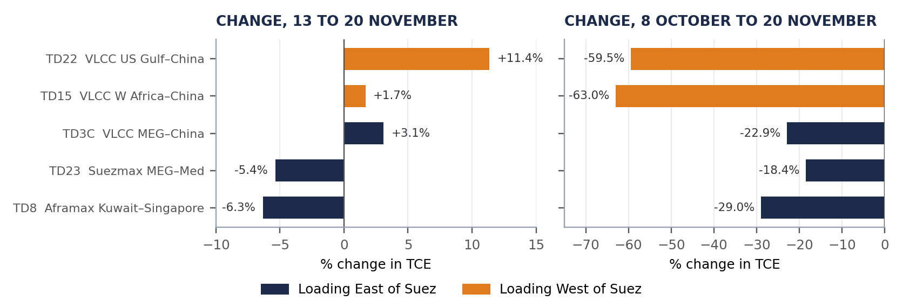
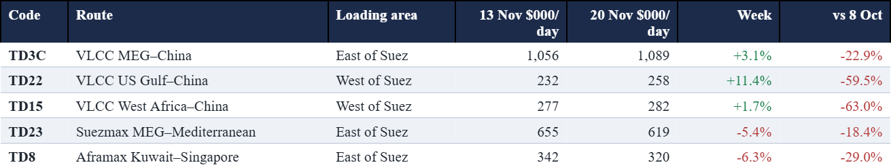
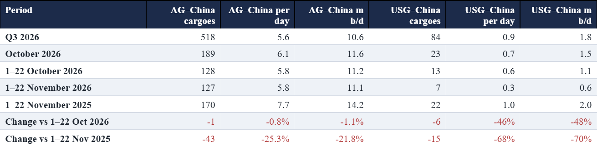
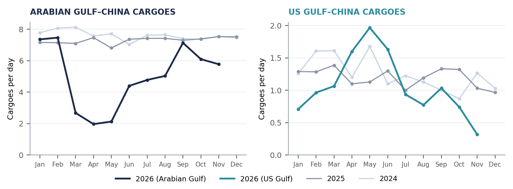
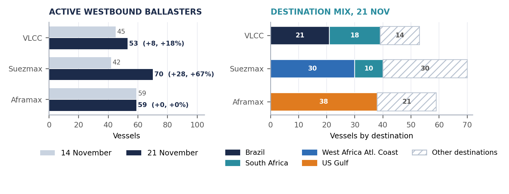
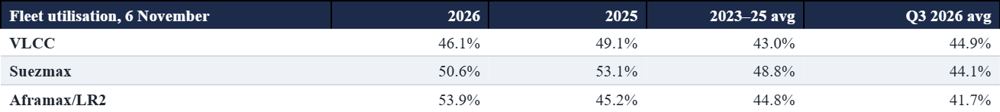
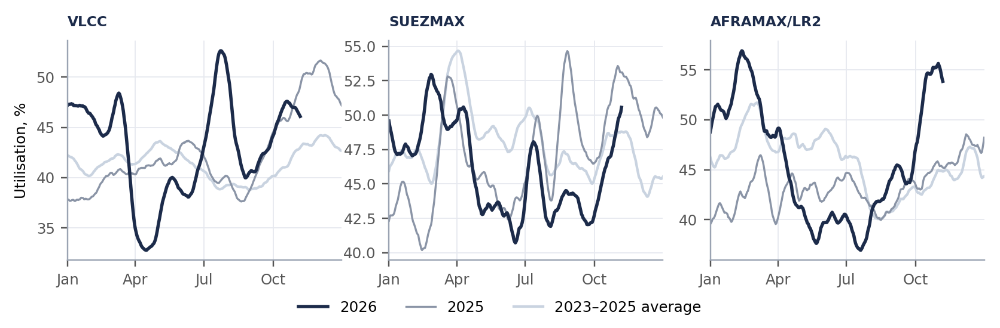

# Weekly Tanker Market Monitor: Week 47 2026

*Published on 25 November 2026*

**Beyond Hormuz · Week 47, 2026**

**By Maria Bertzeletou · Senior Market Analyst, Signal**

> **Figure 1: Heading**  
> **Interactive Data & Source:** [Signal Ocean Platform](https://www.thesignalgroup.com/weekly-market-monitor/weekly-tanker-market-monitor-week-47-2026) | [Local Asset](../../images/6b06a930ece26af65d96de40_80c94c8e.png)

**SPOTLIGHT OF THE WEEK**

## VLCC Supply Builds as Gulf–China Loadings Hold Steady

VLCC earnings fell first on Atlantic routes in Week 45 and then on Gulf routes in Week 46. Over the same period, Signal Ocean's net-supply data showed more VLCCs available for Arabian Gulf–China loading. Net supply for the Arabian Gulf–China trade averaged **93.2 vessels** in 1–22 November, **13.2%** above the full-October average of 82.3 and 8.8% above the same period of 2025. Spot and relet vessels, a subset of net supply, rose **23.4%** to an average of 61.5. Net supply reached 106 on 11 November, the highest since 20 July, and was 86 on 22 November.

Arabian Gulf–China loadings averaged **5.8 cargoes a day** in 1–22 November, the same as in 1–22 October and 25% below the same period of 2025. Details are in the Cargo Demand section.

> **Chart 1: VLCC Net Supply for the Arabian Gulf–china Trade and Its Spot/relet Component, Daily, 1 August–22 November 2026, with October and 1–22 November Averages; Arabian Gulf–china Crude Cargoes Loaded per Week, 2026 and the Same Weeks of 2025.source: Signal Ocean Net Supply (VLCC, Arabian Gulf–china) and Cargo Flows**  
> *Chart 1. VLCC net supply for the Arabian Gulf–China trade and its spot/relet component, daily, 1 August–22 November 2026, with October and 1–22 November averages; Arabian Gulf–China crude cargoes loaded per week, 2026 and the same weeks of 2025.Source: Signal Ocean net supply (VLCC, Arabian Gulf–China) and cargo flows. Weeks run Monday to Sunday. Recent weeks may be revised as more cargoes are recorded.*  
> **Interactive Data & Source:** [Signal Ocean Platform](https://www.thesignalgroup.com/weekly-market-monitor/weekly-tanker-market-monitor-week-47-2026) | [Local Asset](../../images/6b06a930ece26af65d96de46_d74a7b94.png)

## VLCC Earnings Recover From Week 46 Lows

VLCC earnings averaged lower in Week 47, with a sharper decline on the US Gulf–China route (TD22), down **13.2% WoW to $246,000/day**, compared with a **4.7% decline to $1.07 million/day** on Middle East Gulf–China (TD3C). The weekly average TD3C/TD22 earnings ratio widened from **4.03 to 4.37**, against a 12-month average of 2.89. Between 13 and 20 November, TD22 earnings increased by 11.4% to $258,000/day, while TD3C rose by 3.1% to $1.09 million/day, narrowing the earnings ratio to 4.21. Compared with 8 October assessments, TD3C and TD22 earnings remained 22.9% and 59.5% lower, respectively.

> **Chart 2: Daily TD3C and TD22 TCE Assessments and Their Ratio, 24 November 2025–20 November 2026**  
> *Chart 2. Daily TD3C and TD22 TCE assessments and their ratio, 24 November 2025–20 November 2026. Shading marks 16–20 November. Source: Baltic Exchange TCE assessments via Signal Ocean.*  
> **Interactive Data & Source:** [Signal Ocean Platform](https://www.thesignalgroup.com/weekly-market-monitor/weekly-tanker-market-monitor-week-47-2026) | [Local Asset](../../images/6b06a930ece26af65d96de43_42540b2b.png)

> **Figure 4: Averages of Five Daily Assessments in Each Week; the Ratio RoW Averages Daily Ratios.**  
> *Averages of five daily assessments in each week; the ratio row averages daily ratios.*  
> **Interactive Data & Source:** [Signal Ocean Platform](https://www.thesignalgroup.com/weekly-market-monitor/weekly-tanker-market-monitor-week-47-2026) | [Local Asset](../../images/6b06a930ece26af65d96de4c_c3d1d070.png)

**MARKET SIGNAL:  Friday VLCC assessments recovered, led by US Gulf–China, despite lower weekly average earnings and subdued observed cargo loadings. A sustained recovery has yet to be established.**

## Freight: Gulf-Loading Suezmax and Aframax Ease

While VLCC earnings increased across all three benchmarks between 13 and 20 November, Suezmax and Aframax earnings on Gulf-loading routes continued to weaken. TD23 fell 5.4% to $619,000/day, and TD8 declined 6.3% to $320,000/day. Since 8 October, earnings across the three East of Suez loading routes have declined by 18–29%, compared with approximately 60% on the two Atlantic VLCC routes. TD3C earnings remain above $1 million/day, compared with less than $300,000/day on both TD22 and TD15.

> **Chart 3: Percentage Change in TCE by Route: Left, 13 to 20 November 2026; Right, 8 October to 20 November 2026.source: Baltic Exchange TCE Assessments Via Signal Ocean.**  
> *Chart 3. Percentage change in TCE by route: left, 13 to 20 November 2026; right, 8 October to 20 November 2026.Source: Baltic Exchange TCE assessments via Signal Ocean.*  
> **Interactive Data & Source:** [Signal Ocean Platform](https://www.thesignalgroup.com/weekly-market-monitor/weekly-tanker-market-monitor-week-47-2026) | [Local Asset](../../images/6b06a930ece26af65d96de52_f9195a37.png)

## Route Summary: Selected Crude Benchmarks

> **Figure 6: Baltic Exchange TCE Assessments Via Signal Ocean for the 13 and 20 November Closes; Usd/day Rounded to the Nearest $1,000**  
> *Baltic Exchange TCE assessments via Signal Ocean for the 13 and 20 November closes; USD/day rounded to the nearest $1,000. Changes are calculated from unrounded values.*  
> **Interactive Data & Source:** [Signal Ocean Platform](https://www.thesignalgroup.com/weekly-market-monitor/weekly-tanker-market-monitor-week-47-2026) | [Local Asset](../../images/6b06a930ece26af65d96de49_61cfaed3.png)

## Cargo Demand: Gulf Flat, US Gulf Thin

**Arabian Gulf–China.** 127 cargoes loaded in 1–22 November, against 128 in 1–22 October, or about 5.8 cargoes and 11.1 million barrels a day. Weekly loadings in November ranged from 36 to 43 cargoes. Compared with the same period of 2025, daily cargoes were 25% lower and volumes 22% lower. Arabian Gulf–China loadings were broadly unchanged from the corresponding period of October, while VLCC net supply for the same trade averaged 13% above the full October average. The freight correction therefore coincided with a larger visible vessel pool and broadly stable observed Gulf–China loadings.

**Crude cargoes loaded: Arabian Gulf–China and US Gulf–China**

> **Figure 7: Signal Ocean Cargo Flows by Load Date, Covering All Vessel Sizes**  
> *Signal Ocean cargo flows by load date, covering all vessel sizes. Daily averages are calculated using calendar days. November figures are provisional. Recorded loadings exclude forward cargo enquiries and fixing activity.*  
> **Interactive Data & Source:** [Signal Ocean Platform](https://www.thesignalgroup.com/weekly-market-monitor/weekly-tanker-market-monitor-week-47-2026) | [Local Asset](../../images/6b06a930ece26af65d96de55_f1b341a9.png)

**US Gulf–China.** Seven cargoes loaded in 1–22 November, against 13 in 1–22 October and 22 in the same period of 2025. One cargo loaded in the week to 22 November. At 0.3 cargoes a day, loadings are below a third of the 2025 rate for the same period. TD22 rose 11.4% in Week 47 without an increase in recorded US Gulf–China loadings.

> **Chart 4: Crude Cargoes Loaded per Day, Arabian Gulf–china and US Gulf–china, by Month, 2024–2026; November 2026 Covers 1–22 November**  
> *Chart 4. Crude cargoes loaded per day, Arabian Gulf–China and US Gulf–China, by month, 2024–2026; November 2026 covers 1–22 November. Source: Signal Ocean cargo flows by load date; all vessel sizes. Partial-month data are provisional.*  
> **Interactive Data & Source:** [Signal Ocean Platform](https://www.thesignalgroup.com/weekly-market-monitor/weekly-tanker-market-monitor-week-47-2026) | [Local Asset](../../images/6b06a930ece26af65d96de4f_471d5318.png)

## Westbound Ballasters Increase as VLCC Supply Builds

Westbound ballasting activity increased across the VLCC and Suezmax segments in the week to 21 November. Active westbound VLCC ballasters rose from 45 to **53 vessels**, with 47 originating from the Far East. Brazil and South Africa accounted for 39 vessels combined, representing nearly three-quarters of the westbound fleet. A more pronounced increase was recorded in the Suezmax segment, where westbound ballasters rose by 67% from 42 to **70 vessels**, including 30 heading towards the West African Atlantic Coast and 10 towards South Africa. Despite the increase in westbound ballasting, **83% of VLCCs remained East of Suez**, against a typical share of 75%. West-to-East laden movements remained elevated, with 90 VLCC arrivals recorded for November, compared with 57 in September. In the Aframax segment, westbound ballasters remained unchanged at 59 vessels, of which 38 were heading towards the US Gulf. Meanwhile, the US Gulf Aframax tonnage list contracted by approximately 72%, from 46 vessels on 23 October to 13 on 21 November.

> **Chart 5: Active Westbound VLCC, Suezmax and Aframax Ballasters on 14 and 21 November, and Their Destinations on 21 November**  
> *Chart 5. Active westbound VLCC, Suezmax and Aframax ballasters on 14 and 21 November, and their destinations on 21 November. Ballasters are vessels in transit, not vessels available to load immediately.Source: Signal Ocean, 22 November 2026. “Other destinations” is the segment total minus the listed destinations. Ballaster counts cover westbound vessels and use a different vessel population from the Arabian Gulf–China net-supply data.*  
> **Interactive Data & Source:** [Signal Ocean Platform](https://www.thesignalgroup.com/weekly-market-monitor/weekly-tanker-market-monitor-week-47-2026) | [Local Asset](../../images/6b06a930ece26af65d96de5e_7a63c1e1.png)

As of 6 November, VLCC and Suezmax utilisation remained below their corresponding 2025 levels, although both exceeded their Q3 2026 averages. Aframax/LR2 utilisation recorded the largest year-on-year increase among the three segments, reaching 53.9%, against 45.2% a year earlier.

> **Figure 10: Westbound Ballasters Increase as VLCC Supply Builds**  
> **Interactive Data & Source:** [Signal Ocean Platform](https://www.thesignalgroup.com/weekly-market-monitor/weekly-tanker-market-monitor-week-47-2026) | [Local Asset](../../images/6b06a930ece26af65d96de5b_c6d9f4ff.png)

> **Chart 6: Fleet Utilisation by Segment, 2026, 2025 and the 2023–2025 Average, Through 6 November 2026.source: Signal Ocean Fleet Utilisation; International-Trading Crude Tankers, All Age Groups.**  
> *Chart 6. Fleet utilisation by segment, 2026, 2025 and the 2023–2025 average, through 6 November 2026.Source: Signal Ocean fleet utilisation; international-trading crude tankers, all age groups.*  
> **Interactive Data & Source:** [Signal Ocean Platform](https://www.thesignalgroup.com/weekly-market-monitor/weekly-tanker-market-monitor-week-47-2026) | [Local Asset](../../images/6b06a930ece26af65d96de58_f2eac712.png)

## Hormuz Freight Watch: Macro Risks

Efforts to reopen the Strait of Hormuz via diplomatic channels remain unresolved as of 24 November. Qatar has restarted its role as mediator after discussions with American and Iranian representatives, yet Tehran continues to insist that negotiations proceed only if Washington fulfills its demands, which feature the removal of the US naval blockade on Iranian ports. Meanwhile, on 18 November, the Joint Maritime Information Center (JMIC) reaffirmed its **severe regional maritime threat assessment**, cautioning that additional hostile incidents could occur. Even with active diplomacy resumed, ongoing security risks continue to inflate war-risk insurance premiums, extend voyage turnarounds, and restrict shipowner willingness to take on Gulf cargoes. Consequently, a political resolution on its own may not instantly restore pre-conflict market conditions.

Looking ahead, OPEC+ is set to convene on **29 November**, after seven member nations opted to hold September production targets steady through December. Because multiple Gulf producers are currently extracting below these set allocations, near-term crude tanker demand will hinge more heavily on real export output than on nominal production limits. For the VLCC sector specifically, any rebound in Gulf cargo availability must be weighed against a potential rise in effective ship availability as transit hurdles diminish.

## Key Takeaways

The downward adjustment in VLCC freight rates paused towards the end of Week 47, despite lower weekly average earnings. VLCC net supply on the Arabian Gulf–China route exceeded October levels, while Arabian Gulf–China cargo volumes remained broadly unchanged and US Gulf–China shipments remained subdued. The decline in East of Suez earnings since early October remains considerably smaller than that recorded in the Atlantic, with the Hormuz risk premium still embedded in Gulf freight rates. The decline in East of Suez earnings since early October remains considerably smaller than that recorded in the Atlantic, suggesting that Hormuz-related risks continue to support Gulf freight rates. As geopolitical uncertainty increasingly forms part of prevailing market conditions, vessel availability relative to cargo demand appears to be exerting a greater influence on freight rate movements.

***Disclaimer:*** *This report has been prepared by Signal Group for general information purposes only. It does not constitute, and should not be relied upon as, investment, financial, trading, legal or commercial advice, or as a recommendation to enter into any transaction. While reasonable efforts have been made to ensure the information is accurate and reliable at the date of publication, no representation or warranty, express or implied, is given as to its accuracy, completeness or continued availability. Certain figures may be estimates or provisional and may subsequently be revised. Market conditions and other external factors may change without notice and may not be reflected in this report. Readers should conduct their own assessment and seek appropriate professional advice before making any decision. To the fullest extent permitted by law, Signal Group accepts no liability for any loss or damage arising from the use of, or reliance on, this report.*

***Copyright notice:*** *© 2026 Signal Group. All rights reserved. Subject to applicable third-party licensing restrictions, this report may be republished in full or in part provided that Signal Group is credited and an active link to the source is included. Any other copying, reproduction, modification or redistribution requires the prior written consent of Signal Group. Third-party data and content remain the property of their respective owners and are used subject to the applicable terms and licences.*
