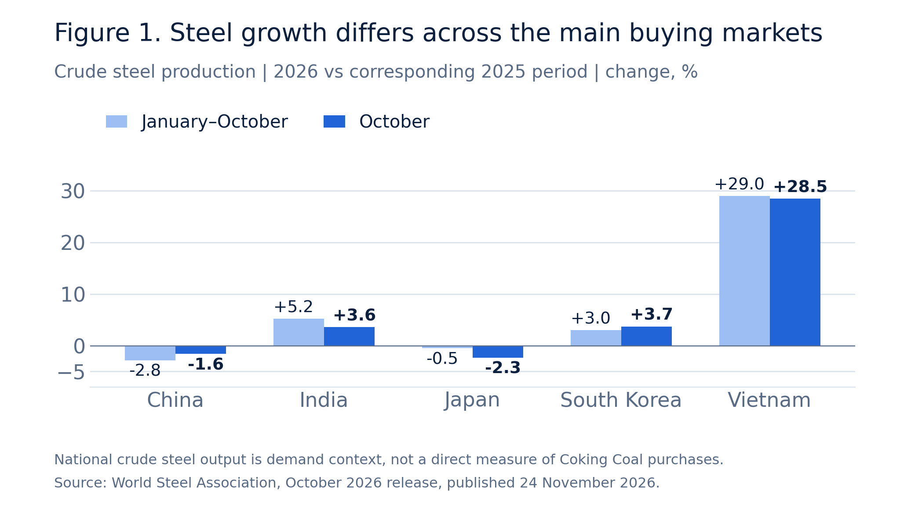
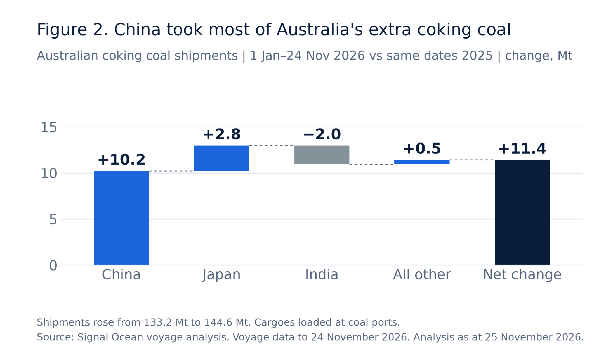
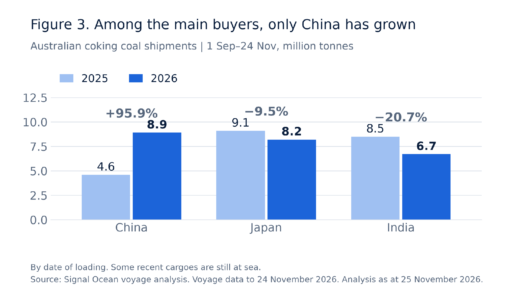
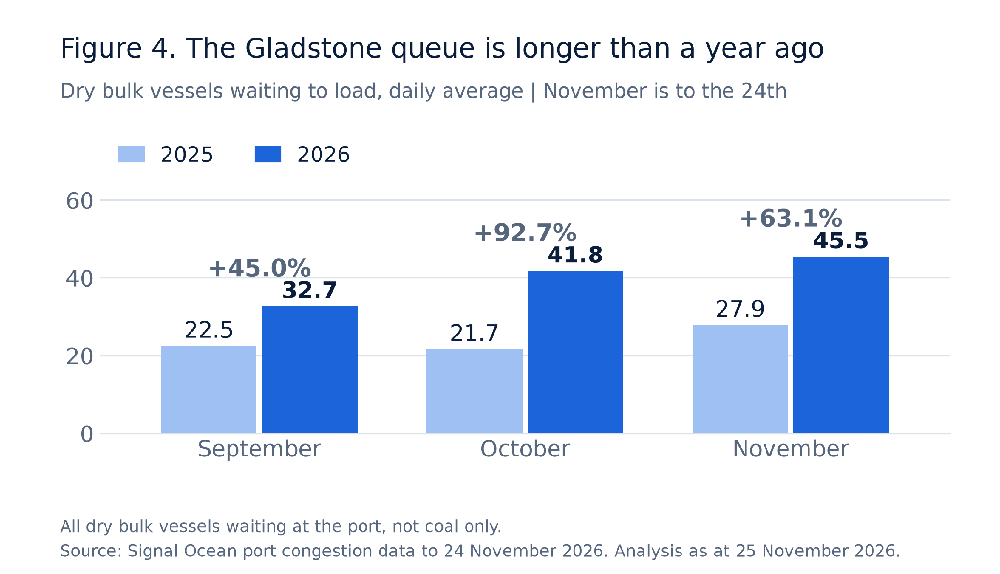
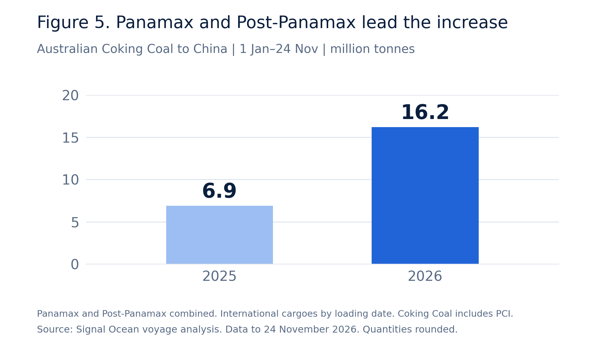

# Market Insights | China Drives Australia’s Coking Coal Export Growth, But Can Demand Hold?

*Published on 26 November 2026*

## China Drives Australia’s Coking Coal Export Growth, But Can Demand Hold?

**Esther Chua  |  Senior Dry Bulk Analyst  |  25 November 2026**

Australian Coking Coal shipments rose 8.6% in the year to 24 November, with China taking nearly nine-tenths of the increase despite weaker Chinese ironmaking. Imports can support loadings as mills replace domestic supply or rebuild stocks; repeat orders determine whether that support lasts.

**The near-term view.** Through 22 December, Whitehaven’s delayed Queensland sales could lift departures as producer stocks clear. Renewed Indian and Japanese purchases would broaden support.

## Steel Output Gives an Uneven Demand Signal

> **Figure 1: Crude-Steel Production Growth in January–october and October 2026, Each Against the Corresponding 2025 Period**  
> *Figure 1: Crude-steel production growth in January–October and October 2026, each against the corresponding 2025 period. Source: World Steel Association.*  
> **Interactive Data & Source:** [Signal Ocean Platform](https://www.thesignalgroup.com/newsroom/market-insights-china-drives-australias-coking-coal-export-growth-but-can-demand-hold) | [Local Asset](../../images/6b07f7a69ef4a616ea7673ab_361523a1.png)

China and Japan’s January–October crude-steel output fell; India, South Korea and Vietnam grew (Figure 1). These totals include routes not requiring Coking Coal. Blast-furnace activity, stocks and sourcing better guide import demand.

JFE estimated that Chiba flooding and typhoon damage cut April–September crude-steel output by about 0.5 Mt, with a further 0.2 Mt loss projected for October 2026–March 2027. Repairs were largely complete by early November; normal operations were still being restored.

India’s hot-metal output rose 1.9% year on year in April–October, against 2.6% for crude steel in the Ministry’s same-period figures, but hot metal fell 2.9% in October. Seven large producers, including the Tata Steel and JSW groups and SAIL, supplied about 93% of April–October hot metal. Their furnace activity, stocks and buying commitments will determine whether Australia regains volume.

## Growth Depends on One Market

Australia shipped 144.6 Mt of Coking Coal between 1 January and 24 November 2026, against 133.2 Mt over the same dates in 2025. Shipments to China nearly doubled, from 10.5 Mt to 20.7 Mt. Japan took 2.8 Mt more (+9.1%) and India 2.0 Mt less (−6.1%). All other destinations together added 0.5 Mt (Figure 2).

> **Figure 2: Change in Australian Coking Coal Shipments, 1 January–24 November 2026 Against the Same 2025 Dates, Mt**  
> *Figure 2: Change in Australian Coking Coal shipments, 1 January–24 November 2026 against the same 2025 dates, Mt. Components may not sum because of rounding. Source: Signal Ocean.*  
> **Interactive Data & Source:** [Signal Ocean Platform](https://www.thesignalgroup.com/newsroom/market-insights-china-drives-australias-coking-coal-export-growth-but-can-demand-hold) | [Local Asset](../../images/6b07f7a69ef4a616ea7673b2_5229b0d4.png)

## Among the Main Buyers, Only China Has Grown Since September

From 1 September to 24 November, total Australian shipments were almost unchanged on a year earlier, at 38.2 Mt against 37.8 Mt. Shipments to China rose 95.9% to 8.9 Mt. Shipments to India fell 20.7% to 6.7 Mt and to Japan 9.5% to 8.2 Mt (Figure 3).

> **Figure 3: Australian Coking Coal Shipments to the Three Main Buyers, 1 September–24 November, 2025 and 2026, Million Tonnes, by Date of Loading**  
> *Figure 3: Australian Coking Coal shipments to the three main buyers, 1 September–24 November, 2025 and 2026, million tonnes, by date of loading. Source: Signal Ocean.*  
> **Interactive Data & Source:** [Signal Ocean Platform](https://www.thesignalgroup.com/newsroom/market-insights-china-drives-australias-coking-coal-export-growth-but-can-demand-hold) | [Local Asset](../../images/6b07f7a69ef4a616ea7673ae_57297bc5.png)

The Chinese surge appears to be slowing. In the four weeks to 24 November, shipments to China were 20.9% above a year earlier, and shipments to India were 26.8% lower. Recent cargoes are still at sea, so the latest weeks are provisional.

## China Bought More While Its Ironmaking Fell

China’s buying did not follow stronger ironmaking. Pig iron and coke output fell 3.1% and 1.3% year on year in January–October; October declines were 4.1% and 6.2%. The China Coking Industry Association reported January–September domestic Coking Coal supply, excluding semi-coke use, down 8.5% year on year, against a 0.8% consumption decline. That is consistent with imports replacing constrained domestic supply, without establishing how much Australian growth came from substitution rather than stockbuilding.

Price signals are mixed. CommodityScope’s indicative premium hard Coking Coal assessment was USD 252.6 a tonne FOB Australia on 24 November, close to its USD 252.45 China netback. January 2027 Dalian futures settled at RMB 1,459 a tonne on 25 November, down 11.1% from 10 September but up 5.9% over 18–25 November. Mysteel’s 16-port imported Coking Coal stocks rose 0.2 Mt to 7.8 Mt in the week to 20 November. Arrivals, mill drawdowns and renewed bookings will clarify demand.

## Steel Exports Show Which Markets the Output Depends On

China made 2.8% less steel in January–October but shipped 6.8% more by sea, 89.0 Mt against 83.2 Mt, and the increase widened to 28.4% between 1 September and 24 November. More of China's output therefore depends on export buyers and on trade policy. China has required export licences for specified steel products since 1 January 2026.

Japan is the reverse. Its seaborne steel exports fell 7.4% in January–October, to 21.5 Mt from 23.2 Mt, alongside lower output.

## Follow the Mill and the Loading Programme

Australian shipments assigned to JFE’s Fukuyama works were level with last year at 4.5 Mt in the year to 24 November. Nippon Steel’s Kashima works took 1.9 Mt against 2.2 Mt and Hyundai Steel’s Dangjin works 2.5 Mt against 3.4 Mt. Unassigned cargoes are excluded and destinations can change. China’s northern ports of Caofeidian, Jingtang and Bayuquan took 7.3 Mt against 2.1 Mt; these public ports do not identify individual buyers.

Shipments to Dung Quat, the port that serves Hoa Phat's steel complex, rose to 3.5 Mt from 2.8 Mt, although they have been lower since September.

Whitehaven Coal reported Queensland equity sales of produced coal of 2.8 Mt in the September quarter, down 12% on the June quarter, citing RG Tanna terminal performance. The company expected sales slippages and elevated inventories to unwind in the December quarter.

## Gladstone Congestion Remains Elevated

Gladstone averaged 45.5 dry bulk vessels waiting to load over 1–24 November, against 27.9 a year earlier and 32.7 in September (Figure 4). Coal vessels that finished waiting in November had waited 18.8 days on average, against 12.5 days a year earlier.

> **Figure 4: Daily-Average Dry Bulk Vessels Waiting to Load at Gladstone**  
> *Figure 4: Daily-average dry bulk vessels waiting to load at Gladstone. November covers 1–24 in both years. All dry bulk vessels, not coal only. Source: Signal Ocean.*  
> **Interactive Data & Source:** [Signal Ocean Platform](https://www.thesignalgroup.com/newsroom/market-insights-china-drives-australias-coking-coal-export-growth-but-can-demand-hold) | [Local Asset](../../images/6b07f7a69ef4a616ea7673ba_180620f6.png)

## Freight: Capesize Is Firm, Pacific Panamax Is Softer

The Baltic Exchange Capesize time-charter average was USD 41,314 a day on 24 November, up 11.1% on the week and 37.4% in four weeks. The Panamax Pacific round voyage was 7.4% lower over four weeks at USD 19,166 a day.

## Panamax and Post-Panamax Lead the Increase

Panamax and Post-Panamax vessels carried 16.2 Mt of Australian Coking Coal to China over 1 January–24 November 2026, against 6.9 Mt over the same 2025 dates (Figure 5). Repeat Chinese orders therefore matter for these vessel classes.

> **Figure 5: Australian Coking Coal Shipments to China on Panamax and Post-Panamax Vessels Combined, 1 January–24 November, 2025 and 2026, Mt**  
> *Figure 5: Australian Coking Coal shipments to China on Panamax and Post-Panamax vessels combined, 1 January–24 November, 2025 and 2026, Mt. Source: Signal Ocean.*  
> **Interactive Data & Source:** [Signal Ocean Platform](https://www.thesignalgroup.com/newsroom/market-insights-china-drives-australias-coking-coal-export-growth-but-can-demand-hold) | [Local Asset](../../images/6b07f7a69ef4a616ea7673b5_3c799545.png)

## The Four-Week Outlook

Through 22 December, the base case is an uneven loading recovery. Falling Gladstone queues alongside stronger departures would improve execution. Repeat Indian and Japanese orders would broaden support beyond China. If producer stocks clear while new purchases fade, the increase in departures would be short-lived.

Weather could interrupt the recovery. The Bureau of Meteorology points to a wetter December across much of Queensland. Spire forecasts a wet final November week in eastern Australia, a drier first December week, then wetter conditions from mid-December into early January.

## Coverage and Sources

**Coverage.** Coking Coal includes PCI. Australian international cargoes loaded at Hay Point, Gladstone, Abbot Point, Newcastle, Port Kembla and Brisbane are compared by loading date through 24 November 2026 with the same 2025 dates. Voyages in progress are included. Terminals identify receiving facilities, not contractual buyers. Steel exports follow Signal Ocean’s steel category. Queues cover all dry bulk; completed coal-vessel waits are separate. Worldsteel and provisional Ministry hot-metal series are separately attributed. Outlooks are conditional judgements.

**Sources.** Signal Ocean voyages and congestion, 24 November; Baltic Exchange, 24 November; [Worldsteel](https://worldsteel.org/media/press-releases/2026/october-2026-crude-steel-production/), 24 November; [China NBS](https://www.stats.gov.cn/sj/zxfb/202611/t20261116\_1965842.html), 16 November; [CommodityScope](https://commodityscope.com/prices/coking-coal/glv), 24 November; [Dalian settlements via Sina Finance](https://stock2.finance.sina.com.cn/futures/api/jsonp.php/var%20\_JM2701=/InnerFuturesNewService.getDailyKLine?symbol=JM2701), 25 November; [Mysteel port survey](https://jiaotan.mysteel.com/a/26112008/709EEF2B5C412C7D.html), 20 November; [CCIA via Mysteel](https://news.mysteel.com/a/26111613/E931336919752F56.html), 16 November; [India Ministry of Steel](https://www.pib.gov.in/PressReleseDetailm.aspx?PRID=2333256&lang=2&reg=48), 5 November; [JFE](https://www.jfe-holdings.co.jp/en/common/pdf/investor/library/top/2026/2026-setumei261106-02e.pdf), 6 November; [MOFCOM/GACC Announcement 79 of 2025](https://www.mofcom.gov.cn/tzgg/art/2025/art\_0f1425b5b23941eea7c9f3d55c16cd94.html); [Whitehaven September-quarter report](https://whitehavencoal.com.au/september-2026-quarterly-production-report/); [Bureau of Meteorology](https://www.bom.gov.au/climate/ahead/outlooks/archive/20261119-outlook.shtml), 19 November; Spire Weather, 24–25 November. Dates are 2026 unless stated.

***Disclaimer:*** *This report has been prepared by Signal Group for general information purposes only. It does not constitute, and should not be relied upon as, investment, financial, trading, legal or commercial advice, or as a recommendation to enter into any transaction. While reasonable efforts have been made to ensure that the information is accurate and reliable at the date of publication, no representation or warranty, express or implied, is given as to its accuracy, completeness or continued availability. Certain figures may be estimates or provisional and may subsequently be revised. Market conditions and other external factors may change without notice and may not be reflected in this report. Readers should conduct their own assessment and seek appropriate professional advice before making any decision. To the fullest extent permitted by law, Signal Group accepts no liability for any loss or damage arising from the use of, or reliance on, this report.*

*Copyright notice: © 2026 Signal Group. All rights reserved. Except where otherwise stated or permitted by law, this report may not be copied, reproduced, modified, published or redistributed, in whole or in part, without the prior written consent of Signal Group. Third-party data and content remain the property of their respective owners and are used subject to the applicable terms and licences.*
