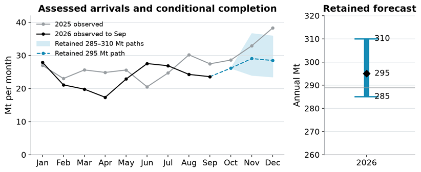
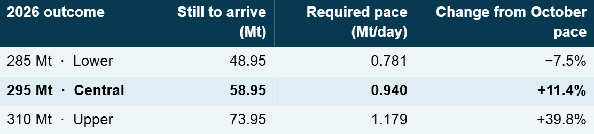
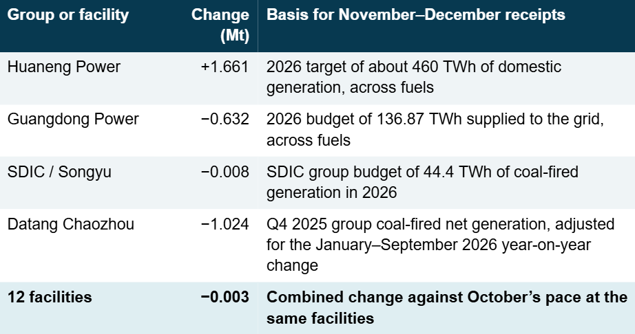
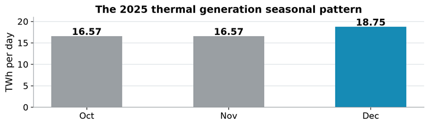
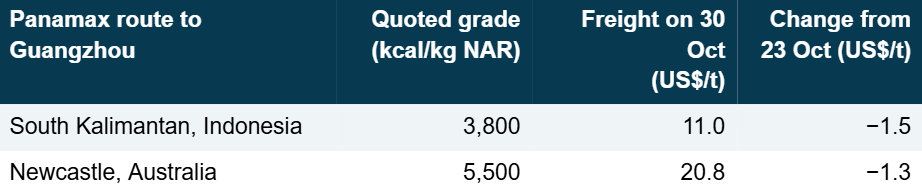
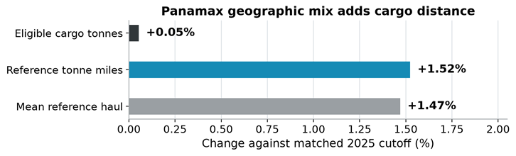
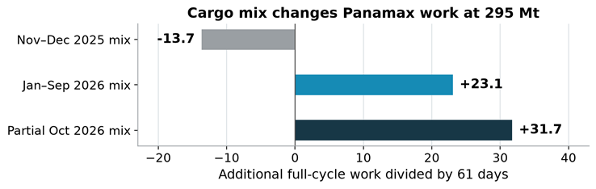

# Market Insights | China’s 2026 Thermal Coal Import Outlook

*Published on 09 November 2026*

## China’s 2026 Thermal Coal Import Outlook

Esther Chua  |  Senior Dry Bulk Analyst  |  9 November 2026

**We retain a range of 285–310 million tonnes (Mt) for China’s 2026 seaborne thermal coal imports, with 295 Mt as our conditional central case.** Extending October’s arrival pace gives 288.96 Mt. Winter restocking could close the 6.04 Mt gap. As at 2 November, the procurement evidence had yet to establish that extra volume.

By 30 October, China-bound Panamax thermal coal volumes were almost flat year on year, but a longer average haul had lifted estimated tonne-miles by 1.52%. At 295 Mt, the choice of loading area and vessel size could still raise or reduce the Panamax workload this winter.

> **Figure 1: China’s 2026 Thermal Coal Import Outlook**  
> **Interactive Data & Source:** [Signal Ocean Platform](https://www.thesignalgroup.com/newsroom/market-insights-chinas-2026-thermal-coal-import-outlook) | [Local Asset](../../images/6aede83ef85a7d81adfcd0f1_00344923.png)

Signal Ocean voyage estimates, including lignite and all anthracite. Full-month observations end in September. October extends the observed pace to month-end. November’s median share of November–December arrivals in 2021–25 splits the two months. The grey line in the annual panel marks the October-pace estimate (288.96 Mt).

## How Much Coal Still Needs to Arrive

> **Figure 2: How Much Coal Still Needs to Arrive**  
> **Interactive Data & Source:** [Signal Ocean Platform](https://www.thesignalgroup.com/newsroom/market-insights-chinas-2026-thermal-coal-import-outlook) | [Local Asset](../../images/6aede878937ce16b1de2ea83_2ffd6c9e.png)

By 07:08 UTC on 30 October, provisional 2026 arrivals totalled 236.05 Mt. October accounted for 24.72 Mt over 29.30 days, or 0.844 Mt/day. The required rates cover the remaining 62.70 days of 2026.

Seasonality and the timing of customs imports informed the revision from 270–290 Mt. Three equally weighted seasonal estimates give 295.75 Mt. In tests for 2022–25 using revised voyage records, the October-pace method had a smaller mean absolute error than the seasonal method (6.50 Mt against 8.03 Mt). Both undershot arrivals in all four years, leaving room for a winter increase. Its size depends on coastal buying.

Twelve facilities linked to four power groups received 4.685 Mt out of China’s 24.720 Mt of seaborne thermal coal arrivals in October to the cutoff (18.95%). Their modelled November–December receipts total 9.752 Mt, against 9.755 Mt at their October pace. If all other receivers maintain that pace, annual imports reach 288.95 Mt, leaving 6.05 Mt to reach 295 Mt.

> **Figure 3: How Much Coal Still Needs to Arrive**  
> **Interactive Data & Source:** [Signal Ocean Platform](https://www.thesignalgroup.com/newsroom/market-insights-chinas-2026-thermal-coal-import-outlook) | [Local Asset](../../images/6aede8bc4746e541c0db5871_bdd5f81d.png)

Signal Ocean estimates apply January–September imports per unit of generation and the facilities’ generation shares, allocating 61 of 92 fourth-quarter days to November–December. Berth calls identify receiving facilities. The legal importer, plant stocks, domestic deliveries and purchase timing remain uncertain.

## A New Unit Changes the Comparison at Chaozhou

Chaozhou’s 1 GW coal-fired Unit 5 first connected to the grid on 25 October. Last winter’s generation may therefore understate this winter’s dispatch. If Chaozhou maintains October’s import pace, its modelled 1.02 Mt decline disappears. On the same assumptions elsewhere, national arrivals reach about 290 Mt, still 5 Mt below the central case. The new unit’s effect on imports will depend on how often it runs and where the plant buys its coal.

On 13 October, Datang sought a 70,000-tonne imported coal cargo (±10%) for delivery to Chaozhou between 28 November and 10 December. Berth draught was limited to 14.2 m. The tender gives a parcel size and delivery window. An award and evidence that the cargo would add to routine receipts would strengthen the import case. The load port would determine the haul.

## Last Winter’s Lift Came in December

> **Figure 4: Last Winter’s Lift Came in December**  
> **Interactive Data & Source:** [Signal Ocean Platform](https://www.thesignalgroup.com/newsroom/market-insights-chinas-2026-thermal-coal-import-outlook) | [Local Asset](../../images/6aede8f5937ce16b1de371de_412b269f.png)

National Bureau of Statistics of China (NBS), industrial enterprises above designated size. Average daily thermal generation in November–December 2025 was 6.64% above October. November itself was almost flat. In 2024, daily output had already risen 12.1% from October to November. This series includes generation from fuels other than coal.

## Domestic Supply and the Winter Buying Decision

In its 30 October briefing, China’s National Energy Administration (NEA) said it had encouraged key regions and companies to increase coal imports as domestic output recovered. September raw-coal production at industrial enterprises above designated size was 6.8% below a year earlier. Delays in delivering the grades coastal plants need could leave more room for seaborne coal.

Stocks temper that case. On 25 October, nationally dispatched power plants held 210 Mt of coal, or 35 days of cover, close to the three-year average. The NEA also reported that coal-fired generation fell 1.9% year on year in September. These stocks give the power sector scope to meet higher burn from inventory. Cover at individual coastal plants depends on the grades they hold and their ability to replenish them.

The 26 October climate outlook favoured near-normal to warmer conditions across most of China for 9–24 November, with Guangdong and much of Fujian forecast at 1–2°C above normal. Colder spells or heavier dispatch could lift burn, but the import requirement depends on what remains after usable stocks and domestic deliveries.

## Landed Prices Offered Little Incentive to Switch

The China Coal Transportation and Distribution Association (CCTDA) assessed both imported grades at RMB 5–10/t above comparable domestic coal on 30 October. Coastal plants were buying for immediate needs. The price a plant pays depends on calorific value, freight and the exchange rate.

> **Figure 5: Landed Prices Offered Little Incentive to Switch**  
> **Interactive Data & Source:** [Signal Ocean Platform](https://www.thesignalgroup.com/newsroom/market-insights-chinas-2026-thermal-coal-import-outlook) | [Local Asset](../../images/6aede93bd74abf5d74f2d5de_563fd7d9.png)

CCTDA’s assessment for 30 October 2026, published on 31 October. Freight is quoted to Guangzhou in US dollars per cargo tonne. The coal offers were for November. NAR is net calorific value as received.

Indonesian logistics could also change the timing of individual cargoes. In September, low Mahakam River levels cut barge payloads by 30–40% at affected Melak operations, according to Indo Tambangraya Megah. Its coastal Indominco operation at Bontang was unaffected. We make no national export adjustment from this local constraint. November loadings depend on river conditions and the availability of coal at the loading point.

## How to Distinguish the Lower and Upper Cases

If late-October arrivals hold at the pace recorded to 30 October, the 295 Mt case requires 57.51 Mt in November–December, against 51.47 Mt at October’s pace. Under the four power-group assumptions, the remaining receivers would need 47.76 Mt, 14.5% above their 41.71 Mt baseline. Awards for additional year-end deliveries would strengthen the case, particularly if coastal stocks fall or domestic deliveries slip.

Imports near 0.844 Mt/day leave the year close to 289 Mt. Stock draws and a recovery in domestic deliveries could slow arrivals to 0.781 Mt/day, enough for 285 Mt. At the other extreme, 310 Mt requires nearly 1.18 Mt/day from the cutoff, almost 40% above October. That would require buying to broaden well beyond the plants identified so far.

## What Changes for Pacific Panamax Tonnage

From 1 January to the 30 October cutoff, Panamax-size dry bulk and multipurpose vessels carried 169.110 Mt of thermal coal to China in 2026, against 169.019 Mt in 2025. On the same cargoes, estimated tonne-miles rose 1.52%, from 0.5034 to 0.5110 trillion tonne-nautical miles. The average reference haul rose from 2,978 to 3,022 nautical miles.

> **Figure 6: What Changes for Pacific Panamax Tonnage**  
> **Interactive Data & Source:** [Signal Ocean Platform](https://www.thesignalgroup.com/newsroom/market-insights-chinas-2026-thermal-coal-import-outlook) | [Local Asset](../../images/6aede9797d1dbd7f71110507_8af04fb3.png)

Signal Ocean voyage analysis, 68,001–100,000 DWT. For each load and discharge zone pair, tonnes are multiplied by the same 2025 cargo-weighted mean distance in both years. Distance is estimated from voyage speed and time at sea. The comparison measures changes in the mix of routes.

## The Same Import Total Can Mean Fewer Panamax Vessel-Days

If October’s pace and cargo mix continue, November–December arrivals account for 16,489 full-cycle Panamax vessel-days. At 295 Mt for the year, the January–September 2026 mix of vessel sizes and loading zones adds 1,407 days against that baseline. Keeping October’s mix adds 1,936 days. Applying the November–December 2025 mix instead reduces the workload by 833 days.

> **Figure 7: The Same Import Total Can Mean Fewer Panamax Vessel-Days**  
> **Interactive Data & Source:** [Signal Ocean Platform](https://www.thesignalgroup.com/newsroom/market-insights-chinas-2026-thermal-coal-import-outlook) | [Local Asset](../../images/6aede991e280f6e1914b617a_70d4e3b4.png)

Signal Ocean scenarios use assessed cargo parcels and full cycles from one load-port entry to the next laden load-port entry, counting the return ballast leg once. Thinly traded routes use proxy estimates. Some days fall outside November–December. Dividing by 61 gives equivalent vessel workloads before any displacement of other cargoes.

For a cargo of the same size bound for Guangzhou, loading at Newcastle instead of South Kalimantan adds laden sailing days. The grades quoted on page 3 have different calorific values, so equal cargo tonnes deliver different amounts of energy. The freight effect depends on the vessel required and which other cargo it could have carried.

In the week to 30 October the Baltic Exchange reported a softer Pacific Panamax market. Indonesian enquiry held up better than competing North Pacific and east Australian business. For November–December, fresh coal fixtures would support rates if they compete with grain or mineral stems for the same open dates. Ballast arrivals ahead of laycans could replenish the list, while bunched loadings or longer port waits could tighten it.

## Coverage and Sources

**Voyage and commodity definitions**

Arrivals are dated on entry to the discharge port. We use deduplicated laden voyages to China with positive assessed cargo intake on dry bulk, ore/bulk/oil and multipurpose vessels, excluding predicted movements and cabotage. The 30 October 2026 archive was retrieved on 31 October. The cutoff of 07:08:45 UTC on 30 October comes from the latest eligible loading entry worldwide. Chinese arrivals at that point remain provisional. Public information runs through 2 November 2026.

The thermal series covers cargo labelled steam coal, lignite, brown coal briquettes and all anthracite, including industrial and feedstock uses. Coking coal and unallocated coal are excluded. Individual cargo ranks within the steam-coal category remain unverified. Power-sector evidence therefore explains only part of the import series.

The separate TDM customs snapshot gives 233.84 Mt for January–September 2026, including lignite and anthracite. Its transport coverage and publisher revision date are unspecified. We use customs data to assess seasonality and voyage data to measure seaborne arrivals.

The Panamax band covers 68,001–100,000 DWT. The matched-year tonne-mile comparison includes dry bulk carriers and multipurpose vessels. It excludes one 69,146-tonne ore/bulk/oil carrier cargo in 2025. There was no equivalent exclusion in 2026.

**Sources**

Signal Ocean voyage analysis, 30 October 2026 archive. TDM customs import snapshot. Company plans from[Huaneng](https://big5.sse.com.cn/site/cht/www.sse.com.cn/disclosure/listedinfo/announcement/c/new/2026-03-25/600011\_20260325\_CS0B.pdf#page=33),[Guangdong](https://static.cninfo.com.cn/finalpage/2026-03-31/1225058381.PDF) and[SDIC](https://www.rns-pdf.londonstockexchange.com/rns/5492F\_1-2026-5-25.pdf). Chaozhou evidence from[Datang’s generation filing](https://www1.hkexnews.hk/listedco/listconews/sehk/2026/1027/2026102700278.pdf),[coal tender](https://www.dtrlcg.com/bulletin/2026-10-13/34203.html) and[China Energy Engineering’s Unit 5 update](https://www.ceec.net.cn/art/2026/10/27/art\_11019\_2540743.html).

NBS industrial production for[October](https://www.stats.gov.cn/english/PressRelease/202411/t20241127\_1957585.html) and[November 2024](https://www.stats.gov.cn/english/PressRelease/202412/t20241223\_1957828.html),[October](https://www.stats.gov.cn/english/PressRelease/202511/t20251117\_1961875.html),[November](https://www.stats.gov.cn/english/PressRelease/202512/t20251218\_1962111.html) and[December 2025](https://www.stats.gov.cn/english/PressRelease/202601/t20260120\_1962350.html) and[September 2026 energy production](https://www.stats.gov.cn/sj/zxfbhjd/202610/t20261019\_1965613.html). NEA[winter supply briefing](https://www.nea.gov.cn/20261030/828a2bbc6839446a963ce58718a716ac/c.html) and[stocks and coal-fired generation](https://www.nea.gov.cn/20261102/d8cfa4e095234d54b2858da7d8e29fe6/c.html). China Meteorological Administration[November climate outlook](https://www.ncc-cma.net/channel/news/newsid/101092).

Baltic Exchange[week 44 freight report](https://www.balticexchange.com/en/data-services/WeeklyRoundup/dry/news/2026/bulk-report-week-44.html). CCTDA[import prices and freight, 30 October](https://www.cctda.org.cn/index.php?a=show&c=index&catid=44&id=6798&m=content). Indo Tambangraya Megah[September public briefing, p. 2](https://indopremier.com/xdir/product/f/aireport\_2026\_09\_14/ITMG/aireport\_20260914\_itmg\_public\_expose\_32148139\_lamp1.pdf).

*Disclaimer: This report has been prepared by Signal Group for general information purposes only. It does not constitute, and should not be relied upon as, investment, financial, trading, legal or commercial advice, or as a recommendation to enter into any transaction. While reasonable efforts have been made to ensure that the information is accurate and reliable at the date of publication, no representation or warranty, express or implied, is given as to its accuracy, completeness or continued availability. Certain figures may be estimates or provisional and may subsequently be revised. Market conditions and other external factors may change without notice and may not be reflected in this report. Readers should conduct their own assessment and seek appropriate professional advice before making any decision. To the fullest extent permitted by law, Signal Group accepts no liability for any loss or damage arising from the use of, or reliance on, this report.*

*Copyright notice: © 2026 Signal Group. All rights reserved. Except where otherwise stated or permitted by law, this report may not be copied, reproduced, modified, published or redistributed, in whole or in part, without the prior written consent of Signal Group. Third-party data and content remain the property of their respective owners and are used subject to the applicable terms and licences.*
