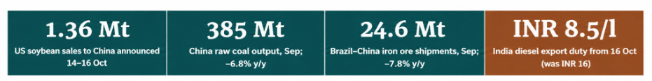
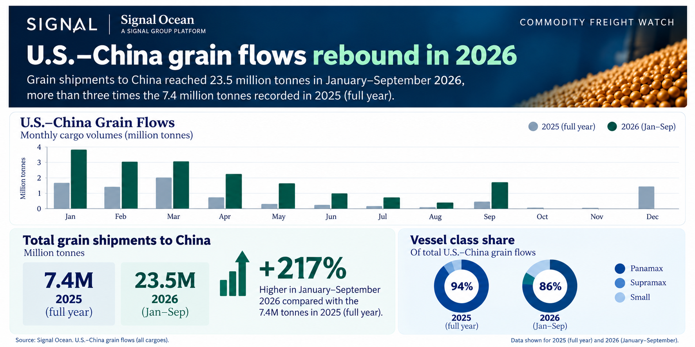
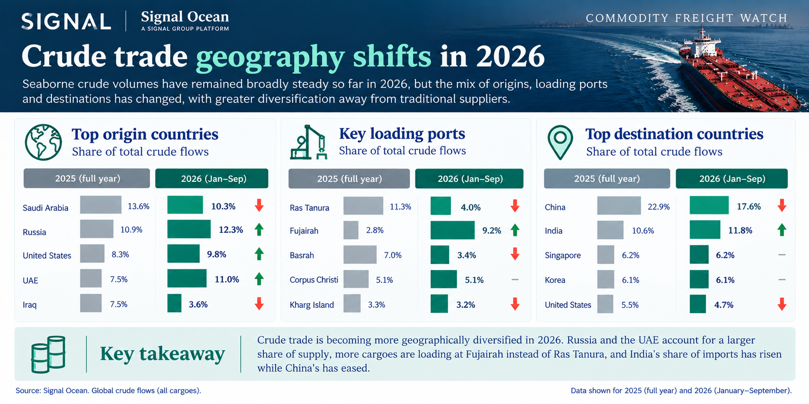

# Market Insights | Commodity Freight Watch

*Published on 23 October 2026*

## Signal Ocean · Market Insights

## Commodity Freight Watch

### Maria Bertzeletou | Senior Market Analyst | 23 October 2026

**Alongside our weekly** [**Dry**](https://www.thesignalgroup.com/weekly-market-monitor/weekly-dry-market-monitor-week-41-2026) **and** [**Tanker**](https://www.thesignalgroup.com/weekly-market-monitor/weekly-tanker-market-monitor-week-41-2026) **Market Monitors, this Market Insight presents our Commodity Freight Watch**, examining developments that could influence seaborne trade and freight in the coming weeks. While the Monitors assess freight performance and vessel supply, this analysis focuses on the underlying commodity developments shaping cargo availability, supported by Signal Ocean Platform data on shipment patterns, loading activity and vessel deployment.

Key factors in dry bulk include Chinese and Indian coal policies, Indonesian export authorizations, iron ore loading delays at Saldanha, and a resurgence in US soybean acquisitions. Meanwhile, oil cargo flows may be shaped by shifting product-export rules and updated sanctions policies, alongside loading schedule risks driven by refinery outages and the Petersburg terminal fire. **Ultimately, the location and timing of available cargoes will dictate the near-term freight trajectory.**

> **Figure 1: Maria Bertzeletou | Senior Market Analyst | 23 October 2026**  
> **Interactive Data & Source:** [Signal Ocean Platform](https://www.thesignalgroup.com/newsroom/market-insights-commodity-freight-watch) | [Local Asset](file:///C:/Users/Dell/Github/Shipping/corpus/07-signal/images/6adb1156203c4cd3caa95aa6_929e61fd.png)

## Spotlight of the Week | Grain

**US–China Grain: The Shipment Pattern Behind the New Purchases**

> **Figure 2: Spotlight of the Week | Grain**  
> **Interactive Data & Source:** [Signal Ocean Platform](https://www.thesignalgroup.com/newsroom/market-insights-commodity-freight-watch) | [Local Asset](file:///C:/Users/Dell/Github/Shipping/corpus/07-signal/images/6adb11909b5c326f4e74be59_7e85302e.png)

**Chinese soybean purchases strengthen the US forward cargo book.** USDA reported **558,000 tonnes** of soybean sales to China on 16 October, following **330,000 tonnes** on 15 October. China-designated sales announced during 14–16 October reached **1.36 million tonnes** for the 2026/27 marketing year. Additional sales included 236,000 tonnes of soybeans to unknown destinations and 127,000 tonnes of corn to Japan. These commitments support future US grain export programmes, although their contribution to Panamax and Kamsarmax employment will depend on shipment dates and loading ports.

**US–China grain shipments recovered in September following a summer slowdown.** Signal Ocean Platform data show stronger monthly US–China grain exports during the first five months of 2026 compared with 2025, followed by weaker summer activity and a September rebound. The earlier soybean-specific selection recorded **10.87 million tonnes during January–August, up 86% year on year**, before the subsequent recovery in shipments. Panamax vessels account for the largest share of the displayed grain movements, with the **US Gulf remaining the principal loading region** alongside Pacific coast exports.

## Coal | Policy and Quotas Reshape Asian Supply

**China** is balancing tighter mine-safety oversight with efforts to maintain domestic coal supply ahead of the winter heating season. September raw coal output fell **6.8% y/y to 385 Mt**, a decline attributed in reporting to stricter safety inspections after the May accident in Shanxi and a fatal accident in Hunan in August. On 16 October, the NDRC and the National Energy Administration urged Shanxi to bring idled mines back into operation and raise output before winter.

**India** continues to prioritise domestic coal production and rail distribution to power plants. The Ministry of Coal reported average daily supply to the power sector rising from **2.2 Mt** in September to **2.5 Mt** over 1–10 October, with rail loading up from 426 to 469 rakes per day. The Power Secretary ruled out a mandatory imported-coal blending requirement for power plants this year.

**Indonesia** 2027 coal production quotas under review: Indonesia opened applications for its 2027 production plans (RKAB) on 1 October, with submissions due by 15 November. The government is assessing production allocations, while uncertainty over approved volumes has already slowed negotiations for 2027 coal supply contracts. For the dry bulk freight market, the outcome will be important for Indonesian export commitments and prospective coal cargo availability across Asian routes.

## Iron Ore and Grain | Supply Risks

**Iron ore -** Saldanha terminal reaches scheduled maintenance deadline. South Africa's Saldanha Iron Ore Terminal is scheduled to complete its 16-day maintenance programme on 21 October, following repairs to shiploaders, conveyors and rail tipplers. Separately, maintenance on the Sishen–Saldanha railway was scheduled to conclude on 16 October. With the terminal handling more than 50 million tonnes of iron ore annually, Capesize employment will focus on resuming loading operations and timing export cargoes after the shutdown. Transnet's longer-term investment in rail and terminal infrastructure aims to improve the reliability of South Africa's iron ore export corridor.

**Grain -  wheat supply shifts and stronger U.S. corn export prospects.** USDA's October outlook points to tighter global wheat trade and stronger U.S. corn export prospects for 2026/27. Reduced wheat export availability from Russia and the United States, partly offset by Argentina and Canada, places greater importance on where importers secure their cargoes. Black Sea disruptions add pressure to sourcing decisions, particularly for buyers in North Africa and Asia.

**Grain - Black Sea attacks intensify pressure on Ukraine’s export corridors.** Maritime security risks escalated in mid-October after HS Dignity sank and Chelsea 3 was damaged in reported drone attacks off Bulgaria on 13 October. Russia subsequently claimed strikes on Ukraine’s Izmail port and commercial vessels on 15 October, although these claims remain independently unverified. Ukraine’s grain and pulse exports reached 5.44 million tonnes by 7 October, down 24% year on year, with wheat shipments falling 42%.

Worsening Black Sea security has increased reliance on alternative export corridors, particularly the Danube route through Izmail, Reni and Romania’s Constanța, while Baltic ports are also being explored. Congestion at the Sulina Canal has added to the pressure, with vessel waiting times previously exceeding two weeks. The European Council called on 16 October for the restoration of safe commercial navigation and further support for the EU–Ukraine Solidarity Lanes. For Handysize and smaller bulk carriers, the shift towards alternative loading ports, longer waiting times and higher freight costs is changing voyage economics, although additional corridor capacity remains constrained by security risks and inland logistics bottlenecks.

## Oil | Crude Flows in Focus

**Crude Trade Geography: Shifting Origin and Loading-Port Shares**

Geopolitical disruptions are reshaping the geography of seaborne crude trade, with changes in supply origins, loading terminals and destination markets becoming more pronounced in 2026. Signal Ocean data highlights a greater share of crude originating from Russia, the UAE and the United States, alongside a shift in loading activity towards Fujairah and away from Ras Tanura and Basrah. On the demand side, India's share has increased while China's has declined.

> **Figure 3: Oil | Crude Flows in Focus**  
> **Interactive Data & Source:** [Signal Ocean Platform](https://www.thesignalgroup.com/newsroom/market-insights-commodity-freight-watch) | [Local Asset](file:///C:/Users/Dell/Github/Shipping/corpus/07-signal/images/6adb12a77f8279abadfd3bbb_371066af.png)

**2025** - Saudi Arabia held the largest share of seaborne crude origins at 13.6%, ahead of Russia (10.9%) and the United States (8.3%). China accounted for 22.9% of destinations, more than twice India's 10.6% share. At the loading-port level, Ras Tanura led with 11.3%, reflecting the importance of Saudi export infrastructure in the distribution of crude cargoes.

**2026** - A different supply ranking and a shift in loading geography. Russia (12.3%) and the UAE (11.0%) have moved ahead of Saudi Arabia (10.3%) in the January–September origin distribution, while Iraq's share has fallen from 7.5% to 3.6%. The most pronounced change is at the loading-port level: Fujairah's share has risen from 2.8% to 9.2%, overtaking Ras Tanura, whose share has declined from 11.3% to 4.0%. This redistribution is particularly relevant for tanker deployment, as greater loading activity outside the Strait of Hormuz changes where vessels need to position for their next cargo. On the destination side, China remains the largest market, although its share has declined from 22.9% to 17.6%, while India's has increased from 10.6% to 11.8%.

## Oil | Regulatory Environment

**Crude and fleet**

**Graham Act waiver.** The 16 October US executive order implementing the Graham Act waived specified new sanctions and duties, including the additional 100% duty on new purchases of Russian-origin crude oil and natural gas by the five largest importers from 18 October. The waivers remain in effect until the President or the Secretary of State decides further action is appropriate; sanctions under earlier executive orders remain in force.

**Sanctioned-tanker sales - under consideration.** US officials have outlined a possible route for legitimate buyers to acquire sanctioned tankers, subject to OFAC authorisation and removal of vessel sanctions on a case-by-case basis, for employment in non-sanctioned trades.OFAC’s public notices reviewed through 20 October did not identify a general authorisation or vessel delistings implementing the initiative. The implications for tanker supply depend on how many vessels secure approval and return to commercial service, and when. Until those steps are confirmed, the initiative cannot be treated as an increase in available tonnage or evidence of freight relief.

**Oil products**

**Russian diesel exports resume, with first US-bound shipment scheduled.** The US licence issued on 9 October, alongside Russia’s partial easing of its diesel export ban from 10 October, has opened the way for additional Russian diesel shipments. The first confirmed export movement involved approximately 40,000 tonnes of ultra-low sulphur diesel loaded at Primorsk on 13 October, bound for Morocco. On 21 October, Russia announced plans to dispatch its first US-bound diesel cargo of 40,000 tonnes on 22 October, with further shipments expected. The US exemption covers specified Russian-origin diesel transactions until 7 April 2027, but does not extend to crude oil. For product tankers, the resumption introduces additional cargo opportunities from Russian export terminals, with the destination mix and pace of subsequent loadings determining the impact on vessel employment and tonne-mile demand.

**India - lower diesel export duty improves shipment economics.** Effective 16 October, India reduced the special additional excise duty on diesel exports from INR 16 to INR 8.5 per litre, while increasing the petrol export duty from INR 0.5 to INR 2.5 per litre. The jet-fuel duty remained unchanged at INR 10.5 per litre. The reduction lowers the tax burden on diesel exports and could encourage additional overseas sales, subject to refinery output, domestic requirements and international demand.

**China - October fuel export approvals support renewed shipments.** Beijing reportedly approved approximately 3.7 million tonnes of diesel, gasoline and jet-fuel exports for October following the Golden Week holiday. These approvals provide scope for Chinese refiners to resume overseas sales, although the volume represents reported export authorisations rather than confirmed shipments. The pace of cargo nominations and loading activity will determine the additional product tanker demand.

**IEA - Diesel stock releases add to available supply.** On 15 October, the International Energy Agency outlined plans to accelerate the release of remaining emergency stocks, including more than 20 million barrels of diesel. The additional supply could help meet immediate product requirements, although the impact on seaborne trade will depend on where inventories are released and whether buyers source replacement cargoes internationally.

**Easing export restrictions in Russia, lower diesel export duties in India and new Chinese export approvals improve the outlook for clean petroleum product shipments. IEA stock releases, however, may limit immediate import demand in receiving markets.**

## Oil | Disruptions and Recovery

**Crude**

**US Gulf - Offshore production recovery supports export availability.** US offshore oil shut-ins declined from **1.46 million b/d on 9 October to 329,059 b/d on 13 October**, equivalent to 16.1% of Gulf production. By 14 October, approximately **202,000 b/d (9.9%)** remained offline. EIA data released on 15 October showed US commercial crude inventories falling by **8.6 million barrels** in the week ended 9 October. The restoration of offshore output improves the supply outlook for US Gulf crude exports, although additional tanker demand will depend on refinery requirements, export nominations and confirmed loadings.

**Saudi Arabia - Houthi attack raises security concerns at Shaybah oilfield.** On 21 October, Saudi authorities reported intercepting a drone targeting Saudi Aramco's Shaybah oilfield. Falling debris reportedly caused a fire outside the processing facility, killing two workers, but **oilfield operations were not disrupted**. The incident adds to security concerns surrounding Saudi energy infrastructure without establishing a reduction in crude production or exports.

**Oil products**

**Ryazan refinery - Partial processing disruption following drone attack.** The 15 October attack forced the shutdown of Ryazan’s CDU-6 crude distillation unit, with an estimated processing capacity of 160,000 b/d, accounting for almost half the refinery’s total capacity. Three other crude distillation units remained operational, limiting the extent of the disruption. No confirmed restart of CDU-6 has been reported, while the impact on diesel production and export volumes remains unquantified.

**Petersburg Oil Terminal.** Fire raises uncertainty over Baltic product shipments. A drone attack overnight on 18 October caused a fire at Petersburg Oil Terminal, a Baltic export facility handling gasoil, jet fuel, fuel oil and vacuum gasoil. The city governor confirmed the fire, while the extent of damage to loading infrastructure and any interruption to export operations remains unclear. No confirmed cargo cancellations or quantified export losses have been established. Any restrictions on terminal operations could delay product loadings and affect vessel turnaround times, with the freight impact dependent on the duration of the disruption and subsequent cargo schedules.

**US Gulf production recovery improves crude availability, while attacks on Russian energy infrastructure raise uncertainty over Baltic product shipments despite the easing of diesel export restrictions.**

## Key Takeaway

Recent developments highlight how freight conditions can tighten without a corresponding increase in cargo volumes. Disruptions to loading schedules, port operations and export programmes can delay vessel turnaround and temporarily reduce available tonnage. In a market where cargo flows and vessel positioning are changing rapidly, operational efficiency is becoming an important factor in short-term freight performance, alongside underlying supply-demand fundamentals.

***Signal data.*** *Signal Ocean Platform, Dry Bulk Flows (US–China grain, export-date basis) and Oil Flows dashboards (crude, export-date basis); January–December 2025 compared with January–September 2026; observations provisional. Origin, loading-port and destination rankings are separate distributions and do not establish individual voyage routes.*

***Policy and operational items.*** *Developments reported 5–18 October 2026, with material updates verified through 21 October 2026. "Approved", "effective" and "issued" refer to government decisions; "reported" refers to press or industry-source reporting; "under consideration" denotes proposals not implemented.*

### Explore More From Signal Ocean

**Discover the data behind our market analysis.**

Explore vessel movements, commodity flows and freight market developments through the[Signal Ocean Platform](https://www.thesignalgroup.com/signal-ocean/platform).

**Current Intelligence Podcast | Listen & Watch**

Explore our conversations on the forces shaping global commodity trade, shipping markets and freight.

- **Ep. 1 | The Dry Side of the Energy Transition** -[Apple Podcasts](https://podcasts.apple.com/us/podcast/the-dry-side-of-the-energy-transition/id6797585495?i=1000779733559) ·[YouTube](https://www.youtube.com/watch?v=BBY0mEmYkoY)
- **Ep. 2 | When Agriculture Meets Energy** -[Apple Podcasts](https://podcasts.apple.com/us/podcast/when-agriculture-meets-energy/id6797585495?i=1000786498249) ·[YouTube](https://www.youtube.com/watch?v=w\_YKlxEFacU)
- **Ep. 3 | China's Energy Paradox** -[Apple Podcasts](https://podcasts.apple.com/us/podcast/chinas-energy-paradox/id6797585495?i=1000790521152) ·[YouTube](https://www.youtube.com/watch?v=3X49Y7bnGzQ)
- **Ep. 4 | The Barrel That Crossed Twice** -[Apple Podcasts](https://podcasts.apple.com/us/podcast/the-barrel-that-crossed-twice/id6797585495?i=1000791609708) ·[YouTube](https://www.youtube.com/watch?v=qihSwar-A4Q)
- **Ep. 5 | Atlantic Crude Freight: Why the Pressure Is Spreading** -[Apple Podcasts](https://podcasts.apple.com/us/podcast/atlantic-crude-freight-why-the-pressure-is-spreading/id6797585495?i=1000796653495) ·[YouTube](https://www.youtube.com/watch?v=S\_N90yTCkTE)
