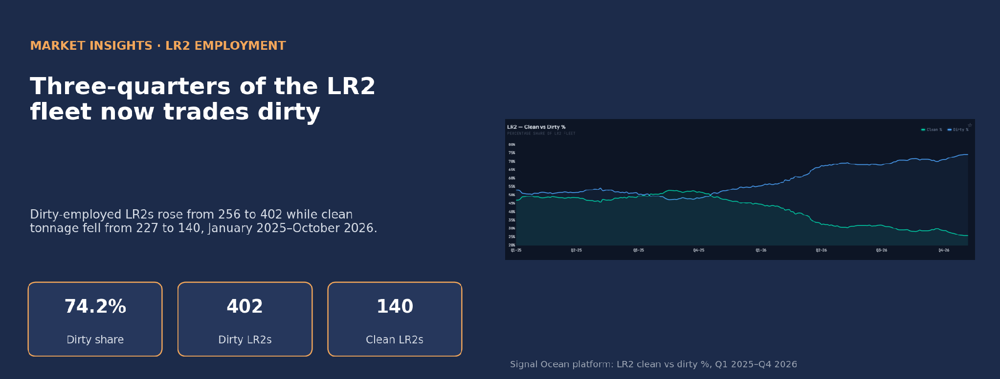
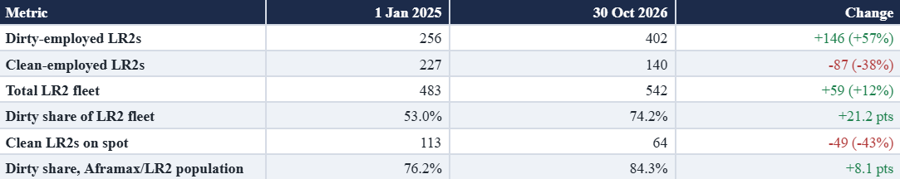
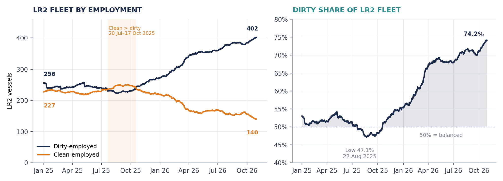
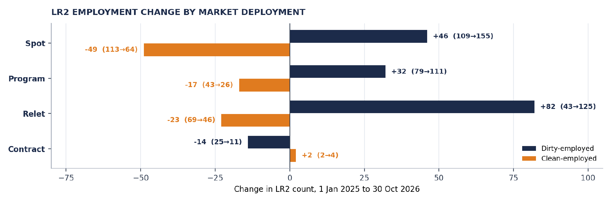
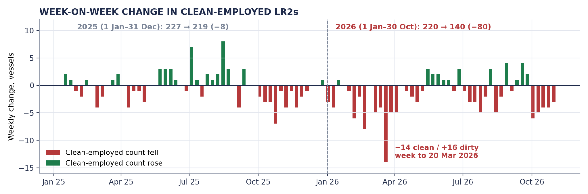
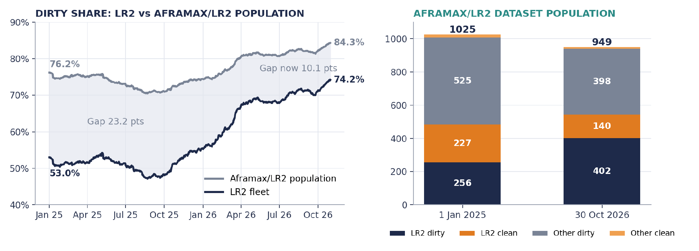

# Market Insights | Lr2s Turn Dirty: A Changing Balance in Tanker Employment

*Published on 03 November 2026*

## LR2s Turn Dirty

## A Changing Balance in Tanker Employment

Maria Bertzeletou  |  Senior Market Analyst  |  12 November 2026

> **Figure 1: A Changing Balance in Tanker Employment**  
> **Interactive Data & Source:** [Signal Ocean Platform](https://www.thesignalgroup.com/newsroom/market-insights-lr2s-turn-dirty-a-changing-balance-in-tanker-employment) | [Local Asset](../../images/6af595d5a8806f8d351ec041_2209cc12.png)

## SPOTLIGHT · LR2 EMPLOYMENT

**Dirty Employment Gains Ground**

The LR2 market has undergone a marked change in vessel employment since the start of 2025. Signal Ocean data show that dirty employment accounted for **74.2%** of the LR2 fleet on 30 October 2026, compared with **53.0%** on 1 January 2025. The shift accelerated in 2026, reducing the number of LR2s in clean trades even as the overall fleet expanded.

Dirty-employed LR2s rose from 256 to **402** vessels, an increase of **57%**, while clean-employed tonnage fell from 227 to **140**, a reduction of **38%**. Over the same period, the combined LR2 count grew from 483 to 542 vessels. A larger fleet has therefore delivered fewer clean ships.

**LR2 employment at a glance**

> **Figure 2: Daily Vessel Counts by Employment**  
> *Daily vessel counts by employment. 30 October 2026 is the latest change in the series; counts are unchanged to 7 November 2026.*  
> **Interactive Data & Source:** [Signal Ocean Platform](https://www.thesignalgroup.com/newsroom/market-insights-lr2s-turn-dirty-a-changing-balance-in-tanker-employment) | [Local Asset](../../images/6af596122ed5539bc2555c80_66733867.png)

> **Chart 1: Lr2 Vessels in Dirty and Clean Employment, and the Dirty Share of the Lr2 Fleet, 1 January 2025–30 October 2026**  
> *Chart 1. LR2 vessels in dirty and clean employment, and the dirty share of the LR2 fleet, 1 January 2025–30 October 2026. Source: Signal Ocean Platform, LR2 employment data.*  
> **Interactive Data & Source:** [Signal Ocean Platform](https://www.thesignalgroup.com/newsroom/market-insights-lr2s-turn-dirty-a-changing-balance-in-tanker-employment) | [Local Asset](../../images/6af59640caca39f8326dcb30_1b1f240e.png)

During the first half of 2025, LR2 employment remained relatively balanced between clean and dirty trades. Clean-employed vessels outnumbered dirty units between **20 July and 17 October 2025**, with the dirty share falling to **47.1%** on 22 August. However, the subsequent increase in dirty employment marked a notable change in fleet deployment, with more LR2 capacity shifting away from clean petroleum product trades.

The most significant adjustment occurred between January and April 2026, when dirty-employed LR2s increased by **82 vessels**, compared with a reduction of **60 vessels** in clean employment. This raised the dirty share from **55.3% to 68.9%** in just four months. Since 23 July, the share has remained above **70%**, suggesting a more persistent redistribution of LR2 capacity towards dirty trades rather than a short-lived change in employment patterns.

## Deployment: Relet and Spot Drive the Dirty Build

The breakdown by employment type provides further insight into the redistribution of LR2 capacity. Within dirty trades, relet employment recorded the largest increase, rising from **43 to 125 vessels**, followed by gains in spot (**+46**) and programme employment (**+32**). In contrast, the clean segment experienced its largest reduction in spot employment, where vessel numbers declined from **113 to 64**.

> **Chart 2: Change in Lr2 Count by Market Deployment and Employment, 1 January 2025 to 30 October 2026**  
> *Chart 2. Change in LR2 count by market deployment and employment, 1 January 2025 to 30 October 2026. Source: Signal Ocean Platform, LR2 employment data by market deployment.*  
> **Interactive Data & Source:** [Signal Ocean Platform](https://www.thesignalgroup.com/newsroom/market-insights-lr2s-turn-dirty-a-changing-balance-in-tanker-employment) | [Local Asset](../../images/6af5966f47907d0f95a86946_855ef661.png)

In our interpretation, the near-tripling of dirty relet tonnage points to a meaningful part of the shift taking place through relet arrangements rather than purely through spot fixing. The employment data record deployment type only; they do not show the underlying contractual or pooling arrangements. For clean product markets, the contraction of the spot list matters most, as prompt spot tonnage is most directly exposed to daily freight.

## LR2 Employment Shifts Accelerate in 2026

Weekly LR2 employment figures show a sustained reduction in clean-employed tonnage since October 2025, with the decline accelerating during 2026. The clean-employed fleet fell by a net **6** **vessels** **in** **2025**, compared with a much larger decline of **82 vessels in the first ten months of 2026**. The largest weekly reduction occurred in the week ending **20 March 2026**, when clean employment fell by **14 vessels**, while dirty trades rose by **16 vessels**.

> **Chart 3: Week-on-Week Change in Clean-Employed Lr2s, Friday to Friday, Weeks Ending 17 January 2025–30 October 2026 (94 Weekly Changes; Base Friday 10 January 2025)**  
> *Chart 3. Week-on-week change in clean-employed LR2s, Friday to Friday, weeks ending 17 January 2025–30 October 2026 (94 weekly changes; base Friday 10 January 2025). Annual net changes use calendar endpoints. Source: Signal Ocean Platform, LR2 employment data; calculations by Signal Ocean Market Insights.*  
> **Interactive Data & Source:** [Signal Ocean Platform](https://www.thesignalgroup.com/newsroom/market-insights-lr2s-turn-dirty-a-changing-balance-in-tanker-employment) | [Local Asset](../../images/6af596936586ab140986f313_063c3ee8.png)

The reduction continued into October, with five consecutive weekly declines ranging from **3 to 6 vessels**. Although clean employment recorded occasional weekly increases, these were insufficient to offset the loss of tonnage. The contraction in clean-employed LR2 capacity, alongside growing dirty employment, has reduced the fleet available for clean petroleum product trades, with potential implications for vessel supply and freight conditions. Weekly changes in employment counts do not necessarily reflect direct shifts between clean and dirty trades, as fleet additions, removals and classification changes may also influence the figures.

## The Aframax Connection

The combined Aframax/LR2 population offers a wider view of the supply balance. Dirty-employed vessels in this dataset population rose from 676 on 1 January 2026 to **800** on 30 October 2026, while clean-employed vessels declined from 233 to **149**. The population’s dirty share reached **84.3%**.

> **Chart 4: Dirty Share of the Lr2 Fleet and of the Combined Aframax/lr2 Dataset Population, and Population Composition, 1 January 2025 and 30 October 2026**  
> *Chart 4. Dirty share of the LR2 fleet and of the combined Aframax/LR2 dataset population, and population composition, 1 January 2025 and 30 October 2026. Source: Signal Ocean Platform, LR2 and Aframax/LR2 employment data. “Population” refers to the vessels covered by the Aframax/LR2 dataset, not a commercial pooling arrangement. “Other” = vessels in that population not counted as LR2s.*  
> **Interactive Data & Source:** [Signal Ocean Platform](https://www.thesignalgroup.com/newsroom/market-insights-lr2s-turn-dirty-a-changing-balance-in-tanker-employment) | [Local Asset](../../images/6af596c2dfc23de1ad598540_dcba8f81.png)

The LR2 fleet is converging on the dirty profile of the wider Aframax/LR2 population: the gap between the two shares has narrowed from **23.2** to **10.1** percentage points. LR2s now account for 57% of the population, compared with 47% at the start of 2025, while vessels outside the LR2 count fell from 542 to 407. Only 9 clean ships remain outside the LR2 count, so clean Aframax-size availability is now almost entirely an LR2 question.

## Freight Implications: Fleet Growth Does Not Equal Available Supply

For clean product markets, a smaller actively employed LR2 fleet may increase sensitivity to cargo demand, vessel positioning and regional imbalances. Even as the overall fleet grows, fewer vessels in clean trades can limit the market’s capacity to absorb additional product cargoes, particularly on long-haul routes.

For dirty markets, increasing LR2 participation expands the supply of tonnage competing for crude and dirty petroleum product cargoes. The freight effect will depend on geographical deployment, cargo sizes, voyage duration and owners’ willingness to move vessels between markets.

The cost and operational requirements of returning a dirty-employed vessel to clean service also matter. Tank cleaning, cargo suitability and commercial considerations mean that capacity to return to clean trades is not immediately available, so any tightness in clean tonnage could persist for some time once established.

## Market Takeaways

The most significant development is not simply that more LR2s are trading dirty, but that the relationship between nominal fleet growth and effective clean tanker supply has changed. With more than 70% of the LR2 fleet in dirty trades, future shifts in LR2 employment could matter for both product tanker availability and Aframax-class dirty competition.

Whether this pattern persists will depend on relative earnings, cargo demand and the commercial incentives for vessels to return to clean service. **A sustained run of weekly gains in clean-employed LR2s would signal a potential reversal of the trend.** For freight analysis, tracking LR2 employment between clean and dirty trades is becoming as important as monitoring the size of the fleet itself.

*Source: Signal Ocean Platform, LR2 and Aframax/LR2 vessel employment data, 1 January 2025–7 November 2026. Calculations by Signal Ocean Market Insights.*

***Disclaimer:*** *This report has been prepared by Signal Group for general information purposes only. It does not constitute, and should not be relied upon as, investment, financial, trading, legal or commercial advice, or as a recommendation to enter into any transaction. While reasonable efforts have been made to ensure the information is accurate and reliable at the date of publication, no representation or warranty, express or implied, is given as to its accuracy, completeness or continued availability. Certain figures may be estimates or provisional and may subsequently be revised. Market conditions and other external factors may change without notice and may not be reflected in this report. Readers should conduct their own assessment and seek appropriate professional advice before making any decision. To the fullest extent permitted by law, Signal Group accepts no liability for any loss or damage arising from the use of, or reliance on, this report.*

***Copyright notice:*** *© 2026 Signal Group. All rights reserved. This report may be republished in full or in part provided that Signal Group is credited and an active link to the source is included. Any other copying, reproduction, modification or redistribution requires the prior written consent of Signal Group. Third-party data and content remain the property of their respective owners and are used subject to the applicable terms and licences.*
