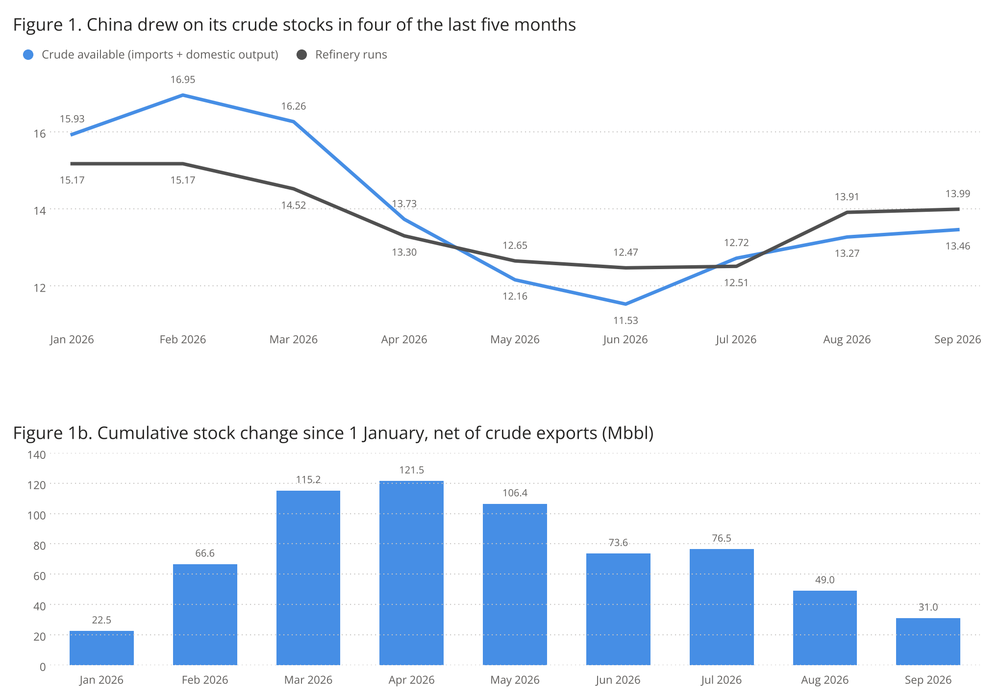
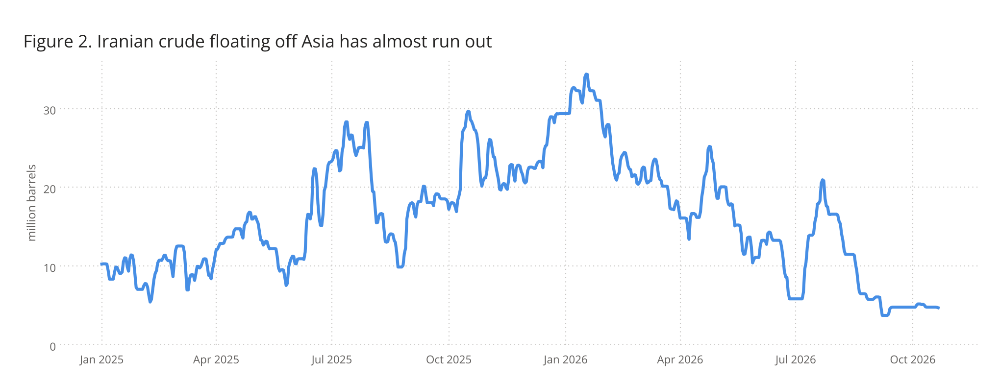
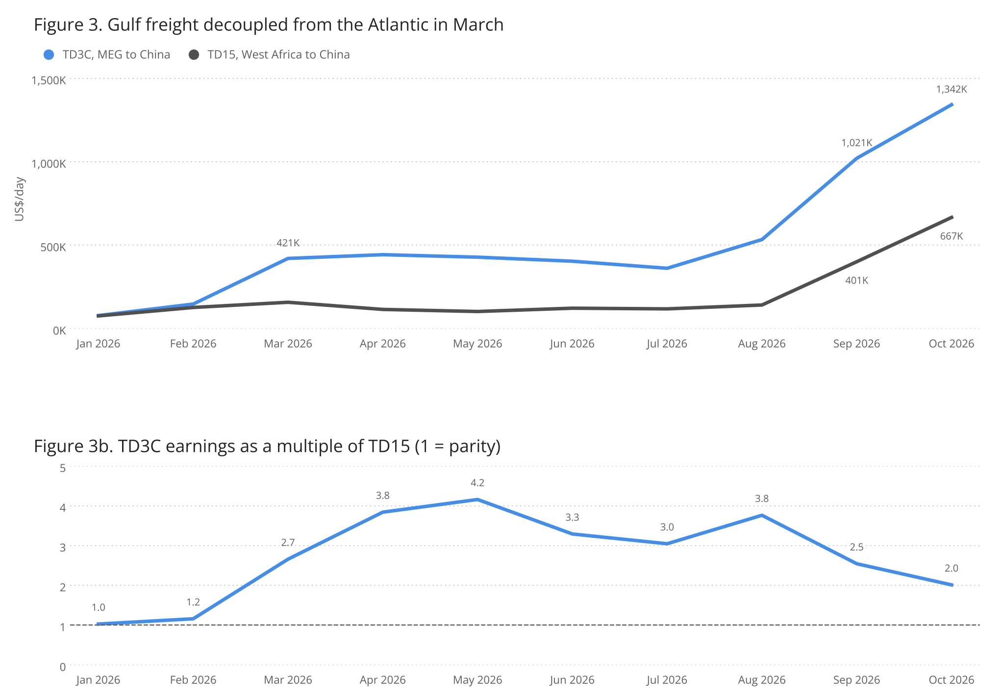

# Market Insights | Ramble on: Who Pays the Freight?

*Published on 29 October 2026*

## Signal Ocean · Market Insights

## Ramble on: Who Pays the Freight?

### Nikolas Zannikos | Market Analyst | 27 October 2026

In September we borrowed aLed Zeppelin title to describe China's crude stockpile, a levee holding backthe import shortfall created by the closure of Hormuz. One month on, the wateris still falling, Gulf crude has rambled on around the Strait, and the questionis what it will cost to rebuild.

China's customs crudeimports were 9.03 mbpd in September, broadly flat on August, while refineryruns climbed to 13.99 mbpd, the highest since March. Hence China drew on itsstocks for the fourth time in five months, a net 0.60 mbpd after crude exports (Figure1). Of the 121.5 million barrels built by April, only 31 million remain. At theMay to September pace of 0.59 mbpd, that would be gone by late November.Arrivals picked up in October, but those cargoes were bought in the summer, andwith Brent around US$ 100 since early September, the refill is likely to slow.

> **Figure 1: China Crude Available (Customs Imports + Domestic Output) Against Refinery Runs, Mbpd, and Cumulative Stock Change Since 1 January, Net of Crude Exports, Mbbl**  
> *Figure 1: China crude available (customs imports + domestic output) against refinery runs, mbpd, and cumulative stock change since 1 January, net of crude exports, Mbbl. Implied stock change = imports + domestic output - refinery runs. Source: GACC, NBS.*  
> **Interactive Data & Source:** [Signal Ocean Platform](https://www.thesignalgroup.com/newsroom/ramble-on-who-pays-the-freight) | [Local Asset](../../images/6ae3120711b7a64b9634be1e_9f79098b.png)

## From the Red Sea to the Relay: Two Bypasses in Six Months

The levee was needed because the Gulf's main exit closed. Our data shows that crude loaded directly inside the Strait of Hormuz fell from about 14 mbpd in January and February to under 1 mbpd in September. China felt it first, with customs imports dropping from 12.0 mbpd in January and February to 7.1 mbpd in June, and the gap was met from tanks.

However, Gulf crude kept moving, and it changed route twice. Between March and July the Red Sea carried the load, with Saudi crude piped across the Peninsula and loaded at Yanbu and Rabigh, a route that peaked at about 4.3 mbpd in June, against about 0.8 mbpd before the war.

The attack on the East-West pipeline in August threw a spanner in the works. The weight shifted back east, and crude now crosses the Strait on tankers, some of them on dark transits, before being transferred ship to ship onto VLCCs off Fujairah, Khor Fakkan and Sohar. This relay grew from almost nothing in February to about 5 mbpd in September, while loadings at Fujairah's berths and Oman's own ports carried a further 3.9 mbpd. By September, loadings at the hub ports had risen to about 8.5 mbpd, five times their 2025 level, and briefly ran close to 12 mbpd in the last week of the month.

## Where the Barrels Went

Meanwhile, the cheapest barrels have gone. After the US blockade in April, Iranian crude largely stopped leaving the Gulf, and the Iranian barrels floating off Malaysia and Singapore are close to exhausted by our count (Figure 2). China's choice narrows to its stockpile or Gulf crude.

> **Figure 2: Iranian Crude on Tankers Idle for More Than 30 Days in Asia-Pacific Waters, Million Barrels; Tankers Whose Draft Shows Them Empty Are Excluded**  
> *Figure 2: Iranian crude on tankers idle for more than 30 days in Asia-Pacific waters, million barrels; tankers whose draft shows them empty are excluded. Source: Signal Ocean (vessel tracking).*  
> **Interactive Data & Source:** [Signal Ocean Platform](https://www.thesignalgroup.com/newsroom/ramble-on-who-pays-the-freight) | [Local Asset](../../images/6ae3153b2bd44e5831d57ae6_95603e71.png)

## Why Has Freight Not Decided Where Asia Buys?

VLCC earnings on the MEG/China route (TD3C) moved from parity with West Africa/China (TD15) in January and February to 4.2 times TD15 in May, and averaged US$ 1.02 million/day TCE in September, 17.5 times their 2025 average (Figure 3). On earnings alone, the Atlantic looked the obvious alternative, unless the crude could be loaded outside the Strait, on the Gulf of Oman route (TD34).

However, earnings overstate what the buyer pays. At the Baltic's standard speeds of 13 knots laden and 12 knots in ballast, a VLCC needs about 46 days for the round voyage from Ras Tanura to Ningbo, against about 76 days from West Africa, so the lower daily rate on TD15 is billed for longer. Take a VLCC carrying about 2 million barrels to Ningbo in September. Loaded at Ras Tanura, inside the Strait, the cargo paid about US$ 52 million in freight, or US$ 26/bbl. Loaded in West Africa it paid about US$ 35 million, or US$ 17.5/bbl, even though TD3C earned 2.5 times as much per day as TD15. Loaded at Mina al Fahal in Oman, outside the Strait, it paid about US$ 30 million, or US$ 15/bbl, the cheapest of the three. By October the order was the same and the gaps wider: about US$ 34/bbl from Ras Tanura, US$ 28 from West Africa and US$ 19 from Mina al Fahal.

> **Figure 3: TD3C and TD15 VLCC Earnings, Us$/day TCE, Monthly Average (October 1 to 26), and TD3C as a Multiple of TD15**  
> *Figure 3: TD3C and TD15 VLCC earnings, US$/day TCE, monthly average (October 1 to 26), and TD3C as a multiple of TD15. Source: Signal Ocean.*  
> **Interactive Data & Source:** [Signal Ocean Platform](https://www.thesignalgroup.com/newsroom/ramble-on-who-pays-the-freight) | [Local Asset](../../images/6ae3156102de6ef484c796fe_587ac579.png)

Furthermore, as the relay off Fujairah, priced on TD34, took over after the pipeline attack, China's imports recovered with it. The TD3C premium, in turn, priced the difficulty of leaving the Gulf. Whenever a route out of the Gulf opened, Asia bought. Our numbers show who paid that premium: cargoes loaded inside the Strait, on TD3C, and buyers avoided those wherever they could. A VLCC loading in the Gulf of Oman, meanwhile, cost less to send to China than one loading in West Africa. Crude prices set how much it bought: Brent rose from US$ 72.48 before the war to an intraday high of about US$ 126 on 30 April, and Chinese buying only recovered once it fell below US$ 80 in the summer. Gulf producers' discounts, and the fit of Gulf medium sour grades with Asia's complex refineries, explain why buyers returned so quickly.

## What It Means for Tonnage

Every cargo that crosses the Strait on one tanker and is reloaded onto another off Oman ties up two vessels and adds waiting time at the transfer point. September showed the first sustained sign of demand pulling on that system, as freight for VLCCs loading in the Gulf of Oman (TD34) tripled m-o-m, faster than TD3C inside the Strait. Attacks on tankers crossing the Strait at the end of September did not stop the trade. In October the shortage reached the Atlantic. The number of VLCCs ballasting towards West Africa, Brazil and the US Gulf fell from about 85 a week in early September to 50 to 54 since mid-October, while transfers off Oman ran at their limits. TD15 rose 60% m-o-m in Worldscale, against 26% for TD34, taking West African earnings to US$ 667,000/day.

## The Bill Comes Due

The September loadings now on the water will reach China in October and November, just as the stock build runs out. China is still buying from the Atlantic, with 19 VLCCs fixed from Brazil and West Africa to China in the last ten days of October, most of them loading in November. Should the transfer network off Oman keep pace, Gulf crude will carry the refill and keep drawing tonnage east, supporting earnings on both routes. Should it falter, China will have to choose between drawing deeper into a stockpile estimated at more than a billion barrels and buying from further away, at a higher freight cost per barrel. Either way, the cost of moving a barrel to Asia has become part of the price of the barrel itself.

***Disclaimer:*** *This report has been prepared by Signal Group for general information purposes only. It does not constitute, and should not be relied upon as, investment, financial, trading, legal or commercial advice, or as a recommendation to enter into any transaction. While reasonable efforts have been made to ensure that the information is accurate and reliable at the date of publication, no representation or warranty, express or implied, is given as to its accuracy, completeness or continued availability. Certain figures may be estimates or provisional and may subsequently be revised. Market conditions and other external factors may change without notice and may not be reflected in this report. Readers should conduct their own assessment and seek appropriate professional advice before making any decision. To the fullest extent permitted by law, Signal Group accepts no liability for any loss or damage arising from the use of, or reliance on, this report.****Copyright notice:*** *© 2026 Signal Group. All rights reserved. Except where otherwise stated or permitted by law, this report may not be copied, reproduced, modified, published or redistributed, in whole or in part, without the prior written consent of Signal Group. Third-party data and content remain the property of their respective owners and are used subject to the applicable terms and licences.*
