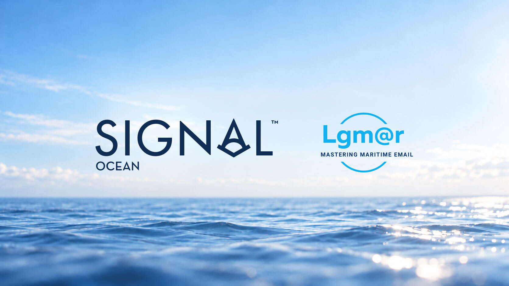

# Signal Ocean Acquires Lgmar to Bring Communication and Data Together for Maritime Professionals

*Published on 15 October 2026*

> **Figure 1: Heading**  
> **Interactive Data & Source:** [Signal Ocean Platform](https://www.thesignalgroup.com/newsroom/signal-acquires-lgmar) | [Local Asset](../../images/6ad09db81eccfd8c4e5baf3c_Aligned-Ocean-Branding-Logos_edit_05.jpg)

**ATHENS, 15 October 2026.** Signal Ocean announced today the acquisition of Lgmar, the Athens-based company behind Telix, a maritime email and communication platform in daily use across the shipping community since 1989.

The acquisition is the latest step in Signal Ocean’s commitment to extend its offerings from market intelligence into the communication workflows where fixtures, operations and post-fixing actually take place.

Signal Ocean's technology, data and AI capabilities combined with Lgmar’s expertise, will provide a transformative service to the industry.

**Ioannis Martinos, CEO of Signal Ocean** said “email is an important part of the shipping workflow. Lgmar has spent 37 years earning the trust of this market by getting the details right - the things that matter if you work in shipping. That understanding is what we are bringing into Signal, and the immediate priority for clients of both companies is continuity.”

Email remains a core working tool of the shipping industry, and the point where market data, counterparties and decisions meet. Signal's investment in maritime communication reflects its conviction that shipping technology needs to meet the industry where the shipping work is being done.

"We built Telix by listening to shipping people and solving the problems they faced," said **Helen Skourtis, Managing Director of Lgmar.** "What mattered in choosing our next step was finding a home that understands that."

"Signal is a company born inside this industry that values the same things we do; the product, the team, and the clients who have stood by us for decades. One of the main qualities Signal holds is thinking ahead of the industry, while having the technical depth to back it up.”

The acquisition deepens Signal Ocean's investment in the daily working tools of commercial shipping, while advancing a longer-held conviction: that the intelligence behind a decision and the place it is taken belong in the same system.

**About Signal Ocean** - Signal Ocean is the technology arm of The Signal Group and the creator of the Signal Ocean Platform. The platform enables charterers, brokers, and shipowners to securely process, combine, and analyze a complex array of private and public data on shipping and commodities. Powered by a rich set of machine learning and artificial intelligence technologies, Signal Ocean processes available data to deliver customized, exclusive insights for smarter, faster, and more informed decision-making. Founded in 2014, the company is headquartered in London with offices in Athens, Singapore, Paris, Sofia and Hamburg. In 2026, Signal Ocean acquired AXSMarine and Alphaliner. The Signal Group is a diversified shipping services organization supported by a world-class mix of commercial shipping professionals, product managers, data scientists, and engineers. The wider group operates Signal Maritime Services, which combines best-in-class commercial ship management with in-anger use of advanced analytics to run a leading Aframax tanker pool, and Signal Ventures, a strategic investment arm focused on incubating, accelerating and investing in next-generation shipping software and technology.

**About Lgmar** - Lgmar is a software company developing highly specialized email and communication products for the shipping industry, by a team of dedicated experts in computer science and maritime business. LgMAR, founded in 1989 and based out of Athens, Greece, serves several hundreds of clients and thousands of users mainly in Greece, as well as in a number of other world regions. Their products are being used by most of shipping personas, including ship owners, ship managers, ship brokers, ship agents, operators, banks, insurance brokers and manning agents.

**Media Contact:** Felix Ekman | [felix.ekman@thesignalgroup.com](mailto:felix.ekman@thesignalgroup.com) | [+1 302 689 3966](tel:+13026893966)
