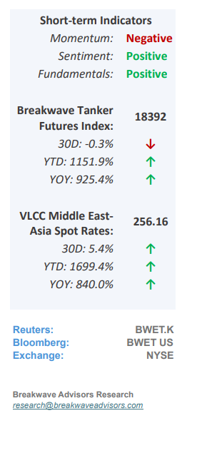
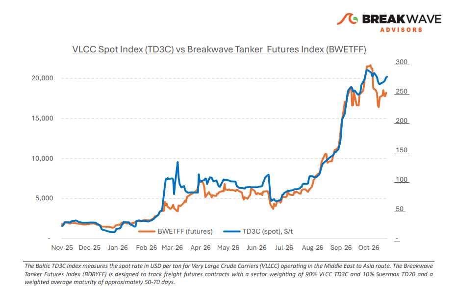
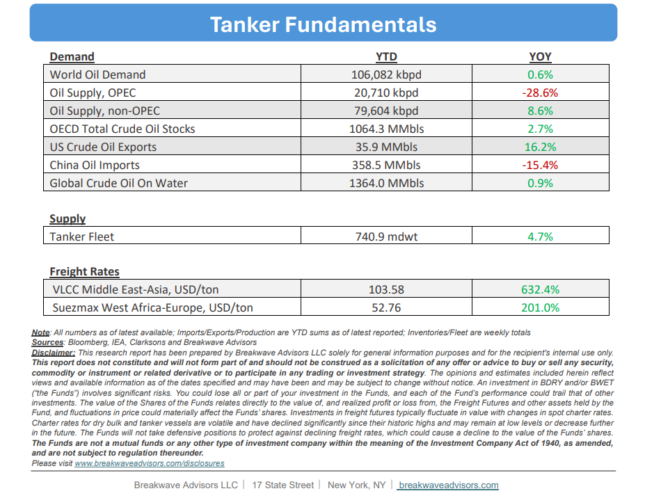

# Breakwave Bi-Weekly Tanker Report - November 3, 2026

**Date:** November 03, 2026  
**Publisher:** Breakwave Advisors | **Category:** Market Insights  
**Original URL:** [https://www.breakwaveadvisors.com/insights/112026wetreport311hyt67-o](https://www.breakwaveadvisors.com/insights/112026wetreport311hyt67-o)  

---

**• VLCC Remain Strong on Low Vessel Availability, Geopolitics**– The recovery in Middle Eastern crude exports has yet to restore normal tanker circulation, with October flows through Hormuz averaging approximately 11.7 million barrels/day, up from 9.8 million barrels/day in September but below the pre-war level of 14.5 million barrels/day. Meanwhile, Middle Eastern **VLCC tonne-miles remain 34% below 2025** levels and tonne-days 24% below pre-war levels, highlighting the disconnect between exceptionally high freight and underlying transportation demand**. Around 80 VLCCs remain engaged in Gulf-of-Oman shuttle operations,**with average round voyages extending to 23 days against an optimal 9–10 days, while offshore transfer bottlenecks and dedicated producer-controlled employment continue to constrain spot availability.**Geopolitical risk remains the principal driver of exceptional VLCC freight** rather than stronger underlying cargo demand. Longer voyage cycles, offshore transfer delays and owners' reluctance to accept employment inside the Gulf continue to reduce effective vessel supply. The latest tightening therefore reflects **restricted fleet productivity** and owner participation rather than stronger tonne-mile demand. With security incidents continuing around Hormuz, the recent freight rebound leaves limited evidence of sustained transportation-cost relief.

> **Figure 1: Cea3cf84ceb9ceb3cebcceb9cf8ccf84cf85**  
> [Local Asset](../../../../../../corpus/03-breakwave/insights/2026/assets/2026-11-03_112026wetreport311hyt67-o_img_cea3cf84ceb9ceb3cebcceb9cf8ccf84cf85_786898ef4ef3.png)

•**Oil Prices Hover Around the $100/bbl mark as Market Awaits Developments**– Crude oil prices remain highly sensitive to ongoing US-Iran negotiations, where a lack of **substantive progress continues to weigh** on market sentiment. While supply flows out of the region have mostly normalized once we include an increase in Red Sea exports, critically low global inventories have effectively eliminated the market's pre-conflict supply buffer, leaving it exceptionally vulnerable to renewed disruptions. Consequently, an **elevated risk premium** will likely persist until global inventories are sufficiently replenished. Even in the event of a diplomatic agreement between the US and Iran, a meaningful **downward price correction remains unlikely** given the historically transient nature of such deals. Ultimately, these structural complexities offer little room for near-term price relief, a reality that the market is steadily reflecting through an elevated long-dated futures curve.

•**Our Long-term View**– The tanker market has been recovering from a long period of staggered rates as the growth in new vessel supply shrunk while oil demand remained elevated in line with the global economy. The recent rapid increase in freight rates has led to significant new vessel ordering, with the orderbook now standing at well above average levels, and although in the near term such a supply/demand misbalance is small, we expect a meaningful negative balance to develop longer term leading to an industry downcycle.

> **Figure 2: Στιγμιότυπο Οθόνης 2026 11 02 205717**  
> [Local Asset](../../../../../../corpus/03-breakwave/insights/2026/assets/2026-11-03_112026wetreport311hyt67-o_img_cea3cf84ceb9ceb3cebcceb9cf8ccf84cf85_762706be0106.png)

> **Figure 3: Στιγμιότυπο Οθόνης 2026 11 03 115011**  
> [Local Asset](../../../../../../corpus/03-breakwave/insights/2026/assets/2026-11-03_112026wetreport311hyt67-o_img_cea3cf84ceb9ceb3cebcceb9cf8ccf84cf85_8a96e18044b2.png)

### Subscribe:
