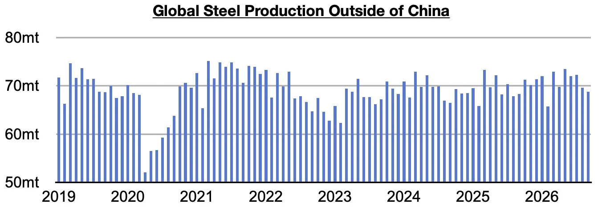
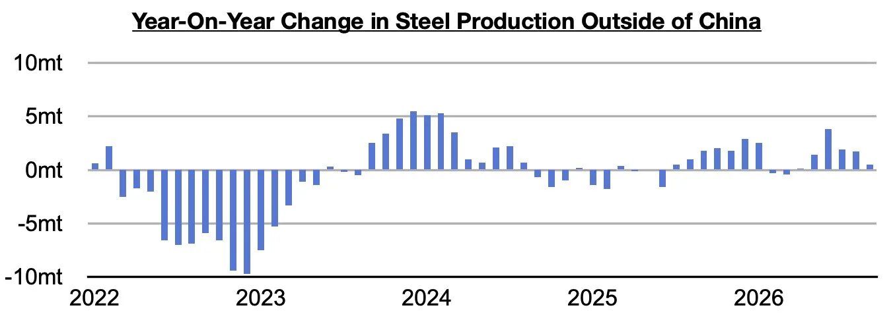
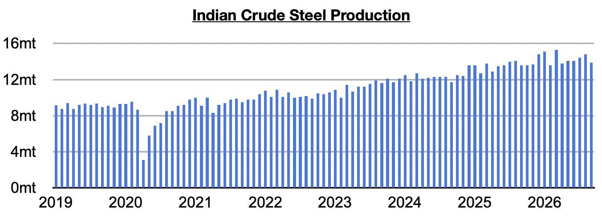

# Slowing Growth in Steel Output Ex-China

**Date:** November 09, 2026  
**Publisher:** Breakwave Advisors | **Category:** Market Insights  
**Original URL:** [https://www.breakwaveadvisors.com/insights/2026/11/9/slowing-growth-in-steel-output-ex-china](https://www.breakwaveadvisors.com/insights/2026/11/9/slowing-growth-in-steel-output-ex-china)  

---

*By*[*Jeffrey Landsberg*](https://www.linkedin.com/in/jeffrey-landsberg-70ab957/)

As we discussed in Commodore Research's most recent Weekly Executive Report, global steel production totaled approximately 142.4 million tons in September. This is down month-on-month by 1.8 million tons (-1%) and but up year-on-year by 600,000 tons. Steel production ex-China totaled approximately 68.8 million tons. This is down month-on-month by 800,000 tons (-1%) but up year-on-year by 500,000 tons (1%).

> **Figure 1: Chart 1**  
> [Local Asset](../../../../../../corpus/03-breakwave/insights/2026/assets/2026-11-09_slowing-growth-in-steel-output-ex-china_img_chart1_71574a29d53a.jpg)

Steel production ex-China has now increased on a year-on-year basis for six straight months. Previously, it had contracted on a year-on-year basis for two straight months. China’s steel output remains in a contraction however.

> **Figure 2: Chart 2**  
> [Local Asset](../../../../../../corpus/03-breakwave/insights/2026/assets/2026-11-09_slowing-growth-in-steel-output-ex-china_img_chart2_f2f74bba4584.jpg)

Indian steel output totaled 13.9 million tons last month. This is down month-on-month by 900,000 tons (-6%) but is up year-on-year by 300,000 tons (2%). Production has now grown on a year-on-year basis for forty-three straight months.

> **Figure 3: Chart 3**  
> [Local Asset](../../../../../../corpus/03-breakwave/insights/2026/assets/2026-11-09_slowing-growth-in-steel-output-ex-china_img_chart3_9a413d0410a4.jpg)

Overall, it is reasonable to expect that steel output ex-China will soon be back in a contraction. We remain concerned for iron ore trade prospects. It is not just price that is low (which is affecting things on the supply side). Demand is also decreasing.

---

**Tags:** Ironore, Commodities, Markets  
