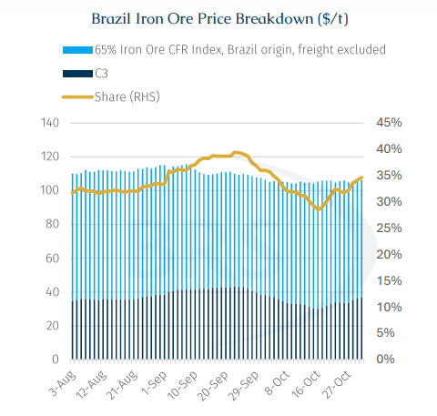
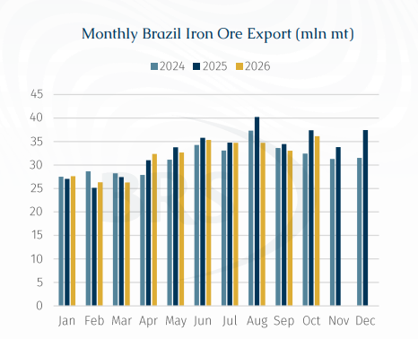
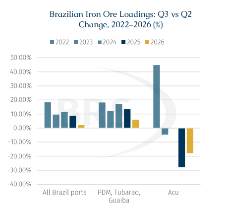
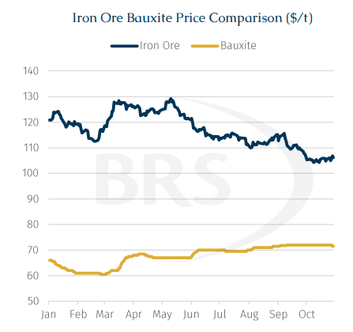

# Brazilian Iron Ore: Squeezed Margins, Resilient Shipments

**Date:** November 16, 2026  
**Publisher:** Breakwave Advisors | **Category:** Market Insights  
**Original URL:** [https://www.breakwaveadvisors.com/insights/2026/11/16/brazilian-iron-ore-squeezed-margins-resilient-shipments](https://www.breakwaveadvisors.com/insights/2026/11/16/brazilian-iron-ore-squeezed-margins-resilient-shipments)  

---

> **Figure 1: Rgb Color Brs Shipbrokers Monogram L**  
> [Local Asset](../../../../../../corpus/03-breakwave/insights/2026/assets/2026-11-16_brazilian-iron-ore-squeezed-margins-resilient-shipments_img_rgb-color-brs-shipbrokers-monogram-l_c365f35f1de5.png)

As November begins, the release of major miners’ third-quarter reports points to a dual squeeze on iron ore earnings from weaker CFR prices and higher shipping costs. Vale, for example, reported a 39% y-o-y decline in iron ore fines EBITDA, despite resilient sales volumes.

According to Vale’s financial report, its average realised iron ore fines price fell from $94.4/t in 3Q25 to $85.1/t in 3Q26., while average freight costs rose 21%, from $18.8/t to $22.8/t. In terms of earnings, lower realised prices and higher freight costs contributed approximately 21% and 8% respectively to the 39% annual decline in fines earnings. Lower ore prices reduced the revenue cushion, while rising freight costs further eroded netbacks, putting greater pressure on the profitability of long-haul shipments.

> **Figure 2: Στιγμιότυπο Οθόνης 2026 11 16 161409**  
> [Local Asset](../../../../../../corpus/03-breakwave/insights/2026/assets/2026-11-16_brazilian-iron-ore-squeezed-margins-resilient-shipments_img_cea3cf84ceb9ceb3cebcceb9cf8ccf84cf85_ab22ce25ec44.png)

Similar pressure was evident among producers with smaller iron ore export operations. Anglo American explicitly noted in its 3Q26 operational report that rising freight rates continued to weigh on realised prices for spot iron ore.

The FOB realised price for its Brazilian Minas-Rio operation fell 12% y-o-y in the first nine months, from $88/t to $77/t. Although this cumulative decline cannot be attributed entirely to freight, the two companies’ disclosures point to the same challenge: weaker ore prices and higher shipping costs are jointly eroding netbacks for Brazilian long-haul cargoes.

> **Figure 3: Στιγμιότυπο Οθόνης 2026 11 16 161428**  
> [Local Asset](../../../../../../corpus/03-breakwave/insights/2026/assets/2026-11-16_brazilian-iron-ore-squeezed-margins-resilient-shipments_img_cea3cf84ceb9ceb3cebcceb9cf8ccf84cf85_98899daaa41d.png)

Brazilian Shipments: A Weaker Q3 Seasonal Uplift

According to AXSMarine data, Brazilian iron ore loadings totalled 283.1 mln mt in the first nine months of 2026, down 2.3% y-o-y. Volumes were broadly unchanged in 1H26, but fell 6.3% y-o-y in 3Q26. Although third-quarter loadings still increased 2.1% q-o-q, which follows its seasonal pattern, this was well below the 8.8%–18.3% increases recorded over the same period across 2022–2025. The weakness therefore lay not in an outright quarterly decline in total volumes, but in a much smaller-than-usual Q3 uplift.

> **Figure 4: Στιγμιότυπο Οθόνης 2026 11 16 161443**  
> [Local Asset](../../../../../../corpus/03-breakwave/insights/2026/assets/2026-11-16_brazilian-iron-ore-squeezed-margins-resilient-shipments_img_cea3cf84ceb9ceb3cebcceb9cf8ccf84cf85_fdb955fc3c8b.png)

A closer look at individual ports reveals a similar pattern. Combined 3Q26 loadings at Ponta da Madeira, Tubarão and Guaíba, the three major export outlets for Vale’s ore, reached 71.8 mln mt, up 5.9% from Q2. This was markedly below the 12%–18% increases posted over the same period in the previous four years.

The slowdown was more pronounced at Acu, the export outlet for Anglo American’s Brazilian iron ore operation. Loadings fell from 7.0 mln mt in Q2 to 5.8 mln mt in Q3, a decline of 17.8%. By comparison, the corresponding declines in 2023 and 2024 were just 4.7% and 0.1%. Although volumes fell 27.8% over the same period last year, this reflected a scheduled slurry pipeline inspection.

Overall, Brazilian iron ore shipments gained considerably less momentum in 3Q26 than in previous years, while some ports recorded more pronounced volume declines. Alongside miners’ disclosures of higher shipping costs and weaker netbacks, these figures suggest that rising freight rates have become an important operating variable and may also be influencing shipment decisions.

Different Implications for Iron Ore and Bauxite

In our recent analysis of Guinean bauxite trade (BRS Dry Bulk Weekly N.238), we stated that shipping costs had at one point exceeded half the bauxite’s delivered price. For higher-cost producers with limited margins, expensive freight does not merely mean lower profits but it can make some cargoes uneconomic to export, delaying planned shipments. Iron ore, by contrast, has a higher cargo value, while major mainstream miners generally have a larger margin cushion. For these suppliers, rising freight costs are therefore more likely to erode profits than to turn profitable shipments into loss-making ones and remove the incentive to export.

> **Figure 5: Στιγμιότυπο Οθόνης 2026 11 16 161457**  
> [Local Asset](../../../../../../corpus/03-breakwave/insights/2026/assets/2026-11-16_brazilian-iron-ore-squeezed-margins-resilient-shipments_img_cea3cf84ceb9ceb3cebcceb9cf8ccf84cf85_5bd63156a67f.png)

With mine production and shipment programmes generally planned in advance, and long-term shipping contracts reducing some major producers’ exposure to spot freight rates, we continue to expect freight volatility to have a relatively limited impact on near-term long-haul iron ore shipments. Barring additional production or logistical disruptions, major miners are likely to continue shipping in line with their existing annual plans.

As freight rates retreat from their recent highs, lower shipping costs should ease the burden on long-haul cargoes and improve miners’ margins moving into November and December. The volume response, however, is likely to differ by commodity. For Guinean bauxite, which is more sensitive to freight costs and where some marginal cargoes had become uneconomic to ship, lower transport costs could bring a more pronounced recovery in both profitability and volumes. For major Brazilian iron ore producers, whose existing shipment programmes have faced fewer constraints, the initial benefit is more likely to be improved earnings, with a more modest stimulus to additional shipments. This year’s freight spike nevertheless serves as a reminder to miners and charterers of the importance of securing freight cover against planned shipments. Limiting excessive spot exposure can help protect margins and preserve shipping flexibility when rates rise sharply.

For the Cape market, if freight pressure persists on long haul cargoes, higher freight rates could strengthen the competitiveness of Australian iron ore in the seaborne market, given its shorter shipping distance. These feedback effects, in terms of less ton-miles, could therefore act as a stabilising force in the Cape market: high freight rates may discourage shipments and cap the upside, while falling rates could draw cargoes back into the market, providing support for the shipping market at some extent.

---

**Tags:** Capesize, Markets, Ironore  
