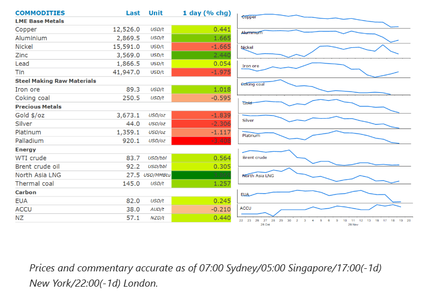
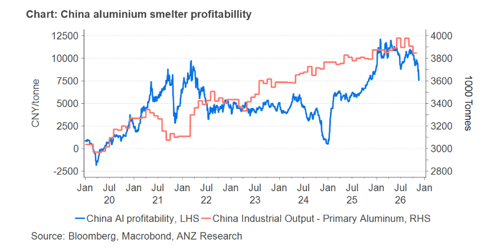

# Rising attacks in Middle East pushes oil higher

**Date:** November 20, 2026  
**Publisher:** Breakwave Advisors | **Category:** Market Insights  
**Original URL:** [https://www.breakwaveadvisors.com/insights/2026/11/20/rising-attacks-in-middle-east-pushes-oil-higher](https://www.breakwaveadvisors.com/insights/2026/11/20/rising-attacks-in-middle-east-pushes-oil-higher)  

---

A focus on supply issues pushed commodities higher. Energy gained, as attacks in the Middle East intensified, while a stronger USD weighed on precious metals.

*By*[*Daniel Hynes*](https://www.linkedin.com/in/dahynes/)

> **Figure 1: Στιγμιότυπο Οθόνης 2026 11 20 123342**  
> **Interactive Data & Source:** [Linkedin](https://www.linkedin.com/newsletters/commodities-wrap-6692196755876012032/?fbclid=IwAR3kiXJqZdxmp9ZcRwBNI7FsBySI-XSC0pfPur1qzjt7OZp7PTE59Tsl1QI) | [Local Asset](../../../../../../corpus/03-breakwave/insights/2026/assets/2026-11-20_rising-attacks-in-middle-east-pushes-oil-higher_img_cea3cf84ceb9ceb3cebcceb9cf8ccf84cf85_10f8d9da619d.png)

### Market Commentary

**Copper** finally found some support following a wave of selling earlier this week. The metal has lost more than 11% this month as traders unwound bullish bets. Given it has benefited from the euphoria surrounding the AI boom in recent months, the big gains on the first day of Anthropic trading on the Nasdaq exchange provided signs that investors still believe the sector has a strong outlook. This comes as the physical; market continues to flash signs of extreme tightness. The Yangshan premium, a gauge of physical market demand for imported copper in China, extended its recent surge to hit a record USD500/t. Spot prices similarly rose to a record premium against futures in Shanghai. The tightness has prompted Chinese consumers to start drawing on copper from the huge stockpile that has been built up in the US. Reports suggest logistics companies have been deluged with inquiries in the past few days from traders seeking to ship copper from the US to China. Several shipments have already been booked, according to Bloomberg.**Nickel** pared gains from earlier this week despite reports that Anglo America is looking to close its Brazilian ferronickel plant. The Barro Alto operation produces around 40kt/y, with most of the output finding its way to Europe. The threat of closure was triggered by a clash over the sale of assets to a Chinese owned company.

**Gold** declined for a fourth consecutive day as a hawkish Fed pushed the USD higher while US Treasury yields gained. Chicago Fed President Goolsbee said he’s concerned the buildout of AI will overheat the economy. This follows Governor Waller, who said inflation remains headed in the wrong direction. He urged the Fed to consider a large, half-percentage point rate hike at its December meeting.

**Crude oil** edged higher as concerns mount over further supply disruptions, as Iran’s attacks on oil tankers transiting the Strait of Hormuz are getting more intense. The number of attacks increased in October and has risen this month according to Bloomberg data. In the latest incident, two seafarers are missing after attacks this week. Several maritime security officials have said that Iran has attempted to hit the same ship on multiple occasions to deter salvors and that there have been sightings of limpet mines attached to vessels. The incidents have prompted the US to consider further military action. Axios reported that the White House has asked the Pentagon for assessments on how Iran would respond to various strike scenarios. Moves to restart peace talks also appear doomed. Iran says it will not engage on the nuclear issue, a major sticking point for both sides, until the question of control of the Strait of Hormuz is settled. The meeting of presidents Trump, Putin and Xi in Shenzhen failed to ignite hope of a resolution. Instead, the three leaders agreed to ramp up global fuel supplies, but didn’t spell out what that would entail.

**European natural gas** jumped as concern about supply was reignited. Mounting tensions in the Middle East remain a concern for gas traders who have very little buffer if disruptions to LNG shipments increase. The outlook was worsened after Norway, Europe’s biggest pipeline supplier reported further flow cuts this week and later in the year. The shutdown of its Visund field was extended by a month until January as repairs continue following a fire. North Asia LNG prices also gained

### Chart of the Day

China has helped buffer the blow to Middle East aluminium supply, by boosting its output and exports this year. However, declining profitability could reverse that trend. After peaking around CNY11,000/t in September, the average margin for Chinese smelters has fallen to around CNY7,500/t. Aluminium output in October was 3.85mt, down from 4mt in August.

> **Figure 2: Στιγμιότυπο Οθόνης 2026 11 20 123448**  
> **Interactive Data & Source:** [Linkedin](https://www.linkedin.com/newsletters/commodities-wrap-6692196755876012032/?fbclid=IwAR3kiXJqZdxmp9ZcRwBNI7FsBySI-XSC0pfPur1qzjt7OZp7PTE59Tsl1QI) | [Local Asset](../../../../../../corpus/03-breakwave/insights/2026/assets/2026-11-20_rising-attacks-in-middle-east-pushes-oil-higher_img_cea3cf84ceb9ceb3cebcceb9cf8ccf84cf85_3b02e99e7ec1.png)

Data source:[Commodities Wrap](https://www.linkedin.com/newsletters/commodities-wrap-6692196755876012032/?fbclid=IwAR3kiXJqZdxmp9ZcRwBNI7FsBySI-XSC0pfPur1qzjt7OZp7PTE59Tsl1QI)

---

**Tags:** Commodities, Shipping, Markets  
