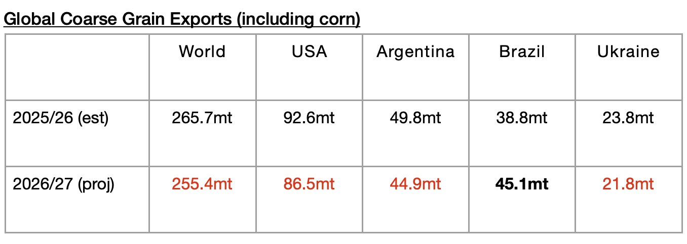
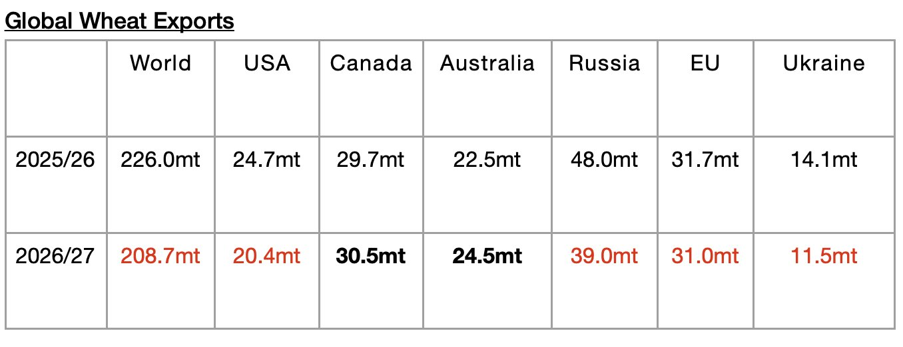
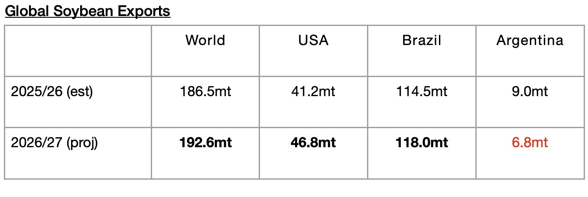
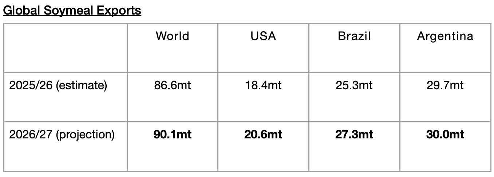

# Less Grain Exports Still Expected

**Date:** November 23, 2026  
**Publisher:** Breakwave Advisors | **Category:** Market Insights  
**Original URL:** [https://www.breakwaveadvisors.com/insights/2026/11/23/less-grain-exports-still-expected](https://www.breakwaveadvisors.com/insights/2026/11/23/less-grain-exports-still-expected)  

---

*By*[*Jeffrey Landsberg*](https://www.linkedin.com/in/jeffrey-landsberg-70ab957/)

The United States Department of Agriculture (USDA) has released its latest forecast for the 2026/27 season and is predicting that global coarse grain, wheat, soybean, and soymeal exports will total 746.8 million tons. This is 1.8 million tons more than the USDA predicted a month ago — but it is 18.1 million tons (-2%) less than is estimated for the 2025/26 season. The forecast is still preliminary, but a year-on-year decline in exports would be a headwind for our market. Compared to the 706 million tons of grain that was shipped during the 2024/25 season, however, 746.8 million tons — if actually shipped — would mark an increase of 40.8 million tons (6%). As we have stressed before, this season’s forecast continues to come in at an impressive level, but it is still less than the incredible 764.9 million tons that is estimated for the 2025/26 season.

The USDA is forecasting that global coarse grain exports in 2026/27 will total 253.9 million tons. This would mark a year-on-year decline of 10.3 million tons (-4%) from the 2025/26 season. Coarse grain exports will remain the global grain market’s largest cargo by volume. Moderate year-on-year declines in coarse grain exports are expected from the United States and Argentina. A small year-on-year decline is expected from Ukraine. A moderate year-on-year increase is expected from Brazil.

> **Figure 1: Chart 1**  
> [Local Asset](../../../../../../corpus/03-breakwave/insights/2026/assets/2026-11-23_less-grain-exports-still-expected_img_chart1_0c333930904d.jpg)

Global wheat exports are expected to total 208.7 million tons. This would mark a year-on-year decline of 17.3 million tons (-8%) from the 2025/26 season. A large decline is expected from Russia. A moderate decline is expected from the United States and Ukraine. A small decline is expected from the European Union. Small increases are expected from Canada and Australia.

> **Figure 2: Chart 2**  
> [Local Asset](../../../../../../corpus/03-breakwave/insights/2026/assets/2026-11-23_less-grain-exports-still-expected_img_chart2_0286f3587f1a.jpg)

Global soybean exports are expected to total 192.6 million tons. This would mark a year-on-year increase of 5.6 million tons (3%) from the 2025/26 season. Moderate increases are expected from the United States and Brazil. A moderate decline is expected from Argentina.

> **Figure 3: Chart 3**  
> [Local Asset](../../../../../../corpus/03-breakwave/insights/2026/assets/2026-11-23_less-grain-exports-still-expected_img_chart3_32c79fc1dc27.jpg)

Global soymeal exports are expected to total 90.1 million tons. This would mark a year-on-year increase of 3.5 million tons (4%). Increases are expected from the United States, Brazil, and Argentina.

> **Figure 4: Chart 4**  
> [Local Asset](../../../../../../corpus/03-breakwave/insights/2026/assets/2026-11-23_less-grain-exports-still-expected_img_chart4_3326e852e325.jpg)

---

**Tags:** Drybulk, Commodities, Markets  
