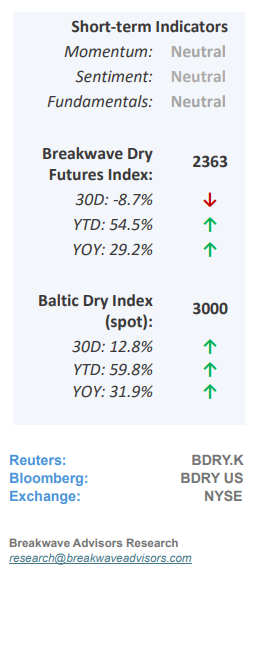
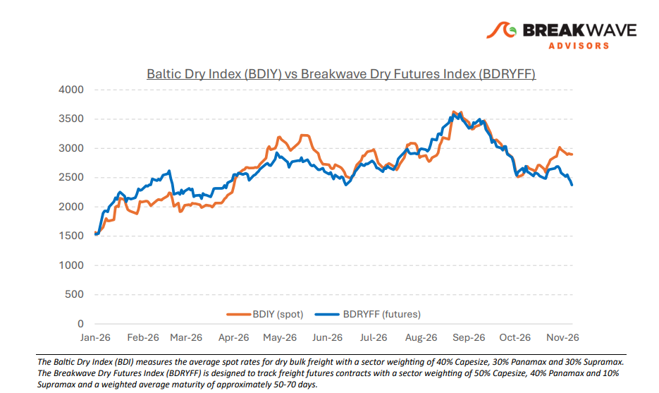
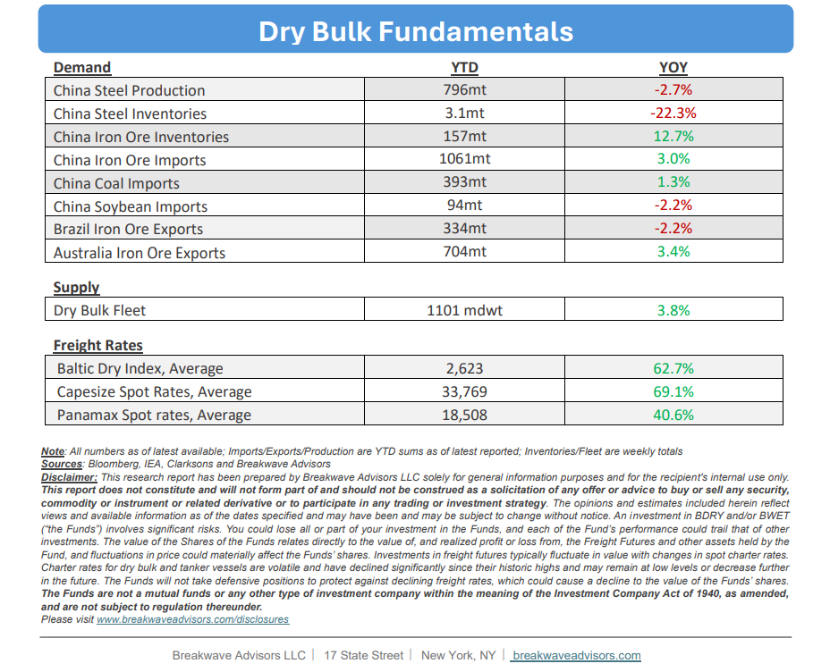

# Breakwave Bi-Weekly Dry Bulk Report - November 24, 2026

**Date:** November 24, 2026  
**Publisher:** Breakwave Advisors | **Category:** Market Insights  
**Original URL:** [https://www.breakwaveadvisors.com/insights/11242026db-report11ki887j](https://www.breakwaveadvisors.com/insights/11242026db-report11ki887j)  

---

•**Capesize Spot Rates Approaching $40,000 Once Again**– As November draws to a close, Capesize spot rates remain **historically elevated**, hovering near the upper end of their recent range at roughly $40,000 per day despite subdued macroeconomic data and compressed steel margins that are gradually eroding iron ore demand. While **December has** historically brought some of the steepest **seasonal rate corrections**, a pattern currently reflected in the forward freight curve, the recent compression in volatility alongside highly profitable charter levels underscores the underlying tightness in the dry bulk market. Looking ahead to next year, although **headline fleet growth is projected to outpace cargo demand growth**, ongoing geopolitical disruptions across two active wars continue to absorb effective vessel capacity through extended ton-miles and rerouting, creating a structurally tighter market than baseline fundamentals suggest and supporting the case for another strong year. Ultimately, barring a resolution to these regional conflicts or a sharp contraction in global trade volumes, the **market's structural inefficiencies should continue to provide a durable floor** for earnings well into the new year.

> **Figure 1: Cea3cf84ceb9ceb3cebcceb9cf8ccf84cf85**  
> [Local Asset](../../../../../../corpus/03-breakwave/insights/2026/assets/2026-11-24_11242026db-report11ki887j_img_cea3cf84ceb9ceb3cebcceb9cf8ccf84cf85_7a1a02f50320.png)

•**Iron Ore Remains Below $90/ton on Bearish Fundamentals, Inventory**– Iron ore prices remain below the psychologically significant threshold of $90 per ton, weighed down by recent Chinese economic data signaling **renewed weakness in industrial production and broader economic activity.**With Chinese steel output projected to post another annual decline and little indication of a near-term reversal, a meaningful price recovery appears unlikely without some unforeseen supply shock. Furthermore, seasonally elevated iron ore inventories continue to exert downward pressure on spot prices, particularly amid softer winter steel demand. Should prices decline further, major **raw material producers will face significant margin pressure,**a dynamic the industry has not experienced in several years. Consequently, market participants should closely monitor upcoming policy signals from Beijing for any potential stimulus that could stabilize construction and manufacturing demand.

•**Our Long-term View**– The last few years have been characterized by increased geopolitical uncertainty. Going forward, we expect such events to continue to affect global trade and have a meaningful impact on effective vessel supply. Combined with the potential for a multi-year cyclical rebound in China’s economic activity following the recent economic turmoil, dry bulk shipping should experience higher volatility on top of a secular tightness driven by stable bulk commodity demand and rather steady but elevated fleet growth.

> **Figure 2: Στιγμιότυπο Οθόνης 2026 11 24 085815**  
> [Local Asset](../../../../../../corpus/03-breakwave/insights/2026/assets/2026-11-24_11242026db-report11ki887j_img_cea3cf84ceb9ceb3cebcceb9cf8ccf84cf85_dbcf46ea5aa4.png)

> **Figure 3: Στιγμιότυπο Οθόνης 2026 11 24 095205**  
> [Local Asset](../../../../../../corpus/03-breakwave/insights/2026/assets/2026-11-24_11242026db-report11ki887j_img_cea3cf84ceb9ceb3cebcceb9cf8ccf84cf85_3c2b573608ba.png)

### Subscribe:
