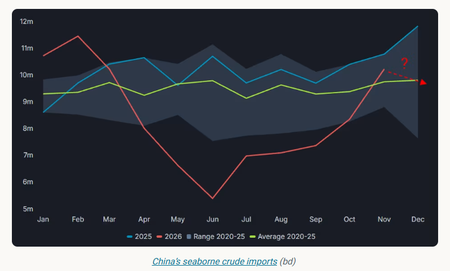
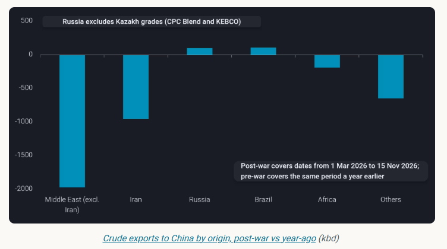
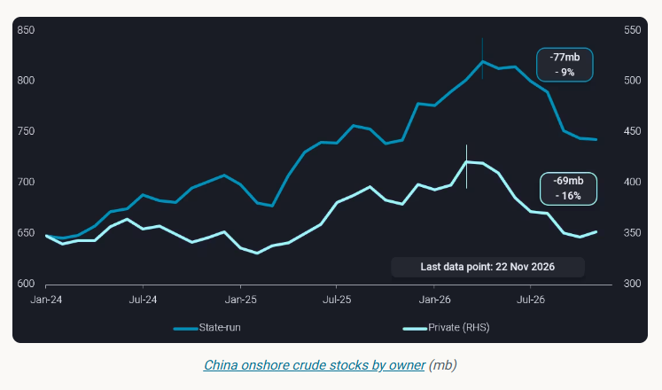

# China crude demand return on high fuel exports, what’s next?

**Date:** November 25, 2026  
**Publisher:** Breakwave Advisors | **Category:** Market Insights  
**Original URL:** [https://www.breakwaveadvisors.com/insights/2026/11/25/china-crude-demand-return-on-high-fuel-exports-whats-next](https://www.breakwaveadvisors.com/insights/2026/11/25/china-crude-demand-return-on-high-fuel-exports-whats-next)  

---

China sees crude imports top 10mbd towards year-end, though momentum may fade once fuel exports normalise; stockpile will emerge as the next demand engine.

*By*[*Emma Li*](https://www.linkedin.com/in/emma-li-73003443/)

China’s seaborne crude imports are set to recover to pre-war levels, supported by higher year-end fuel export quotas and stronger refinery runs aimed at utilising those allocations. November crude arrivals are expected to surge 25% month-on-month to 10.4mbd, broadly matching the 2025 average, while December volumes are likely to remain above the 10mbd mark.

> **Figure 1: Στιγμιότυπο Οθόνης 2026 11 25 121335**  
> **Interactive Data & Source:** [Vortexa](https://www.vortexa.com//oil-gas-data-traders-analysts-data-scientists?gclid=Cj0KCQjw8_qRBhCXARIsAE2AtRZKOvMnbilZ_6_91d7huSFFy71pWLrnPwGwOHVzXsmsG-1a1mZnQw8aAt89EALw_wcB&hsa_acc=1782073842&hsa_ad=548425387665&hsa_cam=14746637662&hsa_grp=125038601902&hsa_kw=&hsa_mt=&hsa_net=adwords&hsa_src=g&hsa_tgt=dsa-1431852288425&hsa_ver=3&utm_campaign=%5BCD%5D%20-%20DSA%20-%20EMEA&utm_medium=cpc&utm_medium=ppc&utm_source=google&utm_source=adwords&utm_term=) | [Local Asset](../../../../../../corpus/03-breakwave/insights/2026/assets/2026-11-25_china-crude-demand-return-on-high-fuel-exports-whats-next_img_cea3cf84ceb9ceb3cebcceb9cf8ccf84cf85_817fcbea5139.png)

However, the demand outlook heading into 2027 is mixed. Refinery runs are expected to slow as domestic fuel demand remains soft and fuel exports cool back toward pre-war norms—driven by likely flat annual quotas and more evenly paced monthly volume allocations. Consequently, crude demand growth will largely hinge on stockpiling, where strategic capacity expansion will outweigh simple replenishment from Hormuz-related stockdraws.

## A Subtle Rebalancing Between Brics and OPEC

While China anticipates strong crude arrivals from the Middle East Gulf in Q4 [link to insight], the country experienced over 3.5mbd in supply losses during the war (covering China-bound crude exports from March 1 to November 20), including nearly 1mbd from Iran and 2mbd from other Middle Eastern producers.

Conversely, supplies from fellow BRICS members Russia and Brazil have held remarkably firm, despite Russian barrels coming under full sanctions late last year. Russian seaborne crude exports to China have exceeded 1.6mbd since September, up from 1.3mbd between March and August and nearly 1.4mbd on average in 2025. Similarly, Brazilian crude exports rose 11% year-on-year to 1.1mbd post-war.

By comparison, Gulf OPEC producers have only recently begun ramping up exports to China as loadings west of Hormuz, shuttle transits, and ship-to-ship (STS) operations east of Hormuz stabilised.

Meanwhile, African OPEC members are unlikely to see China-bound volumes rebound until December, following recent declines in cargo premiums and freight rates.

> **Figure 2: Στιγμιότυπο Οθόνης 2026 11 25 121426**  
> **Interactive Data & Source:** [Vortexa](https://www.vortexa.com//oil-gas-data-traders-analysts-data-scientists?gclid=Cj0KCQjw8_qRBhCXARIsAE2AtRZKOvMnbilZ_6_91d7huSFFy71pWLrnPwGwOHVzXsmsG-1a1mZnQw8aAt89EALw_wcB&hsa_acc=1782073842&hsa_ad=548425387665&hsa_cam=14746637662&hsa_grp=125038601902&hsa_kw=&hsa_mt=&hsa_net=adwords&hsa_src=g&hsa_tgt=dsa-1431852288425&hsa_ver=3&utm_campaign=%5BCD%5D%20-%20DSA%20-%20EMEA&utm_medium=cpc&utm_medium=ppc&utm_source=google&utm_source=adwords&utm_term=) | [Local Asset](../../../../../../corpus/03-breakwave/insights/2026/assets/2026-11-25_china-crude-demand-return-on-high-fuel-exports-whats-next_img_cea3cf84ceb9ceb3cebcceb9cf8ccf84cf85_2d7dc98d58ad.png)

## The Next Demand Engine: Structural Stock Expansion Over Mere Replenishment

Onshore crude stock drawdowns in China have slowed significantly from September’s record pace as seaborne cargo arrivals pick up. Overall, China drew down nearly 150mb of crude held in aboveground tanks during the Hormuz crisis. While this points to potential restocking demand that could support future crude imports, the key questions are how urgently China needs to rebuild these inventories and what conditions will trigger the process.

Relative to total inventory levels, China’s wartime stockdraw was modest, as both state-run and private stocks had reached record highs in the early months of the crisis. Moving forward, replenishment timelines will likely diverge between the two segments:

- State-run restocking (estimated at ~80mb): Heavily reliant on Middle East Gulf supplies, state-run replenishment is likely to begin once crude prices and freight costs ease further and regional deliveries stabilize
- Private restocking (estimated at ~70mb): Independent refiners depend on a recovery in discounted crude supplies, which appears unlikely in the near term given ongoing constraints on both Iranian and Russian flows

> **Figure 3: Στιγμιότυπο Οθόνης 2026 11 25 121520**  
> **Interactive Data & Source:** [Vortexa](https://www.vortexa.com//oil-gas-data-traders-analysts-data-scientists?gclid=Cj0KCQjw8_qRBhCXARIsAE2AtRZKOvMnbilZ_6_91d7huSFFy71pWLrnPwGwOHVzXsmsG-1a1mZnQw8aAt89EALw_wcB&hsa_acc=1782073842&hsa_ad=548425387665&hsa_cam=14746637662&hsa_grp=125038601902&hsa_kw=&hsa_mt=&hsa_net=adwords&hsa_src=g&hsa_tgt=dsa-1431852288425&hsa_ver=3&utm_campaign=%5BCD%5D%20-%20DSA%20-%20EMEA&utm_medium=cpc&utm_medium=ppc&utm_source=google&utm_source=adwords&utm_term=) | [Local Asset](../../../../../../corpus/03-breakwave/insights/2026/assets/2026-11-25_china-crude-demand-return-on-high-fuel-exports-whats-next_img_cea3cf84ceb9ceb3cebcceb9cf8ccf84cf85_8a0fd0044bf8.png)

Ultimately, the primary driver of China’s future crude demand will be storage expansion beyond previous highs.

China currently holds nearly 1.1bb of crude in onshore tanks—roughly 55% of its 2bb total capacity, enough to cover more than six months of seaborne import needs.**Yet the Hormuz crisis exposed a structural vulnerability beneath that headline volume: uneven storage coverage across key refining hubs.**For instance, Shandong province—home to the majority of China’s teapot refiners—benefits from a far more established tank and pipeline network than other regions.

Based on publicly available information, China is set to add at least 200mb of new storage capacity in underserved provinces across 2027–2028. Furthermore, several projects originally scheduled for completion in 2028 may have their timelines accelerated following the lessons of the Hormuz crisis. This buildout is poised to push China’s crude inventories to fresh peaks from the second half of 2027 onward, creating a vital source of demand on top of refinery runs.

In short, while cooling fuel exports will cap refinery-driven crude demand early next year, China’s structural push to expand and geographically balance its strategic storage network will provide a durable floor for seaborne imports through 2027 and beyond.

Data Source:[Vortexa](https://www.vortexa.com//oil-gas-data-traders-analysts-data-scientists?gclid=Cj0KCQjw8_qRBhCXARIsAE2AtRZKOvMnbilZ_6_91d7huSFFy71pWLrnPwGwOHVzXsmsG-1a1mZnQw8aAt89EALw_wcB&hsa_acc=1782073842&hsa_ad=548425387665&hsa_cam=14746637662&hsa_grp=125038601902&hsa_kw=&hsa_mt=&hsa_net=adwords&hsa_src=g&hsa_tgt=dsa-1431852288425&hsa_ver=3&utm_campaign=%5BCD%5D%20-%20DSA%20-%20EMEA&utm_medium=cpc&utm_medium=ppc&utm_source=google&utm_source=adwords&utm_term=)

---

**Tags:** Geopolitics, Shipping, Markets  
