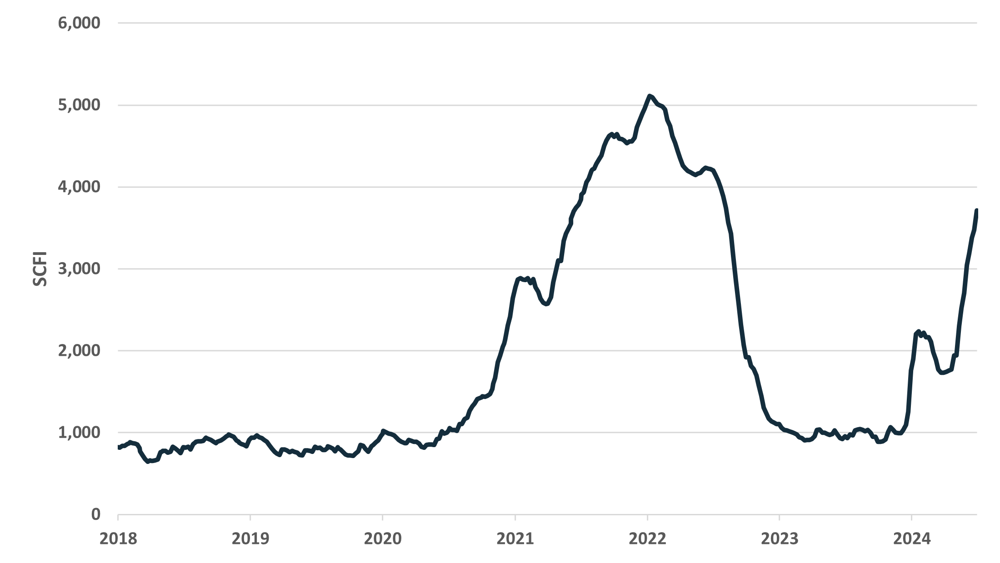

# Fearnleys Dry Bulk Weekly

**Date:** 2024-07-03 | **Department:** BULK | **Publisher:** Fearnleys AS  
**Original PDF:** [Local PDF](../pdfs/2024/2024-07-03_fearnleys-dry-bulk-weekly-3rd-july-2024.pdf) | [Cloud Backup](https://pbrkapp.blob.core.windows.net/report/a0bc8994-c926-4c24-b475-bc141f68d7e2/report.pdf)  

---

## Capesize/Newcastlemax

The rally is on, as was suggested by several factors we have pointed to the last weeks.

However, upside could be limited by the Kamsarmax market, which have been hit by the weakness in coal markets.

Since 2018, the Capesize index have peaked every time it has been around 250% of the Kamsarmax index (lower left chart).

That implies the market could peak below 40.000 USD per day.

Looking further ahead, a downtrend from August through most of September is suggested by leading indicators. The last week's rebound in iron ore prices suggest the market could bottom in late September.

*Chart: Iron Ore Price, Moved 3 Months Forward vs Capesize 5TC*

*Chart: China Imported Iron Ore Consumption, 1 Month Change, Moved 1.5 Months Forward vs Capesize 5TC 1 Month Change*

*Chart: BCI5TC / BPI5TC Above 200% vs BCI5TC*

*Chart: Capesize/Newcastlemax Brazil Export Seasonality*

## Panamax/Kamsarmax

The market tracked average seasonality closely until the last weeks, when weakness in coal markets put an end to the rally.

Fundamental indicators are looking strong, with shipment volume growth well above supply growth, and leading indicators like industrial metals prices pointing upwards through the second half of the year.

On that basis, we still expect the second half of the year to average higher than the first. However, we are uncertain on when the next leg up could start - maybe it will have to wait until late August and the US grains season.

*Chart: Panamax / Kamsarmax Ton-Time Growth vs Supply Growth*

*Chart: Copper Price Lead vs Panamax 1 Year TC*

*Chart: Panamax/Kamsarmax Seasonal Average Market Movement*

*Chart: Handysize - Kamsarmax Black Sea Grains Shipment Seasonality*

## Supramax/Ultramax

The market has dropped back slightly the last week, primarily due to the weakness in coal markets. Seasonality suggest a sideways range the next month or so, then year-to-date highs in the autumn.

The last weeks we have pointed to the positive indications given by various manufacturing PMIs. Developed economies' demand have been weak year-to-date, but the June reports showed that both South Korea, Taiwan and Japan returned to expansion. In the Eurozone, the recovery seemingly have to wait a bit longer, as manufacturing PMIs dropped in June after having shown signs of improvement in April and May.

Otherwise in the markets, the surging container rates have people wondering whether a return to 2021/22 conditions could happen. Tightness in global supply chains are far lower now than then, but we have heard some operators have gotten increased inquiries of traditional "container cargoes" lately.

Worth pointing out in this respect is that it took a few months from when the container market surge started in 2020 until the effects started to be seen in the dry bulk segment.

*Chart: Supramax Seasonal Market Movement*

*Chart: Copper Price Lead vs Supramax 1 Year TC*

*Chart: Supramax / Ultramax Ton-Time Growth vs Supply Growth*

*Chart: Shanghai Containerized Freight Index*
