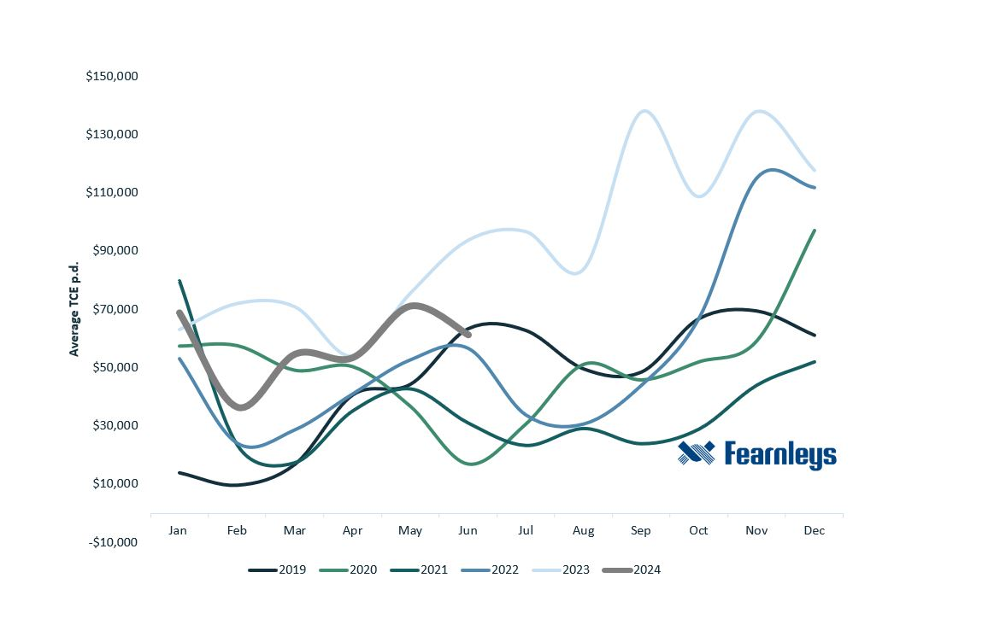
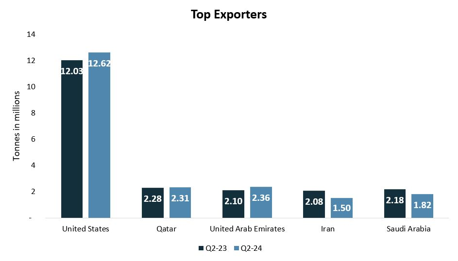
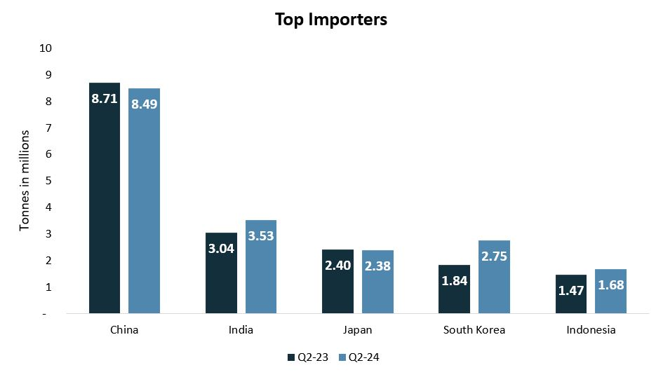
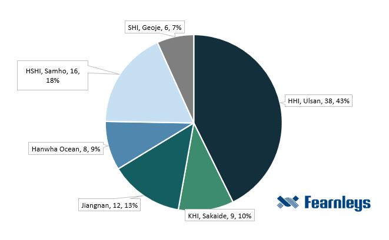

# VLGC Quarterly Market Report - Q2 2024

**Date:** 2024-07-05 | **Department:** LPG | **Publisher:** Fearnleys AS  
**Original PDF:** [Local PDF](../pdfs/2024/2024-07-05_vlgc-quarterly-market-report-q2-2024.pdf) | [Cloud Backup](https://pbrkapp.blob.core.windows.net/report/1ccdee03-2a41-4879-9967-e806d6bb39bd/report.pdf)  

---

### Earnings

*Chart: Rates2*

A solid quarter earnings-wise, with not much unregular market activity. YTD average TCE resides at $57,000 p.d.

The earnings level remained quite stable, with the lowest rates seen in mid-April, in the mid-30s range.  **The average daily Time Charter Equivalent for the VLGCs ended at $61,900 p.d.**, with the following per Baltic index: BLPG1 - $51,858, BLPG2 - $74,650, BLPG3 - $59,216. Total average resulting in a 16% decrease from Q2-2023, however, 24% above Q2-2022. The month of May performed with the highest earnings of $71,000 p.d.

We reiterate our solid forecast for the year in the $60k p.d. range, and expect 2H to bring the rates up even further, due to seasonal demand as well as a tight shipping market.

### Liftings statistics: U.S. & Middle East

**U.S. Gulf/U.S. East Coast**

April: 86 in total/34 being spot

May: 87 in total/32 being spot

June: 91 in total, 27 being spot

**Middle East Gulf**

April: 81 in total/24 being spot

May: 86 in total/27 being spot

June: 76 in total/23 being spot

Due to the changing availability and restrictions at the Panama Canal, we have seen a big change in the sailing patterns of VLGCs in the last 8 months. The share of vessels going in ballast back to the U.S. Gulf/U.S. East Coast from the East, who choose to sail around the Cape of Good Hope have increased extensively since the beginning of the year. In June, over half of the vessels, 55% to be exact, chose the longer route rather than sail through the Panama Canal  - even though the availability at the canal has increased back to "normal levels".

*Chart: Laden USGUSEC*

*Chart: Ballast USGUSEC*

*Fearnleys*

### Exports & Imports

*Chart: Exports*

*Chart: Imports*

*Vortexa*

For volumes lifted on VLGCs, the **United States** remains the dominating party, who **increased their exports by 4.9% quarter-on-quarter**. There was a slight increase in volumes from Qatar and the UAE, while Iran and Saudi Arabia rather saw some decreases.

Amid China importing 27% more in Q1 y/y, their imports in Q2 was down 2.5%. On a total YTD basis, China is up 14%.

South Korea imported 50% more than they did in Q2-2023. These increases coming mainly with origin in the U.S. and Saudi Arabia.

### U.S. Propane Inventories

*Chart: US Propane Inventories*

The U.S. still remains the market leader in exports, with 53% of all VLGC liftings. The nation has exported over 26 million tonnes LPG in the 1H of 2024, which is 53% of its 2023 total exports (on VLGCs only). The inventory levels dropped extensively in Q1 due to increased domestic demand, however, in Q2 they have rebounded and the summer build-up has started. At the end of June, the stock holds 75.8 million barrels.

As the data displays, the U.S. has been consistent in production and consequently exports provided to the market. There are two different terminals (Nederland & Beaumont) that are undergoing expansion projects to increase their export capacity (of both LPG & ethane). These projects will first finalize in 2025 & 2026.

### Fleet & Orderbook

*Chart: Fleet development*

**The total fleet now comprises of 395 VLGCs**, where 16 are used for storage/semi-storage. 16 newbuildings have been delivered YTD, where 5 of these were in Q2. Another 5 are expected in the second half of the year.

In the last 10 years, only 12 VLGCs have been scrapped. However, 13% of the fleet is now older than 20 years, and 9% above 25 years - which would indicate that the scrapping candidates are increasing extensively. However, due to the general positive health of the market, we do not see any incentives for scrapping of these vessel to have an uptake. Unless, the environmental regulations should force a harder hand on the operational requirements, or imposed age restrictions from ports and/or charterers.

**The orderbook-fleet ratio is at 23% with another 91 vessels on order.** There will be a slow fleet growth in the next 18 months, with only 12 newbuilds scheduled for 2025. However, combined in 2026 and 2027, 65 newbuilds are planned for delivery. This will result in a total fleet growth of 15%.

All of the vessels in the orderbook are LPG dual-fuel, except for 7. There is currently 45 "VLACs" on order, which are capable of carrying ammonia as a cargo, at 98% capacity. These vessels will start to be delivered in 2H-2026, however, we anticipate that these vessels will enter the market as "regular" VLGCs, lifting LPG as a cargo.

The anticipated incremental Clean Ammonia Capacity to come before the next decade will not require these vessels for the trade. It will likely be absorbed by the Midsize Gas Carriers (MGCs), which is the segment that currently lifts most of seaborne ammonia. The MGC orderbook-fleet ratio is at 35%.

*Chart: VLGC VLAC OB*

*Fearnleys*

### Yard Status

In the first half of 2024, 35 newbuilding orders have been placed, which is the equivalent to the total orders placed in 2023. This further demonstrates the increased interest in the VLGC sector from an investment perspective. We have seen many new owners entering the market with newbuilding orders the last 18 months.

In terms of yard capacity, the situation remains tight, with limited availability left in 2H 2027. 7 newbuilding orders are already inked for delivery in 2028.

Newbuilding prices have continued on an upward trajectory, with the current price-tag of around **$120 million for a DF VLGC, with no additional ammonia specs.**

*Chart: Yards*

*Fearnleys*

*Chart: VLGC NB dollars*

*Chart: SK OB*

*Chart: CHINA OB*

*Fearnleys*

### Outlook going forward

After the transit restrictions was imposed in Q4 last year, the fluctuations of the three main waypoints for VLGCs, have increased. The water levels in the Panama Canal is soon “back to normal” after expected rainfall, and almost all restrictions have been retracted. Daily transit capacity is soon back to full, at 36 transits per day.

The share of laden transits around the COGH have increased by 115% from the 2023 average of 12.6 to YTD average of 29.3. This due to the major uncertainty that the Panama canal has brought upon the market.

Going into the second half of the year, where Q4 tendsto be the most trafficked quarter of the year, the Panama Canal will still be facing the same challenges as in previous years. The orderbook for both LNG and containerships is huge, we therefore expect waiting days to hit new highs, and auction cost will likely follow suit. This will further increase the utilization of the longer route around COGH, pushing tonne-miles further.

With only 12 newbuilds scheduled for delivery in 2025, **we believe the transit inefficiencies will contribute to a tight shipping market going forward.**

*Chart: Rate forecast2*
