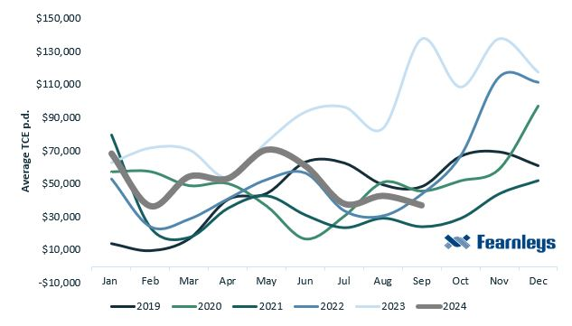
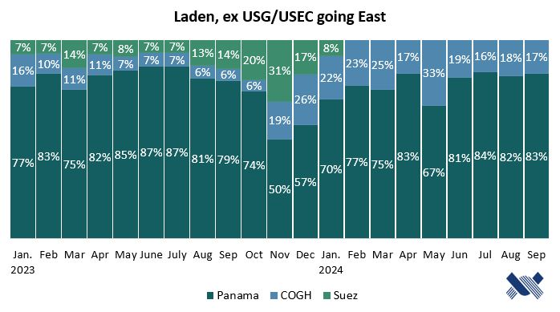
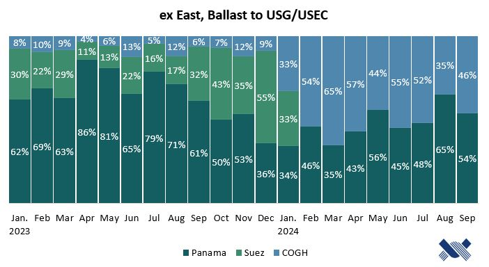
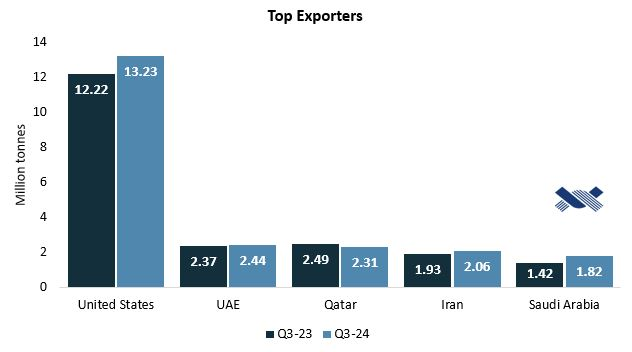
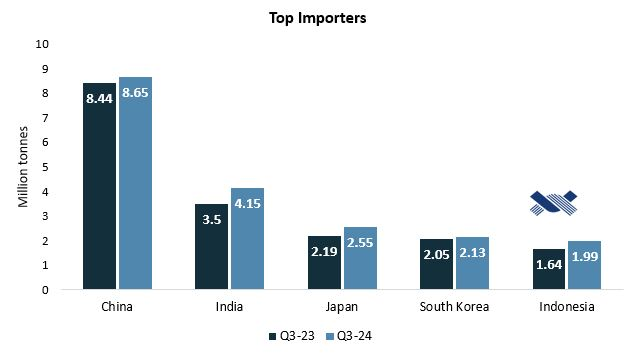
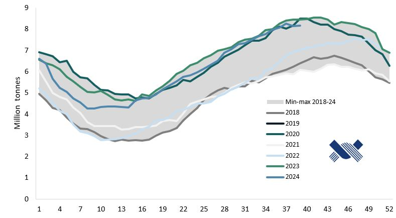

# VLGC Quarterly Market Report - Q3 2024

**Date:** 2024-10-17 | **Department:** LPG | **Publisher:** Fearnleys AS  
**Original PDF:** [Local PDF](../pdfs/2024/2024-10-17_vlgc-quarterly-market-report-q3-2024.pdf) | [Cloud Backup](https://pbrkapp.blob.core.windows.net/report/c4b10204-5de1-4b9b-bd96-015cf85a0d07/report.pdf)  

---

### Earnings

*Chart: RatesQ3*

After experiencing exceptionally high earning levels for 24 months, the VLGC market has entered a downward trend once again. The seasonal low of the summer period has reoccurred, with all three months of the third quarter showing signs of this decline.

**The quarterly TCE average concluded at $39,191 per day**, marking the lowest quarterly result year-to-date. This figure represents a 65% decrease from Q3 2023, but only a 7% decline from Q3 2022.

In terms of the total year-to-date average TCE, it now resides at $51,615 p.d.

*Chart: Q3 Baltic*

Except for the month of July, the West (BLPG3) traded at a theoretical premium to the East (BLPG1).  *See graph for an overview of the three different index routes.*

BLPG1 - $30,150, BLPG2 - $51,192, BLPG3 - $36,230.

Entering into the fourth quarter of the year, U.S. propane inventories are currently at high levels after summer piling, coincidentally with peak demand season starting. However, the current shipping market is long and the level of volatility remains *extremely high*.

### Liftings statistics: U.S. & Middle East

**U.S. Gulf/U.S. East Coast**

July: 85 in total/22 being spot fixtures

August: 101 in total/28 being spot fixtures

September: 91 in total, 20 being spot fixtures

**Middle East Gulf**

July: 80 in total/28 being spot fixtures

August: 80 in total/20 being spot fixtures

September: 70 in total/19 being spot fixtures

*Chart: Arb vs BLPG3*

**The VLGC earnings level is normally highly correlated to the arbitrage window from the West to the East.** However, as the graph clearly illustrates, this has not been the case in recent months. The graph specifically compares the Houston-Chiba index (BLPG3) with the arbitrage. Several factors have contributed to this situation.

During the summer, the U.S. export market experienced disruptions due to maintenance activities as well as hurricane Beryl, which led to delays in loadings. Such incidents usually create a ripple effect, impacting the period following the occurrence. This resulted in fewer spot fixtures from the region and generally higher FOB activity. Consequently, shipping activity was lower than desired, and the impact of an expanded fleet became evident in the position lists, causing a long shipping market.

*Chart: Laden*

*Chart: Ballast*

*Fearnleys*

Due to the changing availability and restrictions at the Panama Canal, there has been a significant shift in the sailing patterns of VLGCs over the past 12 months. These patterns have become a crucial variable in terms of fleet capacity and availability.

The notable change of more vessels opting to sail around the Cape of Good Hope, rather than risk the Panama Canal with its unpredictable conditions, increased significantly around this time last year. This trend persisted throughout the year, but it is only now in Q3 that we have observed a reversal.

There are still no ships sailing through the Suez Canal due to the security situation in the Red Sea. However, as the Panama Canal has returned to normal water levels and full operational capacity, we are seeing more VLGCs utilizing the canal once again. Q4 tends to be the most trafficked quarter for the Panama Canal, and this is typically when congestion reaches its peak.

### Exports & Imports

*Chart: Exports*

*Chart: Imports*

*Vortexa*

For volumes lifted on VLGCs, the **United States** remains the dominating party, who **increased their exports by 4.9% quarter-on-quarter**. Year-on-year, the U.S. has exported 2 million tonnes more this year, with a total of 38.4 million tonnes so far in 2024. This is equivalent to a growth of 6%. Quarter-on-quarter, they displayed an 8% increase in exports.

The Middle East is expected to increase their production and exports levels in 2025 & 2026, mainly from Qatar & the United Arab Emirates.

All top five importing countries increased their imports in Q3 2024 compared to Q3 2023. China, being the main driver, has imported 25.5 million tonnes so far this year, which is an increase of 1 million tonnes from the same period last year. China's strong import demand is likely to continue further, as the new PDH capacity additions added in 2024 & 2025 will result in a 64% growth from 2022 levels.

### U.S. Propane Inventories

*Chart: Inventories*

The U.S. still remains the market leader in exports, with 53% of all VLGC liftings. The nation has exported just over 40 million tonnes LPG so far in 2024, which is 10 million tonnes below the 2023 total (on VLGCs only). After a summer of stock building, inventories have rebounded towards the top of the 5-year period, and at the end of September, the stock holds 97.8 million barrels.

As the data displays, the U.S. has been consistent in production and consequently exports provided to the market. There are three terminals (Targa, Enterprise & Nederland) that are undergoing expansion projects to increase their export capacity (of both LPG & ethane). These projects will first finalize in 2025 & 2026, and can be understood as a testament to the underlying sentiment for further production and export growth from the region.

### Fleet & Orderbook

*Chart: Fleet developmentQ3*

**The total fleet now comprises of 398 VLGCs**, where 16 are used for storage/semi-storage. 18 newbuildings have been delivered YTD, where only 3 of these were in Q3. For the last quarter of the year, another 3 newbuildings are scheduled for delivery.

In the last 10 years, only 12 VLGCs have been scrapped. However, 13% of the fleet is now older than 20 years, and 9% above 25 years - which would indicate that the scrapping candidates are increasing extensively. However, due to the general positive health of the market, we do not see any incentives for scrapping of these vessel to have an uptake. Unless, the environmental regulations should force a harder hand on the operational requirements, or imposed age restrictions from ports and/or charterers.

**The orderbook-fleet ratio is at 25% with 99 vessels on order.** Until 2026, there will be little fleet growth, with only 12 newbuilds scheduled for 2025. Contrary to this, 2026 and 2027 combined will end with 74 newbuilds planned for delivery. This will result in a total fleet growth of 18% in 2 years.

To accommodate the fleet expansion, export volumes must increase accordingly. The significant fleet expansion in 2023 was initially viewed by many market players as a potential tipping point that could destabilize the market. However, the high production and export levels from the U.S. allowed the market to absorb these vessels seamlessly, rendering the fleet expansion relatively unnoticed. Nevertheless, the subdued seasonality observed in Q3 highlighted the impact of the 39 additional vessels introduced last year.

*Chart: VLGC VLAC OB*

It is therefore uncertain whether another substantial influx of vessels can be absorbed similarly. To achieve a more balanced market, export volumes must rise. There is already positive sentiment from the U.S., with several terminals expanding their capacity. However, the production levels forecasted by the EIA will be crucial. Their projections, to be published next quarter, will provide valuable insights into the expected export levels from the U.S. for 2025 and 2026.

All of the vessels in the orderbook are LPG dual-fuel, except for seven. Currently, there are 53 "VLACs" on order, capable of carrying ammonia as cargo at 98% capacity. These vessels are scheduled for delivery in the second half of 2026. However, we anticipate that these vessels will initially enter the market as "regular" VLGCs, transporting LPG as cargo for the foreseeable future. The ammonia production and export market requires substantial growth in both volumes and infrastructure before any trading on VLACs becomes likely.

The anticipated incremental Clean Ammonia Capacity to come before the next decade will not require these vessels for the trade. It will likely be absorbed by the Midsize Gas Carriers (MGCs), which is the segment that currently lifts most of seaborne ammonia. The MGC orderbook-fleet ratio is at 41% now.

### Yard Status

In total, there has been 45 newbuilding orders placed in 2024, this is 10 more than the total in 2023 - with 3 more months of the year to go. This is a historical high, especially given the position of the current newbuilding prices. Al throughout the year, they have remained stable around the are of $115-125 million, depending on whether ammonia capable and the different fuel alternatives.

In terms of yard capacity, the situation continues to tighten, with limited availability left in 2027. There are now 10 VLGC orders scheduled with delivery in 2028.

*Chart: NB Yards*

*Fearnleys*

*Chart: VLGC NB dollars*

*Chart: SK OB*

*Chart: CHINA OB*

*Fearnleys*

*LPG is categorized under "others", but their total share is around 5%.*

### Outlook going forward

After the transit restrictions were imposed in Q4 last year, the fluctuations of the three main waypoints for VLGCs increased. The water levels in the Panama Canal have returned to normal, and the daily transit capacity is back to full at 36 transits per day. The Canal Authority has become acutely aware of its vulnerability during peak seasons and is planning to find a long-term solution to its capacity challenges, although this seems distant at the moment. During Q3, they introduced the LoTSA (Long Term Slot Allocation), which involves packages of slots for 12 months, sold in an auction. Some larger LPG and LNG players took advantage of this, though half of the packages remained unsold at the end of the auction.

We still see many ballasting vessels choosing the Cape of Good Hope route, but it remains to be seen whether this percentage will increase again when the projected congestion hits the Panama Canal during the final quarter of the year.

As we soon will be entering 2025, a year where the fleet will grow very little compared to 2023 and 2024, with only 12 newbuilds scheduled for delivery. There are also about 80 VLGCs that are scheduled for their special survey dry-dock in '25 & '26. This will create a deficit in the available fleet. Chinese demand is expected to remain strong, and we will see conclusions of expansion projects at U.S. terminals. Increased production and export volumes are needed to catch up with the coming fleet growth, which we will see after next year and onwards.
