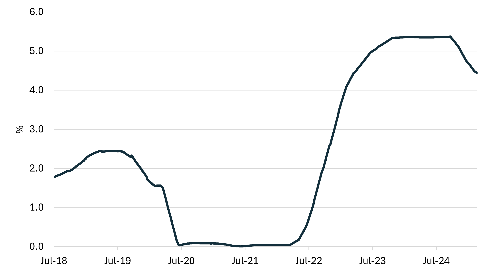
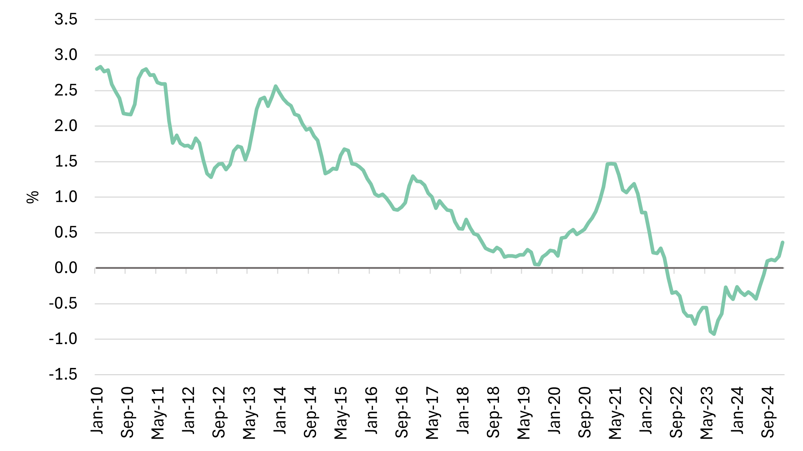

# LNG SnP report - January & February

**Date:** 2025-03-03 | **Department:** LNG | **Publisher:** Fearnleys AS  
**Original PDF:** [Local PDF](../pdfs/2025/2025-03-03_lng-snp-report-janfeb2025.pdf) | [Cloud Backup](https://pbrkapp.blob.core.windows.net/report/f17a6927-c7e2-4e86-8c98-c5fcba7f3140/report.pdf)  

---

## Market reflections

The new year began with renewed interest in LNG vessel sales. The first two months have been active with rumors and movements; two vessels have found new owners, while one has been sent to the breakers. Notably, a substantial number of vessels are currently under consideration, indicating a robust pipeline of potential transactions for owners seeking to divest older tonnage. Based on current market dynamics, it is projected that an additional three to five vessel sales may be finalized shortly.

One trend among market participants is an increased focus on strategic timing for tonnage acquisition, largely attributed to the ongoing and forecast soft chartering market, particularly for older vessels. The lack of chartering opportunities is applying downward pressure on price expectations, leading to careful consideration of market entry points for potential buyers.

The market outlook remains cautiously optimistic, though. Activity in recent months suggests a healthy demand for vessels despite the challenges. The expected sale of more vessels in the near future supports this optimism. Stakeholders must stay vigilant and adaptable to navigate the complexities of market timings and price expectations in order to capitalize on emerging opportunities.

*Chart: Recent sales*

*Chart: Yearly sales*

*Chart: Asset values*

## Newbuilding update

The newbuilding market in general has started the year with a lack of inertia, in stark contrast to the container sector's continued activity. Across most segments, a "wait-and-see" stance prevails, with shipyards, owners, and charterers all showing caution. This uncertainty has widened the gap in pricing between yards, reflecting their varying levels of slot availability and risk appetite. Aside from notable orders from Celsius at SHI and Hanwha Shipping at their own facility, both order books and inquiry pipelines remain notably subdued.

*Chart: Recent orders*

*Chart: Deliveries incl. orderbook*

*Chart: LNGC orders*

## Interest rates

The flurry of activity seen since inauguration of the 47th president of the United States has had its effect on interest rates, as key benchmarks have trended lower. The implications of a potential increase in trade barriers and a more uncertain geopolitical environment is challenging the fundamental outlook on global growth, which the credit markets rapidly translate into lower interest rates.

A number of central banks have already commenced interest rate cuts (US, Eurozone), and while still citing inflation as the "guiding star" it feels as if growth prospects may become a central theme in the near-term. Of course, in the case of slower growth we can only hope that inflation tails off too, as market pundits have begun to whisper about stagflation scenarios. While our last comment included Mr. Powell's wait-and-see attitude, the sentiment seems to be more action than inaction these days and as such it would not be a surprise if we see a further slide interest rates.

*Chart: Interest rate (90 day avg. SOFR)*

*Chart: 10-Year Treasury Constant Maturity Minus 2-Year Treasury Constant Maturity*

*Source: FRED*

## Recycling

2025 is expected to see a larger pool of candidates vessels being considered for recycling, and we seem to have started the year where we ended 2024. One vessel has already been sold for recycling and we expect to see one or two go in the coming weeks. It is interesting to note that the recycling yards are also becoming very focused on the disposal of hazardous materials, which we are led to believe has created significant challenges to the seller of the tonnage. Levels seem to be holding slightly higher than what we are seeing reported from the cash buyers for the reference market of Wet, which have all fallen over the first two months of the year. The largest drop so far in 2025 seem to be in Turkey where the reported prices are down by almost 15%. At present, buyers are indicating delivery Indian sub-continent at around US$ 500/ldt, which is US$ 40-60/ldt higher due to their premium as LNG vessels. The big question will be when will the cash buyers start to create an LNG pricing index?

**Bangladesh**  US$ 460/470

**Pakistan**       US$ 455/465

**India**            US$ 455/465

**Turkey**         US$ 285/295

*Chart: Demolition price (large tanker)*

*Source: Baltic Exchange*

## World fleet at a glance

*Chart: Live fleet by propulsion*

*Chart: Total fleet*

*Chart: LNGC fleet by propulsion and delivery year*
