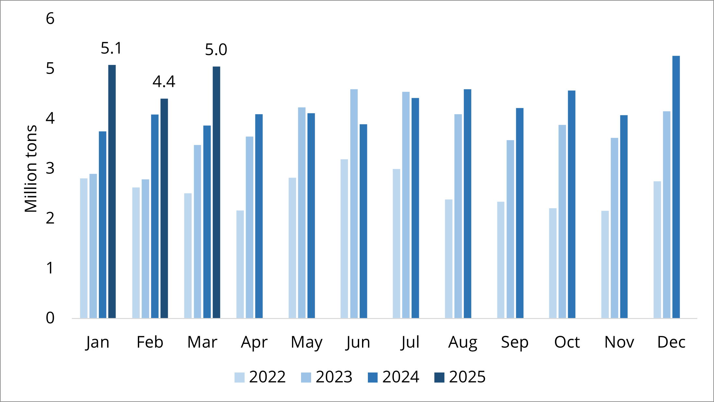
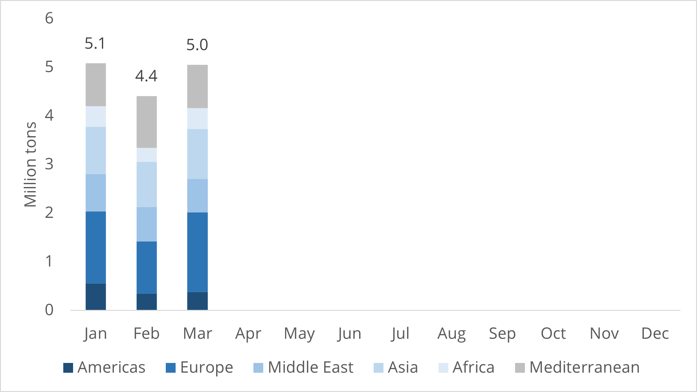
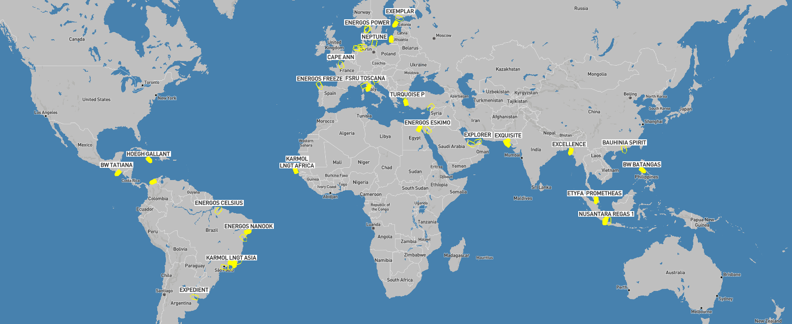
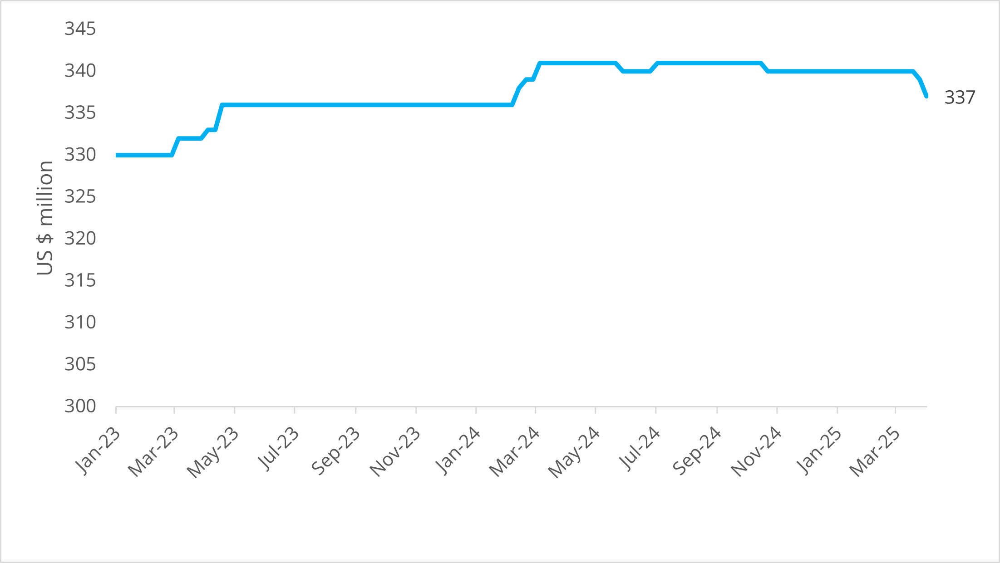

# FSRU Quarterly - Q1/25

**Date:** 2025-04-04 | **Department:** LNG | **Publisher:** Fearnleys AS  
**Original PDF:** [Local PDF](../pdfs/2025/2025-04-04_lng-fsru-report-q125.pdf) | [Cloud Backup](https://pbrkapp.blob.core.windows.net/report/e01bf497-94d1-44fc-ab0e-6e5262df5ae4/report.pdf)  

---

## Market reflections

The FSRU market has been increasingly active through the quarter. Morphing from a market that historically has been focused on long-term charters and long-lead project developments into a more prompt requirement situation. High activity for prompt requirements in North Africa and Middle East of the "We need an FSRU yesterday"-type are driving out underutilized FSRUs to a sublet-market that is uncommon to see. Although the limitation on rapid-fire FSRU projects tend to be on the onshore-side, the most visible requirements come from countries with available jetty/pipeline connections and hence the demand should be considered real.

Looking beyond the near-term, we see a relatively high activity of projects at early/medium-stage development with potential to materialize over the next 12-18 months. That said, the quality, bankability and structuring of these projects may need additional massaging and/or guidance to arrive at a point where they can reach lift-off. Our bottom-up analysis on a project-by-project basis lends credibility to 2-4 new projects (or extensions) reaching FID in 2025 and as such we see the fundamentals of the FSRU market pointing to a continued firm rate environment.

### Key market developments during the quarter

JANUARY

DET auctions Q1 regas slots for Wilhelmshaven 1 (**Hoegh Esperanza**) and Brunsbuttel (**Hoegh Gannet**). Reportedly sold OTD (Obligation-to-Deliver) slots sufficient to keep 2 x FSRUs cold. Price reported was an average of EUR 0.11/MMBtu – well below regas tariffs seen elsewhere in Europe.

Uncertainty arises on startup of DETs two FSRUs at W’haven 2 and Stade. Reporting delays into Q2/25, but market talks of further delays. Stade FSRU (**Energos Force**) removed to perform dredging at terminal.

Gastrade FSRU (**Alexandroupolis**) goes offline two times during month. FSRU has effectively been offline for majority of Q1 and recent Urgent Market Message from Gastrade annoncing that the unit will be out of service until at least 15th May 2025. The extended outage has lead to speculations around the cause which at present appear to be focused around the regasification system.

Hoegh Evi announces partnership with SEFE on green hydrogen from FSRUs. Information is scarce, but the announcement highlights the need for LNG infrastructure supporting the energy transition in European countries.

FEBRUARY

DET auctions remaining 2025 slots (Q2-Q4) at W’haven and B’buttel at an average price of EUR 0.30/Mmbtu.

BOTAS rumoured to have chartered out FSRU (**Saros** (ex-Vasant 1) or **Etugrul Gazi**)  for May/Jun-Nov 2025 to EGAS at around US$ 250,000/day. Deal reported to have subsequently failed.

Deutsche Regas terminates **Energos Power** with BWMK. FSRU idling offshore Mukran terminal. Unit marketed for alternative use with reportedly high interest from multiple parties.

Snam’s second FSRU **BW Singapore** arrives at Petra offshore terminal in Ravenna following minor works at Fincantieri Palermo and GU/CD with heel cargo in Spain. Commercial operations likely to commence in Q2/25.

Gastrade indicates targeting FID on second FSRU to be located close to Thrace, Greece in early-26.

Tokyo Gas acquires 20% of FGEN LNG Corp, the charterer of **BW Batangas** following previous JDA for project.

MARCH

Deutsche Regas reiterates position to restore regas capacity at Mukran to level (13.5 BCMA/~1,350MMSCFD) prior to terminating **Energos Power**.

Ireland announces plans to secure FSRU for development of **“state-led strategic gas emergency reserve”**. Location, timing and process is not defined, but expectations are of an FSRU with 170,000cbm cargo capacity and what appears to be an MSO as BOG management.

**Energos Power** is being discussed for charters with a number of parties following termination by Deutsche Regas. EGAS (Egypt) emerges as  most likely taker, but also hearing talks of Iraqi interests targeting the FSRU. Rate and term unclear, but remaining charter to BMWK is ~8 years with rumoured TC of ~US$ 150,000/day.

**ETYFA Prometheus** idles offshore Malacca. Terminal at Vasillikos bay expected ready towards end-25. Unit no longer being marketed for short-term business.

Jordan emerges with requirement for FSRU in period Jun-Sep 25 to Sep-26 when **BW FSU** is set to arrive. We see limited availability for this requirement with any FSRU likely to come at a premium.

Hanseatic Energy Hub terminates contract with DET for connection between FSRU and terminal in Stade. **Energos Force** is intended for Stade, but the recent news may suggest also Energos Force could become a relet candidate along with sister vessel Energos Power.

Excelerate Energy and New Fortress Energy made headlines on the corporate side with a late-quarter announcement of Excelerate acquiring NFEs Jamaica assets in a transaction valued at US$ 1.055bn - or ~9x EBITDA (2025est). NFEs assets had been rumoured for sale for some time with prospective buyers reportedly ranging from traders to infrastructure funds - and hence a relatively wide valuation range. Emerging as the successful bidder, Excelerate is taking over Montego Bay and Old Harbour LNG terminals as well as the 100MW Clarendon CHP plant together with small-scale distribution to a number of local clients. With a total of appx 30 TBtu of annual demand, the Jamaica business fits well with Excelerate's 0.7mtpa (~35TBtu/yr) contract from Venture Global. While it is not clear whether the Hoegh Gallant will remain in service at Old Harbour (or Excelerate would prefer to use one of their own FSRUs), there is clearly upside to Jamaican LNG demand both from onshore consumers (power generation/industrial) and LNG bunkering. The transaction will definitely be a step-change for Excelerate as it strengthens its position in the Atlantic - and we wait eagerly for the organic growth to trickle through next.

### FSRU activity and volumes

Overall activity at operational FSRUs has been firm during Q1 with average monthly imports at 4.85mt / 232 cargoes (which is up 24% from 3.90mt / 200 cargoes in Q1/24). The Y-o-Y increase is driven primarily by Egypt coming into the play from mid-24. Global LNG imports in Q1/25 came in at 109; which means around 13% of global LNG volumes are delivered to FSRUs. European volumes declined slightly from Q1/24 to 4.2mt from 4.5mt with a big jump in Asia from 2.1mt to 2.9mt, primarily driven by the Summit FSRU back in operation. The last notable change in flows was a solid increase in Turkish imports who took 2.8mt in Q1/25 - up from 1.7mt in Q1/24.

While the absolute levels for each region may not provide a whole lot of information, our read is that the end users seem relatively unphased from changes in commodity prices as the likes of price-sensitive buyers such as Pakistan, Bangladesh and Turkey are steadily importing volumes. From a fundamental perspective, we' re also encouraged to see the percentage of LNG going to FSRUs remaining steady/increasing slightly - adding support to more FSRUs needed as global LNG supply enters the next growth spurt in the coming years.

*Chart: Global volumes imported through FSRUs (2022-2025YTD)*

*Chart: Monthly volumes imported through FSRUs by region (2025)*

*Source: S&P / Platts*

### Recent FSRU Project Developments

*Asia & Middle East*

H-Energy emerged with an RFQ for FSRU for Jaigarh terminal in **India**, targeting 145,000-160,000cbm FSRU for short-term (2-3 years) and/or long-term (15 years) charter. Start-up planned late-25/early-26.

Rumours of **Bangladesh** set to issue tender for FSRU to “restart”/”test” market ahead of elections expected this year. Unclear as to when requirement will be out, but likely to coincide with more political visibility.

**Petrovietnam** emerging with a requirement for FSRU in Ba Ria, Vung Tau. Targeted period is 2026-2029 with capacity of 135,000-174,000cbm and 500/750MMSCFD. No formal documentation released as of yet.

**Iraq** has been approaching market for upto two FSRU commencing operations in H2/25 for minimum 5 yrs firm.

**Jordan** issues RFQ for appx 12 month requirement (Jun-Sep 25 until Sep 26) to bridge gap between departure of Energos Eskimo and arrival of BW FSU. Requirement is 135,000-160,000cbm with 500/715MMSCFD.

*Europe & Mediterreanean*

In **Netherlands**, Eemshaven Energy Terminal announces non-binding EoI (Open Season) for regasification capacity for a duration of 8 years starting Sep-27. Indicating FID in Q3/Q4 2025.

**Ireland** announcing charter or purchase of FSRU (170,000cbm) for strategic gas emergency reserve. No startup time provided. Location remains undecided, but previously mentioned FSRU locations in Ireland include Cork and Shannon and Strategic reserve “is likely to be refilled up to 6 times per year” – suggesting an average daily send-out of appx 60MMSCFD and as such looks to be a seasonal or insurance measure.

**Egypt** is pursuing additional FSRU capacity with talks of up to four FSRUs (3 in south / 1 in north). EGAS have been rumoured discussing widely with market, but no firm transactions disclosed yet.

*Americas & Caribbean*

**Colombia's** EcoPetrol issues RFQ for “LNG Ballena” project, targeting FSRU for connection to existing offshore infrastructure/pipeline appx 17km offshore. Targeting FSRU with 400MMSCFD nominal capacity and startup in Q1/27, but no indication on cargo capacity or preferred contract duration.

Talks of several movements in **Brazil** in preparation for upcoming power auctions. Current auction structure and short dispatch notices are driving interest on FSU and FSRU as storage capacity is becoming critical.

**Dominican Republic** tender reported awarded to Singapore-based player.

*Africa & Other*

Talks of FSU + Onshore regas solution in Dakar, **Senegal** through Elton Oil. Revamp of project first surfacing in 2021. Timing unclear, but expected in 2025 or 2026.

Talks about FSU in Freetown, **Sierra Leone** reemerging. Contractual structure not confirmed, but expected to be supplying RLNG to power plant and LNG to trucking/distribution

**Morocco** project has started to move again after grinding to a halt towards the end of 2024. Now talking about three LNG terminals in Nador West Med, Dakhla and Mohammedia/Jorf Lasfar. Startup indicated around 2027.

### Notable FSRU movements

*Chart: FSRU_Map_2*

*Source: Fearnleys*

The most notable movements for FSRUs during the quarter has been **Energos Power** and her sister **Energos Force**. **Energos Power** was moved from Mukran terminal following termination of the contract and subsequently sailed to Skaw, Denmark for orders. **Energos Force** had been idling in the German Bight for an extended period of time in anticipation of connecting to Stade terminal, but also she has been sent to Skaw for orders.

Germany's third FSRU-in-waiting is **Excelsior** which has been in Ferrol S.Y. for a long time. It is not entirely clear the reason, but Wilhelmshaven 2 is reportedly close to completion which should mean **Excelsior** will soon be on the move.

**BW Singapore** has hooked up at Ravenna following works at Fincantieri Palermo and a GU/CD in Spain.

**Energos Freeze** continues to remain alongside in Ferrol S.Y. (next to **Excelsior**) and there are no tangible reports of her next job for the time being.

**Energos Winter** departed late March from TGS terminal in Santa Catarina, Brazil and is currently for orders in Rio de Janeiro. She is likely heading for a drydock as she has been in service in Brazil for close to 16 years at this point.

### Asset values: Newbuildings and Conversion candidates

*Chart: FSRU conversion candidates: Secondhand values*

*Chart: FSRU Newbuild prices*

*Source: Fearnleys*

With an FSRU market that is expected to remain tight in the near- to medium-term, the number of players looking at adding capacity is in no shortage. However, deciding to move from window shopping and planning to pulling out the credit card remains a challenge for most as many market participants prefer to take a back-to-back approach as opposed to a speculative position. This strategy has thus far proven wise in light of declining secondhand values for conversion candidates. The list of prospective sales candidates in the ST segment with 138,000-155,000 cargo capacity is getting longer by the day, allowing those looking for FSRU (and FSU) conversion candidates to be selective. Pricewise the situation is the same for TFDE with arrows pointing lower, but the number of candidates is fewer and further between although we would not be surprised to see the list grow into summer.

Conversion costs and timelines have not changed materially during Q1. Indications on conversion timeline for end-to-end projects is in the range of 30 months based on conversion works at Asian repair yards. Costs are highly dependent on the specification and project requirements - but for plain vanilla FSRUs indicative costs are in the range of US $120-160 million.

Limited interest and activity in the newbuild market with yards still seeing a solid backlog of LNGC and hence limited reason to drop prices notably.
